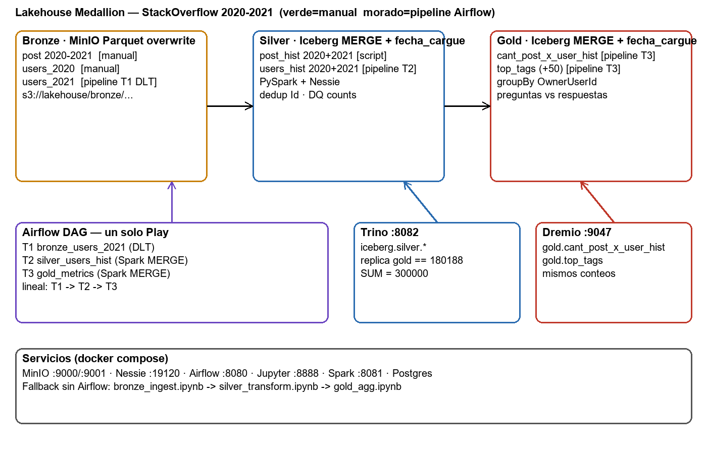

<a id="readme-top"></a>

<br />
<div align="center">
  <a href="https://github.com/nicothinn/lakehouse-medallion">
    
  </a>

  <h3 align="center">Lakehouse Medallion — StackOverflow 2020-2021</h3>

  <p align="center">
    Bronze Parquet (overwrite) → Silver Iceberg (merge) → Gold Iceberg (merge), orquestado con Airflow y consultable en Trino + Dremio.
    <br />
    <a href="#uso"><strong>Ver demo »</strong></a>
    ·
    <a href="sql/trino_replicate_gold.sql">Réplica Trino</a>
    ·
    <a href="sql/dremio_gold_checks.sql">Checks Dremio</a>
  </p>

  
  
  
  
</div>

<details>
  <summary>Tabla de contenido</summary>
  <ol>
    <li><a href="#acerca-del-proyecto">Acerca del proyecto</a></li>
    <li><a href="#primeros-pasos">Primeros pasos</a></li>
    <li><a href="#paso-a-paso-desde-cero">Paso a paso desde cero</a></li>
    <li><a href="#uso">Uso</a></li>
    <li><a href="#plan">Plan</a></li>
    <li><a href="#sustentación">Sustentación</a></li>
    <li><a href="#solución-de-problemas">Solución de problemas</a></li>
    <li><a href="#autores">Autores</a></li>
    <li><a href="#agradecimientos">Agradecimientos</a></li>
  </ol>
</details>

## Acerca del proyecto

[](docs/arquitectura.mmd)

Lakehouse open source local para el Proyecto 2 del curso **Frameworks y Herramientas para Big Data (UAO)**: ingesta StackOverflow 2020-2021 con arquitectura medallón completa y consultable. Un Play de Airflow corre `users_2021` de punta a punta; el resto va precargado manual.

| Capa | Tabla / ruta | Filas | Prueba |
|---|---|---|---|
| Bronze | `s3://lakehouse/bronze/{post,users}/{2020,2021}/` | 150k+150k posts, 100k+100k users | PUT overwrite, rerun OK |
| Silver | `silver.post_hist` / `silver.users_hist` (+`fecha_cargue`) | 300000 / 200000 | rerun → 0 nuevas (merge, no duplica) |
| Gold | `gold.cant_post_x_user_hist` (+`fecha_cargue`) | 180188, SUM=300000 | réplica desde silver **match exacto** |
| Gold extra | `gold.top_tags` | 50 únicas, 0 dups (python 20397, javascript 14727, …) | rerun 2× OK |

Nota muestreo: `users_hist` solo trae usuarios *creados* 2020-2021; los top posteadores son más viejos → `display_name` NULL en esos casos. Los conteos cuadran igual (replica==gold).

<p align="right">(<a href="#readme-top">volver arriba</a>)</p>

### Hecho con

* MinIO — object storage S3 (`:9000`/`:9001`, admin/admin123)
* Nessie — catálogo versionado (`:19120`, ref `main`, backend Postgres)
* Spark — master + worker 3.5.0, driver en Airflow, UI `:8081`
* Airflow — DAG `lakehouse_medallion`, 3 tareas (`:8083`, admin/admin)
* Dremio — lectura directa de Gold (`:9047`)
* Trino — réplica Gold desde Silver (`:8082`)
* dlt + PyArrow + PyIceberg + Jupyter + DuckDB (verificación)

<p align="right">(<a href="#readme-top">volver arriba</a>)</p>

## Primeros pasos

### Prerrequisitos

* Docker Desktop con **16 GB de RAM** asignada (con 8 GB Spark se pega).
* Puertos libres: `9000, 9001, 19120, 7077, 8081, 8083, 8082, 8888, 9047, 31010`.
* Git y Python 3.11 (solo para `dremio_setup.py`, que es stdlib).

### Instalación

```bash
git clone https://github.com/nicothinn/lakehouse-medallion.git
cd lakehouse-medallion
cp .dlt/secrets.toml.example .dlt/secrets.toml  # secrets dlt (no se commitea)
docker compose up -d --build
```

Qué configura cada cosa (no hay más):

| Qué | Dónde | Default |
|---|---|---|
| Creds MinIO para dlt/boto3 | `.dlt/secrets.toml` | admin / admin123 |
| Endpoint, Nessie, bucket, Spark | variables en `docker-compose.yml` | `minio:9000`, `nessie:19120`, `lakehouse` |
| Catálogo Trino → Nessie | `trino-catalog/iceberg.properties` | API v1 (Trino 446 la exige) |

<p align="right">(<a href="#readme-top">volver arriba</a>)</p>

## Paso a paso desde cero

Tiempo estimado: ~30 min (la mitad es esperar que suban los servicios).

**0. Prerrequisitos** — ver [arriba](#primeros-pasos).

**1. Clonar y configurar secrets** — ver [instalación](#instalación).

**2. Levantar el stack** — `docker compose up -d --build` y esperar `healthy` en `p2-minio`, `p2-jupyter`, `p2-trino`, `p2-airflow` (Airflow tarda ~2 min la primera vez; Dremio ~1 min en `:9047`).

```bash
docker ps --format "{{.Names}} {{.Status}}"
```

**3. Subir Bronze a MinIO (crea el bucket solo).** Los `data/*.parquet` ya vienen en el repo; si faltaran se regeneran con `python scripts/sample_bronze.py` (necesita `duckdb` + internet, ~10 min).

```bash
docker exec p2-jupyter bash -c "MINIO_ENDPOINT=http://minio:9000 python /home/jovyan/scripts/upload_bronze.py"
```

Esperado: `bucket creado: lakehouse` + 4 líneas `OK bronze/...` + `BRONZE UPLOAD DONE`. Verifica en MinIO `:9001` que el bucket tenga `bronze/post/2020|2021` y `bronze/users/2020|2021`.

**4. Silver `post_hist` (manual, una sola vez).**

```bash
docker exec p2-airflow python /opt/airflow/scripts/_run_posthist.py
```

Esperado: `post_hist OK: 300000`. Es idempotente (MERGE): re-correr no duplica.

**5. Play en Airflow (el pipeline en vivo).** Abre `:8083` (admin/admin), activa el DAG `lakehouse_medallion` y dale **Play**. Verás en orden: `bronze_users_2021` (DLT, 100000 filas, overwrite) → `silver_users_hist` (Spark MERGE, 200000) → `gold_metrics` (Spark MERGE, 180188/SUM 300000 + `top_tags` 50). Todo verde en ~2 min; los jobs se ven en Spark UI `:8081`. Si Airflow fallara, el respaldo son los notebooks en orden: `bronze_ingest.ipynb` → `silver_transform.ipynb` → `gold_agg.ipynb`.

**6. Consumo: Trino y Dremio (deben dar lo mismo).**

```bash
python scripts/dremio_setup.py   # crea admin + source nessie en Dremio, corre checks
```

Trino `:8082` → `sql/trino_replicate_gold.sql` → `180188,300000`. Dremio `:9047` (admin/Admin123!) → `sql/dremio_gold_checks.sql` → mismos números.

**7. Apagar.** `docker compose down` conserva datos (volúmenes); `docker compose down -v` borra todo (demo desde cero).

<p align="right">(<a href="#readme-top">volver arriba</a>)</p>

## Uso

**Pipeline (1 Play):** Airflow `:8083` → DAG `lakehouse_medallion` → `bronze_users_2021` (DLT, `replace`) → `silver_users_hist` (Spark MERGE) → `gold_metrics` (Spark MERGE + `top_tags`). Los jobs corren en el clúster (`spark-master:7077`, visibles en Spark UI `:8081`); `SPARK_MASTER_URL=local` como fallback.

**Consumo (mismos números en ambos motores):**

* Trino (`sql/trino_replicate_gold.sql`): réplica Gold desde Silver → `180188,300000`. Ojo: el catálogo apunta a `http://nessie:19120/api/v1` (Trino 446 pide API v1; con `/api/v2` falla `API version mismatch`).
* Dremio (`sql/dremio_gold_checks.sql`): Gold directo → `180188,300000` + top_tags. Setup idempotente: `python scripts/dremio_setup.py` (Dremio v24 no acepta `storageType`, S3 al endpoint interno `minio:9000` con `dremio.s3.compat=true`).
* Sin Trino/Dremio a la mano: `scripts/verify_gold.py` corre la misma lógica (match: True).

**Fallback sin Airflow:** `notebooks/bronze_ingest.ipynb` → `silver_transform.ipynb` → `gold_agg.ipynb`, en orden (importan los mismos `scripts/`, nunca divergen).

**Puertos / accesos:**

| Servicio | URL | Creds |
|---|---|---|
| MinIO API/Consola | :9000/:9001 | admin/admin123 |
| Nessie | :19120 | sin auth |
| Airflow | :8083 | admin/admin |
| Jupyter | :8888 | token en logs |
| Spark UI | :8081 | — |
| Dremio | :9047 | admin/Admin123! (o primer login en instalación limpia) |
| Trino | :8082 | — |

<p align="right">(<a href="#readme-top">volver arriba</a>)</p>

## Plan

- [x] Bronze Parquet overwrite (DLT `replace`)
- [x] Silver Iceberg MERGE + `fecha_cargue`
- [x] Gold Iceberg MERGE + `fecha_cargue` (2 tablas)
- [x] Trino replica == Dremio gold
- [ ] Time-travel / branch Nessie en vivo (milla extra, 5 min)
- [ ] Capa visual Power BI (corte 3)

<p align="right">(<a href="#readme-top">volver arriba</a>)</p>

## Sustentación

Preguntas fijas del profe, respuesta en una línea:

* ¿Por qué Parquet en Bronze? Columnar + comprimido para el crudo analítico; overwrite reescribe el día.
* ¿Por qué Iceberg en Silver/Gold y no Parquet? Sin table format no hay tabla SQL/ACID/merge; Iceberg = lista de archivos + metadatos en Nessie.
* ¿Dónde están los secrets? `.dlt/secrets.toml` (montado en Jupyter/Airflow, nunca en código).
* ¿ML de qué capa, BI de qué capa? ML de Silver, BI de Gold.
* ¿Re-correr duplica? No: Bronze `replace`/overwrite, Silver/Gold `MERGE` + `fecha_cargue` (verificado 2×).
* ¿Los jobs corren en el clúster? Sí: driver en Airflow, executors en `spark-master:7077` (Spark UI `:8081`); `SPARK_MASTER_URL=local` como fallback.
* ¿Trino y Dremio coinciden? Sí: réplica Silver→Gold en Trino == Gold en Dremio (`180188,300000`).

<p align="right">(<a href="#readme-top">volver arriba</a>)</p>

## Solución de problemas

* Puertos ocupados: libera `9000/8888/19120` antes de `up` (los usa otro stack si lo tienes arriba).
* Dremio pide RAM: mínimo 8GB en Docker.
* DLT remoto es lento (~20 min): `run_bronze` usa `data/*.parquet` local si existe.
* Re-correr no duplica: Bronze overwrite, Silver/Gold MERGE + `fecha_cargue`.
* `MERGE_CARDINALITY_VIOLATION` en `top_tags`: era el split sobre-escapado (`'\\s+'` en SQL-string no partía por espacios y no hacía trim) → fuente con tags duplicados. Fijo con funciones `split`+`trim` y `groupBy` antes del `limit`.
* `InvalidClassException: RDD` entre driver y clúster: fijar misma versión Spark en compose y driver (aquí 3.5.0 en ambos).
* Si Trino dice `API version mismatch`: el catálogo debe usar `/api/v1` (ver `trino-catalog/iceberg.properties`).

<p align="right">(<a href="#readme-top">volver arriba</a>)</p>

## Autores

Proyecto 2 — **Frameworks y Herramientas para Big Data (UAO)**.

| Nombre | Código |
|---|---|
| Juan Pablo Gómez Veira | 2231715 |
| Laura Daniela Astudillo | 2236318 |
| Angela María Ruiz Tovar | 2235110 |
| María Paula Pinillo | 2236243 |
| Nicolás Peña Irurita | 2232049 |

<p align="right">(<a href="#readme-top">volver arriba</a>)</p>

## Agradecimientos

* Prof. Óscar Jiménez — arquitectura medallón y criterios del curso.
* Dataset StackOverflow (ClickHouse) 2020-2021.
* Plantilla README: [othneildrew/Best-README-Template](https://github.com/othneildrew/Best-README-Template).

<p align="right">(<a href="#readme-top">volver arriba</a>)</p>
