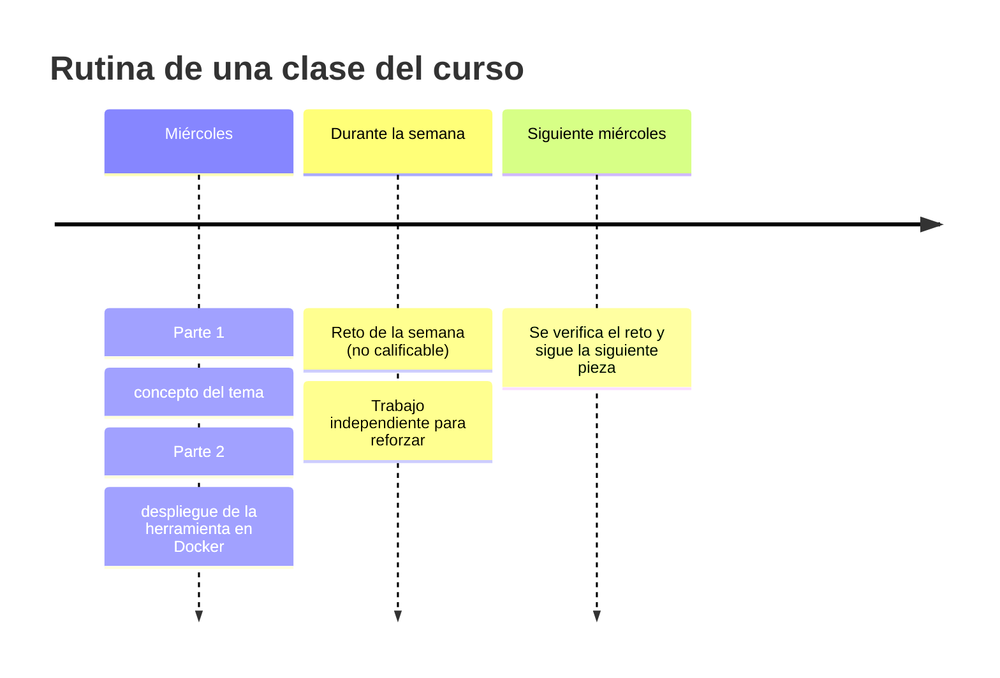
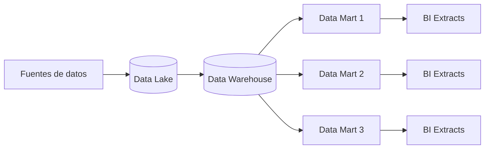
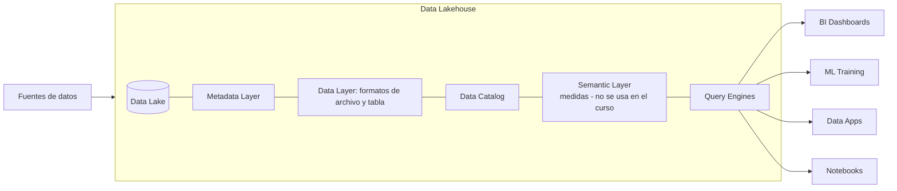
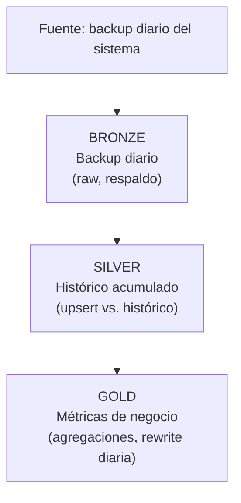

# Apuntes — Semana 1 (29 de Julio de 2026)

> [!note] Nombre de la materia
> El nombre **oficial** de la asignatura es **"Frameworks y Herramientas para Big Data"** (así aparece en el microcurrículo y en el campus). Por el nombre corto, esta vault la refiere como **Big Data**.

---

## 1. Resumen de la clase

> [!warning] Sobre los timestamps de esta tabla
> La grabación se partió en **2 videos** con un descanso de ~15 min entre partes. La columna `Vídeo` indica de qué video proviene la franja (P1 = Parte 1, P2 = Parte 2). Todos los timestamps son los reales de la transcripción. En la primera pasada esta tabla tenía franjas inventadas (llegaban a 02:14, más allá de la duración real de cada video); aquí está reconstruida contra la transcripción.

### Parte 1 — Presentación y planeación del curso (1 h 19 min)

| Vídeo | Tiempo            | Qué pasó                                                                                                                                                                                                                                                                                                                                                                                                                                                                                                                                                                                                                                                                                                                                                                              |
| ----- | ----------------- | ------------------------------------------------------------------------------------------------------------------------------------------------------------------------------------------------------------------------------------------------------------------------------------------------------------------------------------------------------------------------------------------------------------------------------------------------------------------------------------------------------------------------------------------------------------------------------------------------------------------------------------------------------------------------------------------------------------------------------------------------------------------------------------- |
| P1    | 00:00–00:51       | Bienvenida. El profe se presenta: **Óscar Jiménez**; curso "casa llena": **30 estudiantes**; **tercera cohorte** (empezó a darse hace ~1 año en el pregrado).                                                                                                                                                                                                                                                                                                                                                                                                                                                                                                                                                                                                                         |
| P1    | 00:51–06:29       | Presentación del profe: ingeniero **biomédico** UAO, **especialista en analítica de Big Data**. Historia: metrología y mantenimiento de equipos biomédicos → proyecto de **simulador de bomba de infusión** (Arduino + Python + interfaz) → especialización → **consultor de análisis de datos** en empresa de desarrollo de software para **servicios públicos**, e-learning, proyecto **Yellowbrick** de Claro, hoy **ingeniero de datos en Celsia Internet**. Docente hora cátedra (materia de la especialización "Modelos de análisis de Big Data", empieza el **8 de agosto**; diplomado de análisis de datos con Python). Vive en Palmira; los miércoles llega presencial de **Zona América** (puede tardar ~10 min en empezar). LinkedIn: **Oscar Andrés Jiménez Villanueva**. |
| P1    | 06:29–09:45       | Qué es el curso: **ciclo de vida de los datos** (almacenamiento → procesamiento → análisis), *pipelines*, **ETL**, pero enfocado en las **herramientas para desplegar arquitecturas**. Corte 1 y 2: todo **open source** local; corte 3: **Databricks**. ==**Primero los conceptos, luego las herramientas.**== Habla de la "arquitectura Lighthouse"[^1] como la que tiene Databricks, pero en versión open source.                                                                                                                                                                                                                                                                                                                                                                  |
| P1    | 09:45–11:35       | Por qué los conceptos: en las sustentaciones pregunta "¿por qué aquí Parquet y aquí Iceberg?"; los proyectos sirven para la **hoja de vida** y las **pruebas técnicas**. Anécdota: estudiante de la **primera cohorte** con el proyecto de Databricks en el CV quedó contratado en su primer trabajo.                                                                                                                                                                                                                                                                                                                                                                                                                                                                                 |
| P1    | 11:35–13:27       | Filosofía: **cacharrear mucho**; se usa IA para documentación (él prefiere Claude); todo se corre **local con Docker** (luego se escala a Kubernetes, sin pagar nube).                                                                                                                                                                                                                                                                                                                                                                                                                                                                                                                                                                                                                |
| P1    | 13:27–15:05       | Metodología: cada clase = primera mitad conceptual + segunda mitad **despliegue práctico**. Trabajo independiente + colaborativo (tareas/proyectos grupales) + **retos** semanales: no calificables; 2–3 h de trabajo adelantan el proyecto del corte. Ejemplo de la cadena: instalar Jupyter → desplegar Jupyter en Docker → object storage… Herramientas de los primeros cortes: **Docker y VS Code**.                                                                                                                                                                                                                                                                                                                                                                              |
| P1    | 15:05–16:29       | Anécdota del emoji "tortuga". Anécdota: estudiante del **semestre pasado** contratada a la semana de terminar el curso en una empresa que necesitaba desplegar una **arquitectura lakehouse open source**. Airflow se pide muchísimo en ofertas laborales.                                                                                                                                                                                                                                                                                                                                                                                                                                                                                                                            |
| P1    | 16:29–18:02       | Expectativas de los estudiantes: uno por el profe y el horario; otro porque es **complemento de ETL**. Johan (director de la especialización, fue profesor del profe) lo recomienda.                                                                                                                                                                                                                                                                                                                                                                                                                                                                                                                                                                                                  |
| P1    | 18:02–20:26       | Su día a día: equipo de 4 personas (tableros, ETL, agentes IA); **agentes para WhatsApp** con hilos/memoria; LangChain/LangGraph, bases de datos vectoriales; en la empresa Databricks viene heredado de Celsia Energía; transición de arquitectura.                                                                                                                                                                                                                                                                                                                                                                                                                                                                                                                                  |
| P1    | 20:26–22:35       | **Estructura: 3 cortes**; recorrido del contenido del curso (ver [[#5. Estructura del curso: los 3 cortes]]). Comenta que "generalmente salimos a eso de las 8, de 8 a 8 y 15"[^2] — ver la nota al pie sobre la duración real.                                                                                                                                                                                                                                                                                                                                                                                                                                                                                                                                                       |
| P1    | 22:35–24:16       | Agenda de hoy: qué es Big Data, roles, flujo de datos, ingeniería de datos, herramientas y terminología. Pregunta por Spark/PySpark en ETL (sí: en Colab/VS Code "pero no desplegaron ningún clúster"); consejo: **practicar los comandos**, porque con la IA se olvidan en el día a día.                                                                                                                                                                                                                                                                                                                                                                                                                                                                                             |
| P1    | 24:16–29:06       | Demo **DuckDB**: base de datos analítica **en memoria**, cruza CSV, Excel, Postgres y hasta tablas Delta de Databricks (se conecta a las rutas físicas, **sin prender el clúster** → ahorro de costos en dólares). Caso de los agentes: un **RAID** con el histórico (facturación, pagos, órdenes de trabajo) que los agentes consultan con DuckDB.                                                                                                                                                                                                                                                                                                                                                                                                                                   |
| P1    | 29:06–31:29       | **MotherDuck** (la nube de DuckDB): "no te cobran por la ingesta, sino por las consultas" (estaba en fase de prueba/early access). **ClickHouse**: data warehouse usado por Lens, Microsoft, Spotify; versión open source para el curso.                                                                                                                                                                                                                                                                                                                                                                                                                                                                                                                                              |
| P1    | 31:29–35:51       | **MinIO** (object storage, como el S3 de AWS): lago de datos, datos estructurados y no estructurados, contenedores con parquet. **Arquitectura medallón** en vivo: **Bronze** (backup diario, ej. el parquet de facturación del día anterior), **Silver** (tablas históricas: *upsert*[^3] contra el histórico), **Gold** (métricas de negocio agregadas, ej. facturas y monto por municipio). "Override" = sobrescribir la tabla. **Parquet**: columnar, comprimible, el formato de facto para datos analíticos.                                                                                                                                                                                                                                                                     |
| P1    | 35:51–38:47       | El mismo parquet se ve en AWS S3 y en **Azure Data Lake Gen2** (demo: la cuenta Azure sin créditos no dejaba entrar; el profe recomienda la **cuenta de estudiante de la UAO**; muestra storage account y Databricks para el corte 3).                                                                                                                                                                                                                                                                                                                                                                                                                                                                                                                                                |
| P1    | 38:47–41:00       | Adelanto semana 3: **tipos de datos** vs **file format** (parquet, JSON, CSV) vs **table format** (Delta Lake, Apache Iceberg: con Parquet permiten consultar el lago "como tablas de un data warehouse") y **catálogos** (Nessie: dónde están guardadas las tablas; Iceberg genera carpeta de metadatos). Cada semana se arma la arquitectura **pieza por pieza**.                                                                                                                                                                                                                                                                                                                                                                                                                   |
| P1    | 41:00–42:41       | Pantalla compartida perdida y recuperación técnica. Ejemplo final: Nessie + Iceberg con parquet y carpeta de metadatos; "el concepto es lo primordial".                                                                                                                                                                                                                                                                                                                                                                                                                                                                                                                                                                                                                               |
| P1    | 43:43–48:12       | Semana 4: **arquitectura medallón** y **ingesta**. Kappa y Lambda quedan como lectura. **dlt** (librería de Python; dltHub como plataforma; conectores/fuentes-destinos: Databricks, GitHub, Postgres, ClickHouse, BigQuery…) y **PyArrow**; Airbyte/Fivetran solo mencionados. Caso real: **migrar datos económicamente** (no en clúster de nube): API → S3 → MinIO → Azure.                                                                                                                                                                                                                                                                                                                                                                                                         |
| P1    | 48:12–51:03       | Pregunta: ¿parcial o proyecto? Respuesta: **parcial 1 = teórico, individual, conceptual**; **proyectos = prácticos** (caso práctico de pipeline de datos del corte). Anécdota: 4 meses de estudio/búsqueda tras quedar sin trabajo (era la época on-premise: Pentaho, servidores locales).                                                                                                                                                                                                                                                                                                                                                                                                                                                                                            |
| P1    | 51:03–55:06       | Prueba técnica de Celsia: conceptual (dibujar la arquitectura, con qué procesarías) + entrevista con preguntas de Databricks y Spark. Otra prueba: **modelado dimensional** (inventarse los datos, hechos/dimensiones) + Power BI: "estuvo re difícil". "La tranquilidad en las pruebas la da haber estudiado."                                                                                                                                                                                                                                                                                                                                                                                                                                                                       |
| P1    | 55:06–55:59       | Corte 1: semanas 5–6. Semana 5: parcial teórico del corte + se deja el **primer trabajo grupal** (pipeline de datos); semana 6: presentación. **Evaluación corte 1: 15 % proyecto + 15 % parcial + 5 % tareas = 35 %**; una sola tarea por corte (están ocupados con los retos).                                                                                                                                                                                                                                                                                                                                                                                                                                                                                                      |
| P1    | 55:59–58:55       | Corte 2: procesamiento, consulta, orquestación. **Motores SQL**: DuckDB, **Dremio** (el principal del curso), Trino, Firebolt; Dremio consulta las tablas del lago (muestra una consulta con una "rama tipo GitHub" dentro del motor = rama del catálogo Nessie). **DBeaver no es un motor**: es gestor de conexiones (el motor sigue siendo Postgres, Dremio, Trino, ClickHouse…).                                                                                                                                                                                                                                                                                                                                                                                                   |
| P1    | 58:55–01:01:09    | **Spark**: clase específica; se despliega **master + workers**; procesamiento distribuido (batch); PySpark. Databricks fue creado por los creadores de Spark (clústeres que se autoadministran). Lo que hicieron en ETL no era un clúster.                                                                                                                                                                                                                                                                                                                                                                                                                                                                                                                                            |
| P1    | 01:01:09–01:02:46 | Requisitos de hardware: ==**mínimo 16 GB de RAM**== (con 8 GB se quedan pegados); parquets de ~4 millones de registros recortados por rangos de fecha para correr local. Todo lo del curso corre **local** (todo el Docker del profe corre en su PC); quien tenga el mejor PC del grupo presenta el proyecto.                                                                                                                                                                                                                                                                                                                                                                                                                                                                         |
| P1    | 01:02:46–01:06:05 | **Airflow**: orquesta extracción, procesamiento y carga; los jobs corren en el **clúster de Spark** y escriben en el object storage. Demo: grafo DAG → Spark job que levanta un notebook, lee parquet, crea la tabla en catálogo/Gold y se consulta; cierra la sesión de Spark ("importante para que no queden recursos levantados"). Es la misma lógica del job orquestador de Databricks.                                                                                                                                                                                                                                                                                                                                                                                           |
| P1    | 01:06:05–01:08:48 | **Parcial 2** conceptual (solo el corte 2). **Segundo trabajo grupal**: pipeline + despliegue de arquitectura de datos. Al final del corte 2 la arquitectura debe estar completa: medallón (Bronze/Silver/Gold) orquestado con Airflow y consultable por motores SQL; ejemplo completo: notebook → sesión Spark → guarda en Bronze y Gold → consulta con motor SQL. Tabla histórica (Silver, upsert) vs agregaciones (Gold, reescritura diaria) vs backup diario (Bronze, reescribible).                                                                                                                                                                                                                                                                                              |
| P1    | 01:08:48–01:10:41 | `docker-compose.yml` como "manifiesto" que crece cada semana (Jupyter, MinIO, Nessie, ClickHouse, Dremio, Spark, Airflow con Postgres + Redis…); todo se saca de las documentaciones. ==La tarea del corte 2 está asociada a Airflow==.                                                                                                                                                                                                                                                                                                                                                                                                                                                                                                                                               |
| P1    | 01:10:41–01:12:20 | Corte 3: **Databricks + Azure** — desplegar la misma arquitectura lakehouse "productiva con asteriscos" (cuenta de estudiante); práctica de pipeline; proyecto de procesamiento de datos en Databricks; los conceptos se traducen igual a AWS o Google.                                                                                                                                                                                                                                                                                                                                                                                                                                                                                                                               |
| P1    | 01:12:20–01:14:54 | Visualización: **Power BI** es la herramienta del curso; **Apache Superset** queda para que cacharreen (open source; conectado a Databricks "sí prende el clúster", igual que Power BI). El tercer proyecto incluye una **capa de visualización sencilla** (conectar Power BI y que carguen los datos). Databricks es independiente del proveedor, pero Azure integra bien.                                                                                                                                                                                                                                                                                                                                                                                                           |
| P1    | 01:14:54–01:17:58 | La diapositiva de "BI Tools" tenía un error de orden (el profe la corrige y la sube). Semanas **14–15** = dos semanas para el **tercer trabajo grupal** (migrar de open source a Azure; "al revés": no de Azure a open source). Despliegue guiado en clase con una guía de pantallazos.                                                                                                                                                                                                                                                                                                                                                                                                                                                                                               |
| P1    | 01:17:58–01:18:43 | Presentación del trabajo grupal 3 (semana 16); **parcial final acumulativo** de todo el curso, teórico (semana 17). **Corte 3: 15 % proyecto + 10 % parcial + 5 % tareas = 30 %**; total 35 + 35 + 30. Tarea del corte 3: pipeline en Databricks.                                                                                                                                                                                                                                                                                                                                                                                                                                                                                                                                     |
| P1    | 01:18:43–01:19:14 | Anuncio del **descanso** ("estamos ahorita en 15 minuticos") y retiro del profe.                                                                                                                                                                                                                                                                                                                                                                                                                                                                                                                                                                                                                                                                                                      |

### Parte 2 — Introducción al Big Data (1 h 14 min)

| Vídeo | Tiempo            | Qué pasó                                                                                                                                                                                                                                                                                                                                                                                                                                                                                                                                                                                                                |
| ----- | ----------------- | ----------------------------------------------------------------------------------------------------------------------------------------------------------------------------------------------------------------------------------------------------------------------------------------------------------------------------------------------------------------------------------------------------------------------------------------------------------------------------------------------------------------------------------------------------------------------------------------------------------------------- |
| P2    | 00:00–00:31       | En el campus, cada semana sube **diapositivas, grabaciones y recursos** (scripts). Las diapositivas de hoy estaban mal en un par de líneas: "**mañana se las dejo listas**"; las grabaciones también suben mañana.                                                                                                                                                                                                                                                                                                                                                                                                      |
| P2    | 00:31–02:52       | **Bibliografía recomendada**: *Apache Iceberg: The Definitive Guide* ("mucho del contenido de la materia sale de ahí"; ejemplos: Spark, config, iceberg tables); **Kimball** (Data Warehouse Toolkit); el listado "de las tools" ([[Big Data/Apuntes/Recursos/Semana 01/70 ETL Tools for Data Engineers.pdf]]) para ver que existen muchísimas más herramientas que las del curso.                                                                                                                                                                                                                                       |
| P2    | 02:52–03:41       | **Conformación de grupos**: mínimo **4**, máximo **6** integrantes (son 30; "conmigo 31"). **Un representante** por grupo escribe en el campus (una respuesta) el **nombre completo, código y correo** de cada integrante, para la **semana siguiente**.                                                                                                                                                                                                                                                                                                                                                                |
| P2    | 03:41–05:31       | Actualizaciones del curso: la imagen de Spark era de **Bitnami**[^4] y empezó a cobrar, así que pasaron a la imagen oficial de Spark; Airflow está en la 2.9 y va la 3.x; son cosas del día a día con herramientas de terceros.                                                                                                                                                                                                                                                                                                                                                                                         |
| P2    | 05:31–06:05       | **Requisitos**: VS Code, Python, DuckDB, Docker Desktop, Google Colab (solo para algunos ejercicios; "ya no lo estamos usando realmente") y **cuenta de estudiante de Azure**.                                                                                                                                                                                                                                                                                                                                                                                                                                          |
| P2    | 06:05–09:33       | "**No todo es Big Data**": una empresa mediana puede procesar 40 M de registros/día o 20–100 mil. No usar "una bazooka": a veces basta un contenedor con **Pandas**, **PyArrow** o **Polars**, o SQL con **DuckDB**; clúster de Spark solo cuando el negocio lo necesita. Pandas se queda corto en memoria (mata el kernel) incluso en Databricks — anécdota del estudiante del semestre pasado ("con Pandas siempre me daba error de kernel… era mucho dato").                                                                                                                                                         |
| P2    | 09:33–12:23       | Antes vs ahora: **Pentaho** (hoy **Apache Hop**[^5]) y **Oracle Data Integrator (ODI)** — pipelines "de cajita" (¿recuerdan lo de N8N? pero especializado en datos); los usaban en Claro. Las transformaciones corren en SQL. Antes: convertidor con un servidor físico (sin escalar horizontal), DBA de backups, pipelines fallados → re-ejecutar manual al otro día. Ahora: escala **horizontal** (duplicar instancias; en Kubernetes = **pods**), nube elástica, serverless; vertical = más recursos a la misma máquina.                                                                                             |
| P2    | 12:23–20:18       | El costo de la nube: la flexibilidad "se traduce en **costos**" (DBUs de Azure, en **dólares**; la empresa produce en pesos). Opciones: local, nube con *vendor lock-in*, o **VPS propio** (Hostinger, DigitalOcean, Hetzner) administrado con **Kubernetes** → se cambia de proveedor sin migrar todo. El proyecto real del profe: su stack open source local migrado a Kubernetes en un **VPS de AWS**.                                                                                                                                                                                                               |
| P2    | 20:18–23:26       | Las **5 V**: el **volumen** depende de la industria; **variedad, veracidad y valor** se cuidan siempre ("así sean poquitos o grandes datos… uno no sabe de qué reporte, así sea sencillito, va a aportar valor al negocio"). Ejemplo: reporte simple de **PQR resueltas el primer día** (fecha creación vs cierre) → productividad → experiencia del cliente → retención.                                                                                                                                                                                                                                               |
| P2    | 23:26–25:29       | No caer en el sesgo de "hago mi tarea y la entrego": todo tiene un trasfondo de negocio; los datos aterrizan hipótesis sesgadas. Su equipo empezó la analítica de cero: tableros de ventas, PQR, facturación/recaudo; el pipeline de facturación terminó hace menos de un mes (antes la actualización era manual: Excel → Power BI).                                                                                                                                                                                                                                                                                    |
| P2    | 25:29–26:26       | En roles de datos siempre hablas con stakeholders y funcionales; hay que saber **representar los datos**.                                                                                                                                                                                                                                                                                                                                                                                                                                                                                                               |
| P2    | 26:26–29:49       | Cómo traducir el historial del negocio a arquitectura: **integración** (cómo llevar fuentes → analítico: antes copia de la BD productiva, ETL a la madrugada; ahora APIs, JSON/CSV en FTP/S3 — su pipeline recibe **11 archivos JSON = 11 tablas** —, Excel), **gestión** (local vs nube; empresas "devolviéndose" de la nube; proponer open source para automatizar), **análisis** (casos de uso).                                                                                                                                                                                                                     |
| P2    | 29:49–33:46       | **Reducción de costos**: validación de clientes con APIs pagas = ~**25 M pesos**; con proceso propio (LLM resolviendo **preguntas anti-bot sencillas** — sumas, capitales —, no captchas de rotar) bajó a **~100 mil pesos**. Flujo: idea + cacharreo con IA → notebook de ejecución masiva → **servicio en Docker**. Preguntas de Nicolás al respecto.                                                                                                                                                                                                                                                                 |
| P2    | 33:46–38:26       | Ventajas del Big Data + **conocimiento del negocio**: "la foto real del cliente… la tiene uno en los datos". Industrias fijas (agua, luz) vs reñidas (internet/telco: el cliente se cambia de plan). Ejemplo: instalación que tarda X en recuperar inversión pero clientes que se van a los 3 meses → query con fechas + group by municipio + join con órdenes de trabajo y PQR → estrategias de retención.                                                                                                                                                                                                             |
| P2    | 38:26–44:13       | **Retos del Big Data**: complejidad de integración, seguridad (sobre todo ahora con IA[^6]), cumplimiento y sobre todo **calidad de datos** (proyecto real en la empresa: cruces entre fuentes de clientes — teléfonos, cédulas, nombres → ~90–95 % de match y ~**9000 registros** por corregir manualmente). El ingeniero de datos es **custodio de la información**: habla de "alzar la mano a tiempo" — si no, el tablero con datos mal hechos "quema plata todos los días"; el modelo de ML entrenado con datos malos "no nos va a ayudar a decir nada".                                                            |
| P2    | 44:13–45:17       | Casos de uso (diapositiva): manufactura, salud, financieros; Telco como ejemplo del profe; analítica descriptiva, predictiva y prescriptiva.                                                                                                                                                                                                                                                                                                                                                                                                                                                                            |
| P2    | 45:17–50:11       | **Roles** (diapositiva): PM (gestión, no técnico, PMI), Data Analyst (insights/tableros), Data Engineer (de crudo a buen dato), Data Scientist (modelos; ej. predicción de quién paga el crédito), ML Engineer (lleva el modelo a productivo), SRE (despliegue, Kubernetes) / MLOps (entrega continua de modelos). Poll en el chat: ==**escribir en el chat qué rol quisieran**==.                                                                                                                                                                                                                                      |
| P2    | 50:11–55:39       | Línea difusa según la empresa: su equipo empezó con analítica y se fue dividiendo (analítica, agentes IA, ML). *Data analyst* es el rol más competido; *data engineer* tiene menos aspirantes. El científico de datos requiere **muy buena base estadística**; el profe quiso ser científico "pero me fui al lado oscuro: ingeniería de datos". "Hay que **salir de Colab**": saber cómo lo que haces llega a producción. Modelo de clasificación encomendado a terceros (caro) → él hizo un **agente propio con LLM** (RAG + clasificaciones en BD) que ahorró ~**20 horas mensuales** de clasificación manual de PQR. |
| P2    | 55:39–57:57       | Para los tres roles principales: ==**SQL y Python**== ("SQL va a ser para toda la vida; los posts de que SQL va a morir son pura paja"; más relevante con DuckDB y los motores SQL de la nube). Data Engineer: ETL, pipelines, calidad, crudo → limpio, arquitectura medallón; DW: hechos y dimensiones. Data Scientist: modelos con data limpia (entre comillas). Data Analyst: reportes/visualización (Power BI la más usada, Tableau, Superset).                                                                                                                                                                     |
| P2    | 57:57–01:00:32    | ML Engineer: producción. El profe terminó en "ingeniería de IA" por el gusto por pipelines/arquitecturas; no le gustó N8N (prefiere código); el clasificador PQR (RAG + LLM) quedó productivo y ahorró ~20 h/mes.                                                                                                                                                                                                                                                                                                                                                                                                       |
| P2    | 01:00:32–01:03:20 | Lo común: SQL, estadística, **comunicación** y colaboración. La comunicación es obligatoria aunque seas introvertido (el profe: "me sirvió la música, la guitarra"; sugiere terapia o cursos de storytelling; usar congresos y exposiciones). "**Alzar la mano a tiempo**": no comunicar una inconsistencia a tiempo = regaño o seguimiento.                                                                                                                                                                                                                                                                            |
| P2    | 01:03:20–01:06:02 | **Flujo de los datos**: fuentes → procesamiento (batch/streaming) → data warehouse / lakehouse (histórico) → analítica, BI, ML. El curso se enfoca en **batch** ("día vencido"); el streaming entra solo como concepto (Kafka aparece en el microcurrículo). **ETL vs ELT vs ETLT** (ver [[#9. Flujo de los datos]]): en el lakehouse va a haber **ETL diario** para transaccionales y **ELT** para fuentes crudas (ML).                                                                                                                                                                                                |
| P2    | 01:06:02–01:08:23 | Arquitectura moderna (diapositiva): fuentes → data lake → data warehouse → data marts → BI extracts (dos sistemas separados). A dónde llegamos: **lakehouse único** (capa de datos, metadatos, catálogo, capa semántica de medidas — que el curso **no usa** — y motores SQL) que sirve BI dashboards, ML, data apps y notebooks. Datos estructurados → analítica descriptiva; semiestructurados/no → predictiva/ML ("SQL no puede procesar una imagen").                                                                                                                                                               |
| P2    | 01:08:23–01:11:50 | Herramientas de la ingeniería de datos: comparativas Azure/AWS/GCP (enlaces en [[#12. Herramientas del curso (vistas en la clase y a desplegar)]]) — se ven en la siguiente clase. ==**Reto de la semana: instalar Docker Desktop y preparar un contenedor solo con Jupyter Notebook**== (docker-compose + requirements.txt; con al menos **Pandas y Matplotlib**). El profe muestra el contenedor en la interfaz porque en `docker ps` "no se ve bien" (dice que por dislexia). "Las grabaciones se las subo yo creo mañana; ahorita les subo las diapositivas."                                                       |
| P2    | 01:11:50–01:14:02 | **Asesorías**: los **lunes de 7 a 8 p. m.**, a demanda (se piden por el chat; el profe aparta el espacio y manda el link de invitación; suelen ser para avances de proyectos, hasta 2 grupos). Contacto rápido por el chat (responder rápido). Pregunta de David (avances en asesoría): sí, sin problema. Cierre y despedida.                                                                                                                                                                                                                                                                                           |

> [!important] Tareas y pendientes de la semana
> - ==**Reto Semana 1:** instalar Docker Desktop y dejar un contenedor corriendo solo con Jupyter Notebook== — con `docker-compose.yml` + `requirements.txt`, y al menos Pandas y Matplotlib. No es calificable, pero prepara la cadena de despliegues (la siguiente pieza será Jupyter en Docker, luego object storage…).
> - ==**Conformar grupos de 4 a 6 integrantes** y publicar en el campus (una respuesta del representante) el **nombre completo, código y correo** de cada integrante==, para la semana 2 (miércoles 5 de agosto).
> - ==**Escribir en el chat el rol que a cada uno le gustaría**== (analista, ingeniero de datos, científico, ML…).
> - **Recibir en el campus:** diapositivas corregidas y grabaciones de la semana 1 (el profe dijo "mañana se las dejo listas" — 30 de julio).
> - **Anotar la fecha anunciada:** "Modelos de análisis de Big Data" (especialización) empieza el **8 de agosto** y el curso tiene **parcial 1 teórico + primer trabajo grupal** en la semana 5 (ver [[#5. Estructura del curso: los 3 cortes]]).

> [!note] Fuentes de estos apuntes
> - **Transcripción** — [[Big Data/Apuntes/Recursos/Semana 01/Transcripción - 29 de Julio (Parte 1)]] y [[Big Data/Apuntes/Recursos/Semana 01/Transcripción - 29 de Julio (Parte 2)]] (la grabación se partió en dos videos).
> - **Diapositivas** — [[Big Data/Apuntes/Recursos/Semana 01/FYHBD - S1C1-1-1.pdf]] (presentación y planeación del curso) y [[Big Data/Apuntes/Recursos/Semana 01/FYHBD - S1C1-2-1.pdf]] (intro al Big Data).
> - **Microcurrículo oficial** — [[Big Data/Apuntes/Recursos/Semana 01/SIGED - Microcurrículo - FRAMEWORKS Y HERRAMIENTAS PARA BIG DATA.pdf]] y, como lectura de contexto, el listado de herramientas [[Big Data/Apuntes/Recursos/Semana 01/70 ETL Tools for Data Engineers.pdf]].

[^1]: En la transcripción la palabra suena *"Lighthouse"* (también *"Lane House"* o *"Layout"*); el concepto real es **data lakehouse** (data lake + data warehouse), como confirman el microcurrículo y las diapositivas. En la clase el profe dice "la arquitectura Lighthouse como la que trabaja Databricks, pero en open source" — refiriéndose a los mismos componentes (ver [[#10. ¿A dónde queremos llegar? — Arquitectura Lakehouse]]).
[^2]: **Duda real:** en la Parte 1 (20:26) el profe dice "Generalmente salimos a eso de las 8, de 8 a 8 y 15", pero la grabación dura ~2 h 33 min (somado el descanso) y el horario del curso es 18:30–21:30. Con 18:30 + 1 h 19 (fin de la Parte 1 y el descanso de ~15 min), el break quedaría justo cerca de las 8 p. m. — probablemente el comentario se refiere al descanso, no al fin de clase. Queda documentado como duda para confirmar con el profe; no se resolvió silenciosamente.
[^3]: En la transcripción suena *"offset"* y *"observer"*; el concepto real es **upsert** (si el registro existe, no se toca; si es nuevo, se inserta; si cambió, se actualiza). "Override/overwrite" = sobrescribir la tabla.
[^4]: En la transcripción suena *"la imagen de Apache Spark era de Vietnam"*; el proveedor real era **Bitnami** y la imagen oficial de Spark lo reemplazó.
[^5]: En la transcripción suena *"Apache Hub"* (el nombre real es **Apache Hop**, heredero de Pentaho Data Integration) y *"Oracle Data Studio"* (lo correcto: **Oracle Data Integrator, ODI**). El profe también pronuncia "DocDB"/"DocDV"/"Divi" por **DuckDB** (entendido en todo el apunte) y "Summer" por **MotherDuck**.
[^6]: La transcripción dice "la seguridad también sobre todo ahorita con el LMS" — probablemente *"con la IA/LLM"* (contexto: agentes y LLMs); se dejó como seguridad con la IA.

---

## 2. Datos generales de la asignatura

**Ficha oficial (microcurrículo SIGED):**

| Campo | Dato |
| --- | --- |
| Nombre de la asignatura | **Frameworks y Herramientas para Big Data** |
| Número de créditos | **3** |
| Carácter / ofrecido por | Electiva profesional; la dicta el profe también en la especialización[^7] |
| Pre-requisitos | Conocimientos previos de **Python** y **SQL** |
| Docente | Oscar Andrés Jiménez Villanueva ([LinkedIn](https://www.linkedin.com/in/oajimenezv)) |
| Horario | Miércoles 18:30–21:30 (la sesión grabada duró ~2 h 33 min en 2 videos + descanso; ver [^2]) |

- **Cohorte:** tercera del curso (se da hace ~1 año en el pregrado). **30 estudiantes**.
- **Estructura:** 3 cortes → 35 % + 35 % + 30 % (ver [[#5. Estructura del curso: los 3 cortes]]).

**Requisitos de la clase (diapositiva + anuncio):**

- VS Code
- Python
- DuckDB
- Docker Desktop
- Google Colab (ejercicios puntuales; no es la herramienta principal)
- Cuenta de **Azure** con créditos de estudiante (corte 3)

> [!tip] Recomendación del profe (hardware)
> ==**Mínimo 16 GB de RAM**== para correr las herramientas locales (sobre todo Spark, que procesa en memoria). Con 8 GB la sesión se queda pegada. En los grupos, quien tenga el mejor computador presenta el proyecto.

[^7]: En el microcurrículo el campo "Carácter" está en blanco (placeholder "XXXXXX"); el dato de "electiva profesional / también en especialización" viene de la transcripción: el profe dice que "como esto es una lectiva profesional" y que a veces se abre para la especialización.

---

## 3. El profesor: Óscar Andrés Jiménez Villanueva

**Según su diapositiva de presentación:**
- Ingeniero **biomédico** (UAO) y **especialista en analítica de Big Data**.
- Experiencia en metrología, mantenimiento de equipos biomédicos e ingeniería clínica.
- Trabaja como **consultor de análisis de datos** en empresas de desarrollo de software para **servicios públicos y telecomunicaciones**.
- Experiencia en el proyecto **Yellowbrick Data Warehouse de Claro**.
- Actualmente **ingeniero de datos en Celsia Internet**.
- Desarrolla cursos e-learning y contenido educativo.
- **Docente hora cátedra UAO**: diplomado de análisis de datos con Python, pregrado y posgrado.

**Según lo contado en clase:**
- Se cruzó a los datos desde la biomédica: un proyecto de **simulador de bomba de infusión** (Arduino + Python + interfaz) lo llevó al desarrollo y luego a la especialización.
- Su equipo de datos en Celsia Internet: **4 personas**, hacen "de todo un poco": tableros Power BI, ETL en Databricks con Spark, reportes y ahora **agentes de IA** (LangChain/LangGraph, bases de datos vectoriales).
- Arquitectura de agentes para **WhatsApp** (memoria/hilos para atención personalizada) y **agente clasificador de PQR** (RAG con LLM, ~20 horas mensuales ahorradas).
- Vive en Palmira; los miércoles trabaja presencial en **Zona América** (por eso a veces tarda ~10 min en empezar).
- Es músico (guitarra): le ayudó a perder la pena al hablar en público — consejo que repite para los roles de datos.
- *(Contexto: Johan, director de la especialización de analítica de Big Data, fue su profesor y el que recomienda el curso.)*

---

## 4. La filosofía del curso (lo que más repitió el profe)

1. ==**Los conceptos primero, la herramienta después.**== Los conceptos (lake, warehouse, catálogo, formato de tabla, motor SQL, orquestador) se repiten en todas las nubes; solo cambian los nombres de los productos. Si entiendes el concepto, entiendes cualquier proveedor.
2. **Cacharrear mucho.** La mitad de cada clase es conceptual y la otra mitad es **despliegue práctico** en Docker. Se aprende resolviendo, y la IA (Claude, por ejemplo) sirve de copiloto para documentación.
3. **Open source, local, sin pagar nube.** Los dos primeros cortes: Docker local (la idea es escalar luego con Kubernetes/VPS). El tercer corte: **Databricks + Azure**.
4. **El valor de negocio es el norte.** Ningún reporte es trivial: hay que entender cómo aporta (ingresos, retención, experiencia del cliente, reducción de costos).
5. **Calidad de datos y "alzar la mano" a tiempo.** El ingeniero de datos es custodio de la información; si los datos llegan inconsistentes, se escala el problema para que lo corrijan en el origen. ==Dejar un tablero con datos mal hechos "quema plata" todos los días.==
6. **Reducir costos es una propuesta ganadora.** Las empresas locales no siempre pagan nubes caras; proponer open source es gran valor como equipo de datos.
7. **Comunicación y exposición son obligatorias** en roles de datos, aunque la personalidad sea introvertida.
8. **Lo aprendido sirve para las pruebas técnicas:** el parcial es conceptual; proyectos para la hoja de vida.

> [!warning] La trampa del "todo es Big Data"
> El pregrado y la materia se llaman Big Data, pero **no todas las empresas lo son**: pueden procesar 40 millones de registros diarios o 20.000–100.000. A veces la solución correcta es un contenedor con Python + Pandas (o PyArrow/Polars) o consultas SQL con DuckDB, **sin montar un clúster de Spark**. Montar clústeres solo cuando el negocio realmente lo necesita. (Anécdota: estudiante del semestre pasado con Pandas en Databricks siempre con error de kernel — "era mucho dato"; Pandas se queda corto en memoria en cualquier parte.)

---

## 5. Estructura del curso: los 3 cortes

### Corte 1 — Arquitectura y almacenamiento (semanas 1–6) — 35 %

| Semana | Contenido |
| --- | --- |
| 1 | **Introducción al curso**: qué es Big Data, roles del mundo de los datos, flujo de datos, ingeniería de datos, herramientas y terminología |
| 2 | **Arquitecturas de datos modernas**: contexto histórico, OLAP, Data Warehouse, Data Lake, Data Lakehouse |
| 3 | **Almacenamiento de datos**: tipos de datos, *file format* (Parquet…), *table format* (Iceberg, Delta…), catálogos |
| 4 | **Ingesta de datos**: arquitecturas kappa, lambda y medallón; herramientas de extracción (dlt, PyArrow…) |
| 5 | **Parcial 1 teórico** (individual, conceptual) + **Primer trabajo grupal** (caso práctico: pipeline de datos) |
| 6 | Presentación del trabajo grupal 1 |

### Corte 2 — Procesamiento, consulta y orquestación (semanas 7–11) — 35 %

| Semana | Contenido |
| --- | --- |
| 7 | Motores SQL y bases de datos en memoria[^8] (DuckDB, Dremio, Trino, Firebolt) |
| 8 | Procesamiento en batch con Apache Spark |
| 9 | Orquestación con Apache Airflow |
| 10 | **Parcial 2 teórico** (solo del corte 2) + **Segundo trabajo grupal** (pipeline + despliegue de arquitectura de datos) |
| 11 | Presentación del trabajo grupal 2 |

### Corte 3 — Nube y proyecto (semanas 12–17) — 30 %

| Semana | Contenido |
| --- | --- |
| 12–13 | **Proveedores en la nube – Databricks**: despliegue de arquitectura lakehouse en Azure Databricks; Databricks con Apache Superset y con Power BI; trabajo en clase |
| 14–15 | **Tercer trabajo grupal** (migrar la arquitectura open source a Azure; dos semanas) |
| 16 | Presentación del trabajo grupal 3 |
| 17 | **Parcial final acumulativo** de todo el curso (teórico) |

> [!tip] Cómo fluye el trabajo
> Cada semana se despliega **una pieza nueva** del stack en el `docker-compose.yml` local (Jupyter, MinIO, Nessie, Iceberg, ClickHouse/DuckDB, Dremio, Spark, Airflow…). Los **retos semanales** van sumando piezas; al llegar al proyecto solo pasa a integrarse. La misma receta se repite en Databricks/Azure en el corte 3.

### Evaluación

| Corte | Proyecto grupal | Parcial | Tareas y trabajo en clase | Total |
| --- | --- | --- | --- | --- |
| Corte 1 | 15 % | 15 % | 5 % | **35 %** |
| Corte 2 | 15 % | 15 % | 5 % | **35 %** |
| Corte 3 | 15 % | 10 % | 5 % | **30 %** |

- **Parciales 1 y 2:** teóricos, individuales, **solo del corte**; el **parcial final es acumulativo** de todo el curso (también teórico).
- **Proyectos grupales:** casos prácticos. El 1: pipeline con las herramientas del corte 1; el 2: pipeline + despliegue completo (medallón + Airflow); el 3: migración a Azure Databricks + capa de visualización con Power BI.
- **Una sola tarea por corte** ("están ocupados con los retos"): corte 1 → tarea del curso; corte 2 → **tarea de Airflow**; corte 3 → **tarea de pipeline en Databricks**.
- En las sustentaciones pregunta por los **componentes conceptuales** ("¿por qué aquí Parquet y aquí Iceberg?").

[^8]: La diapositiva del curso dice "Motores SQL y bases de datos en proceso"; en la clase se describió DuckDB como una base de datos analítica **en memoria** (y Firebolt como otro motor SQL open source). Se deja "en memoria" como término del curso (la diapositiva usa "en proceso").

---

## 6. Metodología de las sesiones

- Cada clase: **primera mitad conceptual + segunda mitad de despliegue** de la herramienta de la semana.
- **Retos semanales** (no calificables, pero suman): cada semana queda algo listo para la siguiente (ej.: instalar Jupyter, desplegarlo en Docker, montar el object storage…). Con 2–3 horas de trabajo se adelanta el proyecto del corte.
- **Trabajo independiente** para reforzar conceptos + **trabajo colaborativo** (tareas y proyectos grupales).
- Todos los despliegues: **local con Docker + VS Code**; el profe comparte su `docker-compose.yml` con los servicios (Jupyter, MinIO, Nessie, ClickHouse, Dremio, Spark, Airflow…).
- **Campus virtual:** cada semana sube diapositivas, grabaciones y recursos (scripts). Ojo: versiones cambiantes (imagen de Spark Bitnami → oficial; Airflow 2.9 → 3.x).
- **Asesorías:** **lunes de 7 a 8 p. m.**, **a demanda** (se escriben por el chat; el profe aparta el espacio y manda el link de invitación; se usan mucho para avances de proyectos).
- **Contacto rápido:** por el chat del curso (responde más rápido que por correo[^9]).



[^9]: En la transcripción suena *"me pueden escribir directamente por el chat del Gmail"*; dado que el campus es la plataforma (aquí se pidieron los grupos), lo razonable es "el chat del campus/curso". Queda la duda de si es el chat del campus o de alguna otra herramienta (no se resolvió en clase).

---

## 7. ¿Qué es el Big Data?

> [!def] Definición (diapositiva)
> El Big Data engloba conjuntos **extremadamente grandes y diversos** de datos **estructurados, semiestructurados y no estructurados** que crecen exponencialmente. Son tan voluminosos que el software de procesamiento convencional no puede gestionarlos: van desde **terabytes hasta varios petabytes**, y permiten abordar problemas empresariales que antes no era posible resolver.

**Breve historia (diapositiva):**

| Momento | Qué pasó |
| --- | --- |
| 1960–1970 | Primeros **centros de datos** y desarrollo de las **bases de datos relacionales**: los grandes conjuntos de datos tienen orígenes en esta época. |
| ~2005 | La gente empieza a darse cuenta de la cantidad de datos que generan los usuarios en **Facebook, YouTube** y demás servicios online. |
| 2005 en adelante | Frameworks open source como **Hadoop** (y, más recientemente, **Spark**) hacen el Big Data más fácil de usar y barato de almacenar/procesar. |
| IoT y ML | El **Internet de las Cosas** aumenta los dispositivos conectados que generan datos; el **aprendizaje automático** produce aún más datos. |
| Nube | El **cloud computing** amplía las posibilidades: escalabilidad elástica, clústeres *ad hoc* para probar subconjuntos de datos, serverless. |

### Las 5 V

| V | Significado |
| --- | --- |
| **Volumen** | La característica más asociada: enorme cantidad de datos recopilados de diversas fuentes y dispositivos de forma continua. |
| **Velocidad** | Ritmo al que se generan (tiempo real o casi); deben procesarse y analizarse al mismo ritmo para tener impacto. |
| **Variedad** | Datos heterogéneos: estructurados, no estructurados o semiestructurados, de muchas fuentes. |
| **Veracidad** | El Big Data es desordenado, ruidoso y propenso a errores: controlar calidad y precisión es difícil. |
| **Valor** | Determinar el **valor de negocio** de los datos: contener los datos adecuados y analizarlos eficazmente para decidir. |

> [!tip] Matiz del profe sobre las 5 V
> El volumen puede ser grande sin que sea "Big Data" (empresas con 20.000 registros diarios que sí necesitan variedad, veracidad y valor). Las que **nunca se descuidan** son **variedad, veracidad y valor**: "uno no sabe de qué reporte, así sea sencillito, va a aportar valor al negocio".

### Cómo funciona el Big Data (3 acciones clave, diapositiva)

1. **Integración:** concentra datos de numerosas fuentes; los mecanismos normales (ETL) se quedan cortos con terabytes/petabytes. Hay que incorporar, procesar y dejarlos listos para los analistas.
2. **Gestión:** requiere almacenamiento (nube, on-premises o ambos), motores de procesamiento on-demand; la nube combina con los requisitos actuales.
3. **Análisis:** analizar y actuar, y **comunicar** los hallazgos con visualizaciones (gráficos y paneles) para toda la empresa.

### Ventajas y retos

**Ventajas:** inteligencia continua (flujos automatizados en tiempo real + analítica avanzada), mejor toma de decisiones, mayor agilidad e innovación, mejor experiencia del cliente, operaciones más eficientes, mejor gestión de riesgos y reducción de costos (el profe lo remata desde el negocio).

**Retos vistos en clase y en la diapositiva:**

- **Falta de talento:** los perfiles de datos son de los más codiciados del sector informático.
- **Crecimiento acelerado de los datos:** sin infraestructura sólida se vuelve inmanejable.
- **Calidad de datos:** datos crudos desordenados → resultados engañosos y estadísticas poco útiles. ==Es el reto que más destaca el profe.== (Ejemplo real: cruces de clientes → ~90–95 % match, ~9000 registros por corregir.)
- **Complejidad de integración:** la mayoría de las empresas tienen datos aislados en varios sistemas.
- **Seguridad:** los datos son objetivo de valor para los atacantes (más aún con la IA).
- **Cumplimiento normativo:** leyes de privacidad y residencia de datos.

### Casos de uso (diapositiva)

![[Big Data/Apuntes/Recursos/Semana 01/FYHBD - S1C1-2-1.pdf#page=11]]

- **Manufactura:** aprovechar todos los datos que generan para mejorar eficiencia operativa, agilizar procesos y descubrir insights.
- **Salud:** analizar datos no estructurados (informes, notas clínicas, laboratorios) con IA/NLP para mejorar tratamiento y atención.
- **Financieros:** detectar fraudes y capturar oportunidades de mercado (patrones de pago vs historial de actividad, en tiempo real).

Otros ejemplos de la diapositiva: recomendaciones personalizadas; optimización del último kilómetro en logística; detección de baches con cámaras, sensores y GPS; análisis de imágenes satelitales/geoespaciales. En clase, el ejemplo del profe es Telco: clientes que se van antes de recuperar la inversión.

---

## 8. Gestión de los datos

La diapositiva "Gestión de los datos" muestra la colaboración entre perfiles sobre el ciclo de vida de los datos (las tareas de distintas personas se van encadenando):

![[Big Data/Apuntes/Recursos/Semana 01/FYHBD - S1C1-2-1.pdf#page=19]]

```text
Data Scientists & Business Analysts  →  Developers  →  Data Engineers  →  DevOps
        (Explore & Analyze)           (Collaborate & Publish)      (Deploy & Operate)
```

> [!note] ¿Por qué esta imagen en la semana 1?
> Visualiza que los datos no los trabaja un solo rol: se exploran (analistas/científicos), se publican (desarrolladores/colaboración), se construye el pipeline (ingenieros de datos) y se despliegan y operan (DevOps). El curso se enfoca en lo que hacen los **Data Engineers** y el resto del flujo.

---

## 9. Flujo de los datos

> [!def] Pipeline de datos (diapositiva)
> Un **pipeline de datos** es una serie de pasos diseñados para **procesar y mover datos de un origen a un destino**, generalmente pasando por varias transformaciones en el camino.

**Etapas del pipeline (diapositiva):**

| Etapa | Qué hace |
| --- | --- |
| **Extracción** | Obtener los datos crudos desde sus fuentes (bases de datos, archivos, aplicaciones web...). |
| **Transformación** | Limpiar, normalizar, combinar y adaptar: estandarizar, clasificar, eliminar duplicados... mejora la calidad y consistencia. |
| **Carga** | Guardar en el destino (data warehouse, data lake...), listo para consumo de usuarios y aplicaciones. |
| **Orquestación** | Gestión de la secuencia y dependencias de los procesos. |
| **Monitoreo y gestión** | Vigilar el cumplimiento de cada paso. |

### ETL vs. ELT vs. ETLT

![[Big Data/Apuntes/Recursos/Semana 01/FYHBD - S1C1-2-1.pdf#page=21]]

| Patrón | Orden | Uso típico |
| --- | --- | --- |
| **ETL** | Extraer → Transformar (**pre-load**) → Cargar | Clásico: transformación antes de guardar; ideal cuando el destino de análisis es más lento o caro. |
| **ELT** | Extraer → Cargar (**raw**) → Transformar (en el destino) | Moderno: guardar crudo y transformar a necesidad (p. ej., para ML). Es el patrón que resguarda el **lakehouse**: "nunca se descarta crudo". |
| **ETLT** | Extraer → Cargar raw → Transformar → Cargar limpio | Híbrido: se carga al lake, transforma, y se vuelve a cargar un subconjunto (p. ej., al data warehouse para BI). |

> [!note] Aclaración del profe
> "En la arquitectura lakehouse vamos a tener procesos **ETL diarios** para datos transaccionales y también **ELT** para fuentes que guardamos crudas y transformamos cuando se necesiten (ML). Al final son patrones para disponibilizar la información que se consume todos los días."

**Arquitectura de datos moderna (de la diapositiva):**



![[Big Data/Apuntes/Recursos/Semana 01/FYHBD - S1C1-2-1.pdf#page=22]]

- En el enfoque tradicional hay **dos sistemas separados**: el data lake (raw) y el data warehouse (consultas). El lakehouse los unifica (detalle en [[Big Data/Apuntes/Apuntes - Semana 02]]).
- El curso se enfoca en **batch** ("día vencido": datos del día anterior para analítica histórica); el streaming entra como concepto (Kappa/Lambda, Semana 4; Kafka en el microcurrículo), pero no es el objetivo principal.

---

## 10. ¿A dónde queremos llegar? — Arquitectura Lakehouse

![[Big Data/Apuntes/Recursos/Semana 01/FYHBD - S1C1-2-1.pdf#page=24]]



**Componentes del lakehouse (y las herramientas que los representan):**

| Componente | Qué es | Herramienta del curso |
| --- | --- | --- |
| **Data Lake / Object Storage** | Almacén de objetos para datos estructurados y no estructurados (el "S3" de AWS) | **MinIO** |
| **Metadata layer / Catálogo** | Dónde está guardada cada tabla (metadatos) | **Nessie** |
| **Data layer (file + table format)** | Cómo se guardan y versionan los datos | **Parquet** + **Apache Iceberg** |
| **Capa semántica** | Asociada a medidas (la usan BI); el profe aclara que **no se va a usar en el curso** | — |
| **Query engines** | Motores SQL para consultar los datos | **Dremio**, **DuckDB**, **Trino** (rutean la consulta) |
| **In/out** | Alimentación y consumo | BI (Dashboard/Power BI/Superset), ML, apps, notebooks |

> [!def] ¿Por qué un lakehouse?
> Aprovecha **la flexibilidad del data lake** (guardar crudo, todo tipo de datos, económico) y **la capacidad del data warehouse** (consultar con SQL/tablas organizadas). Con table formats (Iceberg/Delta) los archivos Parquet se consultan "como tablas comunes de un data warehouse". Además sirve para **analítica descriptiva** (reportería; datos estructurados) y **predictiva** (semiestructurados/no estructurados para ML: "SQL no puede procesar una imagen para entrenar un modelo").

> [!warning] Concepto antes que nombre
> El mismo lakehouse se llama "lago de datos + catálogo + table format + motor SQL + orquestador" en **AWS/S3**, **Azure/ADLS**, **Google/GCS** y **Databricks** (Unity Catalog, Delta, catalog SQL…). El profe lo llama "arquitectura Lighthouse" en la clase[^1]: son los mismos componentes, y en el corte 3 se ven desde Azure Databricks.

---

## 11. Roles en el mundo de los datos

**Los 6 roles que dibuja la diapositiva:**

![[Big Data/Apuntes/Recursos/Semana 01/FYHBD - S1C1-2-1.pdf#page=12]]

| Rol | Qué hace |
| --- | --- |
| **PM (Project Manager)** | Gestiona el proyecto (administrativo y seguimiento, PMI), no lo técnico. Con perfil técnico entiende costos y tiempos. |
| **Data Analyst** | Analiza datos, define métricas clave y crea cuadros de mando/reportes. El rol que más habla con el negocio. |
| **Data Engineer** | **Prepara los datos** para analistas y científicos (ETL, pipelines). El rol más "back" y técnico. |
| **Data Scientist** | Crea modelos estadísticos y los incorpora al producto. Base estadística muy buena. |
| **ML Engineer** | Producen servicios de ML y establecen las mejores prácticas de ingeniería; ponen los modelos en productivo. |
| **SRE / MLOps** | Site Reliability Engineer: despliegue de aplicaciones (Kubernetes, servicios). MLOps: entrega continua de modelos (como DevOps para ML). |

**Versión visual "Data → salida" del flujo de cada rol:**

```text
Data Analyst   : Data ──▶ Analista ──▶ Insights (gráficos, tableros)
Data Engineer  : Raw data ──▶ Ingeniero ──▶ Good data (limpio)
Data Scientist : Data ──▶ Científico ──▶ ML Service (ej.: import xgboost)
ML Engineer    : Científico ──▶ "In [2]: import xgboost as xgb" ──▶ ML Eng. "K tnx" (despliega)
```

**Diagrama de habilidades compartidas ("Data Roles in 2025"):**

![[Big Data/Apuntes/Recursos/Semana 01/FYHBD - S1C1-2-1.pdf#page=18]]

> [!tip] Lo común entre los tres roles principales
> **SQL y Python**: "Datos es SQL y Python, y SQL va a ser para toda la vida; los posts de que SQL va a morir son pura paja". SQL es cada vez más relevante (DuckDB, motores SQL en nube). También comparten: estadística, visualización, colaboración y comunicación. La **comunicación** es key: hay que exponer hallazgos aunque la personalidad sea introvertida ("hacer terapia o cursos de storytelling" para quemar la pena).

**Ejemplos de la clase:**

- **Tarjeta de crédito:** el científico de datos crea el modelo de predicción de buena paga (datos del cliente, estrellas de pago…); el ML Engineer lo despliega para que la app lo consulte en tiempo real.
- **Su equipo (Celsia Internet):** empezaron con analítica (ETLs + tableros) y se fueron dividiendo: reportes, agentes de IA, ML. "Es bacanísimo hacer de todo un poco, pero no está mal enfocarse; lo importante es entender la ruta completa de los datos entre roles".
- **El profe:** "quería ser científico de datos, pero me fui al lado oscuro y terminé en ingeniería de datos: me gustaron más los pipelines, las arquitecturas y las herramientas".

> [!note] ¿Y en empresas pequeñas?
> La línea entre roles es muy difusa: una sola persona hace ETL + tableros + modelos + despliegue. Entre más versátil sea el perfil, más fácil se desenvuelve técnicamente.

---

## 12. Herramientas del curso (vistas en la clase y a desplegar)

### Stack open source del curso (docker-compose local)

| Herramienta | Tipo | Para qué sirve |
| --- | --- | --- |
| **Jupyter Notebook** | Notebook | Desarrollar y ejecutar scripts/notebooks de procesamiento |
| **MinIO** | Object Storage | Guardar los datos (el "S3" del curso, arquitectura medallón) |
| **Nessie** | Catálogo | Registrar dónde están las tablas (metadata, ramas tipo git) |
| **Apache Iceberg** | Table format | Organizar Parquet en tablas con metadatos y versiones |
| **Parquet** | File format | Formato columnar y comprimido por defecto del procesamiento analítico |
| **DuckDB** | BD analítica en memoria | Consultas SQL locales, cruces de fuentes, ETL ligero |
| **ClickHouse** | Data Warehouse | Warehouse analítico open source (Lens, Microsoft, Spotify) |
| **Dremio** | Motor SQL | Motor principal del curso; consulta el lago de datos |
| **Trino** | Motor SQL | Motor de consulta federada (se conecta por DBeaver) |
| **Apache Spark** | Motor distribuido | Procesamiento batch distribuido (master + workers) + ML a escala |
| **Apache Airflow** | Orquestador | Orquestar extracción, transformación y carga (DAGs) |
| **dlt + PyArrow** | Ingesta | Librerías Python para mover datos fuente → destino |
| **Apache Superset** | BI opcional | Tableros open source (el profe lo deja para cacharrear) |

**En la nube (corte 3):** Azure (ADLS + Databricks, DBUs) + Power BI; se mencionan Snowflake/AWS/GCP como alternativas.

### Demos en vivo de la clase (casi todas corriendo local en el PC del profe)

- **DuckDB**: ETL local, cruza CSV, Excel, Postgres, tablas **Delta** de Databricks ("nos conectamos a las rutas físicas donde están los archivos Delta y no prendemos el clúster: ahorro de costos concreto"). Su equipo consulta el histórico (facturación, pagos, órdenes de trabajo) desde un RAID para los agentes.
- **MotherDuck** (la nube de DuckDB): cobra por consultas, no por ingesta; para cacharrear y consultas baratas.
- **ClickHouse**: warehouse open source usado por Lens, Microsoft, Spotify.
- **MinIO**: object storage con la **arquitectura medallón** (Bronze/Silver/Gold) y parquets adentro.
- **Nessie + Iceberg**: catálogo con ramas tipo git; Iceberg = parquet + carpeta de metadatos.
- **dltHub**: plataforma de dlt con fuentes y destinos listos (Databricks, GitHub, Postgres, ClickHouse, BigQuery…).
- **Dremio + Trino + DBeaver**: DBeaver es un **gestor de conexiones** (no motor); el motor es Postgres, Dremio, Trino, ClickHouse…
- **Superset**: conectado a Databricks "sí prende el clúster" (a diferencia de DuckDB).
- **Airflow 2.9** (ya va la 3.x): su DAG llama a notebooks, como el job orquestador de Databricks.

> [!tip] La regla del curso
> ==**Lo importante son los conceptos atrás; la herramienta es la representación.**== Cuando pregunten "¿aquí por qué Parquet y allá por qué Iceberg?", la respuesta esperada es el concepto, no el nombre.

### Referencias de ingeniería de datos (enlaces de la diapositiva)

- Video: https://www.youtube.com/watch?v=nB7Lo9pGzVk
- Blog "What is Data Engineering From A to Z": https://blog.det.life/what-is-data-engineering-from-a-to-z-8f0dbf0af757
- Sigmoid "Data Engineering": https://www.sigmoid.com/data-engineering/
- Comparativa servicios AWS-Azure-GCP (docs de Google Cloud): https://cloud.google.com/docs/get-started/aws-azure-gcp-service-comparison?hl=es-419
- Cheat sheet comparativa (DataCamp): https://www.datacamp.com/cheat-sheet/aws-azure-and-gcp-service-comparison-for-data-science-and-ai
- Artículo comparativa (Dr. Rabi Prasad, LinkedIn): https://www.linkedin.com/pulse/data-analytics-services-aws-azure-gcp-dr-rabi-prasad-czh7c/

### Libros y bibliografía

- **Apache Iceberg: The Definitive Guide** (muchos temas del curso salen de ahí; muy recomendado).
- **Kimball & Ross, _The Data Warehouse Toolkit_** (3.ª ed., Wiley, 2013).
- **Inmon, _Building the Data Warehouse_** (4.ª ed., Wiley, 2005).
- **Loshin, _Master Data Management_** (2.ª ed., Morgan Kaufmann, 2010).
- Complementaria: AWS Training, Microsoft Learn, Google Cloud Training, Coursera (cloud), **Dremio University**, **Databricks Academy**.
- Referencia de herramientas: [[Big Data/Apuntes/Recursos/Semana 01/70 ETL Tools for Data Engineers.pdf]] (70 herramientas ETL/ELT con sus características).

---

## 13. Arquitectura medallón (adelanto visto en la demo de MinIO)

Aunque el tema formal es de la Semana 4, el profe lo mostró con su MinIO:



- **Bronze:** el backup diario (todos los días se trae el parquet del día anterior y se guarda tal cual, "por si acaso").
- **Silver:** *upsert*[^3] contra el histórico (nuevos se insertan, cambiados se actualizan, existentes no se tocan). "Override/overwrite" = sobrescribir.
- **Gold:** tablas de **métricas de negocio agregadas** (ej.: cuántas facturas y por municipio). Como es un resumen diario, se **reescribe** en vez de acumular historia.

> [!note] Parquet
> "Es el formato que más van a ver en la vida: es columnar, comprimible y el estándar de hecho para los datos analíticos del lago." Detalle técnico en la Semana 3.

---

## 14. Historias reales del profe (ejemplos y anécdotas)

- **Estudiante + hoja de vida (cohorte 1):** con el proyecto de Databricks del curso en el CV lo llamaron de un proceso, pasó la prueba y quedó contratado en su primer trabajo.
- **Estudiante del semestre pasado + lakehouse:** la contrataron a la semana de terminar el curso en una empresa que necesitaba desplegar una **arquitectura lakehouse open source** en la nube.
- **Estudiante del semestre pasado + Pandas:** en Databricks con Pandas "siempre error de kernel… era porque eran muchos datos": Pandas se queda corto aunque sea en Databricks; la estructura de datos importa.
- **Prueba técnica Celsia:** totalmente conceptual (dibujar la arquitectura, con qué procesarías) + entrevista con preguntas de Databricks y Spark. En otra prueba (para consultora) tuvo que inventarse los datos y hacer **modelado dimensional** + Power BI: "estuvo re difícil".
- **4 meses buscando trabajo:** de rechazo en rechazo; al final salieron el curso, el trabajo actual y otra oferta. "Mantener la calma en las pruebas; la tranquilidad la da haber estudiado".
- **Costos reales:** validación de clientes con APIs pagas ~25 millones de pesos → proceso propio (LLM resolviendo preguntas anti-bot sencillas) ~**100 mil pesos**. Mismo patrón: idea local → notebook → servicio Docker.
- **Clasificador de PQR (LLM + RAG):** ~**20 horas mensuales** de clasificación manual ahorradas. "Con una idea que uno cacharrea, se vuelve productivo".
- **El reporte que salvó el semestre:** "cuántas PQR se resuelven el primer día" (fecha creación vs. cierre) → productividad → experiencia del cliente → retención.
- **Clientes que se van:** si una instalación tarda X en recuperar inversión y los clientes se van a los 3 meses, se cruza con órdenes de trabajo y PQR para entender por qué (a veces por municipio). "Es una query sencilla, pero el negocio aprende de ella".
- **Dato = conocimiento del negocio:** el área de datos tiene la "foto real" del cliente; por eso hay que entender la industria (servicios públicos, telco).
- **Migración de arquitectura:** migraron el stack open source local a **Kubernetes en un VPS de AWS** (pods de Spark, Airflow, Dremio): ventaja anti *vendor lock-in*.

---

## 15. Antes vs. ahora (lo que cambió en el mundo de datos)

| Antes (on-premise) | Ahora (nube/mix) |
| --- | --- |
| Servidor único con recursos físicos; DBAs que administran servidores y backups | Infraestructura elástica: clústeres que se aprovisionan y apagan (serverless) |
| Herramientas de ETL "de cajita": **Pentaho / Pentaho Data Integration → Apache Hop**[^5], **Oracle Data Integrator (ODI)**; las usaban en Claro | Pipelines en Python (notebooks), Spark, orquestadores como Airflow, librerías como dlt |
| Escalaba **verticalmente** (apagar el server, cambiar hardware) | Escala **horizontalmente**: se duplican instancias (en Kubernetes: **pods**); Spark: master + workers |
| Copia de la base productiva para hacer ETL de madrugada ("tumbaba" la base) | Fuentes por **APIs**, archivos JSON/CSV en **FTP o S3**; object storage + lakehouse |
| Si el pipeline fallaba: **re-ejecutar manual** al otro día | **Orquestación + monitoreo** (DAGs, checks, alertas) |

> [!warning] El costo de la nube
> La flexibilidad se traduce en **costos**: los DBUs (unidad de cobro por hora en Azure) y los dólares de la nube son una factura grande si el equipo no monitorea ("esos clústeres van a seguir aprovisionando"). Las empresas pagan en pesos y la nube cobra en dólares: ahí vale la pena evaluar local vs. nube vs. **VPS con Kubernetes** (evitar *vendor lock-in*).

---

## 16. Recursos de la semana

### Recursos clasificados (carpeta `Big Data/Apuntes/Recursos/Semana 01`)

- [[Big Data/Apuntes/Recursos/Semana 01/Transcripción - 29 de Julio (Parte 1)]] — transcripción literal, parte 1 (presentación del curso).
- [[Big Data/Apuntes/Recursos/Semana 01/Transcripción - 29 de Julio (Parte 2)]] — transcripción literal, parte 2 (intro al Big Data).
- [[Big Data/Apuntes/Recursos/Semana 01/FYHBD - S1C1-1-1.pdf]] — diapositivas clase 1: presentación del curso, contenidos, evaluaciones y requisitos.
- [[Big Data/Apuntes/Recursos/Semana 01/FYHBD - S1C1-2-1.pdf]] — diapositivas clase 2: qué es Big Data, roles, gestión y flujo de datos, herramientas y reto.
- [[Big Data/Apuntes/Recursos/Semana 01/SIGED - Microcurrículo - FRAMEWORKS Y HERRAMIENTAS PARA BIG DATA.pdf]] — microcurrículo oficial (competencias, módulos, evaluación, bibliografía).
- [[Big Data/Apuntes/Recursos/Semana 01/70 ETL Tools for Data Engineers.pdf]] — listado de 70 herramientas ETL/ELT (referencia transversal).

### Pendiente en el campus

- Diapositivas corregidas (el profe dijo "mañana se las dejo listas" — 30 de julio) y grabaciones de la sesión.

---

## 17. Pendientes y dudas del estudiante

- [ ] **Reto Semana 1:** Docker Desktop + contenedor con Jupyter Notebook (Pandas y Matplotlib). Para la semana 2 (miércoles 5 de agosto).
- [ ] **Conformar el grupo** (4–6 integrantes) y publicar en el campus: nombre completo, código y correo de cada integrante.
- [ ] **Escribir el rol preferido** en el chat del campus.
- [ ] Recordar **asesorías:** lunes 7–8 p. m., a demanda (pidiendo por el chat).
- [ ] **Dudas para el profe:**
  - ¿El comentario "salimos a eso de las 8, de 8 a 8 y 15" se refiere al descanso (=break ~20:00) o al fin real de la sesión? (ver [^2])
  - ¿El chat para contactar al profe es el del campus o el del "Gmail"? (ver [^9])
  - Los parciales son teóricos y conceptuales; ¿qué alcance exacto tiene el parcial 1 (todo el corte 1, no solo la semana 5)?
  - ¿Los grupos pueden mezclar estudiantes de otros programas? (el profe solo pidió 4–6 integrantes sin restricción explícita)
  - ¿El horario "18:30–21:30" se mantiene o la clase termina antes de las 21:30?
- [ ] **Idea del estudiante:** los retos pueden resolverse con apoyo de IA (Claude/ChatGPT para documentación), pero el profe recomienda **practicar los comandos manualmente** porque "en el día a día se olvidan".
