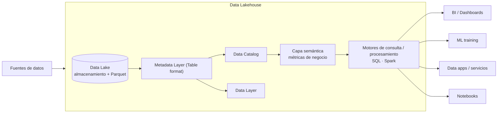

# Apuntes — Semana 2 (5 de Agosto de 2026)

---

## 1. Resumen de la clase

> [!note] Cómo leer esta tabla
> Los timestamps son los **marcadores reales de la transcripción** de la grabación (duración total: **02:45:09**). Sirven para ubicar el contenido en el video, no para calcular la hora del reloj.

| Hora (en la grabación) | Qué pasó |
| ------------- | ------------------------------------------------------------------------------------------------------------------------------------------------------------------------------------------------------------------------------------------------------------------------------------------------------------------------------------------------ |
| 00:00–00:03 | Check-in del reto anterior (Docker + Jupyter). El profe insiste: los **retos** son para dejar lista la infraestructura cada semana y llegar al proyecto con todo adelantado ("sacan jueves, viernes, sábado, domingo, lunes, martes: tienen como casi **ocho días**"). **El proyecto NO es idea propia**: en los 3 cortes el profe pasa **datos + contexto** (proyecto controlado, porque corre en los PCs de cada uno). |
| 00:03–00:05 | Anécdota: el **lunes sacaron a producción los agentes de IA en WhatsApp** en la empresa del profe (salió del equipo de datos; hoy es "pura IA"): antes era un workflow de opciones, ahora conversación natural con memoria. A pedir feedback a quien tenga internet **fuera de Cali** (mencionó Palmira[^celsia]). |
| 00:05–00:07 | Agenda de la clase: **contexto histórico, OLAP, Data Warehouse, Data Lake y Data Lakehouse**. Pregunta de cómo de clara tienen la diferenciación: la vieron por encima en 1.º-2.º semestre; el DW es lo más conocido. |
| 00:07–00:12 | **Los datos como activo:** toda empresa (PYME o grande: usan redes sociales y tienen BD transaccionales pequeñas) es susceptible de análisis; niveles según madurez: **descriptiva → predictiva**. La IA acelera el desarrollo: ejemplo del profe, **Power BI + Claude Code**; recuerda tener alguien con Windows en el grupo (Power BI). Se necesitan **plataformas** para almacenar, analizar y **separar almacenamiento/procesamiento** (insumo para BI y ML) — de ahí el lakehouse. |
| 00:12–00:19 | Primeros sistemas: **RDBMS/OLTP** (PostgreSQL hoy la más usada, open source): volumen gigante de **transacciones pequeñas** (pagos, compras, retiros, ventas), pero **se quedan cortas** para análisis/promedios/tendencias. Diferencia clave: estructura **basada en filas** (OLTP, optimizada para **inserción**) vs. **columnar** (OLAP, optimizada para **búsqueda**: "se para sobre la columna" y agrega; en filas el motor lee registro por registro). ==Concepto clave: por filas = transacciones; por columnas = análisis.== |
| 00:19–00:28 | **Normalizado vs. desnormalizado:** normalizado = tablas pequeñas y sin duplicación (ej. "películas ↔ géneros"), eficiente para insertar; desnormalizado = todo junto en una tabla (ej. películas con el nombre del género incluido), eficiente para **consultar** (un `SELECT` por llave vs. hacer join con otras tablas). En el DW se busca lo **desnormalizado** (respuesta del profe a Juan: la tabla de dimensiones+hechos es normalizada; en el DW va la desnormalizada[^4]). **ETL corre de madrugada** (consulta todo lo del día anterior) → el analítico tiene casi siempre **un día de delay**; el tiempo real vive en la reportería operativa de las apps o en streaming. |
| 00:28–00:32 | Las empresas generan **grandes volúmenes** y necesitan **consultas complejas y agregaciones históricas** → se necesita algo nuevo (nace el lakehouse; el DW comparte esa misma característica). **Línea de tiempo:** DW años 80 (metodología Kimball) → **Data Lake ~2011** (Hadoop + auge de la nube) → **Lakehouse ~2020**. En OLTP el almacenamiento y cómputo quedan rígidos (servidor = sus capacidades); con la nube escalan ambas; Databricks compró una BD basada en Postgres que escalaba en la nube (integrada en Databricks[^5]); ejemplo similar: Supabase. |
| 00:32–00:39 | **Componentes de una BD analítica (OLAP):** storage, file format, table format, storage engine, catálogo y motor de cómputo (en el DW vienen integrados; en el lakehouse se ven todos). Detalle: storage (local/DAS, HDFS, S3/Azure), file format (CSV/JSON/txt; filas vs. columnas; **Parquet** es el estándar; ORC), table format (Iceberg, Delta Lake, Hudi; trabajaremos Iceberg y Delta), storage engine (dentro de las BD OLAP; en el lakehouse no se usa), catálogo (dónde están las rutas físicas de las tablas[^6]), motor de cómputo (Spark, Snowflake, Dremio; motores SQL vs. Spark). **MPP** (procesamiento masivamente paralelo) y escalamiento **horizontal** ("pegar otro computador igual al lado"; la tarea se divide en ejecutores) vs. **vertical** ("comprar una pala más grande"; más RAM/CPU a la misma máquina). En Big Data se usa el horizontal. |
| 00:40–00:43 | **Historia del DW:** hasta ~2015 on-premises: almacenamiento y cómputo **acoplados** en el mismo servidor; escalabilidad limitada; para dar más recursos tocaba **apagar el servidor**; no se podían separar recursos (más almacenamiento = pagar más cómputo). **DW en la nube (2015+):** separación almacenamiento/cómputo, escalar independiente, **apagar el cómputo sin perder datos** (estilo serverless: el clúster se prende al llegar una petición). |
| 00:43–00:48 | **Qué hace el DW:** repositorio centralizado de la **información histórica de la organización** → democratiza los datos históricos ("¿cómo entrenar modelos sin datos históricos... si no están en un repositorio como un DW?"). Limitaciones: no diseñado para ML nativo ni para datos no estructurados (imágenes/videos); arquitectura **cerrada** (componentes del proveedor: no se cambia ni catálogo ni formato de tabla: "solo guardas y consultas, y pagas"); **costoso** (almacenar en el DW es caro, también en la nube) → por eso surgieron alternativas como el data lake. |
| 00:48–00:55 | **Demo MotherDuck** (DW en la nube basado en **DuckDB**): plan free con **10 GB**; IA incluida (el curso pasado no la tenía); pricing Business ~**250 USD + usage** e instancias Pulse/Standard/Jumbo ("aprendan a leer el pricing: las empresas siempre optimizan costos"). Motor SQL: lee un **CSV desde un repo de GitHub** y un **parquet de ~2 GB en un bucket S3** (≈4 M registros[^1]; local con DuckDB es inmediato, el clúster se demoró porque "apenas estaba provisionando"); se conecta desde DBeaver. |
| 00:55–00:59 | Pros/cons del DW (diapositiva): BI/análisis, datos estructurados y limpios, esquemas predefinidos; contras: no soporta datos semiestructurados/no estructurados, esquemas inflexibles, problemas con volumen y velocidad, procesamiento largo. **Arquitectura clásica del DW:** fuentes (API / archivos / BD) → **staging** (área temporal: extracción, mezcla de fuentes, limpieza, vistas de agregaciones del día anterior) → carga → DW (tablas históricas) → **data marts** (subtablas específicas de negocio: "de una tabla gigante sale un data mart de reportería") → BI. |
| 00:59–01:05 | **Data Lake:** respuesta directa de qué es: "una **carpeta del PC normal, pero en la nube**": cualquier tipo de datos (parquet, CSV, video, imagen, logs) **sin obligación de ajustarse a un esquema físico**. Historia: **Hadoop** (HDFS como almacenamiento distribuido en servidores locales + **MapReduce**, jobs en Java, muy técnico) → **Hive** (SQL → jobs MapReduce) → limitantes (operaciones entre tablas se enredan; detalles en la otra clase) → nube: **S3/MinIO/Azure Blob** (más fácil y económico; S3 con **redundancia**: copias en varios servidores) y MapReduce reemplazado por **Spark, Presto, Dremio** (distribuidos). Sobrevivió solo el **formato de tabla de Hive** (qué archivos representan una tabla). |
| 01:05–01:08 | Pros del lake: barato (tarifas S3 bajas), formatos abiertos, **motores de cómputo intercambiables según la carga** (procesar con Spark/PySpark o consultar con SQL; sin motor de almacenamiento dedicado), datos no estructurados (logs, imágenes, correos, sensores). Pregunta de un estudiante sobre motores: "motor de cómputo = procesar (Spark) o consultar (SQL); en el corte 2 les doy el ejemplo". |
| 01:08–01:14 | **El ejemplo de los parquets sueltos** (ventas 04/08, 05/08...): en Python solo se hace un `concat` → un DataFrame en memoria, pero **no es una tabla consultable con motor SQL**; modificar un registro de un CSV suelto no es una transacción; si se cuela un parquet de clientes en la ruta de ventas, el concat falla (esquemas distintos); en una tabla histórica real no hay 3 días sino **mínimo 2 años** → ineficiente. Aquí explica **ACID**: atomicidad ("las tareas se hacen correctamente una después de otra; si una falla no deben fallar las demás"), consistencia ("no se dañan los tipos de datos"), aislamiento ("las transacciones que corren al tiempo no se afectan") y durabilidad ("si actualizo hoy y no lo vuelvo a tocar, sigue ahí"). Con archivos sueltos nada de eso se garantiza; **el DW sí tiene ACID**. |
| 01:14–01:18 | Pros del lake: flexible, streaming (logs), costo eficiente, IA/ML (datasets de imágenes). Contras: sin transacciones; **confiabilidad** (sin procesos de calidad de datos o de esquemas "no sabes si los datos están bien"); **data swamp** (guardar "por si acaso" sin estrategia de datos → pantano: fotos, videos, logs sin uso; "cada proyecto debe tener su porqué"); **gobernanza limitada** (en el DW das permisos por tabla; en el lake si accedes, ves todo); "los DW siguen siendo necesarios". Pregunta de Alejandro: ¿la estrategia es tener lake Y warehouse? → **Depende**: si no hay datos no estructurados, un DW basta (histórico + reportes + BI con Power BI/Tableau/Superset). |
| 01:18–01:27 | **Arquitectura moderna "lake + DW conviviendo"** (ELT): fuentes → batch de ingesta → **lake** (backup del DW, copia física diaria, + datos no estructurados) → transformación (más de un job: "hoy un job por tabla, orquestados a distintas horas"; ejemplo real del profe: recibos de pago en correos → **OCR** → tabla con el texto → un **LLM** valida si el cliente pagó) → DW → data marts → BI. Con nombres: **S3** (lake) + **Airbyte** (ingesta) + **dbt** (transformación) + **Snowflake** (DW) + **Tableau** (BI); en Azure: **Data Factory** (extracción/transformación), **ADLS** (lake), **Databricks** (si se queda corto Data Factory), **Synapse** (DW), **Power BI**.[^2] Análisis en el lake directamente (opción 2): se puede consultar (DuckDB/motores SQL), pero sin ACID ni actualizaciones seguras → y de esa tensión nace el lakehouse. |
| 01:27–01:41 | **Receso** (anunciado: "vamos a break hasta las ocho y media"). La grabación retoma al min 01:41:00. |
| 01:42–01:47 | **Data Lakehouse:** "un híbrido extraño" que reúne lo mejor de ambos; **desacopla almacenamiento y cómputo**, incorpora **ACID** y las funciones del DW (rendimiento, consistencia), **usa los mismos motores de consulta del lake** y su pieza mágica: un **table format** que crea "una **capa de metadatos** entre el motor y el almacenamiento" (spoiler: los 3 parquets sueltos se comportan **como una tabla**: `upsert`/`merge`/`overwrite` sin que se confundan con otras tablas de la misma ruta). "**Sin table format no hay lakehouse**" — ahí llegan Iceberg y Delta (evolución del formato de tabla de Hive). |
| 01:47–01:52 | **Beneficios del lakehouse:** menos copias (lake + DW + data marts + BI extracts = drift) → menos costos, menos inconsistencia entre versiones, mejor gobernanza (acceso por tabla); **consultas más rápidas** (file pruning: el table format sabe qué archivos son de la tabla; compresión columnar del Parquet) → "rendimiento comparable al de un DW"; **snapshots / time travel** (versionamientos: si se daña un día se vuelve a la versión anterior — "errores que no duelen"); **formatos abiertos** (Apache **Iceberg** + Apache **Parquet**: usar sin pagar; evitar **vendor lock-in**); es la arquitectura que **lidera Databricks** ("ya soportan también Iceberg, no solo Delta"). |
| 01:52–01:58 | **Cargas de trabajo:** ETL con Python, ETL con SQL (DuckDB) o ETL con Spark "todo dentro de la misma arquitectura"; ML con Python o PySpark. **Componentes:** el data lake tenía solo storage + compute; el lakehouse agrega **table format + catálogo**; la estructura: fuentes → capa de datos (almacenamiento) → capa de metadatos (table format) + catálogo → capa semántica (métricas de negocio) → motores → salidas: **BI/dashboards, ML training, data apps, notebooks**. Ejemplo en producción: el profe con **DuckDB** se conecta al lakehouse de Databricks (sin prender el clúster), copia el histórico a una base en memoria (RAID) y eso alimenta la **app de análisis de tickets PQR** con un agente/LLM (histórico de facturación y pagos: "usted no ha pagado esta factura..."). |
| 02:00–02:02 | **Recomendaciones del profe:** entender el momento de la empresa; proponer soluciones económicas y fáciles de desplegar; el boom de la nube → llegó la factura en dólares → muchas empresas volvieron a on-prem/VPS/Kubernetes con open source; híbrido típico: datos en **S3** (barato, redundante) + procesamiento **por fuera** (clúster Spark propio) + orquestación con **Airflow o hasta Cron Jobs**; "no casarse con una tecnología" (los conceptos se trasladan entre proveedores casi 100 %). |
| 02:02–02:10 | **Demo Summer.io:** DW "friendly"/amigable, **basado en DuckDB** (el profe habló con sus founders); cambió de enfoque: antes DW general → ahora **base de datos analítica para aplicaciones** (Google Ads, Facebook Ads, marketing); free **sin tarjeta de crédito**; ingesta a través de **Fivetran** (antes Airbyte); transformación en otra capa (dbt o Spark); **cobra por las consultas, no por la ingesta**; tenía tablero incorporado. Comparación de herramientas (costos/flexibilidad): MotherDuck tiene docs muy claras ("copias la página como markdown, se la pasas a Claude y vuela solo"). Mensaje del profe: **lean la documentación, entiendan los conceptos y que la IA solo ejecute**. |
| 02:10–02:14 | **ClickHouse Playground**: probar queries y datasets demo (no se puede subir un dataset; sí descargar datos); **MinIO / Azure Blob Storage**: el segundo se mostró la clase pasada; **DuckLake**: otro enfoque del lakehouse basado 100 % en DuckDB: 3 piezas = storage (S3/AWS) + catálogo (ej. Postgres; DuckDB/SQLite también pueden) + consultas/procesamiento con SQL en DuckDB; **sin table format tipo Iceberg**. El profe compartió su artículo *"Your First Swim in DuckLake"* (MinIO + Postgres + DuckDB + Jupyter/pgAdmin): "varias empresas ya lo usan en producción; cuando empecé el curso hace un año empezó a salir". |
| 02:15–02:19 | **Demo MinIO (object storage local):** carpeta del campus ("aplicaciones") con 4 aplicaciones: **ClickHouse, Jupyter, MinIO y Postgres** (realmente se despliegan las 2 primeras). Compose: imagen, puerto, usuario `admin`/`password`; `docker compose up -d`; UI en `:9001`; buckets: **bronze / silver / gold** ("arquitectura medallón, que luego vamos a ver"); ejemplo: bucket **Taxis** con un parquet subido ("así se ve un parquet en la nube"); volumen: los datos del contenedor quedan en una **ruta física local** (carpeta `data/`) — fundamental para toda app que persista. **Aviso:** MinIO ya no es open source puro ("quedó como community edition"; el semestre pasado dijeron que **no le harían más mantenimiento** a la CE; "todo es negocio"); sigue sirviendo para el curso por ser compatible con la **API de S3**; productivo = pagar MinIO nube, pagar **S3**, o dejar que alguien lo despliegue bien. |
| 02:20–02:26 | **Demo ClickHouse (DW columnar local):** compose con `clickhouse-server`, puerto **8123**, usuario/clave `default`/`default`, web SQL UI; "no veo ni catálogo ni almacenamiento: es un DW, todo queda dentro del motor propio"; crear BD (`Hello World`) → tabla (llave primaria `user_id`) → `INSERT INTO` → `SELECT`; recuerda **DDL** (crear objetos) vs. **DML** (insertar, seleccionar, actualizar, eliminar) y que lo mismo pasa en el lakehouse gracias al table format; se conecta desde **DBeaver**. |
| 02:26–02:33 | **Dataset del proyecto: Stack Overflow** — el doc que sube: insertar la tabla `posts` desde el **bucket S3 público** (la ruta completa de la carpeta de parquets): "si metemos todo son como **59 millones de registros y 38 GB**, no vamos a quemar el PC"; se puede **consultar por años** (eso harán en el proyecto: "vayan cacharreando el de POST"); el profe canceló el insert y prefirió un `COUNT` sobre la ruta: "es más rápido contarlos que cargarlos: **son 4 millones de registros**"[^3]. ClickHouse sirve también como motor SQL para leer datos externos. |
| 02:33–02:36 | **DBeaver** (recomendado): cliente/gestor universal de BD (Postgres, ClickHouse, etc.): conexión `localhost:8123` + base `stackoverflow`; el insert alcanzó a guardar **~400 mil registros** antes de que el profe lo matara (si matas un insert queda a medias: no hay control específico de la inserción); "úsalo también para otros motores SQL". |
| 02:37–02:42 | **Reto de la semana:** un **único `docker-compose` con Jupyter + MinIO** (compartiendo la misma **network**); subir un parquet al bucket y, desde Jupyter, **listar los archivos del bucket y leer el parquet** (contar registros o convertirlo en DataFrame); herramienta: **boto3** (librería para S3/MinIO, va en el `requirements.txt` del Jupyter); el script del campus configura `endpoint_url='http://minio:9000'`, credenciales `admin/password`, región `us-east-1`, bucket (ej. `stackoverflow`) y lista con `list_objects_v2`; el **link del parquet está dentro del script** (2020.parquet). |
| 02:42–02:45 | Cierre: diapositivas y aplicaciones ya están en el campus; **la grabación la sube más tarde o al día siguiente**; el reto "ya adelanta la mitad del proyecto: guardar y leer datos"; **pista**: la `network` del compose es la que hace que los dos contenedores "se hablen". La próxima semana: **formato de datos** (detalle de los componentes del lakehouse). |

> [!important] Tareas y pendientes de la semana
> - ==**Reto Semana 2:** desplegar en el mismo `docker-compose` un contenedor con **Jupyter Notebook + MinIO** (que compartan la misma **network** — "si no, no se hablan"), subir un **archivo parquet** a un bucket de MinIO y ejecutar el script (librería **boto3**) que **lista los archivos del bucket y lo lee** desde Jupyter (contar registros o visualizar).== El script y el parquet (taxis / Stack Overflow 2020) están en el campus en la carpeta "aplicaciones".
> - ==**Recordatorio del proyecto (corte 1):** el profe entregará **datos + contexto**; el proyecto NO es idea propia. El del corte 1 (almacenamiento e ingesta) y el del corte 2 (procesamiento, consulta y orquestación) están **anidados**: son las dos mitades del mismo lakehouse; el corte 3 es lo mismo dentro de Databricks.==
> - **A tomar nota:** el parquet del proyecto (Stack Overflow **POST**) se descarga por el **link que está en el script** del campus; el dataset completo se consulta **por año** ("vayan cacharreando el de POST"). Pueden usar el parquet de ejemplo "taxis" o un CSV cualquiera para el reto.
> - **Pendiente recibir:** la grabación de hoy (el profe la sube al campus ese día o al día siguiente).

> [!note] Fuentes de estos apuntes
> - **Transcripción** — [[Big Data/Apuntes/Recursos/Semana 02/Transcripción - 5 de Agosto]] (fuente principal: es lo que efectivamente pasó en la clase; duración 02:45:09).
> - **Diapositivas** — [[Big Data/Apuntes/Recursos/Semana 02/FYHBD - S2.pdf]] (43 páginas; su contenido está citado en las secciones correspondientes con embeds).
> - **Aplicaciones de la clase** — [[Big Data/Apuntes/Recursos/Semana 02/Aplicaciones.rar]]: composes y scripts de MinIO, ClickHouse, Jupyter (Spark) y Postgres. Todos estaban en el campus.

---

## 2. Contexto de la clase sobre los retos y el proyecto

- La idea de los **retos semanales** (no calificables, pero recomendadísimos): cada semana se va dejando lista la infraestructura: Jupyter (S1), Jupyter + MinIO (S2), y así sucesivamente. Así el proyecto del corte es solo **contexto + movimiento de datos** sobre la plataforma ya armada; "en últimas el proyecto es aplicar: un contexto de datos, un movimiento de datos, un pipeline".
- El proyecto del **corte 1 y el del corte 2 están anidados**: el del corte 1 es la primera mitad (almacenamiento e ingesta); el del corte 2 es la segunda (procesamiento, consulta y orquestación). El del corte 3 es lo mismo, pero dentro de Databricks. Primero todo con **open source** ("para entender cada componente") y después se ve en Databricks.
- En todos los cortes el profe **pasa los datos y el contexto** (proyecto "controlado", porque cada uno corre en su PC); esto evita los problemas de datos que han pasado en semestres anteriores.
- Pregunta del profe al inicio: cómo van con Jupyter (el reto de la semana 1) — nadie puso quejas (solo problemas puntuales).

> [!tip] Profe — una anécdota de agentes (datos + IA en producción)
> El **lunes sacaron a producción los agentes de WhatsApp** de la empresa del profe (equipo de desarrollo + datos). Antes era un menú de opciones; ahora es lenguaje natural con memoria; "han sido pruebas masivas todo el fin de semana". Si alguien tiene el servicio de internet **fuera de Cali** (mencionó Palmira[^celsia]) puede probarlo y darle feedback. Es un ejemplo de que la **estructura del lakehouse** es la base: los datos históricos de facturación/pagos (servidos vía DuckDB) son el contexto de esos agentes.

---

## 3. Los datos como activo

- Los datos son **el activo fundamental** para tomar decisiones, analizar tendencias y competir: "una empresa que no haga análisis de sus clientes, de su competencia, no puede competir en el mercado".
- **Toda empresa es susceptible** de análisis: PYME o grande, todas usan redes sociales y tienen sus propias bases de datos transaccionales, "así sean pequeñitas". (Ojo: no toda empresa necesita un stack Big Data — se vio en la Semana 1).
- **Niveles de analítica según la madurez:** primero analítica **descriptiva** (tableros, reportes diarios) → con histórico en el tiempo, **predictiva** (modelos). La madurez depende de la empresa y del equipo de analítica que encontrará cada uno; si se llega desde cero, toca construir "toda la parte descriptiva" primero.
- **La IA acelera el desarrollo de productos de datos:** ejemplo del profe: **Power BI + Claude Code** (prompts para documentación de tableros, métricas, transformaciones; "es re práctico"; lo llevó a su equipo de datos).
- **Nota para los grupos:** Power BI funciona solo en Windows ("a mí me gustaría usar Linux, pero por temas de usar Power BI me quedo en Windows") → al menos alguien del grupo debe tener Windows para el corte 3 (conexión Superset/Power BI + Databricks).

> [!def] Plataforma de datos
> Sistema que permite (1) almacenar grandes volúmenes de datos, (2) analizarlos eficientemente (consultas sobre historiales), y (3) **desacoplar el almacenamiento del procesamiento** para escalar cada uno por su lado. Es el insumo para BI (reportes/tableros) y ML (modelos). "Por eso nace de alguna manera la arquitectura lakehouse: también separa almacenamiento y procesamiento para dar mayor escalabilidad y flexibilidad".

---

## 4. OLTP y bases transaccionales: por filas

### 4.1 Los primeros sistemas (RDBMS)

- Los primeros "almacenes de datos" (en su momento) fueron las **bases de datos relacionales**: PostgreSQL hoy la más usada por ser open source; también MySQL, SQL Server. "Historia patria".
- **OLTP (Online Transaction Processing):** orientadas a la transaccionalidad: **volumen gigante de transacciones pequeñas** (pagos, compras, retiros de bancos, ventas): insertar, actualizar y leer pocas filas con rapidez y consistencia, baja latencia.
- **Esquema normalizado:** tablas pequeñas y separadas (películas ↔ géneros; clientes, productos...), cada concepto guardado una vez, unidos por claves primarias/foráneas. Eficiente para guardar/insertar; poco de duplicación.

### 4.2 Por filas vs. por columnas (concepto clave de la clase)

| | Ordenada por **filas** (transaccional / OLTP) | Ordenada por **columnas** (analítica / OLAP) |
| --- | --- | --- |
| Ejemplos | PostgreSQL, MySQL, SQL Server | ClickHouse, Parquet, bases analíticas |
| Optimizada para | **Inserción** de registros completos | **Búsqueda / agregaciones** (promedios, sumas, group by) |
| Ejemplo de la clase | Buscar el promedio de edades de 3 estudiantes: el motor lee registro por registro, guarda en memoria e "ir recorriendo" | "Se para sobre la columna" y hace la función de agregación |
| A gran escala | Para promedios sobre miles/millones de registros se queda lenta ("si la BD no tiene recursos, se comienza a quedar pegada") | El motor lee solo la columna necesaria (menos I/O; planes de ejecución optimizados) |

> [!abstract] Por qué el profe insiste en esto
> "Es una diferencia clave que por debajo el usuario no percibe, pero es en síntesis la diferencia entre BD transaccionales y analíticas. Tírense este ejemplo porque lo vamos a seguir viendo **durante todo el curso**: vamos a trabajar con formatos columnares" (ese es el formato Parquet).

- Pregunta de Alejandro: "(¿cuáles son las transaccionales?)" → profe: **las analíticas son las de columnas; las transaccionales son basadas en filas**.

### 4.3 Competencia por recursos (¿por qué no se analiza sobre la BD transaccional?)

- La misma BD tiene recursos limitados de almacenamiento y procesamiento: "o tengo recursos para mis transacciones o recursos para hacer análisis de esa información. Por eso **nunca** hacemos análisis de datos sobre las bases de datos operativas y transaccionales".
- En la práctica conviven dos mundos: **equipos de desarrollo/aplicaciones** (bases operativas, ej. Postgres; crean las APIs que disponen la información) y **equipo de analítica** (su propio ambiente, ej. ClickHouse). "En general siempre es así: una base operacional y una analítica" (respuesta a Alejandro, que preguntó exactamente eso).
- Las cargas analíticas tradicionales corren **en la noche/madrugada**: los jobs ETL consultan toda la información del **día anterior** → casi siempre hay **un día de delay** en lo analítico, y "con eso las empresas pueden vivir común y corriente". Detalle del profe sobre la fecha: hoy (clase del 5 de agosto) se consultará en la madrugada del 6: en la madrugada del 6 de agosto se trae toda la información de lo que pasó el 5.
- El tiempo real ("si quieren datos en tiempo real...", lo dice Alejandro) tiene su propio tema: las aplicaciones tienen **reportería operativa**; la reportería analítica siempre tiene al menos un día de intervalo, y para tiempo real real está el **streaming de datos**.

### 4.4 Normalizado vs. desnormalizado

- **Normalizado (transaccional):** eficiencia en guardar/insertar: varios cambios pequeños y sin duplicar. Ej.: tablas separadas de películas y géneros. "En las tablas más pequeñas se describen los componentes del negocio" y quedan bien guardadas con sus relaciones por llaves primarias.
- **Desnormalizado (analítico/DW):** eficiencia en **consultar**: los atributos vienen juntos para no hacer joins; una sola tabla con la película, el género y el nombre del género; otro ejemplo: la dimensión productos con el producto, el tipo, el rubro y el nombre. "Si yo ya me traigo este registro es solo un `SELECT` por la llave subrogada; si quisiera lo mismo normalizado tengo que hacer `JOIN` con dos tablas más — eso es más pesado para el motor de consulta".
- "La inserción en lo desnormalizado: ¿cuándo se hace? En la madrugada con los ETL", por eso no importa que insertar sea más costoso; lo que importa es traer "bolquetadas de datos" con la menor cantidad de operaciones.
- "Por eso el OLTP favorece datos **normalizados** y el OLAP funciona mejor con datos **desnormalizados**" (y en el DW eso mismo se llama modelado dimensional: hechos y dimensiones[^4]).
- Esperado en el proyecto: en el DW/lakehouse tendrás tablas **históricas** (y más adelante el esquema estrella / star schema: un caso de desnormalización controlada, con data marts de reportería).

> [!tip] Transacciones ACID (en palabras del profe, min 01:11[^7])
> Una transacción debe completarse **correctamente una después de otra**; si una falla, no debe romper las demás (atomicidad). La **consistencia** es que las operaciones no dañan los tipos de datos. La **aislación** es que las transacciones que corren al tiempo no se afectan entre sí. La **durabilidad**: cuando se ejecuta una operación permanece en el tiempo ("si actualizo este dato hoy y no lo vuelvo a tocar, debería mantenerse"). En un directorio con parquets sueltos esto no se puede garantizar: para modificarlos hay que hacer canalizaciones complejas ("coordinación, identificar el archivo, ver que todos los archivos representen la tabla"); por eso los ficheros se organizan como tablas (table format, Semana 3).

---

## 5. La necesidad de OLAP y los componentes de una BD analítica

- Las organizaciones generan grandes volúmenes y **consultas complejas / agregaciones históricas** que las transaccionales no soportan: "necesitamos algo nuevo; ahí nace el lakehouse (y el DW tiene también esta característica)".
- La evolución que vamos a ver: diapositiva "Arquitecturas de datos" (1980s → 2011 → 2020):

![[Big Data/Apuntes/Recursos/Semana 02/FYHBD - S2.pdf#page=6]]

- **Componentes de una plataforma OLAP** (en un DW no los ves porque vienen integrados; en el lakehouse los verás uno a uno):

![[Big Data/Apuntes/Recursos/Semana 02/FYHBD - S2.pdf#page=7]]

| Componente | Qué es | Observación de la clase |
| --- | --- | --- |
| **Storage** | Dónde se guardan los datos: local/DAS, HDFS (tipo Hadoop, ~2011) o nube (S3, Azure Blob, MinIO...). | El almacenamiento de objetos ganó la carrera. |
| **File format** | Cómo se guarda cada archivo: filas (CSV, Avro) vs. columnas (Parquet, ORC). | Para analítica, columnar (Parquet es "el estándar de la industria"; ORC como alternativa). |
| **Table format** | Capa de metadatos sobre los archivos: qué archivos forman una tabla, versiones, esquema. | Ejemplos: Hive (pionero), **Iceberg / Delta Lake / Hudi** (trabajaremos Iceberg y Delta; "Hudi no"). |
| **Storage engine** | Organiza los datos según el table format (índices, compactación, snapshots). | "Esto es más dentro de las BD OLAP: **en el lakehouse no se aplica**". |
| **Catálogo** | Registra dónde están físicamente las tablas (rutas, metadatos, nombres); "ayuda a entender en qué rutas físicas se encuentran guardados esos datos". | En el DW es interno; en el lakehouse podrás ver y elegir tus rutas. |
| **Compute engine / motor de cómputo** | El que ejecuta consultas/transformaciones (Spark, Snowflake, Dremio...). | Los motores actuales usan **MPP** (procesamiento masivamente paralelo). |

- Detalles del profe (min 00:32–00:39): la tecnología de file format/table format la verán en detalle **la próxima clase** ("qué catálogo usar, qué motor..."); los formatos de dato: estructurado (CSV), semiestructurado (JSON), no estructurado (texto plano). En el lakehouse no usamos una BD puntual: "guardamos la información en **formatos de archivo** optimizados para datos columnares (Parquet)"; "uno no se preocupa por el catálogo ni por el storage en un DW: tú desplegas el DW (ClickHouse) y ya".
- **MPP y escalamiento** (min 00:37–00:39): con tantos datos, una sola máquina se queda corta → **horizontal** = "en vez de una pala grande, dos personas con pala cada uno" (la tarea pesada se divide en ejecutores; lo traduces en pods/clústeres: Spark = master + workers; en Big Data es lo estándar) vs. **vertical** = "comprar una pala más grande" (más RAM/CPU a la misma máquina; límite físico; en on-prem había que apagar el servidor). "Van a ver esto sobre todo cuando veamos Spark, en el corte 2".

---

## 6. Data Warehouse

### 6.1 Historia, definición y características

- **Nace en los años 80** con la metodología de **Kimball** (modelo dimensional / BI).
- Hasta **~2015** corría on-premises: almacenamiento y cómputo **acoplados**; escalabilidad limitada; para más recursos tocaba **apagar todo el servidor**; imposible separar recursos (si necesitabas más almacenamiento también pagabas más cómputo).
- **DW en la nube (2015+):** se separa almacenamiento y cómputo; cada recurso escala independiente; se puede **apagar el cómputo sin perder los datos** (estilo serverless: "no consultamos nada en dos horas → el clúster se apaga; llega una petición → se prende"). Es muy importante para optimizar costos.

> [!def] Data warehouse (en la clase)
> Repositorio centralizado que reúne la **información histórica de la organización** (de todas las fuentes: sistemas operativos, bases de datos de aplicaciones, archivos de logs), **limpia, estructurada y gobernada**, optimizado para consultas analíticas y agregaciones. "Ha sido importante para **democratizar el acceso a los datos históricos**... ¿cómo vamos a entrenar modelos si no tenemos historia, si no está en un repositorio como un DW?".

**Ventajas (diapositivas + clase):** grandes volúmenes de datos históricos; **gobernanza** (disponibilidad, uso adecuado, políticas, acceso por roles); calidad de datos con **esquema definido**; consultas optimizadas; "fuente única de verdad".

**Desventajas:** **costoso** (almacenar y procesar; también en la nube); **solo datos estructurados** (no aprovecha imágenes/JSON para ML nativo: hay que extraer, mover y consultar); **arquitectura cerrada**: todos los componentes son del proveedor — no puedes cambiar el catálogo ni el formato de tabla ("uno solo guarda y consulta la información, y paga por eso"); ETLs con recursos limitados = procesamiento lento; problemas con volumen y velocidad.

> [!tip] "El DW no es malo"
> "Si una empresa solo necesita analítica sobre datos estructurados y no quiere datos no estructurados, que monte un Data Warehouse y listo: cumple con guardar y consultar información histórica optimizada para consultas columnares y agregaciones. Hay muchísimos DW en la nube hoy (Snowflake, ClickHouse, MotherDuck, Summer.io...)."

> [!note] Dato de contexto (min 00:44)
> El profe matizó: también las relacionales guardan hoy JSON ("**JSONB** en Postgres") e incluso **datos vectoriales**, así que el límite "solo estructurado" se está flexibilizando; pero un DW sigue sin estar diseñado para el ML con datos no estructurados como tal.

### 6.2 Arquitectura clásica (con staging y data marts)

```text
Fuentes (API / archivos / conexión a BD)
   → STAGING (área temporal: extracción, mezcla de fuentes, limpieza, vistas de agregaciones del día anterior)
   → Carga (parte "load" del ETL)
   → Data Warehouse (tablas históricas con esquema de negocio)
   → Data Marts (subtablas específicas por área de negocio: ventas, finanzas...; de una tabla gigante puede salir un data mart de reportería)
   → BI (Power BI / Superset / Tableau)
```

- En el **staging** se hacen las transformaciones ("mezclo una API, un archivo físico o una conexión a BD"; "hago una vista para la agregación del día de ayer y la guardo en el histórico"; "hago limpiezas en staging y cargo directo"). Así lo describe la diapositiva (fuentes → "Temporary Landing" → ETL → DW → data models → analytics):

![[Big Data/Apuntes/Recursos/Semana 02/FYHBD - S2.pdf#page=18]]

### 6.3 Demo: MotherDuck, Summer.io y ClickHouse Playground

- **MotherDuck** = versión nube de **DuckDB** (la BD analítica embebida que el profe usa mucho). En la demo:
  - Objetivo del profe: "aprendan a mirar el **pricing** porque las empresas siempre van a optimizar costos". Plan *Lite* = gratis con hasta **10 GB de almacenamiento**, usuarios por roles (serve la gobernanza); Business ≈ **250 USD/mes + usage**; instancias **Pulse, Standard, Jumbo** (cobro por segundo de procesamiento); "ya le metieron IA al pricing" (hace un año no tenía).
  - **Es motor SQL, no solo DW:** leyó directo un **CSV desde un repo de GitHub** y un **parquet de ~2 GB en un bucket S3** ("≈4 millones de registros[^1]; local con DuckDB no demora nada; el clúster se demoró porque apenas estaba provisionando") → "puede leer datos desde el lago sin problema". Se conecta desde **DBeaver** (sin notebooks), y tiene una conexión Python muy documentada ("copia la doc como markdown, se la pasas a Claude y vuela solo").
- **Summer.io** (https://summer.io/): DW en la nube **muy amigable** ("una versión muy friendly de ver un data warehouse"), **basado en DuckDB** ("por eso me llamó la atención"; el profe habló con sus founders); **gratis sin tarjeta de crédito**; cambió de enfoque: antes DW general → ahora **base de datos analítica enfocada a aplicaciones** (todo asociado a Google Ads, Facebook Ads, marketing); la **ingesta la hace Fivetran** (un tercero; antes usaban **Airbyte**: "han evolucionado muchísimo"); la transformación va en otra capa (dbt o Spark); **cobra por las consultas, no por la ingesta**; tenía tablero incorporado. "Se los dejo para que la cacharren".
- **ClickHouse Playground** (https://clickhouse.com/docs/getting-started/playground): la versión pública para probar **queries y datasets demo** y ver la sintaxis; **no permite subir datasets** (solo jugar con los demo y descargar datos). "Ahorita ya desplegamos las aplicaciones: el mismo DW lo tendremos local".

---

## 7. Data Lake

### 7.1 Historia

- **Por qué nace:** el DW no daba: solo estructurado, costoso (el clúster Hadoop local costaba más que el almacenamiento objeto en la nube), y on-premises con cómputo/almacenamiento acoplados que no escalaban.
- **Hadoop (~2011):** framework de cómputo distribuido open source + **HDFS** (almacenamiento distribuido en servidores locales) para datos estructurados y no estructurados. **MapReduce:** motor analítico con jobs escritos en **Java** (complejo y muy técnico) → **Hive:** convierte consultas SQL en jobs MapReduce ("convertía sentencias SQL en trabajos de Hadoop"). Limitantes: "las tablas usaban un catálogo y una ruta física, pero las operaciones entre tablas se volvían un enredo" (el profe adelanta pocos detalles: eso queda para la otra clase).
- **La nube (~S3, MinIO, Azure Blob):** más fácil y barato de usar/desplegar; MapReduce abandonado → **Apache Spark, Presto, Dremio** (distribuidos; Spark = evolución del MapReduce). S3 = **redundancia**: "tus datos están aquí, pero tienen copias en diferentes servidores para que no se pierda nunca la información si cae uno".
- **Lo que sobrevivió:** el **formato de tabla de Hive** ("definir qué archivos representan una tabla"); "su diseño no fue pensado para la nube, pero el concepto del table format sí evolucionó" (eso es lo que van a ver la próxima clase con Iceberg/Delta).

### 7.2 Concepto y características

> [!def] Data lake (en la clase)
> "Es como una **carpeta del PC normal, pero en la nube**": guardas cualquier tipo de dato (parquet, CSV, video, imagen, logs) **sin obligación de ajustarse a un esquema físico**. El formato original se conserva; el esquema se interpreta al leer (*schema on read*).

**Pros:** costo de almacenamiento bajo (revisen las tarifas de S3: "no cuesta mucho"); flexible (estructurado, semiestructurado, no estructurado); streaming (logs en tiempo real); soporte IA/ML (dataset de imágenes); **distintos motores de cómputo a elección según la carga** (¿SQL o Spark/PySpark?).

**Contras (de la clase y de las diapositivas):**

- **Sin transacciones ACID** ("si quiero modificar un registro de un parquet suelto..."): canalización compleja, coordinación manual.
- **El concat no es una tabla:** si un parquet de clientes se mezcla en la ruta de ventas, el esquema cambia y el concat falla ("¿qué tal que se me metió un parquet de clientes?"), y en una tabla histórica real hay mínimo 2 años de datos.
- **Data swamp** ("pantano de datos"): guardar "por si las moscas" sin estrategia de datos ("guardo esta información porque vamos a hacer este análisis para este proyecto, para resolver esta duda de negocio") → imágenes, videos y logs sin uso.
- **Confiabilidad ("data reliability") incierta:** sin procesos de calidad de datos, control de esquemas ni transformaciones claras, "no sabes si esos datos están bien".
- **Gobernanza limitada:** en el DW se puede decir "el usuario X no ve las imágenes"; en el lake no: si accedes, ves todo.
- **Rendimiento de análisis lento** (diapositiva "Cons") y por eso **"data warehouses still needed"** para la información estructurada.
- **"Poor data reliability / slow analysis / governance concerns"** de la diapositiva → es el mismo mensaje.

> [!question]- ¿Entonces la estrategia es tener lake y warehouse? (pregunta de Alejandro)
> **Depende.** Si en tu empresa no se van a almacenar datos no estructurados, no es necesario el data lake: con un DW suples todas las necesidades analíticas (histórico + reportes + BI con Power BI, Tableau o Superset). Si van a guardar imágenes/logs o quieren hacer ML, ahí sí el lake gana. "Es depende... de la necesidad de la empresa" — es la respuesta profesional, y se repetirá mucho en el curso.

### 7.3 Comparación rápida DW vs. DL (diapositiva + clase)

| Data lake | Data warehouse |
| --- | --- |
| **Conserva todos los datos** (originales, aunque no se sepa su uso futuro). | Conserva datos seleccionados, transformados y preparados para objetivos conocidos. |
| **Soporta todos los tipos de datos** (estructurado, semiestructurado, no estructurado, logs, imágenes). | Solo estructurados (limpios y con esquema definido). |
| **Soporta a todos los usuarios** (analistas, científicos de datos, ML, generalistas). | Orientado a analistas de negocio/BI. |
| **Se adapta fácil a los cambios** (nuevas fuentes y esquemas sin rediseñar). | Exige definir y controlar el esquema por adelantado. |
| **Visión más amplia y rápida de lo que hay** (el dato llega sin esperar el modelo). | Consultas rápidas, predecibles y gobernadas sobre datos curados, "es la foto de lo que ya decidiste guardar". |
| No garantiza ACID; permisos generales (no por tabla); análisis lentos sin ordenar. | ACID, gobernanza por tabla/rol, esquemas y calidad. |

### 7.4 El data lake junto al warehouse (arquitectura moderna: lake + DW conviviendo)

- El **lake** funciona como **backup del DW** (extraen los datos y guardan una copia física diaria) y como **almacén de datos no estructurados** (imágenes, PDFs, logs).

![[Big Data/Apuntes/Recursos/Semana 02/FYHBD - S2.pdf#page=26]]

- En la arquitectura ELT moderna: fuente → batch (con job de ingesta; "hoy es **un job por tabla**, orquestados a distintas horas") → lake (estructurado y no estructurado) → transformación (que ya no solo limpia: **extrae información de imágenes**; ejemplo real: los clientes envían recibos por correo → OCR → tabla con el texto → un LLM determina si el pago fue correcto) → DW → data marts → BI.
- "Lo que antes era un ETL ahora puede ser **un job por tabla**"; "en tema de transformación se implicaría tener más de un job".
- **Ejemplo con herramientas (diagrama de iconos de la diapositiva):**

![[Big Data/Apuntes/Recursos/Semana 02/FYHBD - S2.pdf#page=28]]

| Capa | Stack generalista del diagrama | Equivalente Azure |
| --- | --- | --- |
| Fuentes | PostgreSQL, **Google Sheets**, **Salesforce**, **Stripe** | (las mismas fuentes: productos como Stripe, Sheets...) |
| Extracción e ingesta | **Airbyte** (conecta cualquier fuente y mueve al destino) | **Data Factory** (extract & load) |
| Lake | **Amazon S3** (también MinIO/Blob) | **Azure Data Lake (ADLS)** |
| Transformación | **dbt** | Data Factory / **Databricks** (si Factory se queda corto) |
| Warehouse | **Snowflake** | **Azure Synapse** |
| BI | **Tableau** | **Power BI** |

- El profe lo cuenta con "nombres" al hablar: "datos en S3 de AWS, DW en **Snowflake** (los primeros del DW en la nube; vienen de Oracle), ingesta con **Airbyte**, transformación con **dbt**, BI con **Tableau**"; en Azure: Data Factory + ADLS + Databricks + Synapse + Power BI.

> [!warning] Costos, vendor lock-in y el híbrido
> Pagar todo a un solo proveedor (Azure/AWS/GCP) es caro: "traduciendo pesos a dólares". **Si dejas de pagar la suscripción, hasta ahí llegan los datos** y toca migrar (mover datos, garantizar continuidad = plata). Las empresas suelen ser **híbridas**: "guardar en **S3** (económico, redundante) y el procesamiento en servidores propios o VPS (desplegar el stack en Kubernetes autogestionado con open source)"; para orquestar scripts simples: **Airflow o hasta Cron Jobs** ("si es un script de Python que no tiene que escalar, se puede programar en consola"). "No se casen con una tecnología: los conceptos (object storage, catálogo) se aplican casi igual en todos los proveedores".

---

## 8. Data Lakehouse

### 8.1 La idea

![[Big Data/Apuntes/Recursos/Semana 02/FYHBD - S2.pdf#page=32]]

> [!def] Data lakehouse (en la clase)
> "Es un **híbrido extraño** entre Data Lake y Data Warehouse: aprovecha el **rendimiento y la facilidad de uso** del warehouse y mantiene la **flexibilidad y el costo** del lake. Desacopla almacenamiento y cómputo, incorpora **transacciones ACID** (consistencia de datos), usa los **mismos motores de consulta del data lake** y tiene un **table format [la magia]** que crea una **capa de metadatos entre el motor y el almacenamiento**."

- Spoiler del profe (min 01:45): los 3 parquets sueltos del día a día, gracias al table format, "se van a poder considerar **como una tabla**": el motor los agrupa al consultar y permite `upsert` / `merge` / `overwrite`; y si en esa misma ruta hay otras tablas, "**no se van a confundir**". "Sin ese formato de tabla **no podemos tener el Data Lakehouse**... Ahí es donde llegan **Iceberg** y **Delta**, que ayudan a que todo eso tenga sentido. Es una evolución que viene desde Hadoop".
- "La otra clase la vamos a aterrizar un poquito" (la capa de metadatos se detalla en la Semana 3).

### 8.2 Beneficios (diapositivas 34–36 + clase)

- **Menos copias → menos drift (inconsistencia entre versiones) y menos costos:** antes: lake → copia al DW → data marts → BI extracts (red de copias difícil de gobernar y sincronizar); ahora las actualizaciones se hacen directo sobre el lakehouse (gracias al ACID) y se consulta sobre el mismo almacenamiento. Menos riesgo de inconsistencia, mejor **gobernanza y cumplimiento normativo** (acceso por tabla "ahora sí").
- **Consultas más rápidas:** optimización en el motor (costos, caché), en el **table format** (*file pruning*: el motor sabe qué archivos son los de mi tabla y solo lee esos) y en el **formato de archivo** (Parquet columnar: compresión a nivel de columna) → "**rendimiento comparable al de un Data Warehouse**".
- **Snapshots históricos / time travel:** versionamiento de la tabla; si se dañan los datos de un día o se sobrescribió una agregación, se trae la versión anterior ("errores que no duelen"; útil para reportes de fin de trimestre sin duplicar, o reproducir un modelo en un punto del tiempo).
- **Formatos abiertos:** Apache **Parquet** (archivo) + Apache **Iceberg** (tabla): se usan sin pagar; lo pueden leer/escribir muchos motores → **evita el vendor lock-in** (que quedar atrapado en un proveedor: "si desplegaste todo en Azure y quieres migrar, cuesta mover los datos y garantizar la continuidad").
- **Menos duplicación de datos y menos ETL;** por la misma razón, menores tarifas de almacenamiento/cómputo.
- **Es la arquitectura que lidera Databricks** ("la empresa de procesamiento de datos más grande del mundo; han invertido muchísimo"); hoy Databricks usa **Delta Lake y también Iceberg** ("ahora guardamos también en Iceberg; se pueden consultar con herramientas open source").

### 8.3 Componentes y salidas (diapositivas 38–39)

- **La diferencia de componentes:** el data lake solo tenía **storage + compute/processing**; el lakehouse agrega **table format + catalog**:

![[Big Data/Apuntes/Recursos/Semana 02/FYHBD - S2.pdf#page=38]]

- Estructura completa y salidas:

![[Big Data/Apuntes/Recursos/Semana 02/FYHBD - S2.pdf#page=39]]



- **Carga de trabajo variada:** "dentro del lakehouse podemos hacer una ETL solo con Python, una ETL solo con SQL (DuckDB) o una ETL con Spark, todo dentro de la misma arquitectura"; para ML, Python (con sus librerías) o **PySpark**.
- **Data apps:** servicios que consultan la información histórica para otras aplicaciones (la app **no** se conecta a la BD transaccional). Ejemplo en producción (min 01:56–01:58): el lakehouse de Databricks guarda el histórico de **facturación, recaudo y reparto de facturas**; el profe con **DuckDB** "se conecta al lakehouse **sin prender el motor SQL** (clúster)", mueve el histórico a una **base de datos en memoria (RAID)** y eso alimenta una **aplicación de análisis de tickets PQR con IA**: un agente/LLM revisa el comportamiento de pago del cliente ("usted no ha pagado exactamente esta factura y por eso no se le ha activado el servicio"). "Nada de eso sería posible sin una arquitectura de datos... un repositorio de datos, nuestra BD analítica con información histórica".
- ¿Por qué DuckDB puede leerlo "gratis"? Por la **capa de metadatos (table format)**: las tablas que están en una ruta física se traen como una tabla normal (igual que MotherDuck leyendo una ruta S3).

> [!tip] Prueba en miniatura: DuckLake (otro enfoque del lakehouse)
> En la clase se presentó el artículo del profe **"Your First Swim in DuckLake"** (min 02:13): una idea de lakehouse **sin Iceberg** — "un storage (S3/AWS), un catálogo (Postgres; también DuckDB o SQLite en local) y todo el procesamiento y consultas con **SQL en DuckDB**; con eso ya tienes un Lakehouse, no es necesidad de un table format como el Iceberg". En el artículo: **MinIO + PostgreSQL (catálogo) + DuckDB (y complementos)** como lakehouse **open source local** (incluye Jupyter y pgAdmin). El profe: "ya **varias empresas lo usan en producción**; es otro enfoque del mismo lakehouse... cuando empecé el curso hace un año estaba empezando a salir". (Ver sección 11.)

---

## 9. Demos de despliegue: MinIO y ClickHouse (segunda mitad de la clase)

> [!note] Contexto
> El profesor compartió en el campus la carpeta **"aplicaciones"** (Semana 2) con 4 aplicaciones: **ClickHouse, Jupyter, MinIO y Postgres** ("realmente vamos a desplegar estas dos: Minio y ClickHouse"; el Jupyter de la semana pasada era del reto 1 y el Postgres no es crítico). Las demostró desde Visual Studio Code + terminal Docker.

### 9.1 MinIO (object storage local)

- Despliegue: `docker-compose.yml` con la imagen, los puertos (API `:9000`, consola `:9001`), usuario **`admin` / contraseña `password`** y el **volumen** → `docker compose up -d` → contenedor listo.
- En la consola se crean los **buckets**: el profe ya tiene **bronze / silver / gold** ("mi data lake en últimas en Minio... para tener nuestra arquitectura medallón, que luego vamos a ver"[^medallon]) y un bucket **Taxis** con un parquet de ejemplo subido: "así se ve un parquet en la nube".
- **Volúmenes (importante):** "cuando desplieguen el MinIO, tiene que tener una **ruta física** donde referir los datos guardados"; los volúmenes del compose montan la carpeta local (`./data:/data` → carpeta `data/` del proyecto): "los datos que guardas en MinIO quedan **en tu PC**; tenganlo en cuenta para **todas las aplicaciones que persisten información**". En producción la persistencia es un tema aparte.
- **Aviso del profe (min 02:18):** "Antes era open source; ahorita quedó como **community edition**; el semestre pasado dijeron que ya no le iban a hacer **más mantenimiento** a la versión community edition — no sé en qué quedó, porque ellos quieren que todo el mundo use el de la nube" (todo es negocio). **Sigue siendo utilizable para el curso** porque implementa la **API de S3** (funciona como guardar en un bucket S3; se conecta con boto3). Para productivo: pagar MinIO en la nube, pagar **S3**, o "que alguien lo despliegue bien".

### 9.2 ClickHouse (warehouse columnar local)

- Despliegue: mismo flujo; servicio `clickhouse-server`; puertos **8123** (HTTP/SQL) y 9000 (nativo); usuario/contraseña **`default`**; interfaz **web SQL** ("aquí no veo absolutamente nada... en `default` no tenemos ninguna información; `system` son tablas del sistema").
- Ejercicio en vivo: crear **base de datos** (`Hello World`) → crear **tabla** (llave primaria `user_id` en el ejemplo) → `INSERT INTO` → `SELECT` ("la base es Hello World; la tabla Mi Primer Tabla... esto es un Data Warehouse histórico").
- Recuerda la teoría: **DDL** = crear/alterar objetos; **DML** = insertar, seleccionar, actualizar, eliminar; también permisos y transaccionales (commit, rollback) — "y justamente ese tipo de operaciones también se dan dentro del **lakehouse** gracias al **formato de tabla**".
- Demostración de que es un DW cerrado: "yo aquí **no veo** aparte de las tablas... ni el catálogo ni el almacenamiento, porque es un DW: todo queda guardado dentro del motor propio" (esa es la diferencia con el lakehouse, donde cada componente se ve).

### 9.3 Dataset del proyecto: Stack Overflow

- Documento de la clase: crear la base `stackoverflow` y la tabla **`posts`** y llenarla **desde el bucket S3 público** (el ejemplo de la documentación apunta a la carpeta completa de parquets por URL).
- "Si metemos esto completo son **como 59 millones de registros y 38 GB**... tampoco vamos a quemar nuestro computador con esa cosa" → por eso se puede consultar **por año**: "la tabla dentro de POST se puede consultar por años y eso lo van a hacer **dentro del proyecto**; si pueden, de una vez **vayan cacharreándole al dataset de POST** de Stack Overflow".
- El profe canceló el `INSERT` en vivo y lanzó un **`COUNT` sobre la ruta**: "es más rápido contarlos que cargarlos: **son 4 millones de registros**"[^3] (y notó que ClickHouse sirve como motor SQL para leer fuentes externas, "no solo DuckDB").
- Al matar el insert quedaron **~400 mil registros** de los 4 M ("si uno mata un proceso, queda a medias, no se hace control específico de la inserción"). Actividad para revisar tamaño del parquet local: ~3 GB el archivo 2020 (también lo llamó "2 o 4 millones de registros" y "parquet de 4 GB" en otro momento del video; el dato exacto varía en la grabación — para la práctica vale lo que diga el script)[^8].

### 9.4 DBeaver (recomendación fuerte)

- "La recomiendo muchísimo": **cliente/gestor universal** de bases de datos (Postgres, ClickHouse...), "es un administrador de bases de datos en general que utiliza los motores de datos para conectarse" — no es un motor, es la herramienta para conectarse a ellos.
- Conexión en la clase: ClickHouse → `localhost` : **8123** → base `stackoverflow` → `SELECT * FROM posts` ("aquí tengo POST, como leer los mismos datos que están en la web SQL"); se usa muchísimo en el trabajo (transaccional y analítico), y servirá para otros motores SQL (Dremio, Trino, etc.).

---

## 10. Reto de la semana (Jupyter + MinIO)

> [!important] Qué hay que dejar listo para la próxima clase
> - ==**Jupyter Notebook y MinIO en el MISMO `docker-compose`** (compartiendo la **misma `network`** — "si no, no se hablan"; la `network` es un parámetro extra por servicio; es con eso que se pueden hacer el pipeline: cargar de un lado a otro, leer, transformar y guardar).==
> - Subir un **parquet** al bucket de MinIO (el de ejemplo "taxis", o el de **Stack Overflow 2020** cuyo link está en el script, o un CSV cualquiera).
> - Ejecutar el **script** de la carpeta Jupyter (librería **boto3**): definida la configuración (URL del MinIO, credenciales, región), **listar los archivos del bucket** y **leer el parquet** (contar registros / convertirlo en DataFrame o head).
> - "Con eso ya adelantan **dos cosas**: poder **guardar** y **leer** datos desde Jupyter hacia MinIO = flexibilidad/ventaja grandísima para el proyecto" ("la mitad asegurada").

**Detalles que el profe puntualizó en la demo (min 02:37–02:42):**

- `boto3` = librería de Python para interactuar con servicios compatibles con S3 (S3 real o MinIO); va en el **`requirements.txt`** del Jupyter (por eso no se les entregó todo armado: "no les dejo el requirements porque es parte del reto" — el de la semana 1).
- El script del campus (`jupyter/Leer_parquet_Minio_Jupyter.py`): define `boto3.client('s3', endpoint_url='http://minio:9000', aws_access_key_id='admin', aws_secret_access_key='password', region_name='us-east-1')`; el bucket se llama como quieran (el profe puso `stackoverflow`); y con **`list_objects_v2`** lista los archivos del bucket (para la lectura del parquet: el profe mostró cómo quedó el archivo en descargas y cómo subirlo desde la UI, y dijo que se puede contar registros o convertirlo a DataFrame con la librería del parquet).
- El link de descarga está **dentro del script**: `https://datasets-documentation.s3.eu-west-3.amazonaws.com/stackoverflow/parquet/posts/2020.parquet` (bucket `posts`, archivo `2020.parquet`).
- El Jupyter del campus es la versión **Spark** (`pyspark-notebook`): "hay que buscar si hay uno más nuevo", y el profe dijo que les dirá cuál imagen usar porque la que él usa tiene optimización con PySpark (les servirá también para el corte 2).
- Instalado el `requirements`, el script también se puede correr localmente (fuera de Docker) apuntando a `localhost:9000` en lugar de `minio:9000`.

---

## 11. Nota complementaria: el artículo de DuckLake del profe

*El profe recomendó su propio artículo en la clase (min 02:13) como alternativa open source al lakehouse "clásico", y compartió el enlace; aquí está el resumen (los comandos/stack son del artículo).*

- **Artículo:** "Your First Swim in DuckLake" — **Oscar Jiménez** (@oscarjim_data) · Medium · publicado en julio de 2025 · https://medium.com/@oscarjim_data/your-first-swim-in-ducklake-d459228279b9
- **Idea:** un lakehouse local: **DuckDB** (motor), **DuckLake** (formato/lakehouse vía extensión: snapshots, esquemas, ACID), **MinIO** (Parquet), **PostgreSQL** (catálogo de metadatos), **Jupyter** y **pgAdmin**.
- **Mensaje del profe:** "es **otro enfoque del mismo lakehouse**, pero basado 100 % en DuckDB": no necesita Iceberg ni su table format; con 3 piezas (storage, catálogo, SQL en DuckDB) ya es un lakehouse; "ya **varias empresas lo usan en producción**"; "cuando empecé el curso hace un año, esto apenas estaba empezando a salir: la información evoluciona rapidísimo". No es obligatorio, es para "que lo cacharren".

---

## 12. Recursos de la semana

### Recursos clasificados (carpeta `Big Data/Apuntes/Recursos/Semana 02`)

- [[Big Data/Apuntes/Recursos/Semana 02/Transcripción - 5 de Agosto]] — transcripción literal de la clase (fuente principal; 02:45:09).
- [[Big Data/Apuntes/Recursos/Semana 02/FYHBD - S2.pdf]] — diapositivas de la semana (43 páginas).
- [[Big Data/Apuntes/Recursos/Semana 02/Aplicaciones.rar]] — composes/scripts de MinIO, ClickHouse, Jupyter (Spark) y Postgres (desplegados/enunciados en la clase).

### Enlaces usados en la clase (diapositivas de "Demo" y "Reto", + clase)

- Data Warehouse: **Summer.io** · **MotherDuck** · **ClickHouse** (https://clickhouse.com/docs/getting-started/playground · https://sql.clickhouse.com/ · https://clickhouse.com/docs/guides/creating-tables · https://clickhouse.com/docs/getting-started/quick-start/oss · https://clickhouse.com/docs/getting-started/example-datasets/stackoverflow · y "conectar a DBeaver").
- Data Lake: **MinIO** (local, demo) · **Azure Blob Storage** (lo mostró el semestre/clase pasada).
- Lakehouse: **DuckLake** (artículo del profe) · "lo construiremos".
- Video de arquitectura moderna (en las diapositivas 26 y 39): https://www.youtube.com/watch?v=9R2z-mzzX0M
- Cursos sugeridos (diapositiva "Cursos"): **Dremio University** — https://university.dremio.com/course/apache-iceberg · **Databricks Academy** — https://customer-academy.databricks.com/learn/courses/3509/get-started-with-lakehouse-architecture-on-databricks · https://www.databricks.com/learn/training/login
- (Reto) script con **boto3** y datasets en el campus, carpeta "aplicaciones" de la semana 2.
- **Copia local para correr (vinculada con uv):** `C:\College\Big Data\Semana 2\Aplicaciones\` — contiene los 4 composes (MinIO `:9000`/`:9001` admin/password; ClickHouse `:8123` default/default; Jupyter Spark en `:8888`; Postgres), el script del reto (`jupyter/Leer_parquet_Minio_Jupyter.py`) y su `README.md` del estudiante con las instrucciones (para correr el script con uv: `uv run python jupyter/Leer_parquet_Minio_Jupyter.py`, apuntando a `localhost:9000` si no es dentro de Docker). El `.rar` original sigue en [[Big Data/Apuntes/Recursos/Semana 02/Aplicaciones.rar]].

---

## 13. Contradicciones y correcciones de fuentes

> [!warning] Cosas que no cuadran entre la transcripción y las diapositivas
> 1. **"Cobra por consultas, no por ingesta":** en la transcripción ([02:07:36]) esa frase es de **Summer.io** ("ellos no cobran por la ingesta, te cobran por las consultas"). De MotherDuck solo se dijo: Business ≈ 250 USD + usage, instancias Pulse/Standard/Jumbo.
> 2. **Tamaño y registros del dataset Stack Overflow:** el dataset completo son **~59 M registros / 38 GB** (insert de la documentación); el **count en clase** sobre la ruta dio **~4 M**. Son dos datos distintos. El parquet 2020 local pesa "3 GB" o "4 GB" según el profe en distintos momentos (y "2–4 millones de registros", "no recuerdo").
> 3. **MinIO ya no es open source (quedó "community edition"):** el profe habló de community edition sin mantenimiento "según lo dicho el semestre pasado"; la sugerencia para productivo fue solo: pagar MinIO nube / pagar S3 / que alguien lo despliegue bien.
> 4. **"La dirección de la casa"** como analogía del catálogo: no aparece en la transcripción de la semana 2 (sí es la analogía que el profe usó en la **Semana 3**) — eliminada.
> 5. **Receso:** el frontmatter anterior decía "receso a las 8:30–8:40 p. m."; lo único confirmable en la grabación es que el receso se anuncia al min **01:27:48** y la clase retoma al min **01:41:00** (≈13 min de pausa; en la transcripción el profe dice: "vamos a break hasta las ocho y media"). Se dejó el dato con los minutos del video, no con hora de reloj.
> 6. **Nombres confusos de la transcripción:** "Cloud Code" = **Claude Code**; "MotherDock/ModernDoc/MoreDoc" = **MotherDuck** (y su motor **DuckDB**); "Diviver/Diver" = **DBeaver**; "DocLake" = **DuckLake** (el artículo del profe lo confirma); "Sommer/Taberhost" = **Summer.io** (la diapositiva 40 lo escribe "Summer.io"); "Fibetran" = **Fivetran**; "Voto3" = **boto3**; "InProgress/Quack" y "construiremos" son audios poco claros de la demo de DuckLake.

[^celsia]: En la transcripción de hoy el profe no nombra la empresa (dice "mi empresa"); el nombre **Celsia Internet** viene de la transcripción de la Semana 1 [[Big Data/Apuntes/Recursos/Semana 01/Transcripción - 29 de Julio (Parte 1)]]. También dice "en Jumbo, por ejemplo en Palmira también" (probablemente el municipio es **Yumbo** o Palmira; el dato verificable es "fuera de Cali").
[^1]: "Me trajo 4 millones de columnas" (error del transcrito; se refiere a **registros**).
[^2]: Nota de contexto: el profe ya había mostrado el diagrama de Azure en la Semana 1; en esta clase menciona las pilas con nombres ("Snowflake, Airbyte, dbt, Tableau; Data Factory, ADLS, Databricks, Synapse, Power BI").
[^3]: Los 4 M corresponden al `COUNT` que el profe lanzó sobre la ruta de parquets del bucket S3 antes de matar el INSERT.
[^4]: Respuesta del profe a la pregunta de Juan: dimensiones + tabla de hechos es el modelado del DW (desnormalizado); "esto [películas/géneros] es la normalizada".
[^5]: La transcripción dice "la compraron y la guardaron dentro de Lakebase [¿Databricks?]" — el nombre exacto del producto no se entendió; es un dato de contexto (compra de una BD Postgres que escala en la nube). No hay referencia explícita al nombre en las fuentes disponibles.
[^6]: En la semana 3 el profe dio la analogía "la dirección de la casa"; en esta clase apenas lo menciona como "rutas físicas".
[^7]: El profe leyó la diapositiva de transacciones ACID (min 01:11) mientras explicaba por qué los archivos sueltos no la cumplen.
[^8]: El peso exacto del parquet 2020 según la grabación: "pesa como 2 GB" [00:54:14] se refiere al parquet del bucket S3 de la demo de MotherDuck (≠ el 2020 del reto); el 2020: "pesan 3 GB" [02:31:38] y "el parquet de 4 GB" [02:39:58] y "2 o 4 millones de registros" [02:31:39]. El URL del script da el dato autoritativo.

---

## 14. Pendientes y dudas del estudiante

- [ ] **Reto Semana 2:** contenedor único Jupyter + MinIO (misma red); subir parquet; ejecutar script boto3 (listar + leer/count). Para la próxima clase: según el calendario del campus, el miércoles 12 de agosto (semana 3 oficial) se suspendió por el terremoto, así que la siguiente clase fue el **miércoles 19 de agosto** (ver [[Big Data/Apuntes/Apuntes - Semana 03]]) — hay más tiempo del anunciado.
- [ ] **Revisar los 4 servicios entregados:** MinIO, ClickHouse, Jupyter y Postgres (Postgres opcional): lo mínimo realmente pedido para esta semana era **Jupyter + MinIO** (+ ClickHouse, que se vio en la demo; "si me escapa uno me disculpan" — con el reclamo de tener los 4, según la semana 3 el reto final será agregar el catálogo **Nessie**).
- [ ] **Descargar el dataset del proyecto** (Stack Overflow POST, `2020.parquet`) desde el link del script (≈2–3 GB; no se sube al campus por peso).
- [ ] **Probar el agente de WhatsApp** si hay servicio del internet fuera de Cali y dar feedback al profe (opcional).
- [ ] **Dudas/decisiones propias:**
  - ¿De qué vamos a hacer el proyecto del corte 1? → El profe pasa datos + contexto; el proyecto es "controlado" (cada uno corre en su PC).
  - ¿Puedo proponer un proyecto distinto? → No: "no es proyecto propio" en los 3 cortes.
  - La socialización/momentos del proyecto se confirmarán en la semana de socialización del primer corte (según anuncios posteriores: semana 4 socialización, semana 5 parcial + entrega).
- [ ] Revisar cómo queda la **plantilla de `docker-compose`** con los 4 servicios (y su `network`) para reto + proyecto.
