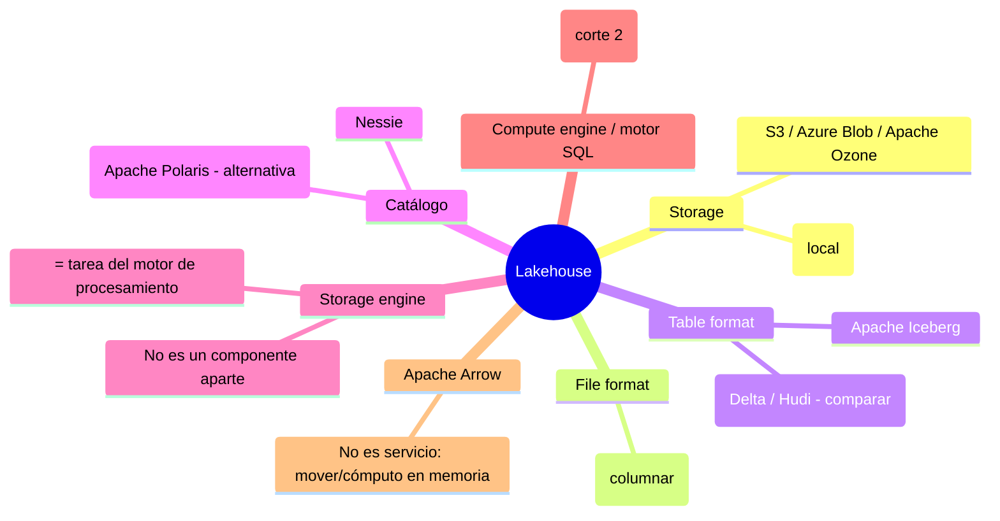

# Apuntes — Semana 3 (19 de Agosto de 2026)

---

## 1. Resumen de la clase (cronología verificada)

| Franja | Qué pasó |
| ------ | -------- |
| 00:00–00:10 | Clase **post-terremoto** (semanas del 10–16 de agosto). El profe abre con un momento humano: cuenta que vive en Palmira y también le tocó salir corriendo de la casa; dice que sigue "desconectado / en estado de alerta" y que sentirse sin energía o triste es normal en una situación así. Invita a escribirle directa o a Sandra si alguien tiene una necesidad emocional o logística. Hace **llamado a lista** ("más que asistencia, saber que están bien"): al inicio estaban 25 de ustedes (faltaban 5), luego se confirman **2 ausentes** — Juan Felipe Castellanos y Juan Esteban Viera — ambos como **problemas de internet** (nota de terceros). |
| 00:11–00:14 | **Cambios de calendario por la U** ("se ha corrido una semana de clases"): hoy = **clase 3**; semana próxima (semana 4) = clase normal + **socialización del proyecto**; semana 5 (cae entre el 31 ago y el 5 sep, como el 2–3 de septiembre) = **parcial 1** (teórico, primera mitad) + revisión de avances del proyecto (segunda mitad); **semana 7 = presentación del proyecto** → desde la próxima semana quedan ~**15 días** para desarrollarlo. Los "exámenes de validación" no aplican al curso; la reunión de la U es para los padres. |
| 00:14–00:15 | **Datos del proyecto (~2 GB: dataset de Stack Overflow POST 2020)**: el profe pasa el enlace; no los sube al campus "para no saturar" el curso. Recomienda descargarlos ya. |
| 00:15–00:20 | Pregunta por el reto anterior y entra en materia: **"esta es de las clases más importantes a nivel de componentes"**: se van a ver los componentes de un lakehouse a fondo. "Si no lo entienden hoy es normal; síganlo repasando, estos conceptos son los básicos del curso" (los usará todos los días, también en pruebas técnicas). Recuerda que al inicio de la **semana 1 pasó un libro sobre Iceberg** y que el primer corte = formatos/almacenamiento/movimiento de datos; el segundo = procesamiento y consulta. |
| 00:20–00:27 | **Storage**: los almacenamientos de **objetos ganaron la carrera** (S3/Azure…); el curso usa **MinIO** en local; aviso: la versión open source de MinIO quedó **fuera de mantenimiento** (proyecto "archived"; actualmente el proyecto de pago se llama **Live Store**); alternativas: **Apache Ozone** (totalmente open source) o **almacenamiento pagado en S3**. |
| 00:27–00:29 | **Storage engine**: en el lakehouse **no es un componente aparte**: es una tarea del **motor de procesamiento** (Spark, motor SQL o hasta Python) que organiza los datos según el table format. |
| 00:29–00:33 | **File format**: qué es, por qué importa (costos, tiempos de lectura/escritura, demanda de cómputo), beneficios, limitaciones, seguridad y rendimiento. |
| 00:33–00:48 | **Parquet a fondo**: columnar, open source, **autodescriptivo** (datos + metadatos); ejemplo filas vs columnas (promedio de edades); compresión **por columna** (dictionary encoding, bit packing, RLE, snappy); row groups (tabla de 1000 columnas, consulta un subconjunto); casos de uso; comparaciones de tamaño (dos tablas, ver [[#7.2 Compresión: "la diferencia de tamaño es absurda"]]); Parquet Viewer nativo de Windows (se murió con el parquet de 2 GB); **Pandas no da** para volúmenes grandes (caso de 4 GB → 100 MB; 40 millones de registros). |
| 00:48–01:03 | **Table format**: la capa de metadatos que convierte varios parquet en **una tabla** (DML + transacciones ACID); carpeta `data/` + carpeta `metadata/` (JSONs); sabe **cuáles parquet representan la última versión**; **Hive = primer table format** (2009, Facebook; directorio = tabla, particiones, Hive Metastore; beneficios y limitaciones); table formats modernos (Iceberg, Delta, Hudi). |
| 01:03–01:07 | Pausa corta de un compañero ("un momento del baño"); el profe interroga dudas. |
| 01:07–01:29 | **Apache Iceberg**: nace en **2017** en **Netflix** (Ryan Blue y Daniel Weeks, según la diapositiva); 2018 → Apache Software Foundation (Apple, Dremio, AWS, Tencent, LinkedIn, Stripe…); **no es** storage engine, execution engine ni servicio: es **formato de tabla + APIs**; arquitectura en árbol (metadata file → manifest list → manifest files → data files); capa de datos agnóstica (Parquet/ORC/Avro); requisito del catálogo (puntero atómico); **Iceberg vs Delta vs Hive ACID**; funcionalidades: **ACID, evolución de particiones, particionamiento oculto, COW/MOR, time travel, rollback, schema evolution**. |
| 01:29–01:48 | **Receso** (el profe lo anuncia en 01:29:29: "retomamos a las 8 y 20") → se retoma en 01:47:37. |
| 01:48–02:00 | **Catálogo**: definición, analogía "dirección de la casa"; qué contiene; cómo lo usa el motor SQL; **Project Nessie** ("git para datos") y **Apache Polaris**; estructuras anidadas (catálogo → namespace → subnamespace → tablas). |
| 02:00–02:09 | **Apache Arrow**: columnares + cómputo en memoria; analogía "euro + fronteras abiertas"; rendimiento (10–100×; PySpark +53× IBM; 4 GB/s C++; 10 GB/s Pandas); record batches → poca RAM; múltiples lenguajes; **Dremio/Trino** por debajo y el paradigma **zero-ETL**; "es la antesala de la ingesta (dlt) de la próxima clase". |
| 02:09–02:12 | Q&A: **"¿Arrow reemplaza a Pandas o va dentro de Pandas?" → "las dos"** (reemplaza cuando Pandas no da; o DataFrame de Arrow visto/manipulado desde Pandas). Recap de los componentes que se usan: MinIO + Parquet + Iceberg + Nessie (+ Arrow para mover). |
| 02:12–02:32 | **Demo**: compose del campus ("carpeta clase") con **3 servicios** (Nessie + MinIO + Jupyter) + notebook (tutorial de Dremio, de **Alex Merced**); pasos: catálogo externo Nessie → namespace `demo` → tabla sencilla → append con **PyArrow** → scan `.to_arrow()` → `.to_pandas()` → `head()`; lectura/escritura en **MinIO** con `pyarrow.fs`; **parquet de 2 GB (Stack Overflow)** → tabla Iceberg `post2020` (muchos parquet pequeños comprimidos + metadata JSON); el **kernel de Jupyter se reinicia 2 veces** al mandar datos a Pandas de una vez; 4 304 021 registros; equivalencia bronze → silver/gold. |
| 02:32–02:35 | **Reto de la semana**: agregar **Nessie** al compose propio (MinIO + ClickHouse + Jupyter + Nessie = 4 servicios) y ejecutar el paso a paso del notebook (más el segundo script de parquet, con el catálogo por defecto de Iceberg). "Con eso tienen la mitad del proyecto asegurado". |
| 02:35–02:39 | **Tarea del corte (individual): INFOGRAFÍA** (temas, requisitos, rúbrica; ==sin imágenes generadas por IA==: "el que me pase una imagen generada, cero"; se verá fácil). |
| 02:39–02:40 | Cierre: entrega de la infografía por **campus**, "les dejo hasta **el otro viernes a las 12**" (el profe la habilita y dice que si no, la habilita mañana; todavía debe subir las diapositivas). Recuerda que se puede escribir al profe o a Sandra. |

> [!important] Tareas y fechas (reorganización post-terremoto)
> - ==**Reto Semana 3:** agregar **Nessie** al compose que ya tienen (MinIO + ClickHouse + Jupyter ya instalados) y ejecutar el paso a paso del notebook del campus (pyiceberg + pyarrow): crear catálogo + namespace + tabla Iceberg con el parquet de 2 GB.== "Con eso tienen la **mitad del proyecto** asegurada".
> - ==**TAREA DEL CORTE (INDIVIDUAL): INFOGRAFÍA** — temas: data warehouse, data lake, data lakehouse, storage / storage engine, table format, file format, catálogo. Debe incluir: concepto desarrollado con **tus propias palabras**, **cómo se relacionan**, **la diferencia entre los tres**, **un caso real** y **5+ referencias**. Herramienta sugerida: **Canva**. ==**NO usar imágenes generadas por IA** ("el que me pase una imagen generada, cero")==. Entrega por ==**campus, hasta el otro viernes a las 12:00**== (ver nota[^1]). Rúbrica publicada en el campus: "si cumplen con todo esto, tienen 5".==
> - ==**Parcial 1** (teórico, solo el corte 1): semana 5, el 2–3 de septiembre, en la primera mitad de la clase.== La segunda mitad se usa para revisar avances del proyecto.
> - ==**Socialización del proyecto del corte:** semana 4 (próxima clase, = clase normal + práctica pequeña); **presentación: semana 7** → ~**15 días** completos desde la socialización.==
> - **Datos del proyecto (~2 GB, Stack Overflow POST 2020)**: el profe pasa el enlace (no los sube al campus por el peso).

> [!note] Fuentes de estos apuntes
> - **Transcripción** — [[Big Data/Apuntes/Recursos/Semana 03/Transcripción - 19 de Agosto]] (fuente principal; 00:00:03–02:40:46).
> - **Diapositivas** — [[Big Data/Apuntes/Recursos/Semana 03/FYHBD - S3.pdf]] (64 páginas, subidas después de la clase según el profe).
> - **Notebook de la práctica** — [[Big Data/Apuntes/Recursos/Semana 03/FYHBD_S3.ipynb]] (script 2: parquet + pyarrow + catálogo por defecto de Iceberg; usa el dataset *pedestrian-counting* del Drive del curso y descarga *yellow_tripdata 2023-01*).
> - **Aplicaciones** — [[Big Data/Apuntes/Recursos/Semana 03/Clase.rar]] (compose con Nessie + MinIO + Jupyter + notebook de la clase).

[^1]: La transcripción dice literalmente "les dejo hasta el otro viernes hasta las 12". Desde el miércoles 19 de agosto, "el otro viernes" apunta al **viernes 28 de agosto de 2026** (el viernes 21 sería "este viernes"); la nota asume esa fecha porque la transcripción no la numera.

### Copia local lista para correr (recomendado)

- ==**`C:\College\Big Data\Semana 3\Clase\`**== con `README.md`, el `docker-compose.yml` de la clase y el notebook. Su entorno con **uv** ya está creado (Python 3.12, pyiceberg[s3fs,hive]==0.9.1 + pyarrow + jupyterlab):
  - Con Docker (como la clase): `docker compose up -d` → Nessie `:19120`, MinIO `:9000`/`:9001`, Jupyter `:8888`.
  - Local: `uv run jupyter lab` y abrir el notebook (recordar: fuera de la red de Docker los endpoints son `localhost`).
- El `.rar` original (fuente del campus) queda en la vault. El `FYHBD_S3.ipynb` de la vault es la copia del campus (script de parquet, no es el notebook del compose).

---

## 2. Cambios de calendario (anuncio formal de la clase)

La U comunicó un **replanteamiento del semestre**: "se ha corrido una semana de clases" (la semana del terremoto no cuenta; la semana del festivo 17 de agosto se vio normal). En términos del curso:

```text
Clase 3  (hoy, 19 ago) → componentes del lakehouse
Clase 4  (vs. próxima, semana 4) → clase normal + práctica pequeña + SOCIALIZACIÓN del proyecto del corte 1
Clase 5  (≈ 2–3 sep, semana 5)  → PARCIAL 1 (teórico, 1.ª mitad) + revisión de avances del proyecto (2.ª mitad)
Clase 7  (semana 7)            → PRESENTACIÓN del proyecto del corte
```

> [!note] Sobre la clase 6
> La transcripción salta de la clase 5 a la clase 7 ("la siguiente semana, que es la semana 7, vamos a presentar el proyecto") sin mencionar la clase 6. No hay que dar la clase 6 por cancelada o existente: es un hueco que el profe no explicó en la grabación. Preguntarle si hace falta clase la semana 6.

- El **parcial es teórico** y solo del corte; **todos los grupos presentan** su proyecto (la dinámica de presentación se verá en la semana 4).
- "Exámenes de validación" (de la diapositiva de la U) **no aplican** al curso ("voy a quitarlo de aquí"); la **reunión con padres** es un comunicado de la U.
- Desde la socialización (clase 4) hasta la presentación (clase 7) hay **~15 días** ("van a tener 15 días hasta la presentación del proyecto... si hiciéramos el lanzamiento una semana después, solo les quedaría una semana").
- Desde la semana 4 ya se puede ir adelantando el proyecto; "esta clase es por el parcial" (la clase 5).
- **Datos del proyecto:** ~**2 GB**; el profe pasa el enlace (el campus no los sube por peso). Es el dataset **Stack Overflow POST 2020** (posts → los "posts" se cargan a ClickHouse también, como veremos).

---

## 3. Los componentes del lakehouse (mapa de la clase)

> [!def] La idea de la clase
> En la clase pasada (BD analítica / Warehouse) vimos: almacenamiento, motor de cómputo, motor de consulta, catálogo, tipo de formato de datos y tipo de formato de tabla. Hoy se aterrizan **dentro del lakehouse** cuáles usamos y para qué. "Con la mezcla de todos estos componentes vamos a poder tener nuestro Lakehouse… ya hoy vamos a poder crear tablas de formato Iceberg."



- El profe: "van a terminar un poco perdidos, puede ser, porque son varias cosas a tener en cuenta… pero estos son los conceptos que tienen que manejar diariamente".
- Los componentes que *usaremos* de aquí en adelante: **MinIO** (storage) + **Parquet** (file format) + **Iceberg** (table format) + **Nessie** (catálogo); **Arrow** como herramienta para mover los datos (por detrás irá **dlt** en la ingesta); el motor de cómputo ya no es un componente aparte en el lakehouse (ver [[#5. Storage engine (la tarea del motor de cómputo)]]).

---

## 4. Storage (almacenamiento de objetos)

- Para grandes volúmenes históricos, el **almacenamiento de objetos ganó la carrera** (antes era Hadoop/HDFS on-premise; con AWS/Azure/Google y S3 el data lake tomó fuerza): sirve para estructurados/semiestructurados/no estructurados, bases orientadas a filas o columnares, y mezclas (diapositiva 5: DAS → HDFS → **object storage** como S3).
- Lo usamos en este curso con **MinIO** (proyecto open source, compatible con la **API S3**: la misma librería `boto3` de Python sirve; "todo está muy hecho para leer datos y hacer integraciones"; por eso aparece en todos los tutoriales de lakehouse).
- Nos interesan sobre todo los **archivos columnares** (comprimen por columna y están optimizados para leer grandes cantidades: "más para leer que para escribir").
- **Aviso del profe sobre MinIO:** para este semestre revisó los temas y encontró que la **versión open source/community de MinIO quedó fuera de mantenimiento** (el repositorio fue archivado por su dueño; el state del proyecto dice "out of maintenance"). Su proyecto comercial se llama **Live Store**: "ya es cobrar por el servicio".
  - Alternativa **100 % open source:** **Apache Ozone** (objeto, escalable; hay que saber desplegarlo "en un entorno distribuido"; "las empresas van a empezar a buscar alternativas").
  - Alternativa práctica "para producción": **pagar S3** ("no es costoso a nivel empresarial; le dejamos el mantenimiento a AWS, que ya tiene todo eso optimizado; y ustedes se encargan del procesamiento").
- "Pueden tener muchas cosas open source desplegadas en sus propios clústeres, pero el almacenamiento guardarlo en S3. Y **no está mal: para eso son las herramientas, para mezclarlas entre sí**."
- Práctico local: la carpeta `data` del compose es el volumen → los datos se conservan en tu PC.

---

## 5. Storage engine (la tarea del motor de cómputo)

> [!def] Storage engine (diapositiva 6 + clase)
> "El motor de almacenamiento es el responsable de **organizar los datos según lo especificado por el formato de tabla** y mantener actualizados los archivos y estructuras de datos" (optimización física, índices, eliminación de datos obsoletos). En sistemas tradicionales va acoplado a la base de datos; en un **lakehouse NO es un componente aparte**: lo asume el **motor de procesamiento/consultas** (Spark, Flink, Trino, Dremio, Snowflake o hasta **Python**).

- En Apache Iceberg, **el almacenamiento (S3/HDFS/ADLS/GCS) no lo hace**: solo guarda archivos; "no entiende de índices, particiones o snapshots". El motor que escribe (Spark/SQL/Python) es quien:
  - escribe los archivos de datos (Parquet, ORC, etc.) según las reglas del table format;
  - mantiene los metadatos (manifiestos, snapshots, esquemas);
  - hace optimizaciones: compactación, limpieza de snapshots obsoletos y la estructura lógica de Iceberg.
- "El almacenamiento físico se limita a guardar los archivos; la **inteligencia de organización la aportan Iceberg + el motor de consultas**" (diapositiva 6).
- El usuario no se preocupa: "cuando uno guarda con Iceberg no tiene que escribir tres archivos más en el pipeline: **eso ya lo hace por debajo el table format**".

---

## 6. File format

> [!def] File format (diapositivas 7–8)
> Formato específico en el que se organizan los datos crudos. "Define la **estructura y el tipo de datos**, así como la forma en que estos pueden ser leídos, escritos y procesados". Influye en la **compresión, la estructura de los datos y el rendimiento de las cargas de trabajo**. "Un file format puede ser un **JPG o un PNG**: depende del tipo de dato".

- Clasificación: **estructurados** (CSV), **semiestructurados** (JSON), **no estructurados** (texto, imágenes); dentro de los estructurados: **orientados a filas** (CSV, Avro) y **columnares** (Parquet, ORC). Los de filas sirven para pocos registros a la vez; los columnares para grandes volúmenes analíticos.
- **Por qué importa** (diapositiva 9): gran almacenamiento de datos = **altos costos**; tiempos largos de lectura/escritura = **sistema lento + alta demanda de cómputo**; alta demanda de cómputo = **incremento de costos**. La optimización del formato reducen los costos operativos.
- **Beneficios** (diapositiva 10): mejora la precisión/calidad de los datos, aumenta accesibilidad e interoperabilidad, incrementa la eficiencia en almacenamiento y recuperación. **Limitaciones:** formatos propietarios (solo los leen sus herramientas) y formatos obsoletos. No todo tiene que ser Parquet: "depende del caso de uso".
- **Seguridad:** los formatos "no proporcionan seguridad de forma inherente"; pueden cifrarse y definirse permisos de archivo en entornos seguros (diapositiva 11).
- En el lakehouse, el formato elegido impacta velocidad de procesamiento y rendimiento general: **Parquet está optimizado para grandes volúmenes** y es el que usaremos ("no vamos a inventar la rueda").

---

## 7. Apache Parquet (el file format del curso)

### 7.1 Por qué Parquet

| Característica | Detalle (diapositiva 12) |
| --- | --- |
| **Columnar** | Los valores de cada columna se guardan juntos, en vez de la fila completa ("1 Marc, Johnson, Washington, 27"). |
| **Código abierto** | Licencia de Apache Hadoop; compatible con la mayoría de marcos de procesamiento ("disponible para cualquier proyecto, modelo o lenguaje"). |
| **Autodescriptivo** | Guarda **datos + metadatos** (esquema, estructura) → facilita que quien escribe, quien almacena y quien lee sean servicios distintos. |

> [!tip] Ejemplo visual (diapositiva 13)
> ![[Big Data/Apuntes/Recursos/Semana 03/FYHBD - S3.pdf#page=13]]
> Para "el promedio de edades": el motor columnar hace la operación **sobre la columna** (pruning: lee solo esa columna); el row-based va registro por registro ("buscar un dato = leer todo el registro"). Con más de un millón de registros, esa diferencia se vuelve enorme.

### 7.2 Compresión: "la diferencia de tamaño es absurda"

- **Compresión por columna** ("se comprime columna por columna, con esquemas de codificación por tipo de dato"). Métodos de la diapositiva 14:
  - **Dictionary encoding:** automático para columnas con pocos valores únicos;
  - **Bit packing:** entero pequeño se guarda con pocos bits (en vez de 32/64);
  - **Run Length Encoding (RLE):** si un valor se repite, se guarda una vez con su número de repeticiones. Parquet alterna **bit packing + RLE** según lo que comprima mejor.
- **Snappy** (el profe lo explica como "coger el parquet y dividirlo en pedacitos ya comprimidos": "se generan más archivos, 10 000 parquetes, pero es parte de la narrativa — cada pedacito viene comprimido"): es el **códice por defecto en Azure Databricks** y ahorra un buen porcentaje sobre Parquet plano (en el ejemplo de la diapositiva: 1.9 GB → 1.5 GB; "son 400 MB que no son despreciables").
- **Números de la clase (dos tablas diferentes, no mezclar):**

  | Fuente | CSV | JSON | Avro | Parquet | Parquet snappy | Parquet gzip |
  | --- | --- | --- | --- | --- | --- | --- |
  | Diapositiva 20 (dataset NYC Parking, FY 2017)[^2] | 6.9 GB | 28.8 GB | — | 1.9 GB | 1.5 GB | 1.1 GB |
  | Tabla en pantalla (profesor, ~500 mil filas)[^3] | (no se alcanza a oír la cifra) | ~35 GB | ~37 GB | ~21 GB | — | — |

  - Caso real del pipeline del profe: unos CSVs de una fuente pesaban **4 GB → ~100 MB** en Parquet ("la capacidad de compresión es absurda").
  - "Hagan la prueba: agarren un dataset pesado de Kaggle y conviértanlo a parquet — lo que ocupa es muy poco."

[^2]: Diapositiva 20: "TAMAÑO DATASET (GB)": CSV 6.9, JSON 28.8, Parquet 1.9, Parquet Snappy 1.5, Parquet GZIP 1.1. Fuente: NYC Parking Violations FY2017 (Kaggle). Puede verse también en la misma comparación citada en la diapositiva 19 (artículo de Medium).
[^3]: El profe leyó una tabla de su pantalla con un archivo de 500 mil filas (JSON 35, Avro 37, Parquet 21 GB). Esos valores **no están en el PDF de 64 diapositivas**; probablemente vienen del artículo de Medium que aparece en la diapositiva 19. Se registran por separado para no confundir las dos comparaciones.

### 7.3 Rendimiento, estructura y evolución

- Los parquet se componen de **row groups** + encabezado/pie con metadatos (diapositiva 15): "si tienes una tabla de 1000 columnas y solo consultas un subconjunto, Parquet carga **solo esas columnas** en memoria; con CSV tendrías que cargar todo el archivo" (más I/O, menos rendimiento).
- **Evolución de esquemas:** se pueden ir agregando columnas; Parquet **fusiona** archivos con esquemas distintos pero compatibles (diapositiva 16).
- **No propietario:** evita vendor lock-in; se lee desde Athena, Qubole, Redshift Spectrum, DuckDB, Spark, Oracle, Snowflake… "cualquier motor ya está optimizado para leer parquet" (diapositiva 16).
- **Casos de uso** (diapositiva 18): 1) grandes volúmenes (SQL sobre Parquet es considerablemente más rápido que Avro/CSV); 2) muchas columnas pero se consulta un subconjunto ("los datos de negocio pasan de 20 a 100 campos"); 3) varios servicios acceden a los mismos datos desde un object storage (separación storage/compute, sin atarse a un proveedor).

> [!warning] Cómo leerlo (y no morir en el intento)
> "Pandas **se queda hasta cierto nivel** para gran cantidad de datos: si le pides el parquet a Pandas de una vez, **se muere el kernel de Python** (pasó 2 veces en vivo en la demo)". Regla del profe: **leer con PyArrow** (`pq.read_table`, o con DuckDB si quieres algo rápido y casual) y recién **convertir a Pandas** para operar con el dataframe. El profe lee sus CSVs de ~4 GB / 40 millones de registros así ("todos esos pipelines tocó hacerlos con Arrow"). El **viewer nativo de Windows** (Parquet Viewer, app de la Microsoft Store, link en la diapositiva 19) sirve para mirar rápido un archivo — "hasta esa herramienta se murió" con el parquet de 2 GB (0:45:09).

---

## 8. Table format (la capa que hace la "magia")

> [!def] Table format (de la clase)
> "El table format es lo que le da la forma lakehouse, desde mi perspectiva": una **capa de metadatos sobre el formato de archivo** que especifica cómo se organizan los archivos de datos en el almacenamiento. "Sin esto podemos tener el object storage, Parquet, motores SQL y Spark, pero **no converge nada**: no podemos consultar los parquet como tablas de un warehouse."

- Con table format, los archivos sueltos soportan **DML** (INSERT, UPDATE, DELETE, MERGE) y **ACID** ("como si fuera un data warehouse, pero guardado en archivos"). El profe lista ACID como "atomicidad, consistencia… durabilidad e inmutabilidad": se ejecutan de forma que "perduran en el tiempo, sean consistentes y se puedan volver a replicar" (la diapositiva 37 lista el aislamiento: "una transacción no afecte a otra").
- **Multi-usuario / multi-herramienta:** varios motores y equipos comparten las mismas tablas (en el lake ya no hay un motor único "cerrado" como en el DW tradicional).
- **Lo importante de cada día:** con un insert diario se generan **nuevos parquet**; el table format hace el seguimiento y sabe **cuáles parquet representan la última versión de la tabla** (y cuáles son históricos). "Es lo más importante: cuáles se van a consultar por el motor SQL".
- **Estructura física de una tabla** (vista en la demo): dentro de la carpeta de la tabla, carpeta `data/` (los parquet) y carpeta `metadata/` (archivos **JSON** que guían: manifiestos, snapshots, esquemas). Dos esquemas/tablas en la misma ruta se agrupan por sus metadatos (diapositiva 25).
- Sin table format habría que procesar todo, interpretar estructuras y combinar la información a mano (diapositiva 24).

### 8.1 Hive, el primer table format (2009)

- Diapositiva 26: "**Hive fue el primer table format**", diseñado para facilitar el análisis en Hadoop con **SQL sobre MapReduce** (en vez de trabajos Java), desarrollado por **Facebook en 2009**. Hive definiría la tabla como **todos los archivos de un directorio** y los **subdirectorios como particiones**; la metadata se registraba en el **Hive Metastore** ("los motores de consulta sabían dónde estaban los datos relevantes").
- **Beneficios** (diapositiva 27): consultas más rápidas con **particiones y bucketing**; soporta varios file formats (Parquet, Avro, CSV); cambios atómicos por partición completa; estándar ampliamente compatible en Hadoop.
- **Limitaciones** (diapositiva 27):
  - cambios solo a nivel de **partición** (no de archivo) → actualizaciones pequeñas difíciles;
  - actualizar varias particiones a la vez **de forma segura: no** (inconsistencias, se pierde el "aislamiento");
  - **no permitía escrituras simultáneas** desde varias herramientas;
  - **listar archivos/directorios tomaba mucho tiempo** en S3 ("si muchos archivos en un prefijo, el almacenamiento se volvía lento");
  - si no se usaban las columnas de partición explícitamente, el rendimiento caía ("full table scan");
  - estadísticas limitadas o inexistentes (difícil planificar consultas).
- "A mayor escala de datos, más notorios y problemáticos se veían estos límites."
- **Formatos modernos** (Iceberg, Delta, Hudi; diapositiva 28): ya no definen la tabla por directorios sino por **una lista precisa de archivos + metadatos** → ACID ("se completan por completo o fallan sin estados intermedios"), **múltiples escrituras seguras** (los cambios de distintos procesos se mantienen consistentes, no se sobrescriben entre sí), **mejores estadísticas y metadatos** (planificación de consultas sin escanear archivos) + time travel e interoperabilidad entre motores.

---

## 9. Apache Iceberg (el table format del curso)

### 9.1 Qué es y de dónde sale

- Diapositiva 29: "Apache Iceberg es un formato de tabla creado en **2017 por Ryan Blue y Daniel Weeks de Netflix**" para superar problemas de **rendimiento, consistencia** y las limitaciones de Hive. En **2018** pasó a la **Apache Software Foundation**, donde participan **Apple, Dremio, AWS, Tencent, LinkedIn y Stripe** (entre otros).
- "Cómo nació": Netflix concluyó que muchos problemas de Hive venían de que **"cada tabla se gestiona como un conjunto de directorios y subdirectorios"**, lo que limitaba la granularidad (acceso fino a datos), la consistencia, la concurrencia y las funciones de un warehouse. (El profe incluso corrige la diapositiva: después de decir "cada tabla se gestiona como directorios…", aclara "perdón, **eso es lo que tenía Hive**".)
- **No es** un Storage Engine, ni un Execution Engine, ni un servicio (diapositiva 30): es **un estándar de cómo se organiza el metadata de una tabla en un data lake** + **APIs/librerías** para que los motores trabajen con él (implementaciones con Spark, Flink; en nuestro caso la librería **pyiceberg** en Python). "No es un componente de un contenedor que vayas a desplegar: va por debajo de la ejecución".
- Objetivo: que los motores "adopten el estándar sin modificar el almacenamiento ni reemplazar herramientas" y que los datos se vean como **tablas normales** ("como en un data warehouse"), sin gestionar la capa de almacenamiento.
- "Muchas de estas herramientas nacen dentro de empresas" (Iceberg → Netflix, Airflow → Airbnb) y luego se vuelven open source.

> [!tip] La imagen del iceberg
> "Solo vemos la punta (la tabla), pero debajo está todo el viaje hasta los archivos": el motor SQL (con el catálogo) hace ese viaje por los metadatos para llegar a los datos. En la hermosa infografía de la diapositiva 33 se ven las "core features" que un ingeniero de datos debe poder explicar: ACID, particionamiento oculto, time travel, schema evolution, evolución de particiones y "open & extensible" (neutral al proveedor, funciona con cualquier motor: Spark, Trino, Flink, Snowflake, Dremio, DuckDB, Polars…).

### 9.2 Arquitectura (el árbol de metadatos)

![[Big Data/Apuntes/Recursos/Semana 03/FYHBD - S3.pdf#page=33]]

```text
Catalog (puntero al metadato vigente)
  └── Metadata file            → esquema, columnas, particionamiento, registro de snapshots
        └── Manifest list      → define un snapshot ("versión") y qué manifiestos lo forman (+ estadísticas)
              └── Manifest files → lista de archivos de datos (ruta + metadatos)
                    └── Data files → Parquet / ORC / Avro (las "hojas")
```

- **Manifest file:** "lista de archivos de datos que incluye la ubicación o ruta de cada archivo y los metadatos sobre ellos"; con eso se crean los **planes de ejecución** (qué archivos leer al procesar/insertar).
- **Manifest list:** define **cuál es el snapshot** de la tabla ("muchas versiones… y se va a ver cuál es la última versión de nuestra tabla"). En la ruta de un pipeline diario se va llenando de parquet: esas son las versiones históricas consultables (ej. en Databricks, dentro de Gold/Silver).
- **Metadata file:** "describe el esquema, la columna, la forma en que está particionada (fecha, columna específica) y los registros de los snapshots". **Son archivos tipo JSON** (el profe lo aclara: "para que se lleven una idea antes de ejecutarlos").
- **Catalog:** lleva el registro de la ubicación de la tabla y **apunta al archivo de metadatos vigente** (si hay varios metadatos históricos, el catálogo dice cuál es el actual).
- **Capa de datos** ("las hojas"): Parquet (grandes volúmenes / columnar), **ORC** (también columnar) y **Avro** (para **flujos en tiempo real**); Iceberg es **agnóstico al file format** y suele vivir en HDFS o S3/ADLS/GCS (diapositiva 34).
- El usuario no escribe esos archivos: "Iceberg ya hace la escritura de manifiestos por debajo… cuando guarden el parquet no tienen que escribir también la lista de manifiestos y el metadata: **eso ya queda por defecto**".
- Es el mismo funcionamiento que Delta ("solo que Delta llama a sus metadatos de otra carpeta").

### 9.3 Funcionalidades clave (ejemplos del profe + diapositivas 37–44)

| Funcionalidad | Qué hace | Ejemplo del profe / diapositiva |
| --- | --- | --- |
| **Transacciones ACID** | Atomicidad, consistencia, aislamiento, durabilidad; **concurrencia optimista** (cambios seguros entre procesos; o se confirma completo o falla sin modificaciones parciales). | "Lo mismo que un warehouse, pero sobre archivos parquet". |
| **Evolución de particiones** | Cambiar el particionamiento (mes → **día**) **sin reescribir la tabla**: el particionamiento vive en los **metadatos** ("los datos siguen siendo los mismos"). La diapositiva 38 lo muestra con `booking_table`: los datos previos quedan en particiones mensuales y los nuevos en diarias; el motor genera planes por cada esquema aplicado. | "Antes tocaba reescribir todo". |
| **Particionamiento oculto** | El usuario filtra con el campo natural: `event_timestamp >= DATE_SUB(CURRENT_DATE, INTERVAL 90 DAY)` y el motor aprovecha la partición (transformaciones `bucket`, `truncate`, `year`, `month`, `day`, `hour`) — sin columnas auxiliares (`event_year/month/day`). | "En Hive eso habría sido un *full table scan*" (diapositivas 39–40: en Hive había que crear la columna `day` explícita; Iceberg lee solo las carpetas/partes de fecha). El "interview tip" de la diapositiva 33: explicar esto. |
| **COW / MOR** | *Copy-on-write*: se reescribe el archivo completo con la corrección y se descarta el viejo. *Merge-on-read*: se crea un archivo pequeño con los cambios de filas que se **reconcilia al leer** (parche sobre el original). | Ejemplo: archivo de ventas de enero; se cambia el valor de una compra → COW genera un enero nuevo, MOR un parche. "Flexibilidad para cargas intensivas en updates/deletes" (nunca lo ha necesitado a ese detalle, pero ahí está). |
| **Time travel** | Snapshots **inmutables**; consultar la tabla en un punto del pasado con su rango de caducidad ("no podemos tener toda la historia"). | "Reporte de fin de trimestre **sin duplicar** la tabla" y "**reproducir un modelo de ML** con los clientes de hace un mes (si el upsert diario ya cambió sus características)". También recuperar un snapshot si la tabla se sobrescribe a diario. |
| **Rollback** | Revertir la tabla a un snapshot anterior (aislamiento por snapshot; diapositiva 43). | "Si el pipeline de hoy cargó datos malos: rollback y re-ejecutar". |
| **Schema evolution** | `ALTER TABLE` para agregar/eliminar/renombrar columnas o cambiar `int → long` sin reescribir datos (la diapositiva 44 pone el ejemplo del rango). | "A nosotros nos tocó: la API empezó a entregar columnas nuevas → un `ALTER TABLE ADD COLUMN` + el pipeline normal. No fue nada difícil". |

> [!note] Otros detalles que dijo el profe
> En un trabajo con Delta (Databricks) le ha tocado "dos o tres veces" ir a buscar las versiones de la tabla para reconstruir información histórica: la facilidad de versionar es lo agradecido. Aprovechó también para recordar el caso de su empresa: tienen tablas **Delta** y consultan con **herramientas open source** "sin prender el clúster de Databricks"; con Iceberg pasa similar, y Databricks ya permite **guardar/leer en Iceberg** (no solo Delta): "el formato abierto es la libertad".

### 9.4 Catálogos de Iceberg y comparativa con Delta/Hive

- Requisito de un catálogo Iceberg: **soportar operaciones atómicas al actualizar el puntero del archivo de metadatos** (todos los lectores/escritores ven una vista consistente; diapositiva 35). Ejemplos:
  - **Amazon S3** (modo Hadoop catalog): archivo `version-hint.text` dentro del directorio de metadatos con el número de versión vigente;
  - **Hive Metastore**: propiedad `location` → apunta al archivo de metadatos activo;
  - **Project Nessie**: campo `metadataLocation` con la ubicación del metadata actual.
- Comparativa (diapositiva 36):

| | Iceberg | Delta Lake | Hive ACID |
| --- | --- | --- | --- |
| Quién lo maneja | Apache Foundation (Netflix, Apple y comunidad) | **Databricks** | Cloudera + Hive |
| File formats | Parquet, ORC, Avro (agnóstico) | Parquet | Solo ORC |
| Transaccional | Sí | Sí | Sí |
| Motor específico | **No: cualquiera** | Sí (solo Spark puede actualizar) | Sí (solo Hive) |
| Open source total | ==**Sí**== | **No del todo** (rendimiento y cloud no son OSS; escrituras solo vía Spark) | Sí pero atado a su motor/proveedor |
| Estado | ==**Estándar de industria ("ya lo ganó")**== | Muy usado en Databricks | Legado |

---

## 10. Catálogo de datos

> [!def] Catálogo (de la clase)
> "El catálogo es la **dirección**: si quiero llegar a la casa de alguien (la tabla), uso la dirección (catálogo); dentro de la casa, la habitación (la ruta que da el table format) y ahí está la persona (los archivos parquet)". En lenguaje técnico: centraliza **ubicación física, metadatos estructurales (columnas, tipos, particiones), versiones del esquema, estado actual, historial de cambios y permisos**; es lo primero que consultan los motores (Spark, Flink, Dremio, Trino) para saber dónde está la tabla.

- ¿Para qué? "En sistemas como **S3/HDFS no puedes preguntar '¿dónde está esta tabla?'** sin un sistema que gestione ubicaciones, versiones y metadatos" (diapositiva 46).
- **Cómo se usa en la práctica** (diapositiva 47, en orden): 1) el motor consulta primero el **catálogo** → la última versión del archivo de metadatos; 2) ese metadata le dice **dónde están los archivos de datos** (Parquet/ORC/Avro); 3) el motor carga/solo los archivos necesarios para la consulta.
- **Tipos:** catálogos **internos** (solo con su motor: Postgres, Snowflake) y **abiertos/externos** (Hive, **Project Nessie**, AWS Glue, **Apache Polaris**). **No confundir** con catálogos de **descubrimiento para humanos**: Collibra, Atlan, o el catálogo interno de Dremio Software (diapositiva 45).
- "El concepto de catálogo lo tenían los data warehouses normalmente; como componente del lakehouse nace desde Hive y desde **Project Nessie**, y ahora Apache Polaris."

### 10.1 Project Nessie: "git para datos"

> [!def] Nessie (diapositiva 48 + clase)
> "Sistema de **control de versiones para catálogos de datos**, similar a un **Git aplicado al manejo de datos**": permite ramificar (branch), etiquetar (tags) y hacer commits sobre catálogos de datos como Iceberg, tratando los cambios como transacciones. Gestión del catálogo **auditable y reversible**, colaboración entre equipos, gobernanza y seguridad.

- **Nessie Catalog**: mantiene la **posición actual** del archivo de metadatos de tus tablas Iceberg; guarda historial de commits del catálogo (ramas, tags, merges); permite consultas en **múltiples tablas** (publicar varias juntas); rollback del catálogo; **soporte para clones sin copia** ("copias de tablas sin duplicar la información": para probar sobre un reporte o datos sin tocar la productiva).
- Compatible con **Spark, Flink, Presto, Trino**; open source y autogestionado; **separa la gestión de metadatos del almacenamiento** (HDFS/nube). El profe: "me gusta porque uno puede sacar una rama `develop` de la tabla productiva, cambiar cosas y luego hacer `merge`… se puede tener la tabla productiva y unas tablas de desarrollo".
- **En el curso:** catálogo del lakehouse (y principal del compose). ==**Importante: en el compose está EN MEMORIA**==: "si ustedes reinician el servicio, se borran los datos y las rutas — para el proyecto tienen que averiguar cómo dejarlo **persistente**".
- Estructura lógica: catálogo → **namespace** → subnamespaces anidados → tablas Iceberg. En la demo: `demo.post2020`; en la arquitectura medallón podrían ser `silver` / `gold` (o por aplicación: `crm.ventas`, `crm.tickets`). "A veces solo se necesita un nivel; el anidado es flexibilidad" (no hace falta `SELECT * FROM cat.esquema.sub.tabla` a menos que se usen varios niveles).
- Link de la diapositiva 48: https://www.dremio.com/open-source/nessie/

### 10.2 Apache Polaris (la alternativa)

> [!def] Apache Polaris (diapositivas 50–54)
> **Apache Polaris (Incubating)** es una implementación de **catálogo para tablas Iceberg** construida sobre el **protocolo REST** de Iceberg, open source: acceso centralizado y seguro de lectura/escritura para motores compatibles con REST (Spark, Trino, Snowflake, Dremio, PyIceberg…).

- El profe: "cuando lo empecé a ver el año pasado estaba en desarrollo; **ya lo lanzaron** y también se puede usar; ya está funcional y se empieza a usar a nivel productivo… pero **vamos a usar Nessie** (la diferencia es que Nessie tiene las capacidades de versiones y se puede desplegar como servicio)".
- Conceptos: catálogos **internos** (los gestiona Polaris, lectura/escritura) o **externos** (Snowflake, Glue, Dremio Arctic: solo lectura dentro de Polaris); **namespaces anidados** ("se crean para agrupar lógicamente las tablas dentro de un catálogo"; la jerarquía del catálogo debe coincidir con la de directorios para que los permisos apliquen); **configuración de almacenamiento** (S3/Azure/GCS con IAM, "relación de confianza entre el proveedor y el catálogo"; *credential vending*) y **permisos** (role-based access control).
- "Se los dejo para que lo investiguen… pero en el curso usaremos Nessie."

---

## 11. Apache Arrow: dónde entra (y por qué se habló hoy)

> [!def] Apache Arrow (diapositiva 55)
> "Combina los beneficios de las estructuras de datos en **formato columna** con el **cómputo en memoria**": una representación de datos **estándar** en memoria con la que cualquier motor puede trabajar, de código abierto, sin copiar ni serializar/deserializar entre sistemas.

- **Analogía del euro** (diapositiva 56): "viajar por Europa **antes** de la Unión Europea: en cada frontera te pierdes el pasaporte y el cambio de divisas; así es mover datos sin Arrow (serializar/deserializar cada vez, copiar, gastar memoria y CPU)". Con Arrow: "viajar por Europa después del euro y eliminación de fronteras: no esperas en la aduana y usas la misma moneda en todos lados".
- Arrow **no es** un motor de almacenamiento ni de ejecución: es la **base compartida** entre motores SQL (Drill, Impala), análisis (Pandas, Spark), streaming (Kafka, Storm) y almacenamiento (Parquet, Kudu, Cassandra, HBase).
- **Rendimiento** (diapositivas 58–59): las optimizaciones vienen de **localidad de caché**, **pipeline** moderno e **instrucciones SIMD** ("muchas operaciones en un solo ciclo de reloj"). Resultado: **entre 10 y 100 veces más rendimiento**, con ejemplos: **PySpark +53×** con Arrow (medido por IBM), **Parquet + C++ a 4 GB/s**, **Pandas hasta 10 GB/s** de lectura. Además: compartir datos **sin copiar** (memoria compartida) elimina costos de serialización.
- **Memoria** (diapositiva 60): funciona con los datos ya "en memoria representados en formato columna" y en **record batches de 64 KB a 1 MB** con hasta 2^16 registros → "cómputo en memoria incluso con **poca RAM**"; en clúster usa scatter/gather + RDMA.
- **Múltiples lenguajes:** C, C++, Java, JavaScript, Go, Python, Rust, Ruby.
- **Uso en el curso** (lo que el profe quiere que quede claro):
  - **Leer/mover datos grandes**: `pq.read_table` (o DuckDB) con PyArrow, y recién ahí `to_pandas()` para manipular "como estábamos acostumbrados". Es el patrón de la demo.
  - La **librería de ingesta de la próxima clase (dlt) usa Arrow por debajo**: "por eso lo quise mencionar, es la antesala de la ingesta".
  - **Dremio/Trino** lo usan por debajo: conectan fuentes distintas (parquet, CSV, bases de datos), **carguen en memoria** y hagan cruces/consultas → **"zero-ETL"**: validar hipótesis o probar si una tabla sirve **antes** de montar la ETL consolidada ("si esta tabla me conviene, hago el ETL con los tres consolidados; si no, ni lo hago"). Antes para ese cruce había que hacer **tres ETLs** (una por fuente) para consolidar las tablas en el warehouse.
  - **Caso real (de otro estudiante):** el semestre pasado se le moría el kernel en Databricks moviendo datos con Pandas: "proba con Arrow para mover esa información… y sí se marcó la diferencia".

> [!question]- Q&A de la clase (02:09:56): ¿Arrow reemplaza a Pandas o se pone dentro de Pandas?
> **"Las dos."** 1) Arrow **reemplaza** a Pandas cuando Pandas ya no funciona para grandes cantidades (mueves la información con Arrow, con dataframes de Arrow); 2) o puedes tener el dataframe Arrow y **convertirlo en dataframe de Pandas**: "la memoria queda representada en Arrow pero se accede a través de Pandas" (Pandas queda como capa superior; sus tipos conservan, mientras pasen a Spark hay tipos que "medio se enredan a ratos, pero es por practicidad").

---

## 12. La práctica (primer lakehouse en miniatura)

**Compose del campus (carpeta `clase`): 3 servicios — Nessie + MinIO + Jupyter** con el notebook de la clase (tomado de un tutorial de Dremio; el profe lo eligió por práctico: "uno de los que más ha escrito sobre Iceberg y arquitectura Lakehouse, **Alex Merced**, trabaja en Dremio"). El notebook viene con una imagen de Jupyter más optimizada; en el curso también está el **notebook con PySpark** → "mejor usen ese (el de PySpark), les va a servir también para el segundo corte".

**Paso a paso del notebook (lo que se probó en clase):**

1. **Instalar** `pyiceberg` + `pyarrow`… en el compose de uno: **en `requirements`** ("la idea no es quemar librerías a la libre en el notebook: así ustedes lo abren y solo hacen imports").
2. **Conectar al catálogo externo (Nessie)**: se pasa la URL del servicio (el catálogo "por defecto" de Iceberg funciona sin Nessie — ese es el segundo script del campus).
3. `create_namespace('demo')` (luego serían `silver`/`gold`) y **crear una tabla sencilla** con un esquema.
4. **Load/append con PyArrow**: "leamos los datos, los tengamos en un dataframe de tipo PyArrow y guardemos" (equivalente a lo que se hace con Pandas, pero con Arrow).
5. Escanear la tabla (`table.scan().to_arrow()`) y **convertir a Pandas** para `head()`: "usamos las mismas capacidades de Pandas" (la tabla pequeña quedó en ~**930 bytes**, nada).
6. **Lectura/escritura directa en MinIO con PyArrow** (`pyarrow.fs`: file system MinIO, credenciales, bucket y path): en el script estaba también leer un parquet grande de la fuente ("un parquet de 20 GB; se demoraba como 10 minutos, lo maté" — para que sepan que desde Arrow cuando es grande también cuesta, o leer el de la fuente, q también puede tardar).
7. **Inferir el esquema del parquet** (leyendo los metadatos del Parquet: filas, tipos de datos de las columnas — "eso es lo que hace el parquet") y crearlo como **tabla Iceberg** (`post2020` en el namespace `demo`), sin escribir el esquema a mano.
8. **El parquet de 2 GB (Stack Overflow):** al guardarlo como tabla quedó **particionado y comprimido en muchos parquet pequeños** + su carpeta `metadata/` (JSON) en el bucket de MinIO. "Aquí quedó dentro de demo, como si esto fuera nuestro silver/gold… aquí hay muchos más parquet: ese parquet pesaba 2 GB y acá se guarda comprimido en todos estos archivos" (la tabla tiene **4 304 021 registros**).
9. **Experimento clave — el kernel se muere:** al hacer `scan().to_pandas()` sobre la tabla completa (o dos tareas a la vez: "justo le pedí dos aplicaciones al mismo tiempo") el **kernel de Jupyter se reinició, dos veces en vivo** ("justamente lo que les decía: directo a Pandas, kernel caído"). La prueba la volvió a hacer `arrow → to_pandas → head`. Regla: con 2 GB/4 M de registros, se lee en Arrow y se convierte después.
10. **Equivalencia con la arquitectura medallón (adelanto):** "el parquet que estaba en `sample/` sería nuestro **bronze** (archivo crudo, un solo parquet); al guardarlo como tabla Iceberg queda en **silver/gold** (múltiples parquetes particionados y comprimidos + metadata)". Los metadatos son el "viaje" que verán en el proyecto; en la ruta se guarda dividida por directorio "para no generar enredos".
11. **Segundo script del campus** ("para que jueguen con PyArrow"): leer un parquet del campus (el notebook [[Big Data/Apuntes/Recursos/Semana 03/FYHBD_S3.ipynb]]: parquet *pedestrian-counting* del Drive del curso + descarga *yellow_tripdata 2023-01*), convertirlo a Pandas, y con **un catálogo `sql` local por defecto** (SQLite) crear la tabla Iceberg y escanearla — **sin Nessie** ("aquí no estamos usando catálogo externo").

> [!note] Spoiler del profe
> "Si quisiéramos, desplegaríamos un **Dremio** como motor SQL y consultaríamos esta tabla sin necesidad de hacerlo desde Python… pero al motor SQL toca configurarle las rutas, el catálogo y ya — **eso lo haremos en el segundo corte**." (Con Spark "es mucho más sencillo: en la sesión de Spark defines catálogo y ruta, y Spark se encarga de todo — ese es el componente de storage engine que vimos.")

---

## 13. Reto y tarea de la semana

> [!important] El reto (para la próxima clase)
> 1. ==**Agregar Nessie al compose** que ya tienen (con Jupyter, MinIO, ClickHouse y su Postgres opcional; los otros composes sirven de referencia: "el Postgres no es tan necesario").==
> 2. ==**Ejecutar el paso a paso del notebook del campus** (catálogo Nessie, namespace, tabla Iceberg, append con PyArrow, lectura arrow → pandas, parquet 2 GB).==
> 3. ==**Ejecutar el segundo script del campus** (pyarrow + parquet, con el catálogo por defecto de Iceberg, sin Nessie).==
> 4. "Con MinIO + ClickHouse + Jupyter + **Nessie** ya tienen **la mitad del proyecto asegurado**: el proyecto es un pipeline con **dlt** que mueve datos entre esos servicios."
> 5. **Pista del profe:** averiguar la **persistencia de Nessie** (en el compose está **en memoria**; si reinicias el contenedor se pierden las tablas/rutas).
> 6. "Asegúrenlo **este fin de semana**: la próxima clase es la ingesta (una librería de Python, nada de servicios nuevos)."

> [!important] Tarea del corte (individual)
> **Infografía** sobre: **data warehouse, data lake, data lakehouse, storage / storage engine, table format, file format y catálogo**.
> - Debe incluir: concepto desarrollado con **tus propias palabras**, **cómo se relacionan**, la **diferencia entre los tres (DW/DL/DLH)**, un **caso real**, y **5 o más referencias** (de dónde se sacó la información).
> - Herramienta: **Canva** (u otra similar). ==**NO usar imágenes generadas por IA**: "el que me pase una imagen generada por IA, cero"== — el proceso de armar la infografía ES la forma de aprender ("así se llevan el proceso mental de aprendizaje").
> - Entrega: ==**campus, hasta el otro viernes a las 12:00**==.[^1] La entrega se habilita en el campus (el profe dijo que la habilita ese día de la clase o al día siguiente). "Y pues es individual."
> - **Rúbrica** en el campus: los temas, cómo se relacionan, el caso real, explicar con tus propias palabras, y las referencias — "si cumplen con todo esto, tienen 5".

---

## 14. Recursos de la semana

### Recursos clasificados (carpeta `Big Data/Apuntes/Recursos/Semana 03`)

- [[Big Data/Apuntes/Recursos/Semana 03/Transcripción - 19 de Agosto]] — transcripción completa (fuente principal; 02:40:46).
- [[Big Data/Apuntes/Recursos/Semana 03/FYHBD - S3.pdf]] — diapositivas (64 pág.): componentes, Parquet (comparación filas vs columnas, compresión, tamaños), Hive, Iceberg (árbol, funcionalidades, catálogos, comparativa), Nessie, Polaris y Arrow. El profe las subió después de la clase.
- [[Big Data/Apuntes/Recursos/Semana 03/FYHBD_S3.ipynb]] — notebook 2 (parquet + pyarrow + catálogo por defecto Iceberg/SQLite; datasets *pedestrian-counting* y *yellow_tripdata*).
- [[Big Data/Apuntes/Recursos/Semana 03/Clase.rar]] — compose del campus (Nessie + MinIO + Jupyter) + notebook de la demo (pyiceberg + pyarrow).

### Dónde quedó el parquet de 2 GB y los datasets

- Los datos del **proyecto** (~2 GB, **Stack Overflow POST 2020**) → los descarga Juan Pablo con el link del profe: `C:\College\Big Data\Semana 3\` (**no en la vault**: regla de almacenamiento).
- El parquet ya existente en `C:\College\Big Data\Semana 3\pedestrian-counting-system-monthly-counts-per-hour.parquet` es el del **script 2** (notebook del campus, originalmente en el Drive del curso, ruta `CONTENIDO/Semana 3`), no el del proyecto; sirve para practicar PyArrow/Iceberg.
- En el notebook del campus (Colab) se descarga el *yellow_tripdata 2023-01* (~45 MB) para el ejercicio del catálogo por defecto.

### Enlaces de la clase (reto, diapositivas 62–63)

- **Iceberg en Colab**: compartido en clase (notebook del campus).
- Iceberg + Spark (Tabulario): https://hub.docker.com/r/tabulario/spark-iceberg · Quickstart: https://iceberg.apache.org/spark-quickstart/
- Iceberg + Jupyter + Nessie + MinIO + Arrow (Dremio): https://www.dremio.com/blog/quick-start-with-apache-iceberg-and-apache-polaris-on-your-laptop-quick-setup-notebook-environment/
- PyIceberg (escribir un dataframe PyArrow): https://py.iceberg.apache.org/#write-a-pyarrow-dataframe
- Stack Overflow dataset (ClickHouse): https://clickhouse.com/docs/getting-started/example-datasets/stackoverflow
- Comparación file formats (Medium, Keras): https://medium.com/@aiiaor/which-data-file-format-to-use-csv-json-parquet-avro-orc-e7a9acaaa7df
- Parquet Viewer (App Windows): https://apps.microsoft.com/detail/9n33z6dplr49
- Dataset de la comparación (NYC Parking Tickets, Kaggle): https://www.kaggle.com/datasets/new-york-city/nyc-parking-tickets
- Documentación: https://iceberg.apache.org/ · The Evolution of Apache Iceberg Catalogs (Dremio) · Ultimate Directory of Apache Iceberg Resources (Medium, Alex Merced) · 2025 Guide to Architecting an Iceberg Lakehouse (Medium) · Why Iceberg + Dremio over Azure Synapse/Snowflake (TowardsDev) · 8 Tools for Ingesting Data into Iceberg (Dremio) · Playlist de YouTube (Alex Merced) · Apache Iceberg — An Architectural Look Under the Covers (Dremio) · Nessie: https://www.dremio.com/open-source/nessie/

> [!note] Notas sobre las fuentes
> - El dataset *pedestrian-counting* es del script 2 (notebook del campus); en esta clase los datos del proyecto se anunciaron como Stack Overflow (el cambio a Yellow Trip quedó registrado en la [[Big Data/Apuntes/Apuntes - Semana 05|Semana 5]]).
> - La comparación de tamaños viene en dos tablas distintas: tabla de la diapositiva 20 (6.9 / 28.8 / 1.9 / 1.5 / 1.1 GB, dataset NYC parking) vs. valores que el profe leyó en pantalla para 500 mil filas (JSON 35 / Avro 37 / Parquet 21 GB), que **no están en el PDF** (ver [[#7.2 Compresión: "la diferencia de tamaño es absurda"]]).
> - Nota: en la transcripción el nombre de MinIO aparece como "Minio"/"mini", "Apache Ozone" como "Apache Zone/Ozono" y el dataset *Stack Overflow* como "stark overflow"; se usan los nombres oficiales.

---

## 15. Pendientes y dudas del estudiante

- [ ] **Reto Semana 3:** compose con Nessie (MinIO + ClickHouse + Jupyter + Nessie) + ejecutar los dos scripts del campus (tabla Iceberg con pyarrow; parquet 2 GB). Lo que falta agregar: **Nessie**.
- [ ] **Tarea: infografía** (individual; para ==**viernes 28 de agosto hasta las 12:00 pm**==[^1], estilo Canva, con referencias, sin imágenes de IA).
- [ ] **Socialización del proyecto** → semana 4 (próxima clase, 26 de agosto).
- [ ] **Parcial 1** → semana 5 (≈ **2–3 de septiembre**; teórico, solo corte 1: semana pasada = almacenamiento/arquitecturas; esta semana = componentes).
- [ ] **Presentación del proyecto del corte 1** → semana 7 (**~15 días** desde la socialización).
- [ ] Averiguar **cómo persiste Nessie** (en el compose está en memoria).
- [ ] Dudas propias:
  - ¿Qué pasa en la **semana/clase 6** del calendario (la transcripción salta de la clase 5 a la 7)?
  - ¿La infografía cuenta directamente en la nota del corte o solo como tarea? (El profe: entrega por campus, individual.)
  - ¿"El otro viernes" es el 28 de agosto? (la transcripción solo dice "hasta el otro viernes a las 12").
- [ ] Registrar `pyarrow`/`pyiceberg` en el `requirements.txt` del compose (no `pip` al vivo en el notebook).
