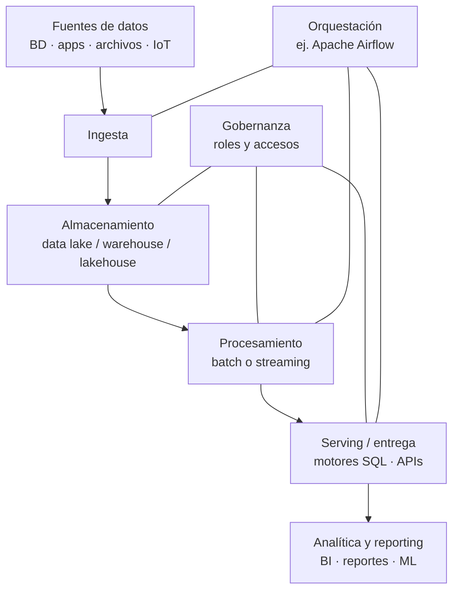
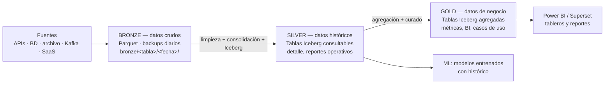

# Apuntes — Semana 4 (26 de Agosto de 2026)

---

## 1. Resumen de la clase

| Hora (aprox.) | Qué pasó |
| ------------- | ---------------------------------------------------------------------------------------------------------------------------------------------------------------------------------------------------------------------------------------------------------------------------------------------------------------------------------------------------------------------------------------------------------------- |
| 00:00–00:01 | Saludo y check-in de los **retos**: el profe pregunta si van al día (nadie ha escrito nada, asume que van bien). |
| 00:00–00:01 | ==**Tarea infografía:** cierra **este viernes 28 de agosto a las 12:00 p. m.**; solo **8 de 30** la han entregado al inicio de la clase.== Pregunta de un estudiante: ¿se sustenta? → **No**, solo entregar el PDF; el profe la revisa: "Estén bien los conceptos, tengan en cuenta la rúbrica que les dejé ahí; expliquen y relacionen los conceptos porque es evolutivo, uno depende del otro". |
| 00:01–00:03 | Recursos de la semana 4 en el campus: diapositivas, recursos y libros; carpeta **"Clase 4"** con los scripts que se van a ejecutar (tema: **ingesta**). |
| 00:02–00:03 | Adelanto: el profe quiere dejar el **tema del proyecto** visto hoy "para que tengan un poco más de contexto" y puedan arrancar desde el fin de semana. Lo hace normalmente una semana antes de la consolidación del proyecto. ==**Parcial dentro de 8 días**== (próxima clase). |
| 00:03–00:03 | **Dinámica de la próxima clase (semana 5):** 1.ª mitad = **parcial teórico**; 2.ª mitad = **trabajo en grupos revisando el avance del proyecto** (el profe pasará por los grupos). La **presentación sería en ~15 días**. |
| 00:03–00:05 | **Pregunta de un estudiante: ¿un Compose por herramienta o varios?** → ==**Un solo Compose que agrupe todas las herramientas.**== Recordatorio de la evolución: clase 1 = solo Jupyter; clase 2 = Jupyter + MinIO; clase 3 = Jupyter + MinIO + Nessie + otros servicios; el proyecto va a dar todos los servicios en un solo compose. |
| 00:05–00:06 | Temas de hoy: 1) **Modern Data Stack** ("lo que estamos trabajando"), 2) **arquitectura Medallón** (cómo distribuir los datos), 3) **ingesta de datos**, con la librería **dlt (Data Load Tool)** de Python, basada en PyArrow. |
| 00:06–00:10 | **Modern Data Stack:** los componentes se centran en la **nube**; todo es más fácil de integrar (**plug-and-play**). Nube (Azure/AWS/GCP): desplegar es sencillo desde consola web pero tiene **costo**; open source "a pie" (manifests Docker/K8s): más control y puede ser más económico; ambos comparten la facilidad de integrar herramientas. En el curso, todo va en **un mismo manifiesto** con herramientas que se anidan y comunican → pipeline de datos. |
| 00:09–00:10 | **Evolución del ecosistema open source:** comunidades gigantes detrás de Apache Iceberg, Spark, etc. Noticia de la vida real: **DuckDB se va a integrar a AWS** (lo respalda la empresa DuckDB Labs); la plataforma **MotherDuck** (el "data warehouse" de DuckDB) nace en ese ecosistema. El profe confiesa ser "medio fan de DuckDB" (lo usó en clase pasada para leer archivos). |
| 00:10–00:15 | **Arquitectura de big data general:** fuentes → ingesta → almacenamiento → procesamiento → entrega/serving → analítica y reporting, con **orquestación** (ej. Airflow) y **gobernanza** (roles/accesos) transversales. El storage puede ser lake, warehouse o lakehouse **dependiendo del componente que uses** (el profe: "puede ser cualquiera"). La **ETL**[^1] aparece en el flujo: fuentes no guardadas + lake + procesamiento → warehouse; o staging → warehouse (arquitectura legacy); o snapshot/backup diario → warehouse; o **lakehouse** (soporta batch **y** streaming, que los warehouse no). |
| 00:15–00:24 | **La "pelea" diaria del rol de datos:** más allá del SQL, toca hacerse **dueños de la información** y entender el **negocio** (ejemplo del profe: **tema de PQRs** → migración de tableros → migración de herramienta → crear la ETL desde cero → agentes de IA y clasificador de PQR con información histórica de clientes). El mismo conocimiento se reutiliza; las tablas históricas bien organizadas son la base de todo (tableros, modelos de churn[^2], agentes). |
| 00:22–00:25 | **Repaso de capas:** fuentes, ingesta, almacenamiento, procesamiento, entrega y analítica/reportes, más orquestación y gobernanza ("quién accede a qué, a nivel de roles"). Cargas de trabajo en **batch** y en **tiempo real** (aunque "a menos que sea realmente necesario" se usa batch; el profe no ha aplicado Flink/Kafka en su trabajo). |
| 00:24–00:28 | **Detalle por capa:** orquestación con Airflow; fuentes de cualquier tipo; **ingesta = el tema de hoy**; procesamiento en batch con **Spark** (en ~2 semanas) y también DuckDB/Python según la capa; **entrega** = motores SQL ("sin ese componente no se accede a nada") y APIs; consultas **exploratorias interactivas** (cruce de información a demanda, sin tablero, para campañas temporales); análisis predictivo y ML. |
| 00:29–00:32 | **Pregunta del profe (más bien dura de la clase):** ¿en qué formato quedan los **backups/ingestas diarias**? → **Parquet** (un estudiante al menos lo dijo). ¿Y las **tablas**? → un estudiante responde "JSON"; el profe corrige: **Iceberg** ("tan paila... es bueno ver los conceptos; si no están practicando, vamos a estar perdidos"; "la IA le soluciona muchas cosas a uno, pero lo que está en la cabeza es lo que más vale"). |
| 00:32–00:35 | **Arquitectura Medallón**: patrón de diseño que organiza **lógicamente** la información dentro del lakehouse. "Manera de mejorar de **manera incremental y progresiva** la estructura y calidad de los datos a medida que fluyen de cada capa". Antes se decía raw/clean (zona sucia, intermedia, limpia); ahora siempre **Bronze → Silver → Gold**. ==**Cada capa es básicamente una carpeta dentro del object storage** (bucket bronce, silver, gold en MinIO).== |
| 00:34–00:47 | **Bronze a fondo:** datos crudos "tal cual" de la fuente, estructura de tabla de origen, columnas adicionales de metadata (fecha/hora de carga, ID del proceso), **CDC** (captura de cambios rápidos), **almacenamiento en frío** (se guarda y no se vuelve a mover): trazabilidad, auditoría, reprocesamiento sin volver a la fuente. **= la capa de backup.** Ejemplo en vivo: API de clientes (JSON) → dataframe → parquet en `bronce/clientes/2026-08-25/...` (se extrae "día vencido" = del día anterior). |
| 00:38–00:47 | **¿Por qué parquet y no JSON en bronce?** Porque es **columnar** (organización por columnas), **comprimen bien** y es un **formato analítico** (lectura rápida de grandes volúmenes). Números de la clase pasada: JSON ~6 GB vs. parquet ~1.6 GB; ejercicio real de 4 GB → ~100 MB. Si la fuente llega XML/JSON/CSV conviene **desanidar de una vez a parquet** en la ingesta ("es un paso menos después"). |
| 00:45–00:47 | **Anécdota del dump:** en su equipo, un pipeline de migración "eliminaba y re-creaba" la tabla productiva cada día; un día la fuente dejó de ser accesible y la tabla resultó borrada. La recuperaron desde la **capa Gold (Iceberg)** (el backup de bronce también servía): "esa es la importancia de tener físicamente nuestras tablas en el lago de datos". |
| 00:47–00:50 | **Silver:** limpieza, conformación y estandarización "lo suficiente" para dar **visión empresarial**; **consolida las extracciones diarias de bronce** → tablas **históricas** (clientes maestros, órdenes, transacciones sin duplicados ni referencias cruzadas); sirven para **reportes operativos** (detalle histórico). |
| 00:48–00:59 | **Formato: parquet es solo para bronce**; Silver y Gold con **Iceberg** (o Delta; el curso usa Iceberg). **Lógicas de guardado** (el profe insiste: es lo más importante de todo): **append** (anexar registros diarios; punto débil: **duplicados** si el proceso se repite o la fuente "cuela" datos de otro día; ejemplo real de 11 tablas JSON diarias en un bucket S3 con fechas corridas → generó duplicados y cuentas que no cuadraban; validar filtro por fecha al ingestar), **upsert/merge** ("observe"[^3]; actualiza el registro por ID si cambió, inserta lo nuevo — ej. PQRs que cambian de estado: abierta → asignada → cerrada), **overwrite** (sobrescribir todo si la fuente ya viene consolidada — ej. una hoja Excel que siempre trae del 1 al último día), **snapshot** (pantallazo diario de estado que cambia — ej. plan del cliente). Concepto de **idempotencia**: ejecutar el mismo proceso dos veces debe dar el mismo resultado sin efectos negativos. |
| 00:59–01:02 | **Iceberg en el storage (MinIO):** tabla Silver → carpeta con **`data/`** (parquets) y **`metadata/`** (archivos JSON de Iceberg) → con el **catálogo** (Nessie) el motor SQL lee la última versión; no se guardan subcarpetas por fecha (salvo **particionamiento** por mes/día — recomendable sobre ~10 millones de registros o mucho volumen por día, sobre todo en históricas). |
| 01:02–01:05 | **ELT (no ETL) en la arquitectura medallón:** "extraemos, **cargamos** y finalmente **transformamos**" (a diferencia del warehouse con ETL + staging). **Dos maneras de hacerlo: (1)** notebook solo de ingesta → guarda bronce; otro notebook de transformación lee de bronce y consolida silver (la idea del proyecto: **un notebook por tarea: bronce, silver, gold**, para saber exactamente qué falló al orquestar con Airflow); **(2)** un solo notebook/ pipeline que extrae, guarda parquet en bronce y de una vez carga en silver (el profe dice que en su día a día usa esta; el error se puede dar "en la mitad del camino" y toca re-ejecutar todo). |
| 01:05–01:10 | **Gold:** capa curada, lista para consumo, específica de proyectos; modelos de datos **Kimball (esquema estrella)** o **Data Marts (Inmon)**; tablas **agregadas**, **optimizadas para lectura**, **desnormalizadas** (menos joins) para conectar a **Power BI** sin cargar millones de registros (ej. cantidad de ventas por departamento/municipio/estrato; cliente por departamento...). **La fuente de gold es Silver** (nunca se lee bronce ni la fuente original). Agregación con **SQL / Spark SQL / Python**. En Gold también se aplican las mismas lógicas: overwrite diario de la tabla de reportes, append de agregados por día, snapshots de métricas. **Gold también es Iceberg** (data + metadata). |
| 01:10–01:15 | **Entre bronce y silver: tratamiento y limpieza** — tipos de datos, organización de columnas (sin espacios, sin mayúsculas raras, sin tildes: `ID cliente` → `id_cliente`; los motores SQL son más rápidos y no se enreda con comillas). **Ejemplo completo (diapositiva):** fuentes = Cloud storage (JSON), Kafka (streaming), Salesforce (CRM, APIs) → bronce (`customers`, `transactions`, `accounts`, `opportunities`, `leads` _raw) → silver (`customers_cleaned`, `transactions_cleaned`, `accounts_cleaned`, cruzada `customer_transactions`...) → gold (`customer_spending`, `account_performance`, `sales_pipeline_summary`, `business_summary`, leads resumidos). **Nivel de agregación y unión flexibles; no siempre se necesita llegar a Gold** (muchas veces la tabla histórica basta). |
| 01:15–01:17 | **Mensaje central: entre cada capa va aumentando la calidad/valor del dato.** Pregunta del profe: ¿de qué capa sacaríamos la información para modelar **ML**? → **Silver** (histórica; los modelos se entrenan con histórico). Gold para tableros. |
| 01:17–01:20 | **Usuarios por capa (gobernanza):** Bronze: ingenieros de datos, operaciones de datos, cumplimiento/auditoría; Silver: ingenieros, analistas, científicos de datos (modelos); Gold: analistas de BI, científicos/ML engineers, ejecutivos y responsables de toma de decisiones (por medio de **herramientas de reportería**, no acceso directo al lago). Cultura del dato: portales de reportería vs. tableros, confianza en el dato, validar con el equipo funcional, dar acceso a las tablas que cada equipo necesita para evitar reprocesos. |
| 01:20–01:24 | **Buenas prácticas (pipeline + error):** aunque la diapositiva (extraída de Microsoft/Databricks) recomienda guardar en "formato de la fuente", el profe la modifica: **guardar parquet si es posible y desanidar de una vez** (menos pasos después, validamos esquema desde la ingesta). ==**Siempre crear, a la par del pipeline diario, un pipeline "en caso de error"**== (reproceso por rango de fechas: recargar lo que falló) + un paso de **validación** de conteos (ej. la fuente tiene 10.000 registros y solo llegaron 8.000 → alzar la mano con tiempo). Las fuentes fallan; la infraestructura (Airflow, la nube) rara vez. |
| 01:25–01:27 | **Buenas prácticas (estructura):** área de staging separada; jerarquía `bronze/{source}/{year}/{month}/{day}/` (el profe prefiere la **fecha completa** `bronze/clientes/2026-08-25/`); limpieza/estandarización en Silver (vistas unificadas: clientes, productos; tablas **desnormalizadas** para reducir joins); Gold enfocada a **casos de uso de negocio** (métricas, consultas rápidas con 2 filtros y listo). |
| 01:27–01:30 | **Buenas prácticas generales:** notebooks para todos los pasos, separar espacios de trabajo por capa; **table format (Iceberg/Delta) en Silver y Gold**; **redundancia de datos** (el costo de almacenar duplicado es menor que el costo de reprocesar); modelo simple `source → stage → curate` (como en dbt). **Ventajas:** desarrollo incremental, progresión lógica, recrear tablas desde crudos (recovery), retención en la nube. **Desventajas:** no reemplaza el modelado dimensional (Kimball/Inmon: es complemento), **triplica el almacenamiento**, a menudo requiere **procesamiento descendente** (reprocesar hacia atrás), equipos con capas separadas pueden ser un problema si los accesos no están bien dados, y **solo aplica a lakehouse** (en un data warehouse no existe arquitectura medallón). |
| 01:30–01:31 | **Pausa hasta las 8:20 p. m.** ("vamos hasta las 8.20 a break"). |
| 01:46–01:48 | Reanudación. **Pregunta del estudiante: Databricks para practicar.** → Opción 1: **Databricks Free** (ambiente limitado, se puede practicar Spark; si quieres guardar los datos usas una cuenta gratuita de AWS para el object storage; pipelines y cacharreo sí se puede); Opción 2 (la del curso, corte 3): desplegar la **arquitectura lakehouse con Databricks desde Azure** con la cuenta de estudiante. |
| 01:49–01:50 | **Ingesta de datos:** definición (espanglish "ingestion" / "ingesta"). Es la que permite **ir a las fuentes y guardarlas en la capa de bronce** del object storage. Puede ser **batch, streaming o híbrida** (capacidad del lakehouse), para datos **estructurados, semiestructurados y no estructurados**. |
| 01:51–01:52 | Ejemplo real del profe: pipeline de **OCR** de los adjuntos de tickets de PQR (los adjuntos son imágenes → OCR → tabla de texto): en bronce quedan las imágenes (backup) y en silver la tabla descriptiva con el texto extraído. |
| 01:52–01:54 | **Herramientas de ingesta:** Apache **NiFi** (similar a **Apache Hop**), **Kafka** (tiempo real), **Databricks** (motor que permite Python para ingesta de cualquier tipo de información), **Airbyte** (fuentes/destinos; se puede desplegar local) y **Fivetran** (herramienta comercial). Capacidades que deben tener: **evolución de esquema, linaje de datos, gestión de errores/retry, escalabilidad, integraciones** (por eso las empresas prefieren herramientas con fuentes predefinidas más que scripts hechos a mano). |
| 01:54–01:58 | **Diferencia ingesta vs ETL:** la ingesta **solo mueve datos de una fuente a un destino** (permite pasos mínimos de transformación, ej. JSON → parquet); la ETL agrega pasos de agregación/consolidación. Usos: además de pipelines, **migraciones** entre aplicaciones. **Beneficios:** insights casi en tiempo real, manejo de volumen, más información para los modelos, **acceso centralizado**. **Desafíos:** consistencia entre fuentes, validaciones, latencia, complejidad de integración (fuentes legacy). |
| 01:58–02:01 | **Buenas prácticas de ingesta:** base sólida + gobernabilidad (monitorear, **retry** con alerta por correo), ingestión **incremental** (solo registros nuevos/actualizados), **linaje**, optimización y escalabilidad planificadas, **calidad y consistencia** (validar conteos: fuente 10.000 → llegaron 8.000). |
| 02:00–02:03 | **¿Dónde se guarda la información durante el movimiento?** → **RAM** (memoria volátil, se libera al terminar; por eso importan las limitaciones del computador). Si los datos son muy grandes: **dividir en lotes** ("dividir y vencerás"): cargar pequeños pedazos a la memoria y moverlos. |
| 02:03–02:07 | **dlt (Data Load Tool):** librería **Python open source** de ingesta y movimiento de datos; se puede correr en cualquier lado (en Databricks hay un choque: Databricks también tiene un producto llamado DLT). No es una herramienta fija, es una **librería** → parametrizas rutas, cargas por lote, creas conectores a demanda. Por debajo usa **Apache Arrow** (movimiento de datos en memoria). Pasos internos: **extract → normalize → load** (ya incluye normalización de esquemas). Acepta JSON, listas, diccionarios, dataframes de pandas y tablas Arrow; **infiere el esquema** automáticamente. |
| 02:05–02:08 | **dlt + DuckDB[^4]:** se puede conectar el pipeline a un DuckDB en memoria (`.db`), cargar ahí, hacer la transformación con DuckDB y volver a usar dlt (u otra librería) para cargar al destino final. "Si es algo local sin tantas capacidades, usamos estas librerías y no nos montamos en una máquina súper poderosa." |
| 02:08–02:11 | **Fuentes, recursos y destinos (conceptos dlt):** **Fuente** = ubicación con los datos (API, hoja de Excel, tabla de BD, archivo, object storage); **Recurso** = agrupación lógica dentro de la fuente (un endpoint de una API, una pestaña de la hoja, una tabla de la BD); **Destino** = donde se cargan (file system/MinIO, DuckDB, Postgres, BigQuery, Snowflake, ClickHouse, MotherDuck, Redshift, Delta Lake...). **< 10.000+ fuentes verificadas** en el hub con su documentación ("optimizada para IA: Codex, Cursor, Claude la entienden rápido"). |
| 02:11–02:12 | **Otros componentes dlt:** **Pipeline** (extraer, normalizar, cargar), **Verified source** (módulos publicados: pruebas, scripts, documentación, revisados por ingenieros), **Esquema** (estructura + instrucciones), **Configuración** (valores de ejecución), **Credenciales/secrets** (secrets fuera del script para no exponer accesos). |
| 02:12–02:13 | **Airbyte:** plataforma open source de integración de datos (600+ conectores, UI + PyAirbyte + API + Terraform, se despliega con `abctl`); el profe dice que cuando lo desplegó local le pareció **enredado y lento** (quemaba el PC), peroundo la parte "puede ser usado, sobre todo el paso a paso está en las diapositivas". **Fivetran** mencionada como referente comercial. **El curso usa dlt.** |
| 02:13–02:19 | **Notebook principal (clase-semana-4.ipynb)** — ejemplos ejecutados/analizados en clase: 1) **API Pokémon** simple: recurso con `@dlt.resource(table_name='pokemon_api')`, `yield response.json()["results"]`, `pipeline.run(get_pokemon)` y `pipeline.dataset().pokemon_api.df()` (por defecto queda en **DuckDB en memoria**; no se definió destino explícito); 2) **API más aterrizada** con `RESTAPIConfig` + paginación (`JSONLinkPaginator`, path `pokemon/ditto`) y `dataset_name="pokemon"`, `dev_mode` para pruebas; 3) **CSV**: `pd.read_csv` desde una URL y `yield` del dataframe; 4) **Parquet remoto** (Yellow Trip ~57 MB) con `fsspec.open` + `pq.read_table` (pyarrow) → `to_pandas()` → `yield` (poco pesado; si fuera grande, el yield en bloques evita caer la memoria). |
| 02:21–02:28 | **Notebook http-to-minio:** objetivo: leer el parquet remoto y guardarlo en **MinIO** (destination `filesystem`). Clave: `!pip install dlt[filesystem] s3fs adlfs` (librería de dominio para el destino; por eso no hay que definir funciones a mano para fuentes/destinos conocidos). Pipeline `parquet_to_minio` con `loader_file_format="parquet"` y `write_disposition="replace"`, dataset `taxis_parquet`. **Las credenciales (bucket_url + access key) se leen de `.dlt/secrets.toml`** (un bloque por pipeline: `[parquet_to_minio.destination.filesystem]`), con los mismos valores del docker-compose (admin/password/localhost:9000). Resultado en MinIO: bucket `taxis`, dataset `taxis_parquet` con su `data/` + carpeta de **metadatos de dlt** (estado de la ejecución, versión). "No me tengo que preocupar cómo era el esquema de llegada ni de fuente ni de destino". |
| 02:28–02:31 | **Notebook minio-to-azure:** leer del bucket de MinIO (fuente `s3://taxis/taxis_parquet/df_data`, glob `*.parquet`, con `readers().read_parquet()`, se puede renombrar la tabla con `.with_name()`) y guardar en **Azure Data Lake (ADLS)** (`abfss://clase-4-dlt@fhbd.dfs.core.windows.net/`). Esta vez las rutas van quemadas en el código (más trazabilidad) pero también se pudieron dejar en secrets; los secrets de fuente y destino están en el `.dlt/secrets.toml` (MinIO admin/password + Azure **account key**). No se pudo mostrar el portal Azure: se acabó la **suscripción de prueba** del profe (piensa renovarla o crear otra cuenta). |
| 02:31–02:36 | ==**Reto de la semana:** ejecutar/replicar los pipelines de dlt desde el contenedor de **Jupyter** (no local).== Requisitos: agregar dlt y las librerías al **requirements** del contenedor de Jupyter y **montar una ruta de workspace** para que `.dlt/secrets.toml` quede accesible (si no, no se conecta al MinIO). El pipeline más importante: **HTTP/parquet → MinIO** ("si hacen ese, hacen cualquier otro"); el de MinIO → Azure = **pendiente** (el profe confirma este fin de semana si renueva la suscripción o da otros secrets). Ejecutar los notebooks mostrados al inicio también. |
| 02:35–02:36 | ==**El proyecto NO se socializó hoy**== (participación muy baja en la clase). El profe lo deja **escrito** (documento en el campus) y la **socialización será la próxima clase (semana 5 = miércoles 2 de septiembre), después del parcial**. =="El proyecto es unir todos los retos"== (con dlt como única pieza nueva de esta semana) y va a ser **un movimiento de datos entre diferentes fuentes y destinos** que ya deben tener en el Docker. El profe quería dar una semana extra (en otros semestres era una semana para presentar): la **presentación queda en ~15 días desde la socialización** (= semana 7, ~miércoles 16 de septiembre). |
| 02:36–02:37 | Cierre: "aseguren el reto; la otra semana es para unir todo lo que falta"; cualquier duda, preguntar durante la semana. |

> [!important] Tareas y fechas de la semana (esto es lo que el profe dejó)
> - ==**TAREA INDIVIDUAL — INFOGRAFÍA** (del corte): entrega por campus ==**el viernes 28 de agosto de 2026, antes de las 12:00 p. m.**== (el campus figura cierre 23:59). Solo **8 de 30** la habían entregado al inicio de la clase. No se sustenta: solo el PDF. Sí o sí con la **rúbrica** (conceptos bien, relacionados entre sí, porque el contenido es evolutivo). Sin imágenes generadas por IA (regla del enunciado de la semana 3). ==**Consigna completa y rúbrica:** [[Big Data/Trabajos/Corte 1/Tarea 1 - Infografía/Consigna - Tarea 1]]==
> - ==**RETO SEMANA 4:** replicar los pipelines de dlt de la clase desde el contenedor de Docker con **Jupyter + MinIO** (ya desplegados): (1) ingesta desde **API** a un bucket de MinIO; (2) ingesta de **archivos CSV y Parquet**; (3) ingesta desde **bucket de MinIO a Azure** (opcional por ahora: esperar secrets del profe).== Requiere ==**agregar dlt y las librerías al `requirements` del contenedor de Jupyter**== y dejar ==**una ruta de workspace montada para los secrets `.dlt`**== (sin eso no hay conexión al MinIO).
> - ==**PARCIAL 1** (teórico, corte 1): próximo miércoles 2 de septiembre de 2026, **primera media hora/mitad de la clase**.== Después, la misma sesión: **trabajo en grupos** con revisión de avances del proyecto (el profe pasa por los grupos).
> - ==**SOCIALIZACIÓN DEL PROYECTO:** la próxima clase (2 de septiembre), después del parcial** — el documento del proyecto ya está escrito/disponible; **PRESENTACIÓN en ~15 días** (semana 7, ~miércoles 16 de septiembre de 2026).== El proyecto = unir todos los retos (solo falta dlt) + movimiento de datos entre fuentes y destinos en el Docker.
> - **Recordatorio:** el Compose del proyecto debe tener ==**UN SOLO `docker-compose.yml` que agrupe todas las herramientas**== (Jupyter, MinIO, Nessie, ClickHouse + lo que siga).
> - **Pendiente del profe:** confirmar (este fin de semana) la renovación de la suscripción de Azure para los secrets del pipeline MinIO → Azure.

> [!note] Fuentes de estos apuntes
> - **Transcripción** — [[Big Data/Apuntes/Recursos/Semana 04/Transcripción - 26 de Agosto]] (fuente principal: qué dijo el profe y qué pasó).
> - **Diapositivas** — [[Big Data/Apuntes/Recursos/Semana 04/2026-FYHBD - S4.pdf]] (35 páginas: Modern Data Stack, arquitectura de big data, arquitectura Medallón, ingesta de datos, dlt, Airbyte, reto).
> - **Scripts de la clase** — [[Big Data/Apuntes/Recursos/Semana 04/Clase-4-dlt.rar]] (notebook principal de ingesta + 2 notebooks de pipelines con sus `.dlt/secrets.toml`).

---

## 2. Modern Data Stack (la "pila de datos moderna")

> [!def] Modern Data Stack (diapositiva)
> Arquitectura de analítica centrada en el uso de componentes en la nube, **modulares, fáciles de integrar (plug-and-play) y listos para usar**, en lugar de herramientas monolíticas y costosas. Busca arquitecturas de datos más **flexibles y rentables** (menos complejidad, más modularidad). Componentes principales: **canalizaciones de datos, almacenamiento, transformación, gestión y gobernanza de datos, monitoreo, visualización y exploración**, y exploración. Beneficios: **autoservicio** en analítica y canalizaciones, gestión de datos ágil, y herramientas **open source o soluciones propietarias simples con precios transparentes**. La **comunidad** es clave (soluciones que evolucionan con sus usuarios).

- En el contexto del curso: todos los componentes que se vieron en la clase 2 y 3 (formato de datos, almacenamiento, procesamiento, motores SQL, orquestación...) ahora se **despliegan como piezas que se comunican entre sí**, "se anidan" y al final hacen un **pipeline de datos**.
- **Un mismo manifiesto:** en lugar de cada herramienta por su lado, se agregan al mismo `docker-compose.yml` (y en producción sería el mismo patrón con Kubernetes) archivos/servicios que "se hablan" entre ellos.
- **Open source vs. nube** (la disyuntiva que se repite):

| Criterio | Nube (Azure/AWS/GCP) | Open source "a pie" (Docker/K8s) |
| --- | --- | --- |
| Despliegue | Muy sencillo desde consola web (servicio listo en menos de una hora) | Requiere learning curve: manifests de Docker o clusters de Kubernetes |
| Costo | Cobra por uso (DBUs, dólares) | Puede ser más económico, controlas todo (hardware, VPS) |
| Control | Bajo (la plataforma es del proveedor) | **Más control exactamente de lo que desplegando** |
| Integración/mezcla | Fácil entre servicios del mismo proveedor | Libre: motor SQL open source + storage pagado (ej. S3) es combinación común |

> [!tip] La frase del profe
> "La nube es nuestro foco... o con lo que en la industria se está haciendo; todo es más fácil de integrar, **plug and play**". Y en las ofertas laborales es normal que el ingeniero de datos proponga soluciones que **mezclen** open source con pagado según la necesidad del negocio.

> [!note] Evolución: DuckDB → AWS / MotherDuck (lo que va a cambiar el ecosistema)
> en la clase el profe comentó que **DuckDB[^4] ya se va a integrar a AWS**: la empresa que lo respalda (DuckDB Labs) y la tecnología pasan a formar parte de AWS, aunque el **proyecto sigue open source** (por economía de desarrollo). En ese ecosistema nació **MotherDuck** (el "data warehouse" de DuckDB en la nube, probado en la semana 2). El profe: "Estoy como medio fan de DuckDB... me ha facilitado muchos temas... es muy práctico usar para cualquier cosa. Ya lo vimos en la clase pasada para leer archivos; y más adelante también lo usaremos". Es el patrón de la industria: proyectos que nacen open source y luego son **adquiridos** (DocDB Labs → AWS) o se convierten en empresa (MotherDuck).

---

## 3. La arquitectura de big data de referencia (repaso de la clase)



- **Componentes de la diapositiva (9):** orígenes de datos, almacenamiento (lagos de datos), proceso por lotes, ingesta en tiempo real (buffer), procesamiento de flujos, aprendizaje automático, almacén de datos analíticos, análisis e informes, y **orquestación** (todas las tareas coordinan "en el orden correcto, de manera automática y repetible").
- **Componentes en la versión del profe:** **Sources → Ingestion → Storage → Processing → Serving → Analytics and Reporting**, con **Governance** arriba y **Orchestration** abajo. "El mismo con un nombre u otro: Airflow puntualmente" para orquestar. Y el componente de **entrega** es clave: "sin motor SQL no puede uno acceder a nada de los datos".
- **Cargas de trabajo:** por **lotes** (batch), en **tiempo real** (streaming), **exploración interactiva** (búsqueda/cruce de información a demanda) y **análisis predictivo/aprendizaje automático** (modelos sobre el histórico).
- **Clave para elegir arquitectura:** "depende de qué componente usemos" → lake, warehouse o lakehouse. El **warehouse** es batch puro (staging) y no soporta streaming; el **lakehouse** sí soporta ambos ("aquí abajo tenemos el streaming"). "Generalmente —a no ser que sea realmente necesario— no se va a tener procesamiento en tiempo real; siempre batch. No me ha tocado usar temas de tiempo real (Apache Flink o Kafka) en lo que he aplicado."

---

## 4. Arquitectura Medallón (Bronze → Silver → Gold)

> [!def] Arquitectura Medallón (definición de la clase)
> "Es un **patrón de diseño** que nos permite decir cómo se organizará esa información lógicamente dentro del lakehouse. Es una manera de mejorar de manera **incremental y progresiva** la estructura y calidad de los datos a medida que fluyen de cada capa." Antes se usaba "raw/clean" (zona sucia, intermedia, limpia); hoy en la arquitectura medallón siempre se entra por **Bronze, Silver y Gold**. A veces también se le llama arquitectura "multi-hop".

> [!def] En palabras muy simples
> ====**Cada capa es una carpeta dentro del object storage.**== En MinIO: bucket `bronce` (o `bronze`), bucket `silver`, bucket `gold`. Los datos "bajan" por las capas y en cada una ganan calidad y estructura.



### 4.1 Bronze: la capa de backup

- Se almacenan **todos los datos provenientes de fuentes externas**, con la **estructura de la tabla de origen "tal cual"** (las tablas del sistema fuente), más **columnas adicionales** de metadata (fecha/hora de carga, ID del proceso).
- Enfocada en **captura de cambios rápidos (CDC)** y en mantener **un archivo histórico al origen**: trazabilidad, auditoría y **reprocesamiento** sin volver a leer la fuente original.
- **Almacenamiento en frío:** "no se va a estar moviendo ni sobrescribiendo constantemente; una vez se guardan los datos no se hace nada más".
- **Estructura (ejemplo del profe):** `bronce/clientes/2026-08-25/clientes_2026-08-25.parquet` — el profe prefiere la ruta con la **fecha completa**; la diapositiva oficial recomienda `bronze/{source}/{year}/{month}/{day}/`. La fuente se consulta "**día vencido**" (si hoy es 26, se extrae el 25: "¿cómo estaban mis clientes ayer?").
- **¿Por qué parquet?** Columnar + compresión + formato analítico: lectura rápida de grandes volúmenes y mucho menos espacio (JSON 6 GB vs. parquet 1.6 GB del ejercicio; 4 GB → ~100 MB en su caso real). "Un paso menos que tienen que hacer luego para leer los datos."
- **Puedes guardar en el formato original si quieres** (la literatura lo recomienda en algunos casos), "pero si de una vez estamos procesando, desanidemos ese JSON, ese CSV, ese Excel que puede estar en SharePoint, y convertámoslo a parquet y tengamos nuestro backup listo. Nos sale mucho más fácil".

### 4.2 Silver: la capa histórica (limpia y estándar)

- Ahí se **limpian, conforman y estandarizan** "lo suficiente" los datos para la **visión empresarial unificada**: clientes maestros, transacciones no duplicadas, referencias cruzadas, entidades y transacciones clave.
- **Consolida las extracciones diarias de bronce → se convierte en la tabla histórica** (los "pantallazos diarios" de bronce se acumulan).
- **Formato Iceberg** (parquet queda reservado para bronce): tablas consultables desde el motor SQL para **reportes operativos** (detalle histórico) y como fuente para **analistas y científicos de datos** (incluye modelar ML con el histórico).
- **Limpieza importante entre Bronze y Silver:** cambios de **tipos de datos**, estandarización de **columnas** (sin espacios ni mayúsculas mezcladas ni caracteres especiales ni tildes: `ID cliente` → `id_cliente`). "Si uno no lo hace, el motor SQL no encuentra la columna tan rápido, toca ponerle comillas... se vuelve un enredo; es mucho más eficiente y rápido con columnas estándar."
- **Particionamiento:** si la tabla tiene muchos registros (más de ~**10 millones** o mucho volumen por día), se **particiona por mes/día** para que el motor SQL lea solo las carpetas de las fechas consultadas (clase Iceberg de la semana 3).

### 4.3 Gold: la capa de negocio

- Datos **curados, listos para consumo, específicos para proyectos**: modelos de datos tipo **Kimball (esquema estrella)** o **Data Marts (Inmon)**; tablas con **agregaciones**, **optimizadas para lectura**, **desnormalizadas** ("para reducir joins").
- Ejemplo: en vez de cargarle a **Power BI** la tabla de millones de registros, se lleva una tabla agregada: "cantidad de ventas por departamento, por estrato, por municipio"; "cuántos clientes tengo por departamento/municipio/estrato".
- **Su fuente es Silver** ("ya ni siquiera se consulta parquet ni la fuente original"): la agregación se hace con **SQL, Spark SQL** (grandes volúmenes) o Python.
- **Se aplican las mismas lógicas de guardado**: overwrite diario de la tabla de reportes (lo más común), append de agregados por día, o snapshots de métricas diarias. "Lo importante: cómo se optimiza la escritura."
- **También es Iceberg** (data + metadata) y es la capa que se conecta a **tabular/BI** y a ejecutivos (vía herramientas de reportería).

### 4.4 La regla de oro del flujo (fuente de cada capa)

```
La fuente de BRONCE es la fuente original (APIs, apps, archivos, Kafka)
La fuente de SILVER es BRONCE   (los backups diarios de parquet)
La fuente de GOLD   es SILVER   (la tabla histórica limpia)
```

> [!note] Flexibilidad de la arquitectura
> No es obligatorio llegar a Gold: "puede ser que tengan en bronce la tabla histórica y esa es la necesidad del negocio; no necesariamente tienen que llegar hasta Gold. Muchas veces tener la tabla histórica es suficiente." Entre Silver y Gold pueden existir otras tablas históricas intermedias que cruzan fuentes (ej. todas las transacciones por cliente) antes de agregar.

### 4.5 ELT vs ETL en el lakehouse (y cómo se mueve el dato)

- En la arquitectura medallón se hace **ELT**: **extract → load → transform** (extraer, cargar y finalmente transformar), a diferencia del data warehouse tradicional (**ETL**, con transformación en staging y luego se consolida el DW).
- **Dos maneras de implementarlo** (el profe las explicó y ambas son válidas):

| Manera | Flujo | Pro | Contra |
| --- | --- | --- | --- |
| **Separada** (la del proyecto) | Notebook solo de **ingesta** (guarda bronce) + notebook de **transformación** (lee bronce → consolida silver) + notebook para gold | Si algo falla, sabes exactamente qué paso falló; con Airflow se identifica por tarea | Más piezas que conectar |
| **Integrada** | Un solo notebook/pipeline: extrae, guarda parquet en bronce y carga en silver (y listo) | Menos ceremonia; el profe dice que en su día a día usa esta | Si falla "en la mitad del camino", se re-ejecuta todo |

### 4.6 Las lógicas de guardado (append / merge / overwrite / snapshot)

> [!def] ¿Por qué importa tanto?
> "Saber que esa información histórica permanezca todos los días y se guarde correctamente es, digamos, lo más importante." Cada tabla del lakehouse debe decidir su **lógica de escritura** según la naturaleza del dato. El profe dejará una **guía de repaso** en el campus, y ya en el **segundo corte** se aplicarán formalmente (ejercicio con upsert/merge).

| Lógica | Qué hace | Cuándo se usa | Ejemplo |
| --- | --- | --- | --- |
| **Append** | Anexa los bloques diarios (lo registros se van "pegando" a la tabla) | Datos **inmutables** que no se editan: transacciones, ventas, capturas diarias | `INSERT` de 100.000 registros de un día tras otro → consolidado histórico |
| **Upsert / Merge** | Por IDs: inserta lo nuevo y **actualiza** lo que cambió (deja la última versión) | Datos que **cambian con el tiempo** y de los que quieres el histórico | **PQRs**: nace "abierta", cambia de asesor, se cierra; clientes que cambian de plan |
| **Overwrite** | Sobrescribe la tabla completa cada corrida | La **fuente ya viene consolidada** (trae todo el rango completo) | Excel que entrega del día 1 al último día del mes; tabla de reportes Gold que se recalcula cada día |
| **Snapshot** | Pantallazo diario del estado ("así estaban los datos hoy") | Estados que cambian y que sirven como fotografía del día | Cuántos clientes con cada plan al cierre de cada día |

> [!warning] El punto débil del append (historias reales del profe)
> 1. **Duplicados por la fuente:** un proveedor dejaba **11 tablas JSON diarias** en un bucket S3 (con ruta por fecha); el profe usó append "porque son datos de capturas, no cambian". Resultado: llegaban registros de la **madrugada** mezclados entre fechas, hubo duplicados y los reportes no cuadraban. La solución: **filtrar por fecha de creación exacta** en la ingesta (validar que el archivo esté dentro del rango de información) y cambiarlo a lógica upsert. "Me confié que estaban bien y no le hice el filtro."
> 2. **Idempotencia:** si vuelves a ejecutar el proceso el mismo día, el append te vuelve a pegar el mismo bloque de registros ("no tiene control simple... ejecutas el mismo proceso y vuelves a tener los mismos resultados sin cambios negativos"). Por eso la ingestión debe ser **idempotente**.
> 3. Las herramientas operativas/transaccionales a veces se quedan cortas procesando tantos registros y "se les puede ir información" — otra razón para **validar conteos** (fuente 10.000 → llegaron 8.000 = problema).

### 4.7 Quién usa cada capa (gobernanza)

| Capa | qué ocurre | y quién es el usuario previsto |
| --- | --- | --- |
| **Bronze** | Ingesta de datos sin procesar | Ingenieros de datos, operaciones de datos, equipos de cumplimiento y auditoría |
| **Silver** | Limpieza y validación de datos | Ingenieros de datos, analistas de datos (detalle refinado), científicos de datos (modelos, análisis avanzados) |
| **Gold** | Modelado y agregación dimensional | Analistas de negocio/BI, científicos de datos e ingenieros de ML, ejecutivos y responsables de toma de decisiones, equipos operativos (vía reportería) |

> [!tip] La diferencia de valor entre capas (palabras del profe)
> "No quiero decir que Silver no sea calidad, pero es calidad en frente a lo que se entrega. En bronce tenemos un backup; en Silver un histórico que ya da un servicio al negocio; en Gold ya el valor consolidado, la métrica que se entrega de una vez: un `<filtro por fecha + filtro por municipio>` y ya tienes el dato, sin hacer group by ni cruces." ==**Y para ML se extrae de Silver** (histórico), no de Gold ni de Bronce.==

### 4.8 Buenas prácticas de la arquitectura medallón (diapositiva + matices del profe)

**Por capa:**

- **Bronze:** ingesta en formato nativo; área o bucket de **staging separado**; estructura jerárquica `bronze/{source}/{year}/{month}/{day}/` (el profe: "a mí me parece mucho más práctico la fecha completa y listo"); lotes para actualizaciones periódicas y streaming para logs de alta frecuencia.
- **Silver:** control de calidad (limpieza, duplicados, estandarización de formatos de fecha/moneda); **vistas unificadas/clientes-productos** para visión única; tablas **desnormalizadas** para reducir joins.
- **Gold:** enfoque en **casos de uso de negocio** (¿para qué se crea cada tabla?), optimización para rendimiento, mantenerlo limpio y mínimo (solo datos válidos y relevantes, sin ruido, mejorando usabilidad).

**Generales:**

- **Estrategia basada en metadatos** (automatizar la gestión de tablas; "los metadatos son datos sobre tus datos: nombres de columnas, tipos, cuándo se creó la tabla, quién la actualizó").
- **Separar espacios de trabajo por capa** (Bronze/Silver/Gold → control de accesos y despliegues: notebooks por capa).
- **Adoptar table format (Delta o Iceberg) en Silver y Gold** (ACID, versionado, consultas eficientes).
- **Considerar redundancia de datos:** en un data lake el costo de una redundancia menor es inferior al costo computacional de eliminarla. "Tres capas con información: el almacenamiento se triplica, pero es barato."
- **Modelo de datos simple:** `source → stage → curate` (es lo mismo que Bronze/Silver/Gold; en dbt se llama igual).
- **Progresión lógica + limpieza incremental:** cada capa es descendente de la anterior; permiten **recrear cualquier tabla descendente a partir de fuentes crudas** (tables y modelos recuperables tras un desastre; la nube además retiene unos días lo eliminado entre buckets).

> [!warning] Ventajas y desventajas de la arquitectura medallón
> **Ventajas (de la diapositiva):** modelo de datos simple y familiar (dbt: source → stage → curate); progresión lógica de la limpieza (gold separada de la ingesta cruda); permite **recrear tablas descendentes** desde los crudos (agregar columnas, reconstruir modelos, recuperación tras desastre).
> **Desventajas (de la diapositiva + clase):** **NO reemplaza el modelado dimensional** (Kimball/Inmon: es complemento); **triplica el almacenamiento**; a menudo requiere **procesamiento descendente** (reprocesar hacia atrás/"devolverse para traer información"); si los equipos trabajan por capas separadas sin acceso cruzado a las tablas, se generan reprocesos innecesarios; ==**solo aplica a lakehouse**== (en un data warehouse no hay arquitectura medallón: no hay manera de guardar parquets ni históricos así; ahí se modela dimensional).

> [!tip] El "pipeline en caso de error" (recomendación fuerte del profe)
> ==Aparte del pipeline diario, siemppre creen, a la par, un **pipeline de reprocesamiento** (carga histórica por rango de fechas: "si sé que fallaron estos días, borro/recargo por rango").== Por qué: **las fuentes fallan** ("los errores son de las fuentes"; el ejemplo de los 11 JSON diarios del proveedor; la migración que borraba la tabla...). Con ese segundo pipeline "es la misma lógica diaria pero por rango de tiempo, es mucho más rápido, y de una vez un **pasito de validación** para confirmar que la fuente está mala y alzar la mano con tiempo". En la práctica: "si está fallando un tablero y estamos en reunión, en menos de cinco minutos —o lo que demore el pipeline— ya corregí esa información". Ese es el *know-how*: anticiparse a los errores y controlar las incidencias.

---

## 5. Ingesta de datos

> [!def] ¿Qué es la ingesta de datos? (diapositiva + clase)
> Primer paso en el ciclo de vida de la ingeniería de datos: **recopilar datos de diversas fuentes** (bases de datos, apps SaaS, archivos, APIs, dispositivos IoT) y **consolidarlos en un repositorio centralizado** (data lake, data warehouse o lakehouse) para limpiarlos, unificarlos y usarlos en analítica/BI/IA. Tradicionalmente se hacía con scripts personalizados o frameworks (Apache NiFi, Kafka) o servicios de la nube (AWS Glue, Google Dataflow, Azure Data Factory); hoy también con librerías como dlt.

- **En el contexto del curso:** "la ingesta es la que nos permite **ir a las fuentes de datos y guardarlas en la capa de bronce**" del object storage (nuestro lakehouse). Es la última clase del primer corte.
- **Tipos de ingesta** (diapositiva):

| Tipo | Qué es | Cuándo |
| --- | --- | --- |
| **Batch** (por lotes) | Recopila a intervalos establecidos (programada) | Actualizaciones periódicas; el tiempo real no es esencial. ==El caso del curso: "día vencido".== |
| **Streaming** | Ingesta continua, en tiempo real | Aplicaciones que requieren acceso inmediato (monitoreo IoT) |
| **Híbrida** | Combina batch y streaming | Actualizaciones estáticas + seguimiento dinámico |

- **Tipos de datos ingestados:** **no estructurados** (texto, audio, imagen, video — suelen requerir herramientas especializadas; ej. el OCR de los PQR: imágenes en bronce, texto extraído a silver), **semiestructurados** (JSON, XML; flexibles y evolutivos), **estructurados** (BD, hojas de cálculo).

> [!tip] Diferencia ingesta vs. ETL (concepto clave)
> - **Ingesta:** ======**mover datos de una fuente a un destino**===== (sin transformación mayor; puede incluir pasos mínimos, ej. JSON → parquet). Acceso más rápido a datos crudos.
> - **ETL:** extraer + **transformar** + cargar (agregación, consolidación) → datos preparados y estructurados.
> - **Data pipeline:** la secuencia completa que puede incluir ingesta + ETL + validaciones + ML + streaming. "La ingesta y la ETL **se complementan**: se ingiere al lakehouse y luego la ETL prepara para análisis/reportes."
> - La ingesta también sirve para **migraciones entre aplicaciones** (sacar todo el histórico de una BD y cargarlo en otra).

**Herramientas de ingesta (mencionadas en la clase):**

| Herramienta | Nota de la clase |
| --- | --- |
| **Apache NiFi** | Similar a Apache Hop[^5]; herramientas "de cajita" para mover datos |
| **Kafka** | Ingesta en tiempo real (con Flink para streaming) |
| **Databricks** | El motor permite ingesta con Python de cualquier tipo de información |
| **dlt (Data Load Tool)** | ==**La del curso:** librería Python, flexible, con código== |
| **Airbyte** | Open source, 600+ conectores, UI + PyAirbyte; el profe la desplegó y le pareció enredada y lenta local, pero "tiene su estrategia en la nube y es muy usada" (diapositivas incluyen el paso a paso con `abctl`) |
| **Fivetran** | Herramienta de ingesta comercial (mencionada; la usa Summer.io) |

**Capacidades esenciales de una herramienta de ingesta:** evolución de esquemas automática (cambia la fuente y la herramienta se adapta), **linaje de datos** (rastrear el origen), gestión de errores y monitoreo (retry, alertas), **escalabilidad**, integraciones con muchas fuentes/destinos. ("Con Python con código se puede todo, pero las empresas optan por herramientas porque vienen con fuentes predefinidas y se ejecutan sin problema.")

**Beneficios:** insights en tiempo real casi; escalabilidad; mejora los modelos de IA (más información actualizada); **acceso centralizado** ("todo va a quedar en un mismo estilo, organizado").

**Desafíos:** consistencia entre fuentes (validaciones robustas), **latencia**, **complejidad de integración** (fuentes legacy, formatos dispares). "El mundo de datos está bastante integrado: es complejo no encontrar una integración."

**Buenas prácticas de ingesta (diapositiva):** establecer una base sólida (flujos eficientes, confiables y **gobernables**); automatizar **monitoreo y gestión de errores** (retry: si falla 2–3 veces, correo de alerta); **eficiencia incremental** (solo registros nuevos/actualizados, no volver a cargar lo que ya existe); gobernanza desde el inicio (ej. Unity Catalog; cumplimiento, acceso seguro, **linaje**); optimización continua; planificación estratégica de escalabilidad; **garantizar calidad y consistencia** (verificaciones de validación a lo largo del proceso; "en la fuente hay 10.000 registros y solo llegaron 8.000: ¿qué pasó? ¿dónde está fallando? ¿es lógica del pipeline o la herramienta?"); monitoreo y ajuste continuo.

> [!note] ¿Dónde se mueven los datos mientras se ingieren? (muy importante)
> ==En la **RAM** (memoria volátil)**. Durante la carga de una fuente a otra, los datos se van moviendo por la RAM del computador; al terminar la tarea se libera.== Por eso las limitaciones del PC importan, y si los datos son muy grandes la estrategia es ==**dividir en lotes**== ("dividir y vencerás": cargar pequeños pedazos a la memoria y moverlos; aplica igual para procesar y para guardar). En dlt esto se logra con `yield` en bloques.

---

## 6. dlt — Data Load Tool (la librería de ingesta del curso)

> [!def] dlt (Data Load Tool) — definición (diapositiva + clase)
> **Biblioteca de Python de código abierto** que carga datos desde diversas fuentes (a menudo desordenadas) hacia conjuntos de datos estructurados y en tiempo real. Ofrece interfaz ligera para extraer datos desde **APIs REST, bases de datos SQL, almacenamiento en nube, estructuras de datos de Python**, etc. Está diseñada para ser fácil de usar, flexible y escalable: **infiere esquemas y tipos de datos** (normaliza, maneja estructuras anidadas), **compatible con múltiples destinos**, **despliegue flexible** (cualquier entorno donde corra Python: Airflow, serverless, notebook), y **automatiza el mantenimiento** (cargas incrementales, evolución de esquemas, contratos de esquemas y datos).

- **Estructura interna:** **Extract → Normalize → Load**: extrae la información de la fuente (a disco duro), la **normaliza** (inspecciona los datos, calcula el **esquema compatible con el destino**, ej. detecta columna `id` tipo int y listas anidadas → crea tabla hija `items__nested`), y la **carga** (migraciones de esquema si es necesario; ej. crea un DuckDB local con las 2 tablas descubiertas).
- **¿Cómo funciona en la práctica?** "Con puro código de Python mover datos de un lado a otro. Puedes implementar tus propias fuentes siempre que los datos sean compatibles con dlt: objetos **JSON, listas, diccionarios de Python, dataframes de pandas, tablas Arrow**. dlt infiere el esquema y calcula la estructura para guardarlos en el destino."

```python
import dlt

pipeline = dlt.pipeline(pipeline_name="my_pipeline", destination="duckdb")
pipeline.run(
    [
        {"id": 1},
        {"id": 2},
        {"id": 3, "nested": [{"id": 1}, {"id": 2}]},
    ],
    table_name="items",
)
```

> [!note] Por qué apreciar a dlt (consejos del profe)
> - **Es una librería, no una herramienta "aterrizada"**: puedes parametrizar rutas, cargas por lote, crear conectores a demanda. "Mucho más estructurado que un `requests` + lógica propia" para mover datos.
> - **Utiliza Apache Arrow por debajo** (movimiento de datos en memoria) y varios módulos de fuentes verificadas (10.000+ fuentes en el hub, con documentación optimizada para herramientas de IA: Codex, Cursor, Claude).
> - **Sirve también para transformar:** se puede cargar en un DuckDB de memoria (`.db`), transformar con DuckDB (o con otra librería de transformación) y volver a cargar con dlt. "Si es algo local que no tenga tantas capacidades, usamos estas librerías y no nos montamos en una máquina súper poderosa."
> - **Ojo con Databricks:** Databricks tiene su propio producto llamado **DLT**; para desplegar dlt ahí hay que hacer "una maniobra", pero en el curso local no hay problema.

### 6.1 Fuentes, recursos y destinos (el vocabulario de dlt)

| Concepto | Definición | Ejemplo |
| --- | --- | --- |
| **Fuente (source)** | Ubicación que contiene los datos con una estructura determinada, organizada en uno o más recursos. En la doc es también la función de Python que extrae desde esa ubicación. | PokeAPI; una hoja de cálculo; una BD SQL; un bucket S3/MinIO |
| **Recurso (resource)** | Agrupación lógica de datos dentro de una fuente (misma estructura/origen). En código: las funciones decoradas con `@dlt.resource`. | Un **endpoint** de una API; una **pestaña** de la hoja de cálculo; una **tabla** de la BD |
| **Destino (destination)** | El almacenamiento donde se cargan los datos desde la fuente | DuckDB, **filesystem (MinIO/S3)**, Postgres, BigQuery, Snowflake, Redshift, **Delta Lake**, ClickHouse, MotherDuck... |

> [!tip] Los demás componentes de dlt (diapositiva)
> **Pipeline** (mueve datos fuente → destino con el esquema); **Fuente verificada** (módulo publicado con pruebas, scripts de demo, documentación; revisado por un ingeniero de datos); **Esquema** (describe los datos normalizados y las instrucciones de carga); **Configuración** (valores que se pasan a la ejecución, cambiables para local/producción); **Credenciales/secrets** (subconjunto de la configuración que se mantiene en secreto y no se comparte en texto plano — se gestionan en `.dlt/secrets.toml` para no dejar expuestos los accesos en el notebook).

### 6.2 El notebook principal (clase-semana-4.ipynb)

4 ejemplos de ingesta, todos hacia **DuckDB (memoria) por defecto**:

| # | Fuente | Técnica | Detalle |
| --- | --- | --- | --- |
| 1 | **API Pokémon (simple)** | `@dlt.resource(table_name='pokemon_api')` + `yield response.json()["results"]` | `pipeline.run(get_pokemon)`; luego `pipeline.dataset().pokemon_api.df()` y `df.head()`. Las tablas se ven con `pipeline.dataset().tables`. Se guarda en memoria (DuckDB): "ni siquiera toca decirle el destino por defecto". |
| 2 | **API Pokémon (con paginación)** | `RESTAPIConfig` + `rest_api_source` + `JSONLinkPaginator` | `base_url`, token, path `pokemon/ditto`, params; `destination="duckdb"`, `dataset_name="pokemon"`, `dev_mode=True` para pruebas. "Para APIs más complejas que necesitan parametrización." |
| 3 | **CSV remoto** | recurso que hace `pd.read_csv("https://people.sc.fsu.edu/~jburkardt/data/csv/hw_200.csv")` y `yield sample_df` | Mismo pipeline: `pipeline.dataset().df_data.df()`. "Simulando un endpoint: si la ruta cambia con la fecha, se deja como parámetro y se ejecuta todos los días." |
| 4 | **Parquet remoto (Yellow Trip)** | `fsspec.open(url)` + `pq.read_table(f)` (pyarrow) → `table.to_pandas()` → `yield df` | "57 MB, no pesa nada; si fuera un parquet más pesado, el yield en bloques evita que se caiga la memoria." **Este es el patrón del curso: leer con pyarrow, convertir a pandas, entregar a dlt.** |

### 6.3 Pipeline HTTP → MinIO (http-to-bucket.ipynb)

- Instalar el dominio: `!pip install dlt[filesystem] s3fs adlfs` (cada fuente/destino tiene su librería; "si el parquet estuviera en MinIO o S3, se puede consultar igual pero se enreda un poco más, con esta librería queda optimizado").
- Recurso: igual que el ejemplo 4 (fsspec + pyarrow + pandas + `yield`).
- Pipeline con **destino `filesystem`** (el nombre de dlt para MinIO/S3/ADLS):

```python
pipeline = dlt.pipeline(
    pipeline_name="parquet_to_minio",
    destination="filesystem",
    dataset_name="taxis_parquet",
)

load_info = pipeline.run(my_df, loader_file_format="parquet", write_disposition="replace")
```

- **Las credenciales NO van en el código**: van en `.dlt/secrets.toml`, por pipeline. En la clase los valores son los del docker-compose local (bucket `s3://taxis`, `aws_access_key_id="admin"`, `aws_secret_access_key="password"`, `endpoint_url="http://localhost:9000"`) y para Azure el `account_name` + `account_key` (abfss) en un bloque separado (`[s3_to_adls.destination.filesystem]`).
- Resultado en MinIO: bucket `taxis` → carpeta del dataset `taxis_parquet` → `data/` con el parquet + una **carpeta de metadatos de dlt** (estado de la ejecución, versión de dlt): "+trazabilidad de qué se guardó y cuál fue el estado de la ejecución". "No me tengo que preocupar cómo era el esquema de llegada ni de fuente ni de destino".
- `write_disposition="replace"`: si vuelvo a ejecutar, sobreescribe. **(Para backup diario tocará usar append/las lógicas del lakehouse; con dlt se configura por carga.)**

### 6.4 Pipeline MinIO → Azure (Minio-to-azure.ipynb)

- Lee del **MinIO local** (fuente filesystem: `readers(bucket_url="s3://taxis/taxis_parquet/df_data/", file_glob="*.parquet").read_parquet().with_name("df_parquet")`) y carga al **Azure Data Lake** (`abfss://clase-4-dlt@fhbd.dfs.core.windows.net/`), también con `loader_file_format="parquet"` y `write_disposition="replace"`.
- Las rutas se dejaron **quemadas en el código** ("más trazabilidad"), pero podría dejarlas en los secrets como en el otro notebook; los secrets se separan por fuente (`[s3_to_adls.sources.filesystem]` = MinIO) y por destino (`[s3_to_adls.destination.filesystem]` = Azure).
- En clase no se alcanzó a mostrar el portal de Azure: se acabó **la suscripción de prueba** del profe (el contenedor ya no aparece). ==**El profe confirma este fin de semana si lo renueva o si da otros secrets.**==

### 6.5 ¿Dónde correr los pipelines? (el reto)

> [!important] El camino del reto (según la clase y la diapositiva)
> - ==NO ejecutar dlt local: hay que ejecutarlo **dentro del contenedor de Jupyter**== ("la idea es que ustedes no lo hagan local ni lo tengan que hacer en el proyecto").
> - ==**Agregar al `requirements` del contenedor de Jupyter** (el que se instala al levantar el compose, como en el reto de la semana pasada): dlt y las librerías de dominio (`dlt[filesystem]`, `s3fs`, `adlfs`, pyarrow, fsspec...).==
> - ==**Montar en el compose del Jupyter un volumen de workspace** donde quede la carpeta `.dlt/` (secrets). El profe comparte el chat de ejemplo entre los volúmenes.== "Si no, no van a poder conectarse al MinIO, porque los secrets que definan quedan en esa ruta dentro de Jupyter." (Regla de dlt: la carpeta `.dlt` del proyecto que ejecuta.)
> - Los **puertos/credenciales de MinIO son los del compose estándar** (transparentes); el de **Azure queda pendiente** hasta la confirmación del profe.
> - Los 3 notebooks del campus (principal, HTTP→MinIO, MinIO→Azure) son lo que hay que replicar/ejecutar; el más importante: **HTTP → MinIO**.

---

## 7. El proyecto del corte 1 (lo que se sabe y lo que quedó pendiente)

> [!warning] Lo que se dijo en clase vs. lo que se esperaba
> El profe había adelantado al inicio (00:02:20) que hoy dejaría "adelantado el tema del proyecto... para que tengan contexto y lo puedan empezar a hacer desde este fin de semana". **No alcanzó**: según él, "han estado muy callados" (la participación fue mala) y prefirió dejar la socialización formal para la próxima clase. Dejó el proyecto **por escrito** (documento en el campus). ====**La socialización NO ocurrió en esta clase.**==== Como consecuencia extra: "en otros semestres han tenido básicamente la semana para presentarlo; aquí les traté de dar un poco más de tiempo (15 días)."[^6]

**Lo que sí confirmó en esta clase (y que define el proyecto):**

- ==**El proyecto es unir todos los retos:** Jupyter + MinIO + Nessie (**y los demás servicios del compose**) + la pieza nueva de esta semana (**dlt**).== "Espero que a estas alturas lo único que falta esta semana es que agreguen lo de dlt… porque el proyecto va a ser un movimiento de datos entre diferentes fuentes y destinos que ya tienen que tener en el Docker."
- ==**Un solo `docker-compose.yml` que agrupe TODAS las herramientas**== (respuesta directa a la pregunta del estudiante: "¿un Compose por herramienta?"). Contexto de la evolución: clase 1 = Jupyter; clase 2 = Jupyter + MinIO; clase 3 = Jupyter + MinIO + Nessie (+ ClickHouse/otros); el proyecto se ejecuta con todos los servicios juntos "en un mismo manifiesto, comunicándose entre sí".
- **Tema general:** pipeline/movimiento de datos con **dlt** entre las fuentes y destinos del stack (tal como los 3 notebooks de la clase: HTTP → MinIO, archivos → MinIO, MinIO → Azure; y hacia las tablas Iceberg del lakehouse).
- **Dinámica de la próxima clase (miércoles 2 de septiembre):** 1.ª mitad **parcial teórico**; 2.ª mitad **trabajo en grupos** con el profe pasando por cada grupo a revisar el avance del proyecto y resolver dudas.
- **Fechas:** parcial = **semana 5 (miércoles 2 de septiembre)**; presentación del proyecto = **~15 días desde la socialización** (≈ **semana 7, miércoles 16 de septiembre de 2026**).
- **Método:** "cuando no lo orqueste con Airflow, sepa bien si en algún caso alguna cosa falló en específico" → por eso los notebooks separados por tarea (ingesta/transformación) para el proyecto.

> [!note] Dudas que quedaron abiertas para la socialización del 2 de septiembre
> - Requisitos/completos del proyecto (¿qué exactamente se entrega? ¿entregable escrito + demo?).
> - Criterios de evaluación y porcentaje del corte 1 (la nota de la semana 1: proyecto 15 % + parcial 15 %).
> - Confirmación del dataset (el anunciado desde la semana 2: **Stack Overflow POST 2020 ~2 GB** vía link del campus) y del contexto de negocio.
> - Datos/credenciales para el pipeline MinIO → Azure (suscripción vencida del profe; espera confirmación y/o nuevos secrets).

---

## 8. Recursos de la semana

### Recursos clasificados (carpeta `Big Data/Apuntes/Recursos/Semana 04`)

- [[Big Data/Apuntes/Recursos/Semana 04/Transcripción - 26 de Agosto]] — transcripción completa de la clase (fuente principal: timestamps y todo lo dicho).
- [[Big Data/Apuntes/Recursos/Semana 04/2026-FYHBD - S4.pdf]] — diapositivas de la semana (35 págs.): Modern Data Stack, arquitectura de big data, arquitectura Medallón (definiciones, capas, usuario previsto, buenas prácticas, ventajas/desventajas), ingesta de datos (concepto, tipos, herramientas, beneficios/desafíos), dlt (concepto, cómo funciona, ejemplo, extraer-normalizar-cargar, fuentes/recursos/destinos, pipeline, fuentes verificadas, esquema, config, credenciales), Airbyte y el Reto.
- [[Big Data/Apuntes/Recursos/Semana 04/Clase-4-dlt.rar]] — scripts de la clase (el `.rar` original del campus): notebook principal `clase-semana-4.ipynb` + `http-to-minio/` (`http-to-bucket.ipynb`, `.dlt/secrets.toml`) + `minio-to-azure/` (`Minio-to-azure.ipynb`, `.dlt/secrets.toml`).

> [!warning] Credenciales en los recursos
> Los `.dlt/secrets.toml` de los recursos contienen **credenciales reales del profe** (la `account_key` de Azure). Se conservan sin modificar porque son la fuente del campus, pero **NO copiar/pegar valores a ningún otro documento** (y menos aún a un repo público). Para el reto con sus propias credenciales de Azure se espera la confirmación del profe.

### Enlaces y recursos del profe (de la clase y diapositivas)

- dlt: https://dlthub.com/ · https://dlthub.com/docs (documentación; fuentes y destinos verificados; docs optimizadas para agentes de IA)
- Airbyte: https://airbyte.com/ (instalación local con `abctl`; diapositivas p. 32-33: `abctl version`, `abctl local install`, `abctl local credentials`)
- Libros: el profe conserva los mismos materiales de referencia del curso (Apache Iceberg: The Definitive Guide, Kimball, Inmon...) — ver lista completa en la [[Big Data/Apuntes/Apuntes - Semana 01#Libros y bibliografía|Semana 1]].
- Dataset del proyecto (link del campus, semana 2): Stack Overflow POST ~2 GB (parquet por año, 2020).

### Sobre la copia local (C:\College) — ya creada

> [!note] Copia local lista para correr (misma dinámica que las semanas 2 y 3)
> - ==**`C:\College\Big Data\Semana 4\Clase-4-dlt\`**== con los 3 notebooks + sus `.dlt/secrets.toml`, `README.md` y entorno **uv** ya creado (Python 3.12; dlt 1.30.0, pyarrow 18.1.0, duckdb 1.5.5 — imports verificados):
>   - `uv sync` + `uv run jupyter lab` para abrir los notebooks.
>   - Local, los secrets apuntan a `localhost:9000` → funciona con el MinIO del compose de la semana 3 prendido. Dentro de Docker sería `http://minio:9000`.
>   - El notebook principal no necesita MinIO (carga a DuckDB en memoria).
> - El `.rar` original (fuente del campus) queda en la vault; la carpeta extraída se eliminó de `Recursos/` para no duplicar.

---

## 9. Pendientes y dudas del estudiante

- [ ] **ENTREGAR LA INFOGRAFÍA** (individual): ==**viernes 28 de agosto de 2026, antes de las 12:00 p. m., por el campus**==. PDF, conceptos bien y relacionados, rúbrica, sin imágenes de IA. (El profe recordó: solo 8 de 30 la han entregado.)
- [ ] **Reto Semana 4:** dlt dentro del contenedor de Jupyter (requirements del Jupyter + volumen de workspace para `.dlt/`): (1) API → bucket MinIO; (2) CSV/parquet → bucket MinIO; (3) MinIO → Azure (pendiente de secrets).
- [ ] **Descargar/practicar los pipelines** del `Clase-4-dlt.rar` (verificados los 3 notebooks) y revisar de nuevo el dataset del proyecto (Stack Overflow POST 2020, link de la semana 2).
- [ ] **Estudiar para el parcial del 2 de septiembre** (teórico): modern stack, arquitectura medallón, ingesta/dlt, más las semanas 1–3 (conceptos: lakehouse, Parquet, Iceberg, Nessie, Arrow...). El profe amenazó con preguntar más seguido en clase: "ya lo básico eran las primeras clases".
- [ ] **Preparar borrador del proyecto** para el avance del 2 de septiembre (compose único con todos los servicios; flujo de datos con dlt).
- [x] **Crear la copia local en `C:\College\Big Data\Semana 4\Clase-4-dlt\`** — HECHO: notebooks + secrets + `README.md` + entorno uv creado y verificado (dlt 1.30.0). Falta ejecutar los pipelines (reto) y el de Azure (pendiente secrets).
- [ ] Dudas para el profe:
  - ¿Renovó la suscripción de Azure? ¿Habrá secrets nuevos para el pipeline MinIO → Azure? (prometió confirmar este fin de semana).
  - En la socialización del 2 de septiembre: confirmar criterios del proyecto y si el dataset es definitivamente Stack Overflow POST ~2 GB.
  - ¿La persistencia de Nessie sigue pendiente para el compose del proyecto? (de la semana 3: en el compose está en memoria).
- [ ] **Ojo (señalado en clase):** el profe va a hacer **muchas más preguntas** en clase y aprovechará la tarea para defender el aprendizaje de conceptos ("la IA le soluciona muchas cosas a uno, pero lo que está en la cabeza es lo que más vale en este momento").

[^1]: En la transcripción suena "proceso CTL" y "proceso TGL" según el fragmento; el contexto (extraer → guardar → transformar/consolidar) confirma que el profe se refiere a **ETL/ELT** (ver sección 4.5) y "staging" para el warehouse clásico.
[^2]: "Churn rate": tasa de pérdida de clientes. Modelo que predice si un cliente es propenso a terminar el servicio (ejemplo del compañero de trabajo del profe, que se "pega" a todas las tablas de la arquitectura para extraer información de usuarios).
[^3]: En la transcripción el profe pronuncia "observe" / "observer" / "appende" para referirse a las lógicas de escritura: el concepto correcto es **upsert/merge** (también llamado "upsert" en el curso; en la semana 1 el profe dijo *offset/observer* y el concepto era upsert).
[^4]: En la transcripción suena "DocDB"/"DocDV"/"docdb" en todo el texto. Se trata de **DuckDB** (y por ende DuckDB Labs / MotherDuck), como ya quedó confirmado en semanas anteriores.
[^5]: En la transcripción suena "Apache Hub"; el profe se refiere a **Apache Hop** (otro asistente de integración de datos, antes Kettle/Pentaho Data Integration), mencionado también en las semanas 1 y 2.
[^6]: Contradicción a registrar: el profe mencionó al inicio de la clase la intención de socializar el proyecto hoy y al final la pospuso oficialmente para la próxima clase. En la semana 3 el calendario alternativo indicaba la socialización en la clase 4 (hoy) y la presentación en la semana 7; se conserva la versión real de lo ocurrido (socialización → 2 de septiembre, presentación → ~15 días después).
