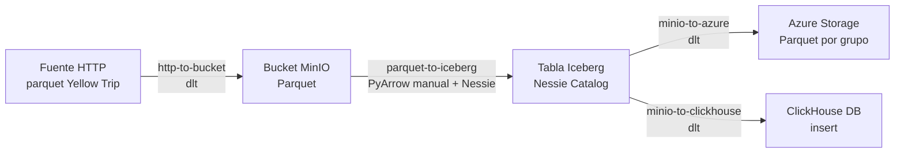

# Apuntes — Semana 5 (2 de Septiembre de 2026)

---

## 1. Resumen cronológico de la clase

> [!note] Cómo leer esta tabla
> Los timestamps son los **marcadores reales de la transcripción** de la grabación (00:00:08–01:28:59, ≈ 1 h 29 min). Sirven para ubicar cada momento en el video, no para calcular la hora del reloj. La dinámica anunciada se cumplió en tres bloques: **parcial (primera mitad)** + **grupos** + **socialización del proyecto con ejemplo en vivo**.

| Franja (en la grabación) | Qué pasó |
| --- | --- |
| 00:00:08–00:02:41 | Apertura: hay 31 asistentes. El profe anuncia la dinámica: **parcial a las 7:00 p. m.** y, al terminar (≈ 7:40), **tema del primer corte: proyecto** — explicación, ejemplo en vivo y **trabajo por grupos** revisando el estado de los retos. Confirma que el parcial ya debe aparecer en el campus (primer corte). Adelanta que **la siguiente clase es la presentación del proyecto**[^1]. |
| 00:02:47–00:03:27 | Reglas finas del parcial: **sí se puede navegar** entre preguntas (dejar una para después y devolverse). **Cámaras encendidas durante todo el parcial, incluso después de terminar.** El profe avisa que él no prenderá la suya por internet lento. |
| 00:03:36–00:08:02 | **Llamado a lista** completo (tres páginas de lista; al inicio faltaban nombres de la tercera página y los completa después). |
| 00:08:02–00:09:40 | Aclaración sobre los **grupos**: el profe se confunde con una lista descargada y confirma que **los grupos NO estaban definidos todavía** — se definen hoy después del parcial, y **el número asignado hoy será el definitivo** en adelante. |
| 00:09:40–00:14:32 | Pausa de ~5 min: estirarse, agua, **prender cámaras** antes de las 7. Consejo de integridad: hacerlo **a conciencia** (aunque tengan "el chayipita de la mano"), porque lo conceptual es lo que queda; el código siempre se resuelve con IA, pero sin base conceptual no se puede aplicar. **Reto/juego**: hacer el parcial con la mano izquierda visible en pantalla (para no tener el Ctrl+Z tan rápido). |
| 00:15:17–00:16:11 | Instrucciones del cuestionario: es un **banco de ~100 preguntas** (casi seguro no se repiten entre estudiantes). Ojo: en algunas el **enunciado trae letras pegadas** y el botón de selección es otro — **vale la selección del cuestionario, no la letra interna**. |
| ~00:15–00:44 | **Parcial en curso.** Incidentes menores: 00:18:18 llama la atención a un estudiante por **leer en voz alta** (parecía dictarle a una IA); 00:20:28 pide cámara a Delgado; 00:25:33–00:31:02 primeras entregas (recuerda **no apagar la cámara** hasta que todos terminen); 00:31:28 confirma que **la nota sale de una vez** en la plataforma; 00:31:55–00:32:35 consejo laboral: acostumbrarse a **prender la cámara** en parciales/presentaciones/trabajo remoto. |
| 00:44:55–00:46:27 | **Fin del parcial.** Balance: "¿fácil, difícil?". Anuncia que **los otros dos parciales no serán tan sencillos** (más preguntas, menos tiempo). Reporta el **promedio del grupo: 4.6**. Pueden apagar cámaras. |
| 00:46:27–00:56:24 | **Conformación de los grupos 1–7 en vivo**: pregunta grupo por grupo, fusiona grupos de 2 personas (no puede haber grupos de dos), reubica a quienes estaban solos. Sube la **foto de los grupos al campus**; todo lo que entreguen en adelante va **bajo ese número** (tarea 2, proyecto 1, tarea 2, proyecto 2, tarea 3, proyecto 3). Habilita **sesiones/breakout rooms 1–7**. |
| 00:56:24–01:11:10 | **Socialización del proyecto del corte 1**: stack a desplegar, los **4 scripts** (fuente→destino de cada uno), dataset (Yellow Trip), **secrets de Azure** (cuenta recuperada: las credenciales compartidas sirven tal cual), las **dos formas** de leer hacia Azure/ClickHouse, persistencia de Nessie, `requirements`, volumen `.dlt`. |
| 01:11:10–01:14:51 | Consideraciones y **entregables** (quita el video de la lista), pantallazos exigidos, librería para verificar la carga en Azure, revisión con **bajada/subida del compose el día de la presentación**. |
| 01:14:51–01:25:24 | **Ejemplo en vivo** con los 4 notebooks (HTTP→bucket, parquet→Iceberg, MinIO→Azure, Iceberg→ClickHouse) + Q&A (¿`.py` o notebook? ¿por qué PyArrow antes de pandas?). Regla de ejecución **el mismo día de la presentación** (cargas con fecha del día). Revisión en vivo + el profe **descarga y ejecuta** cada carpeta. |
| 01:25:24–01:28:59 | Apertura de las **sesiones de grupo** y ayuda a un estudiante a entrar a su sala. **La grabación termina aquí**: el trabajo por grupos con el profe pasando por las salas **no quedó registrado** en la transcripción[^2]. |

> [!important] Tareas, entregas y fechas (lo que dejó esta clase)
> - ==**PROYECTO DEL CORTE 1 — PRESENTACIÓN: la próxima clase (miércoles 9 de septiembre de 2026)**==[^1]: cada grupo muestra los **4 servicios en Docker corriendo**, ejecuta los **4 notebooks en vivo** y entrega una **carpeta comprimida** con todo (ver [[#6. Entregables (qué se entrega exactamente)]]). El profe la **descarga, levanta con `docker compose up` y ejecuta los 4 scripts en Jupyter** por cada grupo.
> - ==**Los 4 scripts DEBEN ejecutarse el mismo día de la presentación** (ej. si la clase es a las 6:30, correrlos tipo 4–5 p. m.)== para que MinIO y Azure muestren **fecha de carga de ese día** — el profe lo revisa.
> - ==**4 notebooks con nombres fijos** (iguales para todos): `http-to-bucket`, `parquet-to-iceberg`, `minio-to-azure`, `minio-to-clickhouse`== (formato **`.ipynb`**, ejecutados **dentro de Jupyter**, nunca local; los `.py` llegan en el corte 2 con Airflow).
> - ==**Compose con los 4 servicios arriba**: Jupyter Notebook + MinIO + Nessie (**persistente**, no en memoria) + ClickHouse.== El día de la presentación el profe **baja y sube los servicios**: si el catálogo se pierde, se pierden puntos.
> - ==**Nada de librerías "quemadas" en los notebooks**: todo en `requirements.txt`.== Y el volumen de `.dlt/secrets.toml` montado en el Jupyter (sin eso ningún script conecta).
> - ==**Calificación por punto: todo o nada**== — si un script no corre, todo lo que depende de él cae; la **rúbrica** la sube el profe al campus después de la clase.
> - **Parcial 1: ya presentado** (promedio 4.6). Advertencia: los parciales 2 y 3 traerán **más preguntas y menos tiempo**.

> [!note] Fuentes de estos apuntes
> - **Transcripción** — [[Big Data/Apuntes/Recursos/Semana 05/Transcripción - 2 de Septiembre]] (fuente principal: 00:00:08–01:28:59).
> - **Diapositivas** — [[Big Data/Apuntes/Recursos/Semana 05/FYHBD - S5.pptx-1.pdf]] (11 págs.: reglas del parcial, componentes del stack, 4 pipelines + diagrama, accesos, consideraciones, ayudas, entregables).

---

## 2. Parcial 1 teórico (primer corte)

### 2.1 Reglas exactas

| Regla | Dato (dicho en clase) |
| --- | --- |
| N.º de preguntas | **25**, conceptuales de lo visto en el primer corte |
| Tiempo por estudiante | **35 minutos** (más de un minuto por pregunta) |
| Ventana de disponibilidad | **40 minutos**: abre **7:00 p. m.**, cierra **7:40 p. m.** (5 min de gabela por si alguien entra tarde) |
| Cámaras | **Encendidas durante todo el parcial, incluso después de terminar** (hasta que acabe el último) |
| Navegación | **Sí se puede**: dejar una pregunta y devolverse después |
| Banco | **~100 preguntas**: casi seguro no le salen repetidas a nadie |
| Trampa de formato | Algunas preguntas traen **letras internas pegadas al enunciado** que no coinciden con los botones: **vale la selección del cuestionario, no la letra interna** |
| Nota | **Sale de una vez** en la plataforma al terminar |

> [!tip] Consejo del profe antes del parcial
> Hacerlo **a conciencia**, como reto personal de qué aprendieron conceptualmente: "el tema del código siempre uno lo soluciona con IA, pero si no saben dónde están parados a nivel conceptual, no pueden aplicar". Y como juego: mantener la **mano izquierda visible** en pantalla durante el examen.

### 2.2 Qué pasó durante el parcial

- **Llamado a lista** previo (00:03:36–00:08:02): 31 presentes; la lista tenía tres páginas y al principio se saltó la última (la completó después).
- Un estudiante **leía en voz alta** y el profe le llamó la atención en vivo (parecía estar dictándole las preguntas a una IA; el estudiante dijo que hablaba con la mamá).
- Recordatorios de **cámaras** a estudiantes puntuales (Delgado, Maya) y orden de **no apagarla** a quienes terminaron primero (desde ~00:30).
- Al cerrar (00:44:55): el grupo lo vio **sencillo**; el profe respondió que los siguientes parciales serán más exigentes (**más preguntas, menos tiempo**, porque notó que responden rápido). **Promedio del grupo: 4.6.** Dudas puntuales de notas, por interno con el profe.

> [!tip] Consejo laboral del profe (00:31:55–00:32:35)
> Acostumbrarse a **prender la cámara** en parciales, presentaciones y trabajo serio: después de la pandemia muchas empresas filtran por eso y solo por no prenderla devuelven gente a presencialidad. En reuniones normales no pasa nada; en cosas serias, sí cuenta.

---

## 3. Conformación definitiva de grupos

- Hasta hoy los grupos **no estaban definidos** (el profe se enredó con una lista descargada y lo aclaró en vivo): se armaron en clase preguntando uno por uno.
- Reglas aplicadas en vivo: **no puede haber grupos de 2 personas** (fusionó los de 2 en un grupo nuevo), reubicó a quienes estaban solos, y el tamaño quedó entre **4 y 6 estudiantes** por grupo[^3].
- Quedaron **7 grupos** (sesiones/breakout rooms 1–7). El profe subió la **foto de los grupos al campus**: esa foto es la fuente oficial de quién quedó con quién[^4].
- ==**Ese número de grupo vale para todo el semestre**: tarea 2, proyecto 1, tarea 2, proyecto 2, tarea 3 y proyecto 3 se entregan bajo ese nombre.==
- Cierre de la grabación (01:25:24–01:28:59): el profe habilita las salas y ayuda a entrar a quienes no podían. El **recorrido del profe por los grupos no quedó en la grabación**[^2].

---

## 4. Proyecto del corte 1 (socialización formal)

> [!def] Qué es el proyecto (diapositiva + clase)
> **Aplicar lo aprendido en el primer corte** desplegando los primeros componentes del data stack y **moviendo datos con dlt entre los servicios**: data lake (**MinIO**), data warehouse (**ClickHouse**), file format (**Parquet**), table format (**Apache Iceberg**), catálogo (**Nessie**) e **ingesta con dlt**. No es un pipeline realista de negocio ("uno no va moviendo y moviendo datos así"), sino la prueba de que **todos los servicios se despliegan juntos y los datos viajan completos** de la fuente al consumo.

### 4.1 Los 4 pipelines exigidos (fuente → destino)

| # | Script (nombre fijo) | Qué hace | Con qué |
| --- | --- | --- | --- |
| 1 | `http-to-bucket` | Lee el **parquet desde la fuente HTTP** y lo guarda en un **bucket de MinIO** en parquet | **dlt** |
| 2 | `parquet-to-iceberg` | Lee ese parquet del bucket y lo guarda en **otro bucket como tabla Iceberg** registrada en el **catálogo Nessie** | **PyArrow + PyIceberg manual (SIN dlt)**[^5] |
| 3 | `minio-to-azure` | Lee la tabla Iceberg y la guarda en **parquet en Azure Blob Storage** (cada grupo en **su propia carpeta**) | **dlt** |
| 4 | `minio-to-clickhouse` | Lee la misma tabla y la **inserta en ClickHouse** | **dlt** (la parte de ClickHouse es la **investigación** del proyecto) |

> [!warning] La regla de integridad del proyecto
> ==**No se debe perder ni un registro** en todo el viaje: fuente → MinIO → Iceberg → ClickHouse.== El conteo de la tabla final debe coincidir con el de la fuente (diapositiva: **3 475 226 registros**; en clase el profe redondea a "como 3 millones"). Verificar con `COUNT` en ClickHouse.

### 4.2 Dataset definitivo y accesos

- **Dataset del proyecto: `yellow_tripdata_2025-01.parquet`** (taxis de Nueva York, enero 2025), servido por **URL HTTP** (CloudFront). **Ya no es Stack Overflow POST**[^6].
- **Destino Azure**: contenedor de la cuenta del profe (cuenta **recuperada**: la suscripción de prueba que estaba vencida en la semana 4 **ya funciona otra vez**, y las credenciales de la diapositiva sirven tal cual). Cada grupo escribe en su carpeta **`GRUPO_X`** (con su número). Detalle exacto de `bucket_url`, `account_name` y ejemplos de `secrets.toml`: diapositiva de accesos (![[Big Data/Apuntes/Recursos/Semana 05/FYHBD - S5.pptx-1.pdf#page=7]]).

> [!warning] Credenciales en los recursos
> La diapositiva de accesos contiene la **`account_key` real de Azure del profe**. Se conserva porque es fuente del campus, pero **NO copiar ese valor a ningún otro documento** (y menos a un repo público). Cada grupo solo cambia `GRUPO_X` por su número al ejecutar.

### 4.3 Las dos formas de leer la tabla (aclaración clave del profe)

Para los scripts 3 y 4 hay **dos opciones válidas**; la primera es la recomendada por sencilla:

1. **Leer la tabla vía el catálogo Nessie** (como en el script de la semana 3: conectarse al catálogo, consultar la tabla Iceberg y mandarla en parquet con dlt). "Yo diría que la primera es más sencilla".
2. **Leer directo la ruta física** donde Nessie guardó la tabla (carpeta `data/` del object storage, el parquet de la tabla Iceberg con la ruta "quemada").

### 4.4 Consejos técnicos dados en vivo (el "oro" de la clase)

- **Nessie persistente (obligatorio, parte de investigación):** el Nessie del compose viene con `store type in memory` por defecto: si bajan el contenedor hoy, **el catálogo se pierde mañana**. Hay que cambiar el parámetro para hacerlo **persistente**. "Realmente no es gran cosa, es poner una cosa en específico". El día de la presentación el profe **baja y sube los servicios**: si se pierde, pierden puntos.
- **Volumen de `.dlt` en el compose de Jupyter (lo más importante de la configuración):** al desplegar el `docker-compose`, definir un **volumen específico** para que la carpeta `.dlt/secrets.toml` creada desde Jupyter quede disponible al ejecutar. **Sin eso ningún script conecta** con MinIO/Azure/ClickHouse.
- **`requirements.txt` completo:** ==ningún notebook con librerías "quemadas"== (`!pip install` dentro del notebook, prohibido). Todo (dlt con sus extras `filesystem`, `s3fs`, `adlfs`, pyarrow, etc.) debe instalarse desde el `requirements` al levantar el contenedor.
- **ClickHouse al cargar:** genera sus **tablas de metadatos** en el esquema `default` (se ven como `default` y tal). Validar con `SHOW TABLES FROM default;` además del `COUNT`.
- **Verificar la carga en Azure sin esperar al sábado a las 12 de la noche:** así como existe `boto3` para MinIO, hay una **librería de Azure** que con el mismo `storage account + key + ruta` confirma si el archivo quedó cargado. Investigarla es parte del proyecto (es "sencillita").
- **Por qué PyArrow antes de pandas (pregunta en vivo):** se guarda primero en memoria con **PyArrow** y luego se convierte a pandas, **por memoria**: pandas solo "no aguanta la presión" con millones de registros (el kernel se cae). Si el parquet es pesado, el `yield` en bloques evita tumbar la RAM.
- **Si falla el script 1**, carguen el parquet **local** para que el 2 funcione; si falla el 2, todo lo demás cae: aseguren cada eslabón antes de la presentación.

> [!question]- Q&A larga: ¿scripts `.py` o notebooks?
> **Pregunta de Nicolás (01:17:11):** ¿los scripts se desarrollan como `.py` o como notebook?
> **Respuesta:** en formato **notebook (`.ipynb`)**, ejecutados en **Jupyter**. Los `.py` llegan en el **segundo corte con Airflow**, cuando ya sean scripts de ingesta orquestados. Por ahora notebooks porque "es lo que realmente uno trabaja" y es más sencillo por partes. Convertir de Jupyter a `.py` después "no es complicado".

> [!question]- Q&A: ¿exposición formal o solo mostrar que funciona?
> **Pregunta de Juan (01:23:28):** ¿hay que hacer exposición o solo mostrar que funciona?
> **Respuesta:** es sencillo: mostrar el **Docker Compose con los 4 servicios**, **ejecutar los 4 scripts** y listo. Revisión en vivo de que todo funciona + entrega de la **carpeta comprimida** (el profe la descarga y la ejecuta él también).

---

## 5. Dinámica de la presentación (próxima clase)

1. Cada grupo muestra el **compose corriendo** (los 4 servicios) y **ejecuta los 4 notebooks en vivo**.
2. Entrega la **carpeta comprimida** con los 4 scripts + `docker-compose.yml` + secrets + documento PDF de pantallazos.
3. El profe, por cada grupo: **descarga la carpeta, levanta todo con `docker compose up` y corre los 4 scripts en Jupyter**. Como ya tiene las imágenes, "sube rapidito".
4. ==**Los 4 scripts deben correrse ese mismo día** (ej. 4–5 p. m. para clase de 6:30)== para que las fechas de carga en MinIO/Azure sean del día; el profe revisa eso en el object storage.
5. **Rúbrica: cada punto es todo o nada** (si el primero no ejecuta, lo de adelante probablemente tampoco). El profe la sube al campus después de esta clase.
6. Así será también el **proyecto 2** (pipeline completo corriendo en clase, explicado por el grupo), con la diferencia de que ahí sí es el pipeline de negocio entero.

---

## 6. Entregables (qué se entrega exactamente)

- **4 scripts** de ingesta y cargue (notebooks `.ipynb` con los nombres fijos).
- **1 `docker-compose.yml`** con los 4 servicios funcionando.
- **1 archivo con los `secrets` de dlt**.
- **1 documento (PDF) con pantallazos** de:
  1. Los **servicios corriendo** en Docker.
  2. Los **dos buckets en MinIO** con sus respectivos parquets cargados.
  3. El **catálogo Nessie con el namespace creado**.
  4. La **consulta con el conteo** de registros en ClickHouse (≈ 3 475 226).
  5. La **consulta de las tablas de metadatos** en ClickHouse (`SHOW TABLES FROM default`).
  6. La **consulta del archivo cargado en Azure** (investigar cómo verificarlo).

Ayudas oficiales (diapositiva): docs de dlt para [filesystem→ClickHouse](https://dlthub.com/docs/pipelines/filesystem-local/load-data-with-python-from-filesystem-local-to-clickhouse), [destino ClickHouse](https://dlthub.com/docs/dlt-ecosystem/destinations/clickhouse), [intro a PyIceberg](https://www.dremio.com/blog/intro-to-pyiceberg/), los **scripts de las clases** y `SHOW TABLES FROM default;`.

> [!note] Consigna oficial del proyecto
> Documento del profe + estado final tras la clase, todo en un solo lugar: [[Big Data/Trabajos/Corte 1/Proyecto 1 - Data Stack/Consigna - Proyecto 1]].

---

## 7. Recursos de la semana

### Recursos clasificados (carpeta `Big Data/Apuntes/Recursos/Semana 05`)

- [[Big Data/Apuntes/Recursos/Semana 05/Transcripción - 2 de Septiembre]] — transcripción completa de la clase (fuente principal: 00:00:08–01:28:59).
- [[Big Data/Apuntes/Recursos/Semana 05/FYHBD - S5.pptx-1.pdf]] — diapositivas de la semana (11 págs.: reglas del parcial, stack del proyecto, 4 pipelines + diagrama, accesos con secrets de Azure, consideraciones, ayudas, entregables con conteo esperado).
  - Diagrama del flujo: ![[Big Data/Apuntes/Recursos/Semana 05/FYHBD - S5.pptx-1.pdf#page=6]]
  - Accesos y secrets: ![[Big Data/Apuntes/Recursos/Semana 05/FYHBD - S5.pptx-1.pdf#page=7]]
  - Entregables y conteo: ![[Big Data/Apuntes/Recursos/Semana 05/FYHBD - S5.pptx-1.pdf#page=10]]

---

## 8. Pendientes y dudas del estudiante

- [ ] **PROYECTO CORTE 1 — PRESENTACIÓN ==miércoles 9 de septiembre==**[^1]: 4 notebooks (nombres fijos) + compose (4 servicios, Nessie persistente) + secrets + PDF de pantallazos; ejecutar todo **ese mismo día** antes de clase.
- [ ] Hacer persistente el **Nessie** en el compose (quitar el in-memory) y probar **bajar/subir** el contenedor sin perder el catálogo.
- [ ] Montar el **volumen `.dlt`** en el servicio de Jupyter y dejar el **`requirements.txt`** completo (sin `!pip install` en notebooks).
- [ ] Investigar el **destino ClickHouse en dlt** (docs de ayudas) y la **librería de verificación de carga en Azure**.
- [ ] Revisar la **rúbrica** cuando el profe la suba al campus (calificación todo o nada por punto).
- [x] Fecha de presentación confirmada: **miércoles 9 de septiembre** (ver [^1]).
- [ ] Dudas para el profe:
  - Confirmar el tamaño esperado de grupos (4–6 vs "máximo cinco", ver [^3]).
  - Foto oficial de los 7 grupos (está en el campus, no en la transcripción, ver [^4]).

[^1]: **Fecha confirmada: miércoles 9 de septiembre de 2026.** En la Semana 4 había quedado ~16 de septiembre (~15 días), pero en esta clase el profe dijo dos veces "la otra semana" (00:02:16 y 01:11:13) y la fecha del 9 quedó confirmada.
[^2]: La dinámica anunciada incluía **trabajo en grupos con el profe pasando por las salas** en la segunda mitad. La grabación **termina justo al abrir las breakout rooms** (01:28:59), así que no hay registro de qué dudas salieron grupo por grupo ni de consejos adicionales. Si el coordinador tiene otra fuente (notas personales, chat), agregarla aquí.
[^3]: En la Semana 1 el rango era **4–6 integrantes**; en esta clase el profe dudó en vivo ("creo que máximo era cinco… 4 y 6 estudiantes"). Se registra el rango operativo visto (grupos de 4–5 tras las fusiones) sin resolver la contradicción.
[^4]: La transcripción con diarización mezcla nombres y apellidos (varios "Juan"), así que **no se reconstruye la lista grupo por grupo desde el texto**: la fuente oficial es la **foto subida al campus** (00:55:09).
[^5]: El profe aclara que dlt **sí podría** guardar en Iceberg pero **solo en la versión paga**, por eso el script 2 se hace manual con PyArrow/PyIceberg. Todo lo demás (puntos 1, 3 y 4) **obligatoriamente con dlt**.
[^6]: **Cambio de dataset (señalado, no oculto):** desde la Semana 2 el proyecto apuntaba a **Stack Overflow POST (~2 GB / hasta 59 M registros)**. En esta socialización el dataset es **`yellow_tripdata_2025-01.parquet` (~3.4 M registros)**. Se registra el vigente sin borrar el historial (ver Semana 4, sección 7).
