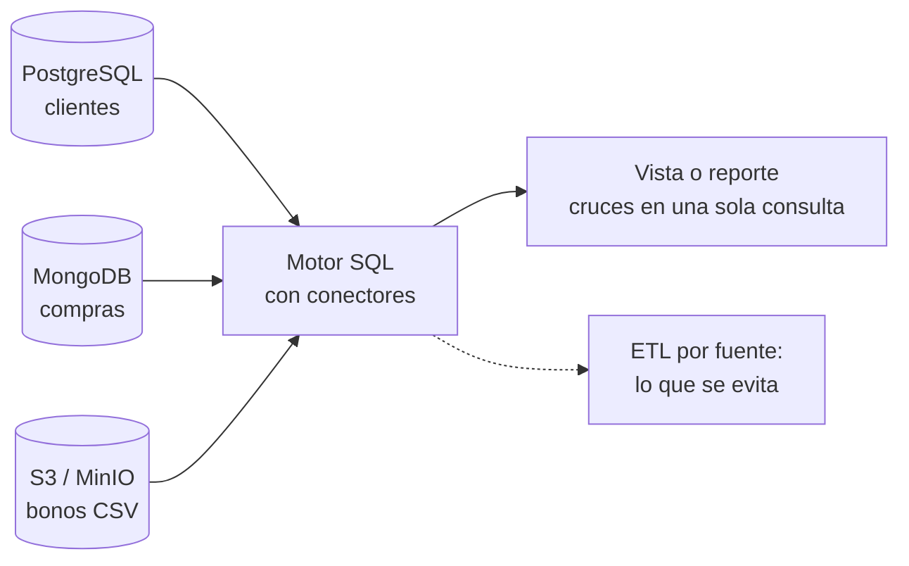
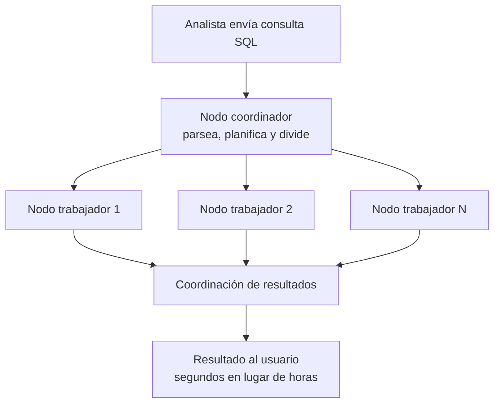

# Apuntes — Semana 7 (16 de Septiembre de 2026)

---

## 1. Resumen cronológico de la clase

> [!note] Cómo leer esta tabla
> Los timestamps son los **marcadores reales de la grabación** (00:00:02–02:44:42, ≈ 2 h 44 min), no la hora del reloj. La clase arranca oficialmente el **corte 2**: primera parte conceptual (motores SQL) y segunda parte práctica (despliegue de Dremio, Trino y DuckDB). Hubo **receso de ~20 min** entre 01:15:19 ("volvemos a las 8:15") y 01:35:22.

| Franja (en la grabación) | Qué pasó |
| --- | --- |
| 00:00:02–00:01:23 | Apertura oficial del **segundo corte**. Recapitulación del corte 1 (almacenamiento, ingesta, contexto histórico y proyecto): "en general todo el mundo le fue bien" y falta terminar de calificar tareas. Aviso de **notas del corte 1**: las pasa primero para revisión y luego las sube a la plataforma ("la otra semana"). |
| 00:01:23–00:03:15 | **Cronograma del corte 2:** hoy motores SQL; siguiente clase **procesamiento batch con Spark**; luego **orquestación con Airflow**; ==semana 10== el **parcial** e inicio del **proyecto grupal**; ==semana 11== presentación de la segunda parte del proyecto. |
| 00:03:15–00:08:12 | Alcance del **segundo proyecto**: a la "semi-arquitectura" del corte 1 (ingesta + almacenamiento) agregarle **cómo consultar** (motores SQL), **cómo procesar** (Spark) y **cómo orquestar** (Airflow), con un pipeline de negocio y la **arquitectura medallón (Bronce → Silver → Gold)**. La **exposición de Airflow (semana 9)** de todos los grupos será la ==nota de la tarea del corte 2==. Agenda del día: **Dremio, Trino y DuckDB** (Firebolt solo de recapitulación; se muestran los porcentajes de evaluación posteriores al corte). |
| 00:08:12–00:10:27 | **Feedback del corte 1:** a los estudiantes les ha gustado la materia y las prácticas, pero piden pausas ("mucha información a la vez"). El profe se compromete a descansos cortos y recuerda el formato: primera mitad conceptual y segunda práctica. |
| 00:10:27–00:14:03 | **Teoría — motor SQL:** definición (recopila e interpreta comandos SQL), operaciones **CRUD** y **DML/DDL**; SQL como estándar ("SQL no se va a acabar"); recomendación de practicar **CTE (por confirmar)** y **window functions**; por qué se necesitan varios motores (datos grandes → **computación distribuida**). |
| 00:14:03–00:21:23 | **Historia:** con **Hadoop** (HDFS, MapReduce, YARN) faltaba un modelo tabular → **formato de tablas Hive** (un directorio = una tabla) → evolución con **metadatos (Iceberg/Delta)**; migración de clústeres a **object storage** (S3, MinIO, Azure Blob Storage) con resiliencia y replicación; **MapReduce cayó en desuso** (reemplazado por Spark, Presto y Dremio). Costos por accesos; **data lake vs. data warehouse** (varios motores por carga de trabajo, sin motor universal). |
| 00:21:23–00:25:34 | **Motor de consulta vs. motor de cómputo** (no son lo mismo, aunque hay herramientas duales); el motor de cómputo del curso será **Spark**. En el lakehouse los datos quedan en el object storage y la consulta/procesamiento se hace con motores externos. |
| 00:25:34–00:34:58 | **Motores de consulta y federación:** ejemplo dibujado con **Postgres (clientes) + Mongo (compras) + CSV en S3 (bonos)** → una sola consulta con joins; ¿qué se evita? **la ETL** por fuente (respuesta de Juan); el resultado se guarda como **vista** para tableros y reportes. |
| 00:34:58–00:44:55 | **Motores embebidos vs. separados** (MySQL, Postgres y ClickHouse traen su motor integrado; el lakehouse se arma como "una especie de Frankenstein"); un motor de consulta **no almacena datos** y trabaja con **arquitectura de conectores**. **Query engine vs. SQL engine** (el "trabalenguas"): todo motor SQL es motor de consulta, pero no todo motor de consulta es motor SQL (Mongo, Neo4j/grafos). |
| 00:44:55–01:01:39 | Bloque **MPP:** explosión de datos (transacciones, sensores, logs) y cuello de botella del nodo único; escalar **hacia arriba** (más RAM/disco, apagar servidor, ventanas de mantenimiento — anécdota del profe en administración de BD) vs. **escalar horizontalmente** en la nube; costos ("el SaaS es un alquiler de recursos"; facturas en dólares). Principios (shared-nothing, particionado, paralelismo, balanceo, tolerancia a fallos), beneficios, casos de uso y **5 pasos de ejecución de una consulta**. Cierre con **GPU** (10–100x) y **serverless** ("con pinzas"; caso AWS Lambda con agentes de IA). |
| 01:01:39–01:09:05 | **Dremio (teoría):** motor de consulta SQL con **federación**, motor **vectorizado** sobre **Apache Arrow**, optimizado para **Apache Iceberg**; vista unificada sin mover datos; soporte **DML** y escritura en tablas Iceberg; **reflections**; conectores y catálogos (**Nessie**); mención de **Apache Polaris**; video y recomendación de **Alex Merced**; caso real consultando **Oracle**. |
| 01:09:05–01:15:19 | **Trino (teoría):** origen **Presto** (2012, Facebook) → PrestoSQL → **Trino** (dic. 2020); motor SQL distribuido, **coordinador + workers**, SQL ANSI y tipos semiestructurados (JSON, Arrays, Maps); **stateless**; no es una base de datos ni OLTP (sí **OLAP**); **comparativa Trino vs. Dremio** y criterios de elección. Pausa: "volvemos a las 8:15". |
| 01:15:19–01:35:22 | **Receso (~20 min).** |
| 01:35:22–01:46:01 | **Bases de datos en memoria:** vínculo con pandas/PyArrow (el kernel que se caía por RAM); **Redis** y sus usos (caché, sesiones, tokens, OTP) y **TTL**; casos del profe con **Redis + DuckDB** (tablas Delta de Databricks → endpoints; ahorro frente a serverless) y portal de reportería con copia diaria; comentario: **AWS compró DuckDB**. |
| 01:46:01–02:00:35 | **DuckDB (teoría):** base **analítica embebida** y **columnar**, creada en 2018 en el CWI, licencia MIT, **MotherDuck**; consultas y formatos (CSV, JSON, Parquet, Arrow, pandas/Polars, MySQL/Postgres, buckets S3); **persistencia en `.db`** vs. memoria; EDA con SQL; **cuándo sí y cuándo NO** (no transaccional, no terabytes, no streaming); comparativas (SQLite, Spark, pandas, Polars, Postgres, Talend); anuncio del notebook de la clase y de un notebook de ejemplo **ETL DuckDB vs. Python**. |
| 02:00:35–02:09:21 | **Demos:** despliegue de **Dremio** con `docker compose` sobre la **red externa del proyecto** (las imágenes pesan y tardan) e inicio del de **Trino** (compose + volúmenes de configuración); Dremio queda en ==9047== y se crea el usuario administrador. |
| 02:09:21–02:18:03 | **Dremio con Nessie:** Add Source → Nessie (`http://nessie:19120/api/v2`, sin autenticación), storage S3/MinIO (`my-bucket`, `admin/password`, path-style, endpoint `minio:9000`, `dremio.s3.compat`), Encrypt Connection desmarcado; aparece la tabla **Taxis Iceberg**; consulta con ==3.475.226== registros; **anécdota**: un query desmedido tumbó el pod de Nessie y borró los catálogos (lección de persistencia); limitaciones de la versión open source (usuarios sin roles de admin). |
| 02:20:25–02:30:01 | **Trino con DBeaver:** `docker compose down` de Dremio y despliegue de Trino; consola de administración (workers y queries); conexión de **DBeaver** a `localhost:8080` con usuario `admin` (sin password) y consulta de la tabla Iceberg: el mismo ==3.475.226==. Recordatorio: **solo cambiar la ruta** de las tablas Iceberg para el proyecto. |
| 02:30:01–02:38:29 | **DuckDB con Python:** script de la clase con **dos métodos** (API de DuckDB con guardado persistente vs. **JupySQL/duckdb_engine** con magics `%sql`; reiniciar el kernel entre ambos); lectura de CSV y parquet con comodines, conteos y conversión a DataFrame. **Web UI** (`duckdb -ui`): lee el parquet que "tumbaba" pandas en ==724 ms==, más rápido que desde Python; cruces y descarga en **CSV**. Lanzamiento del **reto**. |
| 02:38:29–02:44:42 | **Spoiler — DuckDB + Iceberg:** extensión `iceberg` + `secret` de S3 y `iceberg_scan()` sobre la ruta de la tabla en MinIO (al profe se le borró ese notebook y dijo que lo regeneraría); analogía con leer tablas **Delta** en Databricks. **Cierre:** ya se pueden consultar las tablas Iceberg; falta **procesarlas con Spark**; recordatorios (data stack, diapositivas y aplicaciones en el campus, grabación "mañana") y despedida. |

> [!important] Tareas, entregas y fechas (lo que dejó esta clase)
> - ==**RETO SEMANA 7**== (diapositiva 43, en la carpeta `Aplicaciones-S7/`): (1) agregar **Dremio** al stack del compose y conectarlo al catálogo **Nessie** para leer las tablas **Iceberg** de MinIO; (2) lo mismo con **Trino**; (3) **instalar DuckDB local** y leer las tablas Iceberg de MinIO; (4) **instalar DuckDB como librería de Python** y ejecutar el script de la clase. El profe pidió ==agregar los servicios al compose del proyecto durante la semana== ("la idea es que ya en el transcurso de la semana agreguen estos dos servicios dentro de su stack, porque va a ser usado en el proyecto" — 02:23:06).
> - ==**Semana 8 (siguiente clase): procesamiento batch con Spark**== — despliegue de los clústeres y procesamiento de datos (00:05:34).
> - ==**Semana 9: orquestación con Apache Airflow**== — ==**exposición de todos los grupos = nota de la tarea del corte 2**==; las instrucciones de la exposición se dejan la semana siguiente (00:06:03). "Todos los grupos van a exponer sobre eso" (00:06:18).
> - ==**Semana 10: parcial del corte 2 + inicio del segundo proyecto grupal**== (00:02:59).
> - ==**Semana 11: presentación de la segunda parte del proyecto grupal**== (00:02:59).
> - **Notas del corte 1:** el profe las pasa **primero para revisión** ("yo se las subo antes y les doy unos días para que la revisen", 00:00:53) y luego las sube al campus/plataforma; dijo **"la otra semana"** (00:00:30) — fecha exacta por confirmar.
> - **Tercer corte:** se verá **Databricks**; cuando llegue, compartirá un desarrollo propio de **DuckDB + Redis** para disponibilizar datos de forma económica (01:43:42).

> [!note] Fuentes de estos apuntes
> - **Transcripción** — [[Big Data/Apuntes/Recursos/Semana 07/Transcripción - 16 de Septiembre]] (fuente principal: 00:00:02–02:44:42).
> - **Diapositivas** — [[Big Data/Apuntes/Recursos/Semana 07/FYHBD - S7.pdf]] (44 págs.: motores de cómputo/consulta, MPP, Dremio, Trino, bases de datos en memoria, DuckDB, laboratorio y reto).
> - **Aplicaciones de la clase** — carpeta `Aplicaciones-S7/` (compose de Dremio y Trino, catálogo `iceberg.properties` y notebook `DUCKDB_PYTHON.ipynb`): rutas y enlaces en [[#10. Recursos de la semana]].

---

## 2. Inicio del corte 2: cronograma y alcance del segundo proyecto

> [!note] Recapitulación del corte 1
> "Ya iniciamos hoy oficialmente el segundo corte" (00:00:02). El primer corte fue **almacenamiento, ingesta de datos, contexto histórico y el proyecto**; "en general todo el mundo le fue bien" en parciales y proyecto, y faltan algunas notas por terminar de calificar. Las notas se pasan primero para revisión y luego se suben a la plataforma (ver callout de tareas).

| Semana | Qué se ve | Hitos y notas |
| --- | --- | --- |
| ==7 (hoy, 16 sep)== | Motores de consulta SQL: **Dremio, Trino y DuckDB** | Inicio oficial del corte 2; se agregan los motores al stack |
| ==8== | **Procesamiento en batch con Spark** | "Cómo desplegar los clústeres de Spark también para procesar los datos" |
| ==9== | **Orquestación con Apache Airflow** | ==Exposición de todos los grupos = nota de la tarea del corte 2==; prepararse desde ya |
| ==10== | **Parcial** | ==+ inicio del segundo proyecto grupal== |
| ==11== | — | ==Presentación de la segunda parte del proyecto grupal== |

- **Alcance del segundo proyecto:** sobre la "semi-arquitectura" del corte 1 (ingesta + almacenamiento) agregar **cómo consultar los datos** (motores SQL), **cómo procesarlos** (Spark) y **cómo orquestar las ETL** (Airflow). "Va a ser agregar a la arquitectura estas aplicaciones y un pipeline con un contexto específico de negocio" (00:03:35). En el primer corte los datos eran crudos; "en este caso vamos a tener que procesar datos y armar nuestras tablas" (00:03:43).
- **Arquitectura medallón completa en el proyecto:** "Vamos a aplicar ya toda la arquitectura de medallón... un pipeline completo desde Bronze, Silver y Gold" (00:04:02). En la demo se anticipa: las tablas Iceberg vivirán en los contenedores/buckets **Silver y Gold**, y el motor SQL consultará ambas (02:18:03).
- **Menciones de la agenda:** **Firebolt no se usará** (aparece solo como recapitulación) y se muestran los **porcentajes de evaluación posteriores al corte 2** (00:06:41). DuckDB también se puede usar para **ETLs en SQL** ("si uno quiere definir transformaciones en vez de usar Python o Spark, se puede usar DuckDB por temas de eficiencia", 00:07:37).
- **Tercer corte — Databricks:** el profe adelantó que ahí se hará el despliegue tipo Databricks ("ese procesamiento, ese despliegue, esa arquitectura... lo vamos a hacer en el tercer corte", 00:55:37) y que desplegar un **object storage en Azure** es muy sencillo (00:20:21).

---

## 3. Reto de la semana 7: Dremio + Trino + DuckDB

> [!important] Reto (diapositiva 43)
> 1. ==**Agregar Dremio** dentro del stack de aplicaciones en el contenedor y conectar el catálogo de **Nessie** para leer las tablas **Iceberg** guardadas en **MinIO**.==
> 2. ==**Agregar Trino** dentro del stack de aplicaciones en el contenedor y conectar el catálogo de **Nessie** para leer las tablas **Iceberg** guardadas en **MinIO**.==
> 3. ==**Instalar DuckDB local** y leer las tablas Iceberg guardadas en MinIO.==
> 4. ==**Instalar DuckDB como librería de Python** y ejecutar el script dejado en clase.==

- **Recomendación del profe (02:02:19 y 02:23:06):** en vez de desplegar los motores por aparte, **meterlos de una vez en el mismo compose del proyecto**. "También podrían tener un compose para cada servicio, pero tendrían que compartir una red... por efectos prácticos es mejor tenerlo todo de una vez" (02:23:22). Si usan los compose de ejemplo, ==cambien el nombre de la red externa por el de su red del proyecto== (el de Dremio viene apuntando a `semana5-proyecto-parcial_data-stack`).
- ==Lo único que cambia en las configuraciones de ejemplo es la **ruta donde están las tablas Iceberg**==: en Dremio (el bucket de la fuente Nessie) y en Trino (`default-warehouse-dir` del catálogo). "Solo tienen que cambiar en dónde van a tener sus tablas de Iceberg en el caso de Trino y en el caso de Dremio" (02:29:37).
- El profe dejó un **"spoiler"** de cómo leer tablas Iceberg desde DuckDB con la extensión `iceberg` + `secret` de S3 (ver [[#7.6 Leer tablas Iceberg desde DuckDB (spoiler del reto)]]). En clase: "la idea es que investiguen también cómo hacerlo desde DuckDB con Iceberg y MinIO" (02:41:16).

| Archivo en `Aplicaciones-S7/` | Rol |
| --- | --- |
| [[Big Data/Apuntes/Recursos/Semana 07/Aplicaciones-S7/dremio/docker-compose.yml\|dremio/docker-compose.yml]] | Despliega Dremio OSS (`dremio/dremio-oss:latest`) en ==9047==, 31010 y 32010, conectado a la **red externa** del proyecto del corte 1. |
| [[Big Data/Apuntes/Recursos/Semana 07/Aplicaciones-S7/trino/docker-compose.yml\|trino/docker-compose.yml]] | Despliega Trino (`trinodb/trino:latest`) en ==8080==, con volúmenes `catalog/`, `config/` y `auth/`, y credenciales `TRINO_USER=admin` / `TRINO_PASSWORD=password` por variables de entorno. |
| [[Big Data/Apuntes/Recursos/Semana 07/Aplicaciones-S7/trino/trino/catalog/iceberg.properties\|trino/trino/catalog/iceberg.properties]] | Catálogo **Iceberg** de Trino: Nessie (`http://nessie:19120/api/v2`, ref `main`) + warehouse en `s3://my-bucket/taxis` + MinIO (endpoint, path-style y credenciales). |
| [[Big Data/Apuntes/Recursos/Semana 07/Aplicaciones-S7/duckdb/DUCKDB_PYTHON.ipynb\|duckdb/DUCKDB_PYTHON.ipynb]] | Notebook de la clase: dos métodos para usar DuckDB desde Python (API de DuckDB y JupySQL) sobre CSV/Parquet. |
| [[Big Data/Apuntes/Recursos/Semana 07/Aplicaciones-S7/duckdb/data/netflix_movies_and_tv_shows_sample_dataset_sample.csv\|duckdb/data/netflix_movies_and_tv_shows_sample_dataset_sample.csv]] | Dataset CSV de ejemplo para las lecturas del notebook. |
| `duckdb/data/parquet/` | Carpeta que el notebook lee con el comodín `data/parquet/*.parquet` (vacía en la copia del vault). |

> [!note] Aclaración (aporte del agente)
> En la copia del vault, `trino/trino/config/` y `trino/trino/auth/` están **vacías** (son los puntos de montaje de los volúmenes del compose) y `duckdb/data/parquet/` también; los datos de práctica deben tomarse del campus o de la versión ejecutable en `C:\College\Big Data\Semana 7\Aplicaciones-S7\`.

---

## 4. Teoría: motores de consulta (query engines)

### 4.1 Motor SQL y motor de cómputo

> [!def] Motor SQL (diapositiva 3 + 00:10:27)
> "Un motor SQL es un tipo de software que **recopila e interpreta los comandos de SQL**" para aplicarlos sobre una base de datos relacional; su objetivo es **crear, leer, actualizar y eliminar datos (CRUD)**. SQL significa **Structured Query Language** y es el estándar por defecto para consultar datos: "hay muchas bases de datos, mucha información... es imposible que SQL se acabe" (00:11:51).

- El profe mencionó **DDL** y **DML**; lo que más se usa es la **manipulación** (consultar, insertar, cruzar información). Consejo: practicar **CTE (por confirmar)** y **window functions**, que "siempre lo piden para todo el tema de los roles de datos y salen mucho en pruebas técnicas" (00:12:27).
- **¿Por qué varios motores de cómputo?** Porque cuando el conjunto de datos es muy grande "se necesita algo que esté distribuido y que procese esos datos en paralelo": dividir una tarea en tareas pequeñas y orquestarlas en diferentes clústeres (00:12:55). De aquí en adelante todo lo que se verá es **computación/procesamiento distribuido**.

> [!note] Aclaración (aporte del agente)
> En clase la atribución entre DML y DDL quedó ambigua ("las de DDL son las de insertar... (por confirmar)"). La distinción estándar: **DDL** define estructura (`CREATE`, `ALTER`, `DROP`) y **DML** manipula datos (`SELECT`, `INSERT`, `UPDATE`, `DELETE`); **CRUD** resume las operaciones sobre los registros.

> [!def] Motor de cómputo (diapositiva 3 + 00:24:49)
> Componente que **ejecuta las cargas de trabajo de los usuarios para procesar los datos**; es el que permite procesar toda la información dentro del lakehouse. Con datasets muy grandes se necesita un motor **distribuido** bajo MPP; ejemplos: **Apache Spark, Snowflake y Dremio**. En el curso, el procesamiento fuerte será con **Spark** (semana 8).

- Diferencia clave (00:21:23): "un motor de consulta y un motor de cómputo es otra cosa: el motor de consulta es para **traer la información y leerla**, y el motor de cómputo es para **procesarla**". Pero hay herramientas **duales**: Spark (con Spark SQL), Dremio y Presto "pueden procesar datos en SQL". Lo que no se cumple al revés: puede haber motores SQL que no sean motores de procesamiento, pero sí son de consulta.

### 4.2 Historia del ecosistema (diapositivas 3–5 + clase)

- **Todo empezó con Hadoop** (00:14:51). Componentes: **HDFS** (sistema de archivos distribuido, con resiliencia: si se dañaba un nodo, los datos estaban repartidos y se recuperaban), **MapReduce** (distribuía las cargas de trabajo) y **YARN** (asignaba recursos). Hadoop guardaba datos en bruto, pero **faltaba un modelo tabular** para consultarlos.
- **Formato de tablas Hive:** reconocía **un directorio y los archivos dentro como una tabla**, "como si fuera una base de datos relacional" (00:17:47). Así se podía consultar con SQL lo que estaba en carpetas.
- **El siguiente paso (Iceberg/Delta):** como respondió un estudiante, **los metadatos** (00:18:59). Los archivos de metadatos permiten hacer seguimiento detallado de **versiones y cambios** de la tabla ("el árbol de Iceberg con los archivos de datos y metadatos"). Con más archivos y transacciones, Hive "se empezaba a quedar corto".
- **Migración al object storage:** se dejaron los clústeres Hadoop/HDFS y se pasó a **Amazon S3, MinIO y Azure Blob Storage**, "más fácil de administrar y más económico" (diapositiva 5). La nube ya trae **resiliencia y replicación entre regiones** sin tanta configuración ("no se quedan en una sola región... tienen copias en diferentes regiones").
- **MapReduce cayó en desuso** y fue reemplazado por **motores de consulta distribuidos como Apache Spark, Presto y Dremio** (00:21:03).
- **Costos de red con la lógica de Hive:** leer por estructura de carpetas hacía muchas llamadas, y en el almacenamiento "muchas veces se cobra... por cuántas veces estás accediendo a esa información" (00:22:43).
- **Data lake vs. data warehouse:** "una característica que diferenciaba a un data lake de un data warehouse era la **capacidad de aprovechar distintos motores de cómputo** para diferentes cargas de trabajo". No existía (ni existe) un motor universal; el data warehouse trae un motor de cómputo incorporado, el data lake/lakehouse separa almacenamiento y cómputo (00:23:09).

### 4.3 Query engine vs. SQL engine (el "trabalenguas")

> [!def] Query engine (motor de consulta) — diapositiva 8 + 00:39:27
> "Es un motor que **ejecuta consultas sobre datos**; **no necesariamente usa SQL**" (por ejemplo, MongoDB tiene su propio query engine y no usa SQL; Neo4j consulta grafos con Cypher). "Se enfoca en cómo **planificar, optimizar y ejecutar** consultas sobre un backend de datos".

> [!def] SQL engine — diapositiva 8
> "Es un **tipo específico** de query engine: recibe consultas en SQL (o un dialecto de SQL), las interpreta y las transforma en un **plan de ejecución**". Ejemplos de la diapositiva: **Trino, Spark SQL, DuckDB y PostgreSQL** (su motor interno).

> [!tip] La frase que el profe repitió (00:42:53)
> ==**Todo motor SQL es un motor de consulta, pero no todo motor de consulta es un motor SQL**==. Postgres o MySQL son motores de consulta SQL; Mongo (documentos) y Neo4j (grafos) tienen motor de consulta, pero **no** motor SQL. Dremio, en cambio, es **query engine genérico y SQL engine** a la vez (00:41:05).

- Un motor de consulta **no almacena datos**: "su tarea es ir a conectarse a la base de datos o al repositorio donde está la información y disponibilizarla para poderla consultar" (00:37:21). Tiene **arquitectura basada en conectores** y funciona muy bien con data lakes/lakehouses **Iceberg, Delta o Hudi** (gracias al catálogo).
- En las bases tradicionales (**MySQL, Postgres**) el motor de consulta viene **integrado** y no hay que desplegarlo aparte; en **ClickHouse** también viene dentro de la base. En el lakehouse, en cambio, armamos **componentes separados**: "es una especie de Frankenstein" (00:35:07). Los motores de consulta "evolucionaron para salirse de estar embebidos" y servir a muchos tipos de datos y tareas.

> [!question]- ¿Se busca juntar muchos motores de cómputo en uno solo? (00:27:45)
> **Pregunta de Juan.** No: "de hecho antes se distribuyen las cargas de trabajo. Si un solo motor de cómputo no es suficiente, se pueden crear más motores de cómputo, disponibilizar más clústeres de cómputo", como los clústeres de Spark (00:28:00).

> [!question]- "¿Tú tienes el query engine y con él primero sacas las consultas y después lo metes al motor SQL?" (00:41:28)
> **Confusión de Juan con el "trabalenguas".** No es una cadena de dos motores: el **SQL engine es un tipo de query engine**. Todo motor SQL (Postgres, MySQL, Trino, DuckDB) es un motor de consulta; los motores no SQL (Mongo, Neo4j) también son motores de consulta, solo que especializados en otro tipo de datos.

### 4.4 Federación de consultas

> [!def] Federación de consultas (diapositiva 7 + 00:26:42)
> Capacidad de un motor de consulta de **leer datos de múltiples sistemas al mismo tiempo** (bases relacionales, NoSQL, archivos en object storage) y **cruzarlos con joins en una sola consulta SQL**, sin consolidarlos antes en un único repositorio. "Múltiples sistemas y múltiples bases de datos al mismo tiempo, utilizando joins a partir de un motor de consulta SQL".

- **El ejemplo dibujado en clase (00:28–00:31):** en **Postgres** los datos de **clientes**; en **Mongo** las **compras** de los clientes (NoSQL para transacciones de aplicaciones web); en un bucket **S3** unos **bonos** en CSV que también referencian al cliente por ID. Con federación y un motor SQL se leen las tres fuentes "como tablas relacionales" y se cruzan en una consulta para producir un reporte.
- **¿Qué se evita?** La **ETL** por cada fuente (la respuesta del estudiante fue "ETL"): sin federación habría que hacer ETL de Postgres, ETL de Mongo, procesar los CSV, consolidar en el warehouse/lakehouse y recién ahí cruzar. Con federación "uno se salta ese paso": "se genera en el motor SQL, se guarda una **vista** que representa ese reporte y esa vista se dispone a tableros" (00:34:07). No reemplaza la ETL en general (sigue sirviendo para históricos y pipelines), pero es ideal para **análisis rápido y reportería**.



### 4.5 MPP (procesamiento masivamente paralelo)

> [!def] MPP (diapositiva 10)
> "MPP, o procesamiento masivamente paralelo, es una **arquitectura de base de datos** diseñada para manejar volúmenes masivos de datos y consultas complejas... utiliza una **red distribuida de nodos** de procesamiento para almacenar datos y ejecutar consultas". El corazón es el **procesamiento de consultas en paralelo**: descomponer las consultas SQL en **tareas más pequeñas que se ejecutan simultáneamente en muchos nodos**, cada uno con su propio sistema operativo.

- **¿Por qué nació?** (00:44:55) Transacciones, sensores y logs crecieron exponencialmente; un **solo nodo se convierte en cuello de botella**. Antes se escalaba **hacia arriba** (más disco/RAM en el mismo servidor), lo que implicaba **apagar el servidor, ventanas de mantenimiento** los fines de semana de madrugada (anécdota del profe administrando bases). Con la nube se escala **horizontalmente**: más nodos, más capacidad de almacenamiento y procesamiento.
- **El costo es la otra cara:** "el SaaS es un alquiler básicamente de recursos" (00:49:49); las facturas llegan en dólares y hay que **estimar bien las cargas** para no llevarse sorpresas.
- **Principios fundamentales (diapositiva 11):**
  - **Arquitectura shared-nothing:** cada nodo opera de forma independiente con su propio SO, memoria y almacenamiento; **no comparten recursos centrales** → se minimizan cuellos de botella, permite escalar horizontalmente y no hay punto único de fallo.
  - **Estrategias de distribución de datos:** **particionado** (por hashing, round-robin o claves específicas) y **claves de distribución** (determinan qué nodo almacena cada conjunto de datos).
  - **Métodos avanzados de ejecución:** **paralelismo** (dividir la consulta en múltiples tareas) y **balanceo de carga** (que todos los nodos tengan una carga similar; que uno no procese el 80% y los otros el 4%).
  - **Confiabilidad empresarial:** **tolerancia a fallos** — si un nodo se cae, la tarea se reasigna a otro nodo y no se pierden datos ni la operación (00:52:03).
- **Principales beneficios (diapositiva 12):** escalabilidad lineal (añadir nodos); rendimiento sobresaliente en analítica compleja (segundos sobre petabytes); gestión inteligente de recursos (asignación dinámica, incluso con ML); alta disponibilidad (replicación y failover, "99,9% de disponibilidad en la nube"); integración con analítica avanzada e IA (entrenar modelos **sin mover datos**); gestión simplificada a escala empresarial (cloud-native).
- **Casos de uso (diapositiva 13):** decisiones en tiempo real (bancos detectando fraudes en milisegundos), BI avanzado (dashboards sobre miles de millones de registros) y data warehousing empresarial (extendido a streaming, ML y cargas híbridas OLTP/OLAP).
- **¿Cómo procesan las consultas? — 5 pasos (diapositiva 13 + 00:56:32):**

1. **Parsing y planificación:** el **nodo coordinador** analiza la consulta y crea el **plan de trabajo** óptimo.
2. **Distribución de tareas:** se reparten las tareas entre los nodos, definiendo los recursos de cada uno.
3. **Ejecución paralela:** cada nodo procesa su partición de datos al mismo tiempo.
4. **Coordinación de resultados:** los resultados parciales se vuelven a interconectar/agregar y ordenar.
5. **Optimización continua:** se monitorea el rendimiento y se ajustan recursos (más nodos) si la consulta queda "pegada".



- **Innovaciones recientes (diapositiva 14):**
  - **Aceleración con GPU:** mejora el rendimiento **10–100x** con miles de núcleos; ideal para agregaciones complejas, ML y analítica en tiempo real.
  - **Arquitecturas serverless:** eliminan costos fijos (se cobra por uso), escalan "de cero a cientos de nodos bajo demanda" y reducen **30–50%** los costos en cargas variables. Matiz del profe: hay que tomarlo **"como con pinzas"** (00:58:03): sirve si la demanda no es constante, pero sin control "esa factura va a llegar bastante alta". Caso real: una prueba con **AWS Lambda** (funciones serverless) para agentes de IA — se aprovisiona, ejecuta y se apaga según la demanda (01:00:23). Si la carga es diaria y constante, conviene **recursos fijos**.

---

## 5. Dremio

> [!def] Dremio (diapositiva 15 + 01:01:48)
> Motor de consulta SQL y plataforma de lakehouse abierto especializado en **federación de consultas**: ofrece una **vista unificada de diferentes fuentes** "sin necesidad de moverlos o copiarlos", con un **motor de consultas vectorizado** (por debajo usa **Apache Arrow** para traer los datos a memoria y disponibilizarlos a la consulta). Optimizado para **Apache Iceberg** y compatible con distintos catálogos.

- **Qué permite (diapositivas 15–16):** consultas SQL **ad hoc y de BI de baja latencia** directamente sobre el data lake, con tiempos de respuesta "en fracciones de segundo"; los ingenieros pueden **ingerir y transformar** con soporte completo de operaciones **DML**; se pueden **unir datos del lago con bases de datos externas sin moverlos**. La plataforma se basa en estándares de la comunidad (**Apache Iceberg y Apache Arrow**) y "elimina la dependencia de proveedores".
- **Escritura en Iceberg con SQL:** "Dremio también permite escribir sobre tablas de Iceberg usando SQL"; se puede armar **todo un pipeline en Dremio** que conecte fuentes y termine escribiendo una tabla (01:03:21). Con eso, "si ustedes hacen un pipeline de transformación con Python y lo guardan en tabla Iceberg en MinIO, ya con Dremio tienen una especie de **pseudo-lakehouse** que procesa y consulta datos sin problema" (02:17:15).
- **Reflections (data reflections):** "vistas que se crean y se actualizan automáticamente" y aceleran las consultas evitando escaneos completos; reducen la necesidad de ETLs para tener la información al día (01:04:24 + diapositiva 25). Junto con **catálogo unificado y linaje de datos**, son las funcionalidades extra frente a Trino.
- **Arquitectura de la plataforma (diapositiva 17):** arriba el consumo (**Data Science, Dashboards, Applications**) con interfaces **ODBC, JDBC, REST y Arrow Flight**; en el medio el **SQL Query Engine** (price performance, reflections, federación, multicloud) y el **Lakehouse Management** (catálogo moderno, **Git for Data**, optimización de datos); abajo **object storage con Iceberg** (ADLS, S3, GCS, on-prem) y fuentes **no-lago** (RDBMS, NoSQL, Snowflake). La diapositiva enlaza dos videos de YouTube sobre la arquitectura.
- **Proyectos open source creados por Dremio (diapositiva 19):** **Apache Arrow** (estándar columnar en memoria), **Apache Arrow Flight** (transferencia de datos de alto rendimiento), **Nessie** (metastore de lakehouse con experiencia tipo Git) e **Iceberg** (estándar para gestionar datos en data lakes).
- **Fuentes compatibles (diapositiva 18), resumen:**

| Tipo | Ejemplos |
| --- | --- |
| Metastores / catálogos | AWS Glue Data Catalog, Hive, **Nessie** (procesar, gestionar, consumir y compartir datos con conceptos de control de versiones, commits y pruebas) |
| Almacenamiento de objetos | **Amazon S3, Azure Data Lake Storage Gen1, Azure Storage, Google Cloud Storage, HDFS**, MapR-FS, NAS |
| Bases de datos | **PostgreSQL, MySQL, Oracle, SQL Server, MongoDB, Elasticsearch, Snowflake, Amazon Redshift, Apache Druid, IBM Db2, Synapse**, Azure Data Explorer, Amazon OpenSearch, Teradata y **Dremio Cluster** (consultas federadas entre clústeres) |

- **Nessie vs. Apache Polaris:** "ya Nessie no es el que están usando tanto; de hecho ya hay un nuevo proyecto que se llama **Apache Polaris**... Iceberg ya va a tener su propio catálogo" (01:08:41, por confirmar). Aun así, el curso sigue con **Nessie** "porque es muy práctico para verlo como interfaz, entender las rutas y todo eso que hemos venido probando".
- **Dato del profe (por verificar):** "Actualmente Dremio lo compró SAP" (01:03:54). No sabía si el proyecto seguirá siendo open source; Dremio tiene versión open source y versión cloud (con más conectores).
- **Caso real (01:06:10):** la semana anterior necesitaba revisar una **base de datos Oracle**; usó Dremio como motor SQL y "saqué el reporte de una vez", sin tener que usar **SQL Developer** (herramienta de Oracle), y con **reflections** creó vistas para reportes.

> [!tip] Recomendación de video: Alex Merced (01:06:43)
> El profe recomienda seguir a **Alex Merced**, portavoz de Dremio: "sabe mucho de arquitectura de Iceberg y de arquitectura lakehouse open source", tiene libros sobre el tema y canales con videos. Además, el canal de Dremio en YouTube tiene mucha información (dos videos de arquitectura quedan enlazados en la diapositiva 17).

---

## 6. Trino

> [!def] Trino (diapositiva 20 + 01:09:05)
> "Motor de consultas SQL **distribuido** y de **código abierto** para consultas **ad hoc** y **ETL por lotes** contra múltiples tipos de fuentes de datos"; además maneja tipos estándar y **semiestructurados, como JSON, Arrays y Maps**.

- **Historia:** en **2012**, Martin Traverso, David Phillips, Dain Sundstrom y Eric Hwang (trabajando en **Facebook**) desarrollaron **Presto** para reemplazar a **Apache Hive** (necesitaban consultar cientos de petabytes); se liberó como open source en **noviembre de 2013**. Tras la escisión surgió **PrestoSQL**; Facebook creó una comunidad competidora bajo la Linux Foundation y solicitó la marca **Presto**, lo que derivó en litigios; **en diciembre de 2020, PrestoSQL pasó a llamarse Trino**.
- **Cómo funciona (diapositiva 21 + 01:10:53):** sistema distribuido con arquitectura **MPP**: tiene un **nodo coordinador** que gestiona múltiples **nodos trabajadores**; "cuando un analista envía una consulta de SQL, el coordinador se encarga de parsear, planificar y programar la consulta distribuida" y devuelve la información. Soporta **SQL ANSI** estándar y transformaciones más complejas (parsing de JSON y MAP). Gracias a Presto/Trino, ya no hay que montar ETLs costosos solo para consultar varias fuentes.
- **Ventajas clave (diapositiva 22):**
  - **Conexiones agnósticas a las fuentes:** SQL sobre MySQL, HDFS, SQL Server, etc., y **consultas entre fuentes heterogéneas**, sin que el usuario conozca las conexiones y dialectos de cada sistema.
  - **Enfoque en la nube:** desde Presto se **separa almacenamiento y cómputo**, ideal para entornos cloud.
  - **Stateless:** el clúster **no almacena datos**, por lo que puede escalar automáticamente según la carga **sin riesgo de pérdida de datos**. "Solo son recursos para consultar información o procesarla, nada de almacenarla" (01:12:00).
- **Casos de uso:** consultas ad hoc y reportes (crear datasets inmediatos); analítica en data lakes (datos estructurados y semiestructurados sin transformaciones masivas, tableros operativos); **ETLs por lotes** (procesar grandes volúmenes de varias fuentes con SQL).
- **Desafíos:** "requiere una configuración inicial considerable, lo que puede ser una barrera de entrada" (diapositiva 23). En clase: en Trino la configuración se hace con **carpetas y archivos/parámetros**, a diferencia de Dremio, que se configura por **interfaz web** (01:12:44).
- **Lo que Trino NO es (diapositiva 24 + 01:13:13):** "Trino **no es una base de datos** relacional de propósito general; no es un reemplazo para MySQL, PostgreSQL u Oracle"; **no fue diseñado para OLTP**. Sí está diseñado para **data warehousing y analítica, es decir OLAP** ("para que lo tengamos claro, es un motor SQL para traer información de diferentes fuentes"). Nació como alternativa a Hive o Pig sobre HDFS, pero no se limita a HDFS (también bases relacionales, Cassandra, etc.).

| Criterio | Trino | Dremio |
| --- | --- | --- |
| Qué es | **Motor SQL distribuido** "puro" (stateless) | **Plataforma de datos como servicio** (lakehouse) |
| Fuerte en | Consultas rápidas/ad hoc sobre muchas fuentes; OLAP; federación de datos | Curación, catalogación y **aceleración (data reflections)**; linaje; catálogo unificado |
| Configuración | Archivos y parámetros | Interfaz web |
| Extras | Totalmente open source | Más conectores, gestión de datos, Git for Data, vistas para BI |
| Se elige cuando... | "Solo queremos consultar datos y tener un motor SQL puro que ayude a extraer información para ETL y reportes" (01:14:47) | "Queremos algo más completo con catálogos, optimizaciones, vistas para reportes y reflections" (01:14:59) |

- Comentario del profe **(por verificar):** creyó recordar que la versión "producto" de Trino se llama **StarRocks** ("no recuerdo si Trino tiene una versión como producto; creo que se llama StarRocks", 01:14:04). Puede ser un lapsus; se deja anotado como duda para el profe.
- **El catálogo del curso — `iceberg.properties`** (archivo en `Aplicaciones-S7/trino/trino/catalog/`):

```properties
connector.name=iceberg
iceberg.catalog.type=nessie
iceberg.nessie-catalog.uri=http://nessie:19120/api/v2
iceberg.nessie-catalog.ref=main
iceberg.nessie-catalog.default-warehouse-dir=s3://my-bucket/taxis

fs.native-s3.enabled=true
s3.endpoint=http://minio:9000
s3.path-style-access=true
s3.region=us-east-1
s3.aws-access-key=admin
s3.aws-secret-key=password
```

  - `connector.name=iceberg` y `iceberg.catalog.type=nessie`: se usa el conector Iceberg y el catálogo **Nessie** (el mismo del proyecto del corte 1).
  - `iceberg.nessie-catalog.uri`: endpoint interno de Nessie (`http://nessie:19120/api/v2`); `ref=main` es la **rama** de Nessie (capacidad tipo Git; en Dremio el equivalente se quitaba con el filtro de *branch*).
  - `default-warehouse-dir` = **dónde están las tablas** (`s3://my-bucket/taxis` en el ejemplo) → ==para el proyecto, cambiar solo esta ruta==.
  - Parámetros para **MinIO**: `fs.native-s3.enabled=true`, `s3.endpoint=http://minio:9000`, `s3.path-style-access=true`, región y credenciales `admin/password`. "Aquí no ha cambiado nada raro... son las mismas credenciales que venimos usando" (02:05:53).
  - El **nombre del catálogo en Trino es el nombre del archivo**: `iceberg.properties` → catálogo `iceberg` (en la demo: el catálogo de Dremio se llamó `Nessie` y el de Trino `iceberg`, 02:28:15).

---

## 7. Bases de datos en memoria y DuckDB

### 7.1 Bases de datos en memoria (IMDB/RTDB)

> [!def] Base de datos en memoria (IMDB) — diapositiva 27
> Sistema de gestión de bases de datos que **almacena toda la información directamente en la memoria RAM** de uno o más equipos —"en lugar de... almacenamiento en disco"—, con una velocidad de acceso "casi instantánea". También se conocen como **bases de datos en tiempo real (RTDB)**; existen desde la **década de 1980** y se usaron en industrias con tiempos de respuesta críticos: telecomunicaciones, banca, viajes y juegos (hoy también ERP).

- **Relación con lo ya visto:** es el mismo principio de pandas o PyArrow (los datos viven en RAM), y recuerda el problema del proyecto: **el kernel "se moría"** cuando pandas no soportaba el parquet de millones de registros (01:36:52). El procesamiento en memoria no es malo, **tiene límites**: cuando no alcanza, se pasa a PyArrow o Spark.
- **¿Cómo funciona?** Mezcla de **gestión de almacenamiento**, **tratamiento de datos** y mecanismos a prueba de fallos (**replicación**): almacenamiento (todo en RAM, más rápido que disco/SSD), tratamiento (consultas y operaciones en memoria → menos latencia) y **persistencia** (copia en disco con escrituras asíncronas, instantáneas/snapshots o replicación entre nodos).
- **Ventajas y limitaciones (diapositivas 29–30):**

| Ventajas | Limitaciones |
| --- | --- |
| Velocidad de lectura/escritura (sin E/S de disco) | **Costo:** la RAM es más cara que el disco |
| **Procesamiento en tiempo real** (finanzas, juegos, OTP) | **Limitaciones de memoria:** depende de la RAM disponible/asignada |
| Arquitectura simplificada (menos E/S, más fácil de gestionar) | **Volatilidad:** riesgo de pérdida ante apagón o caída (se mitiga con logs de transacciones, snapshots y funciones de durabilidad) |
| Compresión y escalabilidad (añadir RAM o distribuir en varios nodos) | Hay que definir recursos y controlar persistencia/TTL |

- **Usos actuales (diapositiva 28):** monitoreo de dispositivos médicos; analíticas financieras en tiempo real; banca y tarjetas de crédito; e-commerce y subastas; datos de mercado de productos/ofertas; ML para facturación y suscriptores; procesamiento SIG; sensores IoT en streaming; gestión de redes; resultados de publicidad (A/B); apuestas interactivas.
- **Modelo de datos (diapositiva 28):** el esquema tradicional almacena **por filas**; hay bases con **arquitectura orientada a columnas** que responden muy bien a grandes volúmenes con acceso rápido a subconjuntos de datos (de aquí sale el "motor columnar" de DuckDB), y bases especiales para datos no estructurados.

### 7.2 Redis (base en memoria transaccional)

- "Una base de datos en memoria que es como la **más usada: Redis**" (01:37:54). Se usa sobre todo para **caché**: **sesiones** e inicio de sesión de usuarios, **tokens** y **OTP** (códigos de autenticación), códigos para iniciar procesos. Es del lado **transaccional/documental** (datos semiestructurados), a diferencia de la base analítica del curso.
- **TTL (Time To Live):** parámetros con los que se define **cuánto perdura** la información ("una durabilidad de 15 días y ya después se eliminan o se sobrescriben"; también se puede sobrescribir diario). Sin TTL, un apagón o la caída del pod puede perder la caché (01:41:38).
- **Caso del profe — Redis + DuckDB (01:42:37):** usa **DuckDB para conectarse a las tablas Delta del lakehouse de Databricks** y **mover los datos a Redis** (que quedan en memoria); sobre Redis crea **endpoints** para que las aplicaciones consulten históricos. Razón: ==cuesta muchísimo menos que tener un clúster serverless de Databricks prendido para cada consulta==; "las aplicaciones corriendo en pods de Kubernetes no representan mucho gasto" (01:43:13).
- **Portal de reportería (01:43:42):** la misma idea aplicada a un portal: todos los días se carga **una sola copia** de las tablas elegidas en una base en memoria, que se vuelve la fuente temporal del portal; un "jobcito" sobrescribe la información al día siguiente. Así, cada consulta de un usuario no prende el motor SQL del lakehouse (que es serverless y costoso).
- El profe compartirá ese desarrollo **cuando se vea Databricks en el tercer corte** (01:43:42).

### 7.3 DuckDB: qué es y para qué sirve

> [!def] DuckDB (diapositivas 31–32 + 01:46:21)
> **Base de datos analítica embebida**: se ejecuta **dentro de otro proceso** (tu aplicación o notebook) y **no se accede a ella por red**; permite "procesar y consultar de manera eficiente **gigabytes** de datos de diferentes fuentes" con un **motor SQL analítico columnar**. Creada en **2018** por **Mark Raasveldt y Hannes Mühleisen**, investigadores del **Centrum Wiskunde & Informatica (CWI)** de los Países Bajos; de ahí salieron **DuckDB Labs** (startup) y la **DuckDB Foundation** (sin ánimo de lucro, **licencia MIT**).

- **MotherDuck:** otra startup que busca extender DuckDB a un "sistema analítico distribuido y de autoservicio" en la nube y el borde (edge), con colaboración y compartición, y procesamiento desde cualquier almacenamiento en la nube. DuckDB es local; MotherDuck es la versión cloud — "son productos separados" (01:47:55). Comentario del profe: "**AWS compró** a la empresa que desarrolló DuckDB... vamos a ver qué van a crear" (01:46:01). (En la Semana 4 ya se había comentado esta noticia; el proyecto sigue open source.)
- **Analítica rápida y "sin montar clúster":** "sin necesidad de configurar grandes clústeres de Apache Spark ni ejecutar un data warehouse en la nube solo para procesar unos cientos de gigabytes" (diapositiva 34). "Ya podemos procesar gigabytes localmente con nuestros computadores, aun teniendo 8 o 16 GB de RAM" (01:54:04); ideal para equipos emergentes de datos y recursos fijos.
- **Motor columnar:** "como son columnares, ya tiene toda la optimización para consultas analíticas" (01:49:38); maneja bien tanto tablas anchas (muchas columnas) como largas (muchas filas).
- **Consultas federadas y formatos (diapositiva 40 + 01:48:09):** **CSV** (carga en bloque y paralela, asignación automática de columnas), **DataFrames** de pandas o Polars (mismo proceso Python, sin copiar datos), **JSON** (desestructurar, aplanar y transformar en tablas relacionales; tipo JSON nativo), **Parquet** (metadatos de esquema, *pushdown* de predicados evaluados en la capa Parquet, "el formato columnar ideal para data lakes"), **Apache Arrow** (vía ADBC, sin copiar ni transformar), **buckets de la nube (S3 o GCP)** y bases como **MySQL, SQLite y Postgres**. No exige declarar el esquema antes: lo infiere y se puede sobrescribir.
- **Extensiones sobre ANSI SQL (diapositiva 34):** `SELECT * EXCLUDE(...)`, `SELECT * REPLACE(...)`, `GROUP BY ALL`, `PIVOT`/`UNPIVOT`, soporte de `STRUCT` y datos anidados. Si algo no viene integrado, "probablemente exista una extensión" (ej. datos geoespaciales, búsqueda de texto completo; y la extensión `iceberg` del reto).
- **Persistencia vs. memoria:** DuckDB puede trabajar **en memoria** o generar un **archivo `.db`** (`duckdb.connect("my_db.db")` o `%sql duckdb:///ruta/archivo.db`) que permite **recuperar la información** después; igual que en Redis, "si no lo guardan, se pierde el proceso" (01:57:50). También sirve para **EDA** (análisis exploratorio) y analíticas estadísticas en SQL, muy cómodo "para las personas que vienen más de trabajar con SQL" (01:59:37).

### 7.4 Cuándo usar y cuándo NO usar DuckDB

- **¿Cuándo sí? (diapositiva 35):** tareas analíticas expresables en SQL sobre datos estructurados, siempre que **los datos ya estén disponibles (no streaming)** y los volúmenes **no superen unos cientos de gigabytes**. Es excelente para **datos privados** porque se analizan localmente, sin salir del sistema (salud, finanzas, IoT). Ejemplos: analizar logs en su lugar; procesar datos médicos personales; reportar consumo de energía; datos de movilidad; preprocesar/limpiar datos para ML; trabajar con DataFrames de pandas/Polars sin duplicar datos.
- **¿Cuándo NO? (diapositiva 36 + 01:57:03):** si necesitas **muchas transacciones o escrituras concurrentes** → no es una base transaccional; si trabajas con **terabytes** y arquitecturas empresariales complejas → se queda corto (limitado por la memoria principal); si necesitas **streaming o tiempo real** → no lo soporta, "solo permite cargas por lotes (batch)".
- **Por qué interesarse (comparativas de la diapositiva 34):**

| Frente a... | DuckDB es... |
| --- | --- |
| SQLite | más rápido para cargas analíticas (SQLite no es para analítica) |
| Spark | más fácil de configurar (si los datos caben en RAM) |
| pandas | menos consumo de recursos |
| Polars | más estable ("sin errores raros de Rust") |
| PostgreSQL / Redshift / otros RDBMS | más simple de usar |
| Talend | más potente en transformaciones |

- **Ejemplo del profe (diapositiva 34 + 01:54:49):** antes, para procesar logs de AWS en S3 tocaba usar **Athena** (se cobraba por datos escaneados); con DuckDB se despliega en una **VM EC2** y se consultan los archivos cerca de la fuente, pagando **solo el costo de la VM**. "Y los pipelines también se pueden correr sobre DuckDB" (01:55:24).
- **Dónde encaja (diapositivas 38–39):** de forma transitoria para **transformar, filtrar y pasar datos** a otro formato, o creando **tablas para persistir y analizar** después; se pueden corregir nombres de columnas, tipos y valores, y **desanidar/aplanar** documentos. Flujo de trabajo sugerido: EDA → SQL incremental verificando cada paso → funciones de ventana, **CTE** y pivotes → decidir el consumo de resultados (archivos, aplicación/API, notebook o dashboard).
- **Aclaración del profe:** por ahora en el curso DuckDB se usa como **motor de consulta y reportería**, no como motor de transformación ("la transformación la veremos más desde Spark", 02:38:15), aunque "opciones hay": se podría hasta escribir a ClickHouse u otros destinos con DuckDB (02:33:29).

### 7.5 El notebook de la clase (DUCKDB_PYTHON.ipynb)

- El profe dejó el script en `Aplicaciones-S7/duckdb/`: muestra **dos métodos** para usar DuckDB desde Python.

> [!warning] No mezclar los dos métodos en la misma sesión
> ==El método 1 (API de DuckDB) y el método 2 (JupySQL) no son compatibles al mismo tiempo: hay que **reiniciar el kernel** o separarlos en otro notebook== (02:31:12).
- **Método 1 — API de DuckDB (con guardado persistente):**

```python
import duckdb
conn = duckdb.connect("my_db.db")            # archivo persistente (.db)

conn.sql("SELECT * FROM 'data/*.csv' LIMIT 10")          # CSV con comodín
conn.sql("SELECT * FROM read_parquet('data/*.parquet')") # Parquet
df = conn.sql("SELECT * FROM 'data/*.csv' LIMIT 10").df  # a DataFrame
```

  - `connect("my_db.db")` crea el archivo de base de datos **persistente** ("se te crea un archivo... que nos deja guardar esta información", 02:30:21). Se puede leer `data/*.csv` (todos los CSV de la carpeta) o pasar el nombre exacto del archivo; `.df` convierte el resultado en DataFrame de pandas; `read_parquet('data/*.parquet')` lee los parquet.
- **Método 2 — JupySQL + `duckdb_engine` (celdas `%sql`):**

```python
# !pip install jupysql duckdb-engine
%load_ext sql
%config SqlMagic.autopandas = True
%config SqlMagic.feedback = False
%config SqlMagic.displaycon = False

%sql duckdb:///:memory:          # en memoria; alternativa persistente: %sql duckdb:///ruta/archivo.db
%sql SELECT * FROM read_csv('data/*.csv')
%sql SELECT * FROM read_parquet('data/*.parquet')
%sql SELECT count(*) FROM read_parquet('data/*.parquet')
```

  - Con `duckdb:///:memory:` se trabaja en memoria; si se pasa la ruta de un archivo, queda **persistente** (02:32:08). JupySQL y duckdb-engine permiten escribir las consultas como **magics `%sql`** dentro del notebook, "así como en Databricks, que luego lo vamos a ver" (02:31:50). Las configuraciones de `SqlMagic` hacen que los resultados se muestren "embellecidos" como DataFrames.
- **Conteos, exploración y duplicados:** el notebook también lista los archivos de la carpeta (`os.listdir("data/")`), cuenta registros (`SELECT count(*) ... fetchdf()`) y calcula duplicados en el DataFrame (`df.duplicated().sum()`). El profe lo resume: "la misma vuelta, es un tema solo de conectarnos a los datos" (02:32:37).
- **Archivos de práctica:** `data/netflix_movies_and_tv_shows_sample_dataset_sample.csv` (CSV) y la carpeta `data/parquet/` (el notebook usa comodines `data/*.parquet` y `data/parquet/*.parquet`).
- **Comparación que dejó el profe:** ofreció un notebook de ejemplo de **ETL con DuckDB (SQL) vs. Python** para que comparen las transformaciones ("si quieren algún ejemplo de ETL con DuckDB usando SQL, me avisan, yo les paso un notebook", 02:01:04; también lo anunció en 02:34:06).

### 7.6 Leer tablas Iceberg desde DuckDB (spoiler del reto)

- Pasos mostrados (diapositiva 42 + 02:39:29): instalar y cargar las extensiones **`httpfs`** e **`iceberg`**, crear un **secret** de S3 con las credenciales de MinIO y leer con **`iceberg_scan()`** pasando la **ruta de la tabla**:

```sql
install httpfs;
install iceberg;
LOAD httpfs;
LOAD iceberg;

CREATE SECRET (
    TYPE s3,
    KEY_ID 'admin',
    SECRET 'password',
    REGION 'us-east-1'
);

SET unsafe_enable_version_guessing = true;
SET s3_endpoint='localhost:9000';
SET s3_use_ssl=false;      -- MinIO local no tiene certificado SSL
SET s3_url_style='path';   -- fuerza la ruta /bucket/archivo

SELECT * FROM iceberg_scan('s3://my-bucket/taxis/taxis_iceberg_<uuid>');
```

  - El `secret` usa las **mismas credenciales** (`admin` / `password`) y los mismos parámetros de **path-style** que ya usan en Dremio y Trino; a `iceberg_scan()` se le pasa la **ruta donde están los metadatos de la tabla** en MinIO. "Con ese secret de S3 ya pueden ir a leer directamente las tablas de Iceberg... también desde la Web UI" (02:40:21).
  - Aplicación futura: las tablas **Delta en Databricks** se leerán de forma similar pasando la ruta en Azure (02:41:01). El profe reconoció que **se le borró ese notebook** con la reiniciada del PC y dijo que lo regeneraría: "la idea es que también lo investiguen" (02:41:33).

---

## 8. Demos de la clase (paso a paso)

### 8.1 Dremio: despliegue sobre la red del proyecto

1. Carpeta de la clase: `Aplicaciones-S7/dremio/` (descargada del campus → "Semana 7 → aplicaciones semana 7"). ==El único compose de la clase es de Dremio y Trino; DuckDB no tiene compose== (02:01:58).
2. `docker compose up -d`: Dremio se despliega usando una **red externa** — la misma del **proyecto del corte 1**. "Yo le digo: despliegue este contenedor de servicio, pero utilice esta red que ya existe para poder conectarme a las aplicaciones que ya están acá abajo" (02:02:33). El compose de ejemplo apunta a la red `semana5-proyecto-parcial_data-stack`: ==cambien solo el nombre por el de su red== cuando lo integren a su proyecto (02:03:43).
3. La descarga de la imagen tardó (las imágenes "pesan"; el profe incluso contó cómo eliminar imágenes viejas) (02:03:32 y 02:21:51).
4. UI de Dremio: ==http://localhost:9047==. Se crea el **usuario administrador** (pide correo y contraseña con validación; el correo de la universidad sirve) (02:07:20).
5. **Add Source → Nessie** ("vamos a ver Nessie, que es nuestro catálogo"). Se llenan **dos secciones** (General y Storage Settings):

| Campo | Valor en la demo |
| --- | --- |
| Name | `nessie` |
| Endpoint URL | `http://nessie:19120/api/v2` |
| Authentication | `None` (no hay autenticación en el Nessie local) |
| Storage provider | **S3 / AWS** (misma API que usa **MinIO**) |
| Root Path / bucket | `my-bucket` (==el bucket donde están sus tablas Iceberg; en el proyecto, cámbienlo por el suyo==) |
| Access Key / Secret Key | `admin` / `password` (credenciales de MinIO) |
| Propiedades de conexión | `fs.s3a.path.style.access=true`, `fs.s3a.endpoint=minio:9000`, `dremio.s3.compat=true` |
| Encrypt Connection | ==desmarcado== (Nessie local sobre HTTP) |

  - En clase uno de los parámetros salió mal escrito y el profe lo corrigió: "f.s3a... me está faltando la f" (02:14:22). ==Los tres parámetros son los mismos que están en la diapositiva 41.==
6. Al guardar, aparece en Nessie la tabla **"Taxis Iceberg"** (la del proyecto del corte 1). Se quita el filtro de *branch* ("porque el branch es por el tema de la capacidad de Nessie de tener ramas", 02:15:45) y se consulta: la primera ejecución hace una **carga previa en memoria** y luego "los 3 millones de registros ya quedan cargados". El conteo es el esperado del proyecto: ==3.475.226 registros==.
7. En Dremio se pueden **guardar vistas**, **descargar los resultados** en el formato que se quiera y revisar configuraciones de concurrencia/nodos (secciones de settings). A futuro, ese catálogo representará el esquema del lakehouse (ej. `Gold` → `ventas` → `ventas_diarias`) (02:18:03).
8. **Cierre de la demo:** `docker compose down` ("bajamos todo con los volúmenes", por confirmar) antes de pasar a Trino (02:20:35).

> [!warning] La anécdota que explica la insistencia en la persistencia (02:19:01)
> En un despliegue productivo no habían configurado límites ni concurrencia, y "una persona mandó un query, un monstruo de query, mal, mal", que consumió **todos los recursos y tumbó el catálogo de Nessie: borró todos los catálogos**. Estaban en pruebas, pero la lección quedó: por eso el profe insiste en la **persistencia** (Nessie no en memoria) y en **configurar y controlar** las herramientas. "Un usuario hace una consulta grandísima, mal hecha, llena de joins, no optimizada... y si no tenemos bien configuradas las herramientas, nos tumba la arquitectura" (02:19:52).

> [!note] Limitaciones de la versión open source (02:20:06)
> En Dremio OSS se puede crear el usuario administrador y dar acceso a más usuarios, pero **no hay gestión de roles** tipo admin/viewer (eso es de la versión empresarial). Es una de las limitaciones de la versión libre.

### 8.2 Trino: despliegue y consulta con DBeaver

1. Carpeta `Aplicaciones-S7/trino/`: el compose define **volúmenes** para la configuración del catálogo (`./trino/catalog`), la configuración (`./trino/config`) y auth (`./trino/auth`), y las credenciales `admin / password` por variables de entorno (02:04:22).
2. `docker compose up -d`: "estos manes están súper pesados" — la descarga de imágenes también tardó (02:21:37).
3. **Trino no trae interfaz para ejecutar consultas**: se expone como **servicio** y uno se conecta con un **gestor externo**, en este caso **DBeaver** (02:21:37 y 02:27:55). La consola de administración se abre en ==http://localhost:8080== (usuario `admin`, password no necesario): ahí se ve el clúster, los **workers** activos y los **queries en ejecución** ("es más la consola de administración del clúster... solo tenemos un worker") (02:25:32).
4. Conexión en **DBeaver**: nueva conexión → **Trino** → host `localhost`, puerto ==8080==, usuario `admin`, sin password y sin esquema. El error en vivo se debía a que el profe había movido el puerto en otra prueba (02:26:47).
5. Consulta sobre la tabla Iceberg del catálogo (en la demo, catálogo `iceberg`; "el catálogo que yo le puse en Nessie, le llamamos Nessie, y aquí le pusimos Iceberg"): el mismo conteo, ==3.475.226== (02:28:15). Se ve el query, las filas y las métricas de memoria.
6. **Comparación:** Dremio se configura por **interfaz web**; Trino por **parámetros/archivos** del despliegue. "Tenemos el mismo resultado, que es poder consultar nuestra información" (02:28:38). ==Para el proyecto solo hay que cambiar la ruta donde estarán las tablas Iceberg (Dremio y Trino)== (02:29:37).

### 8.3 DuckDB: Python y Web UI

1. **Instalación local:** por **package manager / CLI**; en Windows hay métodos alternativos que el profe pasó por el chat (02:23:38). El profe ya lo tenía instalado.
2. **Script en Python (notebook `DUCKDB_PYTHON.ipynb`):** método 1 con `duckdb.connect("my_db.db")` (persistente) y lecturas de CSV/parquet; método 2 con **JupySQL/duckdb_engine** (reiniciar kernel); conteos y duplicados (ver [[#7.5 El notebook de la clase (DUCKDB_PYTHON.ipynb)]]).
3. **Web UI:** se abre con ==`duckdb -ui`== (02:34:21). En la demo se leyó "el parquet que tumba el pandas" en ==724 ms==, con otras cosas corriendo en memoria encima (02:35:27) — comparado con el reinicio de kernel que provocaba pandas.
4. **Diferencia Python vs. Web UI:** desde Python la misma lectura fue **más lenta** ("debe ser por el tema de que se define primero en memoria y guarda... posiblemente está más optimizado desde la Web UI", 02:37:42). El profe usa la Web UI para **cruces y reportería**, y luego **descarga los registros en CSV**: "yo generalmente hago los cruces y luego los descargo en CSV y ya" (02:37:11).
5. **Cierre práctico:** se recordó el **reto** (Dremio + Trino al compose + DuckDB sobre Iceberg) y el **spoiler** de `iceberg_scan()` (ver [[#7.6 Leer tablas Iceberg desde DuckDB (spoiler del reto)]]).

### 8.4 Incidencias en vivo (para tenerlas en cuenta)

- **Descarga pesada de imágenes** de Dremio y Trino: hay que tener paciencia; el profe borró imágenes viejas y comentó cómo hacerlo (02:03:32, 02:21:51).
- **Error de conexión en DBeaver:** era porque el puerto de Trino se había movido en otra prueba; se corrigió y conectó sin problema (02:26:47).
- **Problema personal del profe con la autenticación en dos pasos (2FA)** de la cuenta de la universidad: no puede responder mensajes con rapidez; "si de pronto me han escrito esta semana y no les puedo responder rápido, yo trato de hacerlo siempre" (01:52:16–01:53:32). No está relacionado con el curso, pero explica demoras.
- **Recordatorio final:** las diapositivas y las aplicaciones están en el campus; la grabación se subía "mañana" (02:44:19).

---

## 9. Correcciones de transcripción

La transcripción automática confundió varios términos. Correcciones aplicadas (inferidas del contexto); selección de las principales del mapa de correcciones (78 en total):

| En la transcripción | Correcto |
| --- | --- |
| DocDB, DogDB, DocDV, DockDB, DocDig, DocTV, LogDB, OVD, VIVI | **DuckDB** |
| Dremium, Dermio, Dremet, Deremia | **Dremio** |
| Trin, Trinom | **Trino** |
| diviver, Diviver, Diver | **DBeaver** |
| Layhouse, Lighthouse, library | **lakehouse** |
| Medallon | **medallón** |
| Structure Query Language | **Structured Query Language** |
| RAIS (tipos de datos de Trino) | **arrays** |
| Raíces, RAISE, RAID, Rays | **Redis** |
| Payarro | **PyArrow** |
| ModernDoc | **MotherDuck** |
| Pollards | **Polars** |
| talent | **Talend** |
| Atena | **Athena** |
| Plasticsearch | **Elasticsearch** |
| AdSource | **Add Source** |
| NSI | **Nessie** |
| Hoodie | **Hudi** |
| Starrocks | **StarRocks** |
| SpySQL, UPSQL | **JupySQL** (confirmado por el notebook de la clase) |
| DocDevEnzyme | **duckdb_engine** (confirmado por el notebook de la clase) |
| CCB, SCB | **CSV** |
| Object Storage Dominion | **object storage de MinIO** (por confirmar) |
| Azure Below Storage | **Azure Blob Storage** |
| "el C3", "bucket de C3", EC3 | **S3** |
| Minion, Minium | **MinIO** |
| Yellowtrip | **Yellow Trip** |
| "definimos el catálogo con PyAlbert" | **PyIceberg** (por confirmar) |
| "operaciones de ML", "las de ML" | **DML** |
| "operaciones cruz" | **operaciones CRUD** |
| "operaciones de HTML" (en Dremio) | **operaciones de DML** |
| "CPS, Windows Functions" | **CTE (por confirmar), window functions** |
| ADUP, JARN | **Hadoop, YARN** |
| "más reviews" | **MapReduce** |
| "tele", RTL, TLC, DTL, DLT | **ETL** |
| "SSL sobre archivos JSON" (Athena) | **SQL** |
| "virtual machine de S2" | **EC2** |
| "confederación" | **federación** |
| "donación de datos con el MPP" | **una base de datos MPP** (por confirmar) |
| "dos sesiones a completar" (Dremio) | **dos secciones a completar** |
| "compact igual a true" | **`dremio.s3.compat` = true** |
| "pads de acceso" | **paths de acceso** |
| "ActiveFS3 enable true" | **`fs.s3…enable = true`** (por confirmar) |
| "fs.ca35" | **`fs.s3a`** (por confirmar) |
| "Clear, Docker, Compose. Op, noté" | **`docker compose up -d`** (por confirmar) |
| "Postdown" | **`docker compose down`** |
| "compost" | **compose** |
| "select asterisco prom nodo 1" | **`select * from` nodo 1** |
| "DocDV-UI" | **`duckdb -ui`** |
| "Cuando una lista envía una consulta" | **Cuando un analista envía una consulta** |
| "se destruye esa tarea" | **se distribuye esa tarea** (por confirmar) |
| "escalamento", "tolerancia falla" | **escalamiento, tolerancia a fallas** |
| "a cada clóset", "un nuevo no", "cada modo" | **clúster, nodo** (por confirmar) |
| "el CERVA", "el server les" | **el serverless** |
| "se despega / se desplega" | **se despliega / despliega** |
| "es un trabalengual" | **es un trabalenguas** |
| SPEAKER_00 / SPEAKER_02 / SPEAKER_03 | **Estudiante 1 / Estudiante 2 (Juan) / Estudiante 3** |
| SPEAKER_02 en [00:30:17], [02:09:21], [02:15:41], [02:22:01], [02:39:23], [02:42:15] | **Profesor** (tramos largos mal diarizados) |
| SPEAKER_00 en [00:01:39] y SPEAKER_03 en [02:20:25] | **Profesor**; además [00:08:40] y [00:14:29] son segmentos mixtos `Estudiante 2 / Profesor` |

---

## 10. Recursos de la semana

- [[Big Data/Apuntes/Recursos/Semana 07/Transcripción - 16 de Septiembre]] — transcripción de la grabación (fuente principal: 00:00:02–02:44:42).
- [[Big Data/Apuntes/Recursos/Semana 07/FYHBD - S7.pdf]] — diapositivas (44 págs.: motores de cómputo/consulta, MPP, Dremio, Trino, bases en memoria, DuckDB, laboratorio y reto). Páginas embebidas que más aportan:
  - Query engine vs. SQL engine: ![[Big Data/Apuntes/Recursos/Semana 07/FYHBD - S7.pdf#page=8]]
  - Principios fundamentales de un MPP: ![[Big Data/Apuntes/Recursos/Semana 07/FYHBD - S7.pdf#page=11]]
  - Laboratorio: conectar Dremio con Iceberg vía Nessie en MinIO: ![[Big Data/Apuntes/Recursos/Semana 07/FYHBD - S7.pdf#page=41]]
  - Laboratorio: conectar DuckDB con Iceberg en MinIO (`iceberg_scan`): ![[Big Data/Apuntes/Recursos/Semana 07/FYHBD - S7.pdf#page=42]]
  - Reto de la semana: ![[Big Data/Apuntes/Recursos/Semana 07/FYHBD - S7.pdf#page=43]]
- **Carpeta `Aplicaciones-S7/`** (aplicaciones de la clase):
  - [[Big Data/Apuntes/Recursos/Semana 07/Aplicaciones-S7/dremio/docker-compose.yml]] — compose de Dremio OSS con la red externa del proyecto.
  - [[Big Data/Apuntes/Recursos/Semana 07/Aplicaciones-S7/trino/docker-compose.yml]] — compose de Trino con volúmenes de configuración y credenciales.
  - [[Big Data/Apuntes/Recursos/Semana 07/Aplicaciones-S7/trino/trino/catalog/iceberg.properties]] — catálogo Iceberg (Nessie + MinIO) que usa Trino.
  - [[Big Data/Apuntes/Recursos/Semana 07/Aplicaciones-S7/duckdb/DUCKDB_PYTHON.ipynb]] — notebook de la clase (dos métodos de uso de DuckDB desde Python).
  - [[Big Data/Apuntes/Recursos/Semana 07/Aplicaciones-S7/duckdb/data/netflix_movies_and_tv_shows_sample_dataset_sample.csv]] — CSV de ejemplo de las lecturas.
  - Carpetas de apoyo: `trino/trino/config/` y `trino/trino/auth/` (vacías, puntos de montaje) y `duckdb/data/parquet/` (parquet de práctica, vacía en la copia del vault).
- **Versión ejecutable del curso** (carpeta local): `C:\College\Big Data\Semana 7\Aplicaciones-S7\` — úsenla para correr los compose y el notebook tal cual se mostró en clase.

---

## 11. Pendientes y dudas del estudiante

- [ ] **Reto Semana 7:** ==agregar **Dremio** y **Trino** al compose del proyecto (misma red), conectados a **Nessie** para leer las tablas **Iceberg** de MinIO==; ==**instalar DuckDB local** y **como librería de Python**== ejecutando el notebook de la clase. "Va a ser usado en el proyecto" (02:23:06).
- [ ] En las configuraciones de ejemplo, **cambiar solo la ruta de las tablas Iceberg** (Root Path en Dremio; `default-warehouse-dir` en Trino) por la de su bucket/tabla.
- [ ] Ejecutar el notebook `DUCKDB_PYTHON.ipynb`: probar los **dos métodos** y recordar **reiniciar el kernel** entre ellos; revisar conteos y duplicados.
- [ ] Probar la lectura de Iceberg desde DuckDB con `install iceberg` + `secret` de S3 + `iceberg_scan()` (spoiler del reto; el notebook del profe se le borró y quedó pendiente de regenerar).
- [ ] Revisar las **notas del corte 1** cuando el profe las pase para revisión y luego en el campus/plataforma ("la otra semana", fecha por confirmar).
- [ ] Confirmar **fechas exactas del corte 2** (en clase solo se dieron por número de semana): ==semana 8 = Spark==; ==semana 9 = Airflow + exposición grupal (nota de la tarea)==; ==semana 10 = parcial + inicio del proyecto==; ==semana 11 = presentación de la segunda parte==.
- [ ] Dudas para el profe:
  - ¿Se confirma que "Dremio lo compró SAP" y que el nuevo catálogo de Iceberg será **Apache Polaris**? ¿Seguimos usando Nessie en el curso? (por verificar / por confirmar).
  - ¿**StarRocks** es en realidad la versión "producto" de Trino o es una herramienta aparte? (lo mencionó "creo", por verificar).
  - ¿Se puede compartir el notebook de ejemplo **ETL con DuckDB (SQL) vs. Python** que ofreció en clase? (02:01:04 / 02:34:06).
  - ¿El desarrollo de **DuckDB + Redis con Databricks** se compartirá cuando se vea el tercer corte? (01:43:42).
  - Detalles de la **exposición de Airflow** de la semana 9 (formato, duración, rúbrica): "la siguiente semana les dejo cómo es la exposición" (00:06:03).
