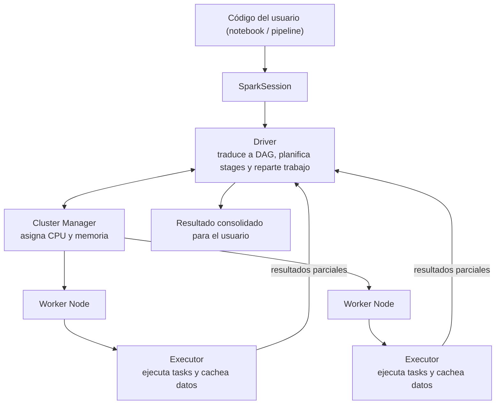
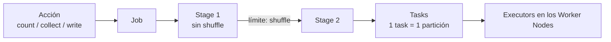
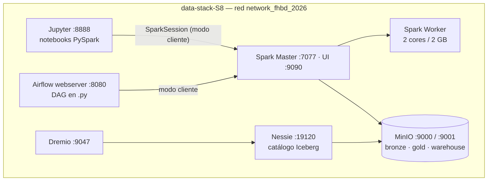

# Apuntes — Semana 8 (23 de Septiembre de 2026)

---

## 1. Resumen cronológico de la clase

> [!note] Cómo leer esta tabla
> Los timestamps son los **marcadores reales de la transcripción** de la grabación (00:00:02–02:46:09, ≈ 2 h 46 min; hubo **receso entre 01:22:15 y 01:40:08**). Sirven para ubicar cada momento en el video, no para calcular la hora del reloj. La clase tuvo tres bloques: **teoría de Spark (primera parte)**, **receso** y **despliegue + notebooks en vivo (segunda parte)**.

| Franja (en la grabación) | Qué pasó |
| --- | --- |
| 00:00:02–00:03:28 | Apertura: hoy = Spark. Anuncio grande: **la próxima clase (miércoles 30 sep) se expone la Tarea de Apache Airflow por grupos** (primera parte conceptual, segunda mitad ejecutar el pipeline orquestado con los clústeres de Spark); "sí o sí hay ocho días desde hoy". El profe comparte hoy el contenedor con Airflow. |
| 00:03:28–00:09:12 | Check-in: quién ha usado Spark (un estudiante la usó en la materia de infraestructura, desde Docker, para pipelines y análisis a escala). Plan: primera parte conceptual, segunda el despliegue. Menciona **dbt** como herramienta de transformación muy pedida en vacantes (no está en el curso; recomendada). |
| 00:09:12–00:12:22 | Introducción a Spark: open source, políglota, escalable; historia (nace en la Universidad de California, luego open source); relación **Spark ↔ Databricks**; in-memory computing y reutilización de resultados. |
| 00:12:22–00:16:24 | Conceptos fundamentales: **SparkSession** (punto de entrada), **DataFrames** (vs. Pandas: distribuidos), **Driver**, **Executors**, **Cluster Manager** y **particiones**. |
| 00:16:24–00:20:37 | **Transformaciones vs. acciones** (`filter`, `select`, `groupBy` / `count`, `collect`, `write`), evaluación **perezosa (lazy)**, dependencias **narrow vs. wide**, **shuffle** como cuello de botella y **Spark UI**. |
| 00:20:37–00:25:18 | Características: velocidad vs. MapReduce, **caché y persistencia**, tolerancia a fallos, despliegue flexible y **Spark Streaming** (el curso usa solo batch). PySpark como estándar de industria. |
| 00:25:18–00:31:06 | **Abstracciones principales: RDD** (unidad básica, distribuida, tolerante a fallos) y **DAG** (a diferencia del DAG de Airflow, que define el usuario), más **DataFrames/Datasets** (Datasets solo en Java y Scala). |
| 00:31:06–00:40:06 | **Arquitectura de Apache Spark**: driver ↔ executors ↔ Cluster Manager ↔ Worker Nodes; **analogía de la orquesta/obra de teatro**; componentes internos del driver; ejemplo `df.groupBy("pais").count()` + `collect()`; flujo de una aplicación. |
| 00:40:06–00:46:42 | Ciclo de vida y recursos: una aplicación = una ejecución/SparkSession; aplicaciones **aisladas** con recursos **compartidos**; ejemplos (100 particiones / 10 executors; 10 GB de RAM para 3 pipelines). |
| 00:46:42–00:53:18 | **Cluster Managers** (Standalone, YARN, Mesos, Kubernetes) y **modos de ejecución** (local, **client** — el que usará Airflow — y cluster mode); ejemplo del clúster de 4 workers × 16 núcleos. |
| 00:53:18–01:03:05 | Ejemplo integrado del **1 TB de logs** (3 Worker Nodes, YARN); reparto de recursos (reservar ~1 GB de RAM para el propio nodo); **ciclo job → stages → tasks** y límites de stages por **shuffle**. |
| 01:03:05–01:15:45 | Resumen del ciclo y **ecosistema**: **Spark SQL** (dos estilos de escritura y uso con Power BI vía JDBC), **MLlib**, **Structured Streaming** (Kafka; recomendación de cacharrearlo) y **GraphX** (Netflix). |
| 01:15:45–01:22:15 | Modos de despliegue con Docker/Standalone, **buenas prácticas** (particiones, shuffles, persistencia, Spark UI, cluster manager), cuatro pilares y visión a futuro (Kubernetes, nube, declarative pipelines). Fin de la teoría y receso "hasta las 8:20 p. m.". |
| 01:40:08–01:49:31 | Parte práctica: el contenedor que queda en el campus (proyecto + **Airflow** + clústeres de Spark); **Spark Master** con acceso a MinIO y **un Worker de 2 GB / 2 cores**; **`Dockerfile.spark` custom** (dependencias Postgres, Iceberg/Nessie, AWS) y **`spark-defaults.conf`**. Aviso: **MinIO dejó de ser open source**; menciona **"Flossy" (por confirmar)** como emulador local de servicios cloud. |
| 01:49:31–01:57:20 | Notebooks 1 y 2: sesión con extensiones "quemadas" vs. sesión que lee recursos de la configuración (**1 worker de 2 cores; 1 executor de 2 cores / 2 GB RAM / 1 GB driver; app "Spark Load to Iceberg"**). Aclaración: los parámetros de recursos todavía habría que agregarlos al `spark-defaults.conf`. |
| 01:57:20–02:05:25 | Notebook de ejemplo (DANE + clientes): API y CSV → Pandas → Spark; transformaciones (drops, casteos, filtros, nulos), **join interno** por municipio/ciudad, columna de auditoría **`current_date`**, backup parquet **snappy** en **bronce** y tabla Iceberg en **`nessie.gold`**. |
| 02:05:25–02:17:27 | **Ejecución en vivo**: Jupyter, Spark Master, MinIO, Nessie y Dremio; cambio de la **IP de MinIO**, cambio del **ID de la API** del cliente, corrección en caliente de la columna **`DPTO`**; validación de tabla en Nessie gold y del parquet del día en bronce. |
| 02:17:27–02:25:03 | **Problemas de configuración en vivo**: la tarea corrió dentro de Jupyter y **no llegó al clúster de Spark** porque faltaba el **Master** en la sesión; diferencia **`SparkSessionBuilder` vs. `SparkConf`**; queda pendiente revisar las **versiones de Spark** del Master y del Worker. |
| 02:25:03–02:28:15 | Caso **Bitnami** (imágenes que dejaron de ser open source y se volvieron pagas) → por eso usan la **imagen oficial de Spark**; deja la carpeta actualizada en el campus y pide **probar bajar y volver a desplegar MinIO con la última imagen**. El compose de Airflow **no funciona del todo a propósito: hay que corregirlo (es parte de la tarea)**. |
| 02:28:15–02:35:14 | **Anuncio detallado de la Tarea 2 (Airflow)**: presentación conceptual de Airflow y sus componentes + últimos desarrollos; desplegar Spark + Airflow y ejecutar `Spark Load to Iceberg`; tiempos, nota y entregables (ver callout y sección 10). |
| 02:35:14–02:45:49 | **Demo en vivo de Airflow**: DAG que llama al notebook; **conexión Airflow → Spark Master en modo cliente**; validación en Nessie/MinIO y en **Spark UI** con una aplicación ejecutada **por el usuario `Airflow`**. Recordatorio: el **DAG debe estar en `.py`** (Airflow no detecta notebooks). Cierre y despedida. |

> [!important] Tareas, entregas y fechas (lo que dejó esta clase)
> - ==**EXPOSICIÓN TAREA 2 (APACHE AIRFLOW): miércoles 30 de septiembre de 2026**==, la clase empieza con **todos los grupos exponiendo** (los mismos grupos del proyecto del corte 1). Dos partes: **(1)** presentación conceptual de Apache Airflow, sus componentes y últimos lanzamientos; **(2)** **ejecución en vivo** del pipeline orquestado: correr desde Airflow el script **`Spark Load to Iceberg`** usando el clúster de Spark.
> - ==**Tiempo: 20 minutos por grupo (15 de presentación + 5 de demo del pipeline en funcionamiento)**==[^1]. ==**Nota: 60 % la presentación y 40 % la ejecución del DAG en Airflow; si el pipeline no funciona, ese 40 % es cero.**==
> - ==**Entregables: un solo `docker-compose` con todos los servicios integrados (Spark + Airflow + el resto del stack), el script/DAG de Airflow en `.py` y la presentación en PowerPoint.**== En el campus, la consigna fija además el ==**cierre: miércoles 30 de septiembre, 18:15**==, entrega grupal comprimida.
> - **Requisitos técnicos que dejó el profe:** carpetas de Airflow ==**`config`, `docs`, `jobs` y `logs`**==; **cambiar la IP de MinIO** en el notebook (el comando está en las notas del stack); **corregir la conexión Airflow → Spark Master en modo cliente** (es investigación de la tarea; dejó videos de guía); convertir el notebook a **`.py`** para la carpeta de DAGs; el compose que dejó **no funciona 100 % a propósito**.
> - ==**Proyecto del corte 2: hay que adicionar Spark al Compose del proyecto**== ("es terminar de hacer la arquitectura"); el profe lo revisará "en dos semanas". Anuncio: "este segundo corte no era tan regalado" y hay **mucha dependencia entre Spark y Airflow**.
> - ==**Prueba sugerida: borrar, bajar y volver a desplegar el contenedor de MinIO con la última imagen**== (MinIO dejó de ser open source). Para el próximo semestre probablemente lo reemplacen por **"Flossy" (por confirmar)**, un emulador local de servicios cloud.
> - **Adelanto del tercer corte:** integración con **Power BI vía JDBC** (se explicó al pasar en Spark SQL).

> [!note] Fuentes de estos apuntes
> - **Transcripción** — [[Big Data/Apuntes/Recursos/Semana 08/Transcripción - 23 de Septiembre]] (fuente principal: 00:00:02–02:46:09).
> - **Diapositivas** — [[Big Data/Apuntes/Recursos/Semana 08/FHBD-S8.pdf]] (50 págs.: introducción a Spark, conceptos, abstracciones, arquitectura, jobs/stages/tasks, ecosistema, despliegue y resumen).
> - **Stack de la clase** — [[Big Data/Apuntes/Recursos/Semana 08/data-stack-S8/docker-compose.yaml|data-stack del curso (compose)]] + `Dockerfile.spark`, `spark-defaults.conf`, `notas.txt` y los 3 notebooks de `notebooks/` (ver sección 9).
> - **Consigna de la tarea** — [[Big Data/Trabajos/Corte 2/Tarea 2 - Apache Airflow/Consigna - Tarea 2]].

---

## 2. Introducción a Apache Spark

> [!def] ¿Qué es Apache Spark? (diapositiva + clase)
> "Apache Spark es un **motor de procesamiento de datos distribuido y de código abierto**, diseñado para manejar grandes volúmenes de datos en diferentes formatos (**estructurados, semiestructurados y no estructurados**). A diferencia del paradigma clásico de MapReduce, Spark fue concebido para **superar sus limitaciones en velocidad y flexibilidad**, ofreciendo un modelo mucho más versátil." (deck, p. 2). En clase: hace parte de los frameworks de **procesamiento masivamente paralelo** y es "**el estándar por defecto de procesamiento distribuido** para transformaciones de datos" (00:07:38).

### 2.1 Motivación: los límites de MapReduce

- **MapReduce (Hadoop)** "dependía excesivamente de **operaciones de disco entre cada paso** del pipeline" → lento, sobre todo en tareas **iterativas** (machine learning, análisis interactivo).
- Spark lo reemplaza mejorando velocidad y flexibilidad: "nace Spark para reemplazar ese motor de procesamiento de Hadoop que era el MapReduce y siendo **mucho más rápido, mucho más eficiente**... ganándole todas las limitaciones" (00:07:15).
- **In-memory computing:** Spark "procesa en memoria y **reutiliza los resultados en memoria** acelerando las tareas": si unos datos ya se cargaron, se reutilizan sin volver al disco ni a la fuente (00:11:53–00:12:08).

> [!tip] Dato adicional del profe: dbt
> "Aparte de Spark también están pidiendo ya bastante **dbt**" (00:07:38). Es una **herramienta de transformación de datos** (se definen modelos, fuentes, tablas de hechos y dimensiones; muy ligada al ETL), **no está en el curso** pero la recomienda para el perfil profesional y para "cacharrearla" (00:08:42).

### 2.2 Historia y contexto

| Año | Hito (deck, p. 4) |
| --- | --- |
| **2009** | Spark fue creado en el **AMPLab de la Universidad de California, Berkeley** |
| **2014** | Se convirtió en **proyecto top-level de Apache** |
| Hoy | Uno de los motores de procesamiento más usados del mundo; "el **estándar de facto** de la industria" (01:20:48) |

- Sigue siendo **open source** ("todavía sigue siendo un proyecto open source", 00:10:39) y lleva **~12 años madurándose** desde 2014 (01:20:48); cada año siguen saliendo funcionalidades.
- **Databricks:** es "el producto que crean los **creadores de Spark**"; plataforma **Lakehouse** completa que "provee toda la infraestructura para desplegar esos clústeres". Si no, toca **desplegar los clústeres open source uno mismo** (Docker/Kubernetes) o contratar Databricks: "ahí ya va a depender de qué se requiere y obviamente el bolsillo" (00:11:37).

### 2.3 Uso en producción

- Compañías como **Alibaba, Tencent o Baidu** lo usan a gran escala para análisis, publicidad, búsquedas y recomendaciones (deck, p. 3); Spark es "la **pieza central del ecosistema de big data moderno**".
- Usa un **ecosistema integrado** de librerías: **Spark SQL, MLlib, GraphX y Structured Streaming** (sección 8); todo corre sobre el mismo motor.

---

## 3. Características principales

| Característica | Detalle (deck + clase) |
| --- | --- |
| **Velocidad** | Puede ser **hasta 100 veces más rápido que MapReduce** para cargas que aprovechan la memoria. Divide los datos en **particiones** y las distribuye entre nodos garantizando paralelismo; los **DAGs** permiten optimizar dependencias y **evitar recomputaciones**. |
| **Caché y persistencia** | API sencilla para **guardar datasets en memoria o disco** y **reutilizarlos en múltiples pasos** del pipeline sin volver a leer del almacenamiento externo. |
| **Tolerancia a fallos** | Si un nodo/executor falla, el **driver reasigna** la tarea (y su partición) a otros executors. Es una "resiliencia del procesamiento": un pipeline de transformación que no elimina registros puede terminar con **la misma cantidad de registros originales**. |
| **Despliegue flexible** | Corre sobre distintos gestores: **YARN, Mesos, Kubernetes o su propio Standalone** (sección 6.5). |
| **Computación en tiempo real** | **Structured Streaming** procesa flujos con baja latencia (casi tiempo real). ==En este curso el alcance es solo procesamiento batch== (00:23:46). |
| **Políglota** | Scala, Java, Python y R. El estándar de industria es **PySpark** (Python), el que usa el curso (00:24:03). También hay shells interactivos (PySpark shell) para pruebas rápidas. |
| **Open source y escalable** | "Cualquiera lo puede utilizar, adaptar y desplegar dentro de su infraestructura"; desde un **portátil** hasta clústeres de **miles de nodos** o entornos productivos en la nube. |

> [!tip] Frase del profe sobre el Streaming (01:12:31)
> "Si no han trabajado con streaming, les recomiendo que lo **cacharreen**, porque hace parte [de las vacantes]... hay algunas empresas que trabajan con procesamiento de datos en tiempo real". En su empresa apenas después de dos años están viendo la necesidad; "el estándar siempre es en batch, pero en streaming también lo piden a veces".

---

## 4. Conceptos fundamentales

> [!def] SparkSession
> "El **punto de entrada principal** para cualquier aplicación en Spark desde la versión **2.0** en adelante. Representa la aplicación Spark y permite **crear DataFrames, ejecutar consultas SQL, leer datos** desde diferentes fuentes y **acceder a la configuración** del motor" (deck, p. 5). ==Existe una correspondencia **1 a 1** entre una SparkSession y una aplicación Spark==. En clase (00:12:42): si no se define una sesión que apunte al clúster, "todo quedaría corriendo dentro de la misma aplicación de Jupyter... no quedaría distribuido".

> [!def] DataFrame (de Spark)
> "La **abstracción más común** en Spark SQL. Representan datos estructurados en **filas y columnas con un esquema** asociado (tipos y nombres)." A diferencia de un DataFrame de Pandas o R, **puede distribuirse en múltiples nodos**, lo que permite procesar grandes volúmenes (deck, p. 5). En palabras del profe: "es casi como un DataFrame de Pandas; la diferencia es que en Spark los datos se pueden **distribuir en diferentes nodos**... el de Pandas [está] en memoria nada más" (00:13:27).

Los demás componentes (deck, págs. 6–7 + clase 00:14:08–00:16:09):

| Concepto | Qué es |
| --- | --- |
| **Driver** | Proceso central que **coordina la ejecución**; contiene la SparkSession. Transforma las operaciones del usuario en un **DAG**, planifica stages y **distribuye los trabajos** entre los executors. |
| **Executors** | Procesos que corren **en los nodos del clúster** y ejecutan las tareas asignadas por el driver. Guardan datos **en memoria o disco local** para reutilizarlos y **reportan el estado** de vuelta al driver. |
| **Cluster Manager** | **Administrador del clúster**: asigna **recursos de CPU y memoria** a las aplicaciones. Puede ser **YARN, Mesos, Kubernetes o el Standalone** propio de Spark. |
| **Particiones** | Spark **divide los datos en particiones** (subconjuntos de filas) distribuidas en los nodos. Cada partición es la **unidad mínima de procesamiento** y su cantidad **influye directamente en el paralelismo** de la aplicación. |

> [!def] Transformations vs. Actions
> - **Transformations:** operaciones que definen un **nuevo DataFrame a partir de otro** (`filter`, `select`, `groupBy`...). Son **evaluadas de forma lazy (perezosa)**: no se ejecutan de inmediato, **construyen el plan lógico** de ejecución.
> - **Actions:** operaciones que **devuelven un resultado o escriben datos** (`count`, `collect`, `write`...). Al invocarse **desencadenan la ejecución real del DAG**.

> [!def] Evaluación perezosa (Lazy Evaluation)
> Spark **retrasa la ejecución hasta que se solicita una acción**. Así puede **optimizar el plan completo**, aplicando técnicas como *predicate pushdown* o la **reducción de shuffles innecesarios** (deck, p. 9). En clase: "hay operaciones que primero se **planean** y luego se **ejecutan**" (00:16:24).

### 4.1 Dependencias narrow vs. wide y el shuffle

| Tipo | ¿Qué ocurre? | Ejemplos | Coste |
| --- | --- | --- | --- |
| **Narrow (estrecha)** | Cada **partición de salida depende de una sola partición de entrada**; no hace falta reorganizar datos. Fáciles de paralelizar. | `map`, `filter` | Bajo |
| **Wide (ancha)** | Una partición de salida **depende de múltiples particiones** del padre; requieren **reorganización** de datos entre particiones. | `groupBy`, `join`, `reduceByKey`, `groupByKey` | Alto |

> [!def] Shuffle (01:03:05)
> "Es el proceso mediante el cual [Spark] **redistribuye los datos entre particiones** para que **todas las claves iguales terminen en la misma partición** antes de un reduce o una operación puntual". Implica **lectura, escritura y transferencia por red**, por eso ==es el **punto más costoso** de la ejecución y el cuello de botella típico de las transformaciones==. Spark lo optimiza con buffers, compresión y ficheros intermedios, "pero sigue siendo un cuello de botella" (deck, p. 32).

> [!tip] Por qué pertenece al examen mental del día a día
> Entender esto explica "por qué a veces hay unas transformaciones que las hace más rápido": un pipeline con **menos datos pero más joins/groupBy** puede tardar más que uno con más datos y pocas operaciones (01:00:49–01:01:26).

### 4.2 Spark UI

- Interfaz web de monitoreo en el **puerto 4040 del driver**: permite ver **trabajos, stages y tasks**, los **workers**, qué tareas se ejecutaron, **bajo qué usuario**, tiempos de ejecución y uso de recursos.
- "Si se necesitan **matar procesos**, también se puede hacer desde ahí" (00:20:06). Es una de las buenas prácticas: **monitorear con el Spark UI** (sección 7.1).

---

## 5. Abstracciones de datos: RDD, DAG y DataFrames/Datasets

> [!def] RDD (Resilient Distributed Dataset) — deck, p. 12
> **Unidad básica de datos distribuida** en Spark: una **colección inmutable de objetos, dividida en particiones** repartidas en distintos nodos. Ofrece **tolerancia a fallos gracias al *lineage*** (linaje): si una partición se pierde, Spark puede **recomputarla** siguiendo el historial de transformaciones. Sobre un RDD se aplican **transformations** (producen nuevos RDDs: `map`, `filter`, `flatMap`, `union`, `join`) y **actions** (desencadenan ejecución y devuelven resultados: `collect`, `count`, `saveAsTextFile`).

> [!note] Un lapsus de clase (registrado, no reproducido)
> En clase el profe dijo "colección de objetos **mutables**" (00:25:38) y luego se explicó: "no se pueden cambiar... permanece su consistencia". La definición correcta (la del deck y la intención del profe) es **inmutable**: las transformaciones crean **nuevos** RDDs, no modifican el original (por eso el *lineage* puede recomputar).

> [!def] DAG (Directed Acyclic Graph) — deck, p. 13
> Cuando el usuario **encadena transformaciones**, Spark construye internamente un **grafo dirigido acíclico** que representa las **dependencias entre RDDs**. El DAG es **optimizado y dividido en stages y tasks** por el *DAGScheduler*, "para que solo se ejecute lo necesario, minimizando shuffles y recomputaciones".

> [!question]- ¿Yo tengo que definir el DAG, como en Airflow?
> **No.** En Airflow el DAG lo define el usuario en código ("primero ejecutemos esta función..."); en Spark "uno solo manda los comandos normales, como lo haría con Pandas, y ya Spark por debajo se encarga" (00:29:13–00:29:56). El DAG de Spark lo **construye el motor** a partir del encadenamiento de operaciones.

> [!def] DataFrames y Datasets — deck, p. 13
> **DataFrames:** colecciones de datos **estructurados con esquema** (similares a tablas relacionales); permiten escribir consultas en estilo **declarativo**. **Datasets:** extensión **tipada** de los DataFrames, "que combinan la seguridad de tipos con las optimizaciones internas"; ==disponibles solo en **Java y Scala**== (en Python se usan DataFrames). Todos ellos se apoyan internamente en la abstracción distribuida de los RDDs.

---

## 6. Arquitectura de Apache Spark

> [!def] Los cuatro pilares (deck, pp. 15 y 45–46)
> **Driver** (coordina la aplicación, genera DAGs y reparte tareas), **Executors** (ejecutan las tareas en paralelo y gestionan memoria/caché), **Cluster Manager** (asigna recursos a las aplicaciones) y **Worker Nodes** (nodos que albergan a los executors).

### 6.1 La analogía de la orquesta (y la obra de teatro)

| Componente | En Spark | Analogía de la orquesta (deck, p. 15) | Analogía del teatro (deck, p. 19) |
| --- | --- | --- | --- |
| **Driver** | Recibe el código, crea el plan, decide "qué músicos tocan y cuándo" | **Director de orquesta** (recibe la partitura) | **Director** que organiza la obra |
| **Executors** | Ejecutan las tareas y guardan datos temporalmente | **Músicos** que interpretan su parte | **Actores** que representan las escenas |
| **Cluster Manager** | Asigna CPU y memoria a la aplicación | **Administración** del teatro: salas y recursos | **Administrador** que asigna salas, luces y recursos |
| **Worker Nodes** | Máquinas (físicas/virtuales) donde viven los executors | Las **salas** donde tocan | Los **escenarios** donde actúan |

> [!tip] Por qué funciona la analogía (00:41:55)
> "A todos los músicos les toca, entre una orquesta, **tocar al mismo tiempo una parte de la partitura**": a cada uno le llega una **parte de los datos (partitura)** y una **tarea**, y todos ejecutan **en paralelo**. "En una orquesta hay momentos en los que unos tocan y otros no, pero para aterrizar nos sirve el ejemplo".

### 6.2 Diagrama de la arquitectura



> [!note] El diagrama de la diapositiva
> El diagrama completo de esta arquitectura está en el deck (p. 18): [[Big Data/Apuntes/Recursos/Semana 08/FHBD-S8.pdf#page=18|FHBD-S8.pdf — arquitectura en modo clúster]] (también embebido en [[#13. Recursos de la semana]]).

### 6.3 El driver y sus componentes internos (deck, p. 20)

El driver es "absolutamente esencial: es el **corazón** de la aplicación" y cumple cuatro funciones:

1. **Traducción del código a DAGs:** convierte las operaciones declaradas en un grafo de dependencias.
2. **Planificación:** divide el DAG en **stages y tasks** que se envían a los executors.
3. **Gestión de la comunicación:** coordina con el Cluster Manager y con los executors.
4. **Almacenamiento de metadatos:** mantiene el estado de la aplicación, resultados parciales y seguimiento de fallos.

**Componentes internos del driver:** **DAG Scheduler** (organiza las operaciones en etapas), **Task Scheduler** (asigna tareas a los executors), **Backend Scheduler** (interactúa con el Cluster Manager) y **Block Manager** (gestiona datos en memoria o disco).

> [!tip] Ejemplo del profe (00:43:16)
> Con `df.groupBy("pais").count()`, "el driver **no ejecuta directamente el conteo**, sino que construye el DAG con la operación". Al invocar la acción (`collect()`), el **DAG Scheduler** divide la lógica en stages y el **Task Scheduler** reparte tareas entre los executors.

### 6.4 Executors y aplicaciones

- Los executors tienen "solo dos funciones principales": **ejecutar el código** asignado por el driver y **reportar el estado** de la computación de vuelta (deck, p. 17).
- **Cada aplicación Spark tiene su propio conjunto de executors dedicados** (aislamiento): si dos usuarios corren aplicaciones distintas, sus executors **no se mezclan**; pero ==los recursos del clúster sí se comparten== ("el executor no se comparte, pero los recursos del clúster donde están viviendo sí", 00:46:12).
- Ejemplo (deck, p. 21): si un dataset tiene **100 particiones** y hay **10 executors**, cada executor procesa **10 particiones en paralelo**; si uno falla, el driver **reasigna** las tareas pendientes.
- Ejemplo del profe (00:45:47): "si tengo **10 GB de RAM y voy a correr 3 pipelines**, y a cada uno le asigno **5 GB**, estoy **sobrepasando** las capacidades del clúster y comienzan los errores". Tenerlo en cuenta al dimensionar.

### 6.5 Cluster Managers y modos de ejecución

| Cluster Manager | Características (deck, p. 25 + clase) |
| --- | --- |
| **Standalone** | El que viene **integrado con Spark**. Fácil de instalar; **limitado en escalabilidad**. ==Es el modo del curso, montado con Docker (imágenes oficiales de la comunidad).== |
| **YARN** | Gestor de recursos de **Hadoop**; permite que Spark **conviva con otros frameworks** en un clúster Hadoop. Muy usado en entornos empresariales. |
| **Mesos** | Generalista; "permite **ejecutar Spark junto a otros sistemas** distribuidos". Hoy en día **menos usado** que Kubernetes ("casi no lo he oído nombrar, ni tampoco lo he usado", 00:52:47). |
| **Kubernetes** | Orquestador de contenedores; permite **desplegar Spark en la nube, flexible y escalable**. ==Es el estándar para el despliegue productivo.== |

| Modo de ejecución | ¿Dónde corre el driver? | ¿Dónde corren los executors? | Cuándo se usa |
| --- | --- | --- | --- |
| **Local** | Todo en **una sola máquina** (no se distribuye). | Misma máquina | Pruebas y desarrollo (`spark-submit --master local[4]` = 4 hilos) |
| **Client** | En la **máquina del usuario** (cliente). | En el clúster (Worker Nodes) | Pruebas interactivas (notebooks); ==**es el modo que usará Airflow**: "el driver va a vivir sobre Airflow y él manda a ejecutar las tareas en los clústers de Spark" (00:52:11)== |
| **Cluster** | **Dentro del clúster** | Dentro del clúster | ==El más usado en producción== |

> [!warning] Distribución de recursos: el cálculo fino del profe
> Ejemplo de la clase (00:49:19): clúster de **4 workers × 16 núcleos**; el Cluster Manager puede asignar **8 núcleos a Spark** (la mitad), **2 núcleos por executor → 4 executors en total**. Con RAM: si a cada nodo se le dan **4 GB**, hay que **reservar ~1 GB para los procesos internos del nodo** ("para que la máquina virtual no colapse"), quedando **3 GB útiles** para executors. "Es mucho de calcularlo, de cómo se procesan los datos, cómo se comportan".

### 6.6 Ejemplo integrado: 1 TB de logs (deck, p. 26)

Con un clúster de **3 Worker Nodes** y **1 TB de logs** de un servidor:

1. **Lanzamiento:** el usuario ejecuta el programa en **cluster mode con YARN**.
2. **Planificación:** el driver (enviado al clúster) **crea un DAG** de transformaciones sobre los logs.
3. **Asignación:** el Cluster Manager asigna **2 executors por cada Worker Node** y cada executor procesa una partición de los logs (≈ **200 GB** cada uno)[^2].
4. **Procesamiento y consolidación:** los resultados parciales (conteos de errores) llegan al **driver**, que consolida y los devuelve al usuario.

"De esta forma, una tarea que sería **imposible en un solo servidor** se resuelve de manera distribuida y **tolerante a fallos**".

> [!note] La arquitectura que queda en el campus (resumen de la práctica)
> El `data-stack-S8` define el clúster Standalone del curso con Docker: **1 Spark Master + 1 Worker de 2 GB y 2 cores** (ampliable "copiar y pegar"), Jupyter, MinIO, Nessie, Dremio y Airflow (sección 9). En Kubernetes "ya es la manera escalable: uno define las capacidades y cuántas réplicas" (01:44:12).

---

## 7. Ciclo de vida de un job: Jobs → Stages → Tasks

> [!def] De código a ejecución (deck, p. 28)
> Al escribir código Spark no se ejecuta nada de inmediato: primero se construye el **DAG** de dependencias. Cuando aparece una **acción** (`count()`, `collect()`, `write()`), Spark desencadena la ejecución en **cuatro pasos**: **(1)** el driver envía el DAG al *DAGScheduler*; **(2)** el DAG se divide en **jobs**; **(3)** cada job se divide en **stages** (tramos del DAG **donde no hay necesidad de shuffle**); **(4)** los stages se dividen en **tasks**, "las unidades más pequeñas de trabajo, ejecutadas por los executors en paralelo".



- **Jobs:** "un job corresponde **generalmente a una acción** invocada en el código". Ejemplo: `df.count()` y luego `df.collect()` generan **dos jobs**.
- **Stages:** agrupan operaciones "que pueden ejecutarse **sin necesidad de rebarajar datos** entre nodos". ==El **límite entre stages** se da cuando Spark necesita hacer un **shuffle** (redistribución)== (00:57:08).
- **Tasks:** "unidades **mínimas** de ejecución"; cada task procesa **una partición** del RDD/DataFrame. Ejemplo: si un RDD tiene **8 particiones**, un stage producirá **8 tasks**; el **TaskScheduler** las asigna a los executors disponibles.

> [!important] Resumen que dio el profe (01:03:05–01:04:27)
> - El driver planifica con ayuda del **DAG Scheduler** y el **Task Scheduler**.
> - Un **job** = una **acción**; un job se divide en **stages**; un stage se divide en **tasks**.
> - **Narrow vs. wide** determinan los **límites entre stages**.
> - El **shuffle ocurre en las dependencias anchas** y ==es el punto más costoso de la ejecución==.

### 7.1 Buenas prácticas de rendimiento (deck, p. 44 + clase 01:16:58)

| Práctica | Qué significa |
| --- | --- |
| **Ajustar las particiones** | Demasiadas particiones generan **overhead**; muy pocas **desaprovechan** los executors (menos particiones que executors = recursos sin usar). |
| **Evitar shuffles innecesarios** | Preferir operadores eficientes como **`reduceByKey`** en vez de los genéricos (p. ej. `groupByKey`). |
| **Persistir con criterio** | Solo guardar en caché los datasets **que se reutilizan varias veces**; "depende mucho de lo que se haya usado". |
| **Monitorear con el Spark UI** | Revisar **stages, tareas lentas, shuffles y logs**; "tener como un control". |
| **Escalar con el cluster manager adecuado** | Standalone para pruebas, YARN en entornos Hadoop, **Kubernetes en cloud**: "el entorno eficiente para la nube es Kubernetes". |

---

## 8. Ecosistema de Apache Spark

> [!def] Spark SQL (deck, p. 35)
> Extiende a Spark con un motor **optimizado para datos estructurados**. Introduce dos conceptos clave: **DataFrames** (colecciones con esquema tabular) y el **Catalyst Optimizer** (motor que traduce consultas SQL o transformaciones declarativas en **planes de ejecución eficientes**). Permite "procesar datos haciendo uso de SQL... aprovechando que las transformaciones SQL se distribuyen dentro del motor de Spark" (00:06:14).

**Dos estilos de escritura (deck, p. 36):**

```python
# Estilo 1: consulta SQL directamente
spark.sql("SELECT producto, SUM(monto) as total FROM ventas GROUP BY producto").show()

# Estilo 2: API de DataFrames (declarativa, más cercana a Pandas)
df = spark.read.csv("ventas.csv", header=True, inferSchema=True)
df.groupBy("producto").sum("monto").show()
```

**Beneficios:** soporta múltiples fuentes (Hive, Avro, ORC, Parquet, JSON, **JDBC**); permite **combinar SQL con operaciones de DataFrames**; se integra con **herramientas de BI (Tableau, Power BI) mediante el conector JDBC/ODBC**.

> [!tip] Consejos y uso real del profe (01:07:02–01:10:38)
> "Yo sí les recomiendo que practiquen **mucho SQL**, porque es básicamente el estándar por defecto de la mano con Python". En Databricks lo usa mucho para **reportería y crear DataFrames desde consultas a tablas**. Con el conector **JDBC de Power BI** se puede traer **solo lo necesario** en vez de la tabla completa (ej. "año ≥ 2026" en la consulta) — "eso lo hacemos en el **tercer corte**, pero para adelantar un poco".

- **MLlib** (deck, p. 37): librería de **machine learning distribuido**: algoritmos supervisados (regresión lineal/logística, árboles de decisión, random forests), no supervisados (**K-means, PCA, ALS** para recomendaciones), preprocesamiento y **pipelines de ML** (API similar a Scikit-learn). Ventaja: "aprovecha el **paralelismo** de Spark para manejar datasets **más grandes que los que caben en la memoria de una sola máquina**".
- **Structured Streaming** (deck, p. 38): procesa **flujos en tiempo real con la misma API** de DataFrames y SQL; Spark trata el flujo como una "**tabla en continuo crecimiento**". Características: *event time* y *watermarks* (tolerar retrasos), **exactly-once semantics**, salidas flexibles (memoria, consola, **Kafka**, HDFS, bases de datos). En clase: "lo que venga, por ejemplo, de logs en tiempo real o información de **Kafka**" (01:11:40); la empresa del profe apenas está viendo esa necesidad y **Fabric** es una de las opciones en evaluación.
- **GraphX** (deck, p. 39): procesamiento de **grafos distribuidos**: datos como **vértices y aristas** y algoritmos clásicos a gran escala. Aplicaciones: **redes sociales** (comunidades, influencers), **recomendaciones basadas en grafos** (el ejemplo de **Netflix**: "películas relacionadas del mismo género, actor o director", 01:14:01) y **análisis de rutas y logística**.

> [!def] Integración del ecosistema (deck, p. 40)
> Todas las librerías **comparten el mismo motor de ejecución** (SQL, ML y streaming en un **mismo clúster**), usan **APIs unificadas** (DataFrames/Datasets) y **escalan horizontalmente**. Ejemplo: *Structured Streaming* lee en tiempo real → *Spark SQL* limpia → *MLlib* entrena un modelo → *GraphX* analiza relaciones. "Todo dentro de una misma aplicación Spark".

> [!note] Visión a futuro (deck, pp. 48–49)
> **Integración con la nube** (servicios administrados: **AWS EMR, Databricks, GCP Dataproc, Azure HDInsight**), **Kubernetes como estándar**, **streaming unificado**, **optimización automática** (Catalyst), **ecosistema ML/IA** (integración con TensorFlow/PyTorch) y **comunidad** en expansión (PySpark). El profe mencionó también los **declarative pipelines** de Databricks ("eso ya se puede ejecutar dentro de Databricks y **nació dentro de Spark**", 01:21:30).

---

## 9. Despliegue en el curso: el stack `data-stack-S8` (Docker)

> [!def] Qué es (01:43:37)
> Es el **data stack del curso** con todo lo necesario para esta clase: el clúster **Spark Standalone** (Master + Worker), **Jupyter**, **MinIO**, **Nessie**, **Dremio** y **Airflow** (Postgres + Redis + webserver + scheduler + worker + triggerer + init), todos en una **misma red Docker** (`network_fhbd_2026`). El profe dejó la carpeta en el campus y avisó: "la otra carpeta es lo mismo que esta, pero **la tienen que ajustar un poquito** para que les funcione... no te lo han regalado" (02:35:14). ==Versión ejecutable lista: `` `C:\College\Big Data\Semana 8\data-stack-S8\` ``==.



### 9.1 Servicios (según el `docker-compose.yaml`)

| Servicio | Imagen / definición | Detalles |
| --- | --- | --- |
| `spark-master` | `custom-spark:3.5.5-py39` (build propio) | `spark-class ...Master`; puertos **7077** (master) y **9090→8080** (UI); variables AWS (admin/password) para MinIO |
| `spark-worker` | `custom-spark:3.5.5-py39` | **`SPARK_WORKER_CORES=2` y `SPARK_WORKER_MEMORY=2g`**; depende del master; "un nodito Worker" ampliable copiando y pegando el bloque |
| `jupyter` | `jupyter/pyspark-notebook` | Puerto **8888** (sin token/password); monta `notebooks/` y `requirements.txt`; variables `SPARK_MASTER`, `CATALOG_URI`, `WAREHOUSE=s3://warehouse/`, `STORAGE_URI=http://minio:9000` |
| `minio` | `quay.io/minio/minio:latest` | Puertos **9000** (API) y **9001** (consola); usuario `admin` / `password`; volumen `./minio-data` |
| `nessie` | `projectnessie/nessie:latest` | Puerto **19120**; volumen `./nessie-data` (catálogo persistente) |
| `dremio` | `dremio/dremio-oss:latest` | Puertos **9047**, 31010, 32010 (motor SQL sobre el catálogo) |
| `postgres` / `redis` | `postgres:13` / `redis:7.2-bookworm` | Base de metadatos y broker de **Airflow** |
| `airflow-*` (webserver, scheduler, worker, triggerer, init) | `apache/airflow:2.9.0` + build propio (`dockerfile`) | Webserver en **8080**; carpetas montadas `dags/`, `logs/`, `config/`, `plugins/`, `jobs/`; `CeleryExecutor` |

### 9.2 La imagen de Spark: `Dockerfile.spark`

> [!warning] ¿Por qué un Dockerfile custom? (01:41:37)
> Porque **entre todas las aplicaciones de la arquitectura tienen que poder conectarse**: la imagen `apache/spark:3.5.5` "pelada" no trae los JARs de Postgres, **Iceberg/Nessie** ni **AWS/MinIO**. El profe define una "imagen custom": base **`apache/spark:3.5.5`** + **Python 3.9** + los **JARs "bakeados" en build-time** (Postgres 42.7.3, `iceberg-spark-runtime-3.5_2.12:1.5.0`, `nessie-spark-extensions-3.5_2.12:0.77.1`, `hadoop-aws:3.3.4`, `aws-java-sdk-bundle:1.12.262`, AWS SDK bundle 2.24.8) + `spark-defaults.conf` copiado + pip (`pandas`, `boto3`, `pyspark==3.5.5`, `pyarrow`). Deja una nota clave: *"spark.jars.packages NO se define aquí porque los JARs ya están bakeados en la imagen (definirlo causaría descargas redundantes en cada sesión)"*.

### 9.3 Configuración: `spark-defaults.conf`

Es donde quedan **por defecto** las dependencias y parámetros, para **no quemarlos en cada sesión**: extensiones SQL (**Iceberg + Nessie**), catálogo por defecto **`nessie`** (URI `http://nessie:19120/api/v1`, ref `main`, auth `NONE`, warehouse `s3a://warehouse/`), **IO S3FileIO apuntando a MinIO** (`http://minio:9000`, path-style, región `us-east-1`) y el filesystem **`fs.s3a`** para leer/escribir directo (`s3a://bronze/...`, credenciales por *environment variables*), más ajustes JVM (ivy en `/tmp/.ivy`, timezone UTC).

> [!tip] La lección central de esta configuración (01:43:22)
> "Cuando uno despliegue en productivo, uno no va a **quemar** toda esa serie de parámetros en la sesión de Spark... ==la idea es que **ninguno de estos parámetros quede quemado** en la sesión de Spark==". El Dockerfile + `spark-defaults.conf` son "la manera limpia"; el ejemplo explícito de los notebooks es solo para **entender** qué hay detrás. "Por eso primero quiero que lo hagamos viendo explícitamente esas librerías, y ya después convertirlo" (02:40:28).

### 9.4 Los notebooks de la clase

Están en `data-stack-S8/notebooks/`. En lenguaje sencillo:

| Notebook | Qué hace |
| --- | --- |
| **`Spark-load-to-Iceberg.ipynb`** | ==**El script base de la Tarea 2.**== Define variables de conexión (Nessie, warehouse `s3://gold/`, IP de MinIO, credenciales), arma la **SparkConf** con los paquetes JAR (Postgres, Iceberg, Nessie, AWS SDK, Hadoop AWS) y las **extensiones** (Iceberg + Nessie) + S3 hacia MinIO, crea la sesión, **lee el parquet `s3a://bronze/yellow_tripdata_2025-01.parquet`**, lo inspecciona (`printSchema`, `show`, `display`, `limit`, `toPandas`), hace `CREATE NAMESPACE IF NOT EXISTS nessie.gold`, y escribe la tabla Iceberg **`nessie.gold.yellowtrip`** con **`writeTo(...).createOrReplace()`** (≈ *overwrite*), terminando con `spark.stop()`. |
| **`Ext-Load-Data-Clientes-Spark-Iceberg-Minio.ipynb`** | Pipeline de ejemplo con **dos fuentes**: la **API de datos.gov.co (DIVIPOLA de municipios, dataset `gdxc-w37w`, límite 2000)** vía `sodapy`, y un **CSV de clientes/instalaciones** desde GitHub. Convierte todo de **Pandas a Spark** (`createDataFrame`), limpia y transforma (normaliza nombres de columnas, drops, casteos de latitud/longitud, filtros de **Valle del Cauca**, manejo de fechas y de nulos tipo `PRODUCTO → NO_ESPECIFICA`), hace un **join interno** por municipio/ciudad, agrega la **columna de auditoría `f_actual` = `current_date()`**, guarda el **backup diario en parquet (snappy) en el bucket `bronze`** (prefijo `clientes_inst/`, subido con `boto3`) y crea la tabla Iceberg **`nessie.gold.clientes_inst`**; valida con `spark.read.table(...).show()`. |
| **`test-iceberg.ipynb`** | Prueba mínima de conectividad: un dataset pequeño de ventas **en memoria** (con nulos y duplicados a propósito), crea el namespace `nessie.sales` y escribe la tabla `nessie.sales.sales_data_raw` con `createOrReplace()`. Sirve para validar que la sesión, el catálogo y el guardado funcionan. |

> [!tip] La regla transversal del profe: la columna de auditoría (02:01:55)
> "Toda extracción del día siempre tiene que quedar con una columna nueva que se llame **`current_date` o fecha actual**, para indicar **qué día se extrajeron esos datos**". Es una columna de **auditoría**: permite saber si un pipeline corrió un día, cuántos registros se guardaron por día y detectar faltantes. ==El profe anunció que lo va a pedir en el proyecto.==

### 9.5 Lo que pasó en la ejecución en vivo

- Se abrieron **Jupyter, Spark Master, MinIO, Nessie y Dremio**; antes de correr hubo que **cambiar la IP de MinIO** en el notebook (se obtiene con `docker inspect -f '{{range .NetworkSettings.Networks}}{{.IPAddress}}{{end}}' minio_fhbd_2026`, comando que queda en las `notas.txt` del stack).
- También tocó **actualizar el ID/app token de la API** (cambiaron el cliente) y **corregir en caliente el nombre de la columna `DPTO`** (la API había cambiado nombres), un "error productivo" típico (02:12:25).
- Resultado validado: parquet del día en **bronce (MinIO)** y tabla en **Nessie gold** visibles en MinIO/Nessie; Dremio se revisó para consultar la tabla (mismos pasos de la clase pasada).
- **Problema importante (y lección para la tarea):** la primera ejecución **no llegó al clúster de Spark** porque la sesión **no incluía el Master**: "toda la ejecución dentro de la sesión de Spark se definió, pero no le dijimos dónde está el Spark... **lo utilizó dentro de Jupyter**" (02:17:27). Al revisar, la diferencia era **`SparkSessionBuilder` (con `master`) vs. `SparkConf`** ("este no va a soportar esta característica de conectarse a este Spark Master", 02:19:29); el profe propone usar también **`setMaster`**. Quedó pendiente **revisar las versiones de Spark del Master y del Worker** (dio errores extraños) y dejó el aviso de que **sube la corrección en la carpeta del campus** (02:22:50, 02:44:54).
- **Demo final (con Airflow):** el DAG ejecutó el notebook en modo cliente y en **Spark UI** se vio la aplicación ejecutada **por el usuario `Airflow`**, "prueba de que el modo cliente funciona" (02:42:44).

---

## 10. Tarea 2 — Apache Airflow (lo que se expone el 30 de septiembre)

> [!note] Consigna oficial
> Resumen del campus: presentación grupal sobre **qué es Apache Airflow y sus componentes, casos de uso y últimos lanzamientos**, más la ejecución orquestada del script **`Spark-load-to-Iceberg`**; entrega de **compose + DAG + PPT** por el campus, ==**cierre 30 de septiembre, 18:15**== (archivo comprimido `Tarea-2-FHBD-Grupo-X`). Detalle completo en [[Big Data/Trabajos/Corte 2/Tarea 2 - Apache Airflow/Consigna - Tarea 2]] (no se duplica aquí).

Condiciones y requisitos que dejó el profe en clase (02:28:15–02:37:46):

- ==**Cuándo:** miércoles 30 de septiembre de 2026, la clase empieza con **todos los grupos exponiendo** ("sí o sí", "el otro miércoles"). Grupos: **los mismos del proyecto** (primera entrega).==
- **Parte 1 — conceptual (PowerPoint):** qué es Apache Airflow y **qué hace cada componente** del compose (**web server, scheduler, worker, trigger, la base de datos de metadatos (Postgres), Redis y el init**) y **cuáles son los últimos lanzamientos/desarrollos** de Airflow. Pista del profe: ==los **DAGs ya no son "dirigidos": se pueden hacer en loop** (tema de investigación)==.
- **Parte 2 — demo en vivo:** desplegar **Spark + Airflow** dentro de la arquitectura y **ejecutar desde Airflow el notebook `Spark Load to Iceberg`** (leer el parquet de bronce → crear namespace → crear la tabla → validar). En la demo se debe ver: **datos guardados en MinIO, Jupyter corriendo, namespace/tabla en Nessie, el job en Airflow y la tarea ejecutada en Spark** (Spark UI, usuario `Airflow`).
- ==**Tiempos y nota: 20 minutos por grupo (15 de presentación + 5 de demo); 60 % la presentación y 40 % la ejecución; si el pipeline no funciona, ese 40 % es cero.**==[^1]
- **Entregables:** el **compose con todos los servicios** (integrando Spark + Airflow al stack que ya tienen), el **DAG de Airflow** y el **PowerPoint**.
- **Requisitos técnicos mencionados:** crear las carpetas de Airflow ==**`config`, `docs`, `jobs` y `logs`**== (definidas por la documentación); **cambiar la IP de MinIO** en el notebook (el comando queda en las notas del stack); **corregir la conexión Airflow → Spark Master en modo cliente** (host = Spark Master; es parte de la investigación, hay videos de guía y un compose de referencia con la integración en el campus); el **DAG debe estar en `.py`** dentro de la carpeta de DAGs — "Airflow **no va a encontrar los DAGs que no estén en formato `.py`**" (02:44:19) —; y **corregir el compose**, porque "no les va a funcionar del todo... **es parte de la tarea**".
- El profe ya entregó: la **carpeta/contenedor actualizado en el campus** (con Spark + Airflow y el proyecto), un **compose de referencia con la integración** y **videos** de la conexión Spark–Airflow.
- **Tipos de archivo:** el notebook se prueba primero en Jupyter; cuando funcione, se convierte a **`.py`** para que Airflow lo detecte.

> [!question]- ¿La tarea es con los grupos del proyecto?
> Sí. Preguntó un estudiante en clase y el profe confirmó: **los mismos grupos de la primera entrega del proyecto** (02:35:03–02:35:11).

> [!warning] Advertencia del profe sobre el corte 2
> "No les dije que este segundo corte iba a ser más difícil. **No era tan regalado**" (02:43:09); en Spark y Airflow "hay **mucha dependencia** entre uno y otro y van a encontrar tropiezos; ahí es donde más comienza uno a tener" (02:24:46). El proyecto del corte 2 es **adicionar Spark al Compose** de la arquitectura y "eso lo veremos en dos semanas".

---

## 11. Otros anuncios de la clase

- ==**MinIO dejó de ser open source**== y sus imágenes "no se están manteniendo tan fácil como antes". El profe dejó el **comando/ajuste para apuntar a otra versión** y pidió como prueba: **borrar, bajar y volver a desplegar el contenedor con la última imagen de MinIO** (02:27:18). Anticipó que para el **próximo semestre** probablemente reemplace MinIO por **"Flossy" (por confirmar)**, un **emulador local de servicios cloud** (simula Azure, AWS, Oracle y GCP: entre otros, Lambda, S3, Kafka, Athena, instancias EC2, SQS/SNS *(por confirmar)*, Elasticsearch, Azure Monitor, Microsoft Graph y máquinas virtuales). "Se los recomiendo muchísimo... sobre todo, **importante para pruebas técnicas**" (01:48:36).
- **Caso Bitnami (por qué usan la imagen oficial de Spark):** antes usaban imágenes de **Bitnami**, que "dejaron también de ser open source y las volvieron pagas", y tocó migrar a la **imagen original de Apache Spark**. Lección: "es muy importante, sobre todo en la parte de **elegir open source**, que esas dependencias... sean las correctas, **todavía tengan soporte** o sean directamente de la comunidad" (02:25:52). En su proyecto real, por eso eligió todo open source con **S3 como Object Storage "a la fija"**.
- **Proyecto del corte 2:** integrar **Spark** al Compose de la arquitectura ("terminar de hacer la arquitectura"); el profe dará más componentes después y lo revisará "en dos semanas".
- **Tercer corte:** se adelantó la integración con **Power BI vía JDBC** (Spark SQL) para traer tablas filtradas a los tableros.
- **Buenas prácticas de configuración:** usar `spark-defaults.conf` + Dockerfile para no exponer **secretos ni parámetros** en los jobs ("que ninguno de los secrets ni nada de esa información importante quede expuesta en un job", 02:40:28).

---

## 12. Correcciones de transcripción

La transcripción automática confundió varios términos. Correcciones aplicadas (inferidas del contexto):

| En la transcripción | Correcto |
| --- | --- |
| last part session / los SESH, el Sparsation / Spark session | **SparkSession** |
| Spark Context | **SparkContext** |
| data frames | **DataFrames** |
| data sets | **Datasets** |
| los RD y los DAX | los **RDD** y los **DAG** |
| DAC (todos los casos) | **DAG** |
| RGRD / RDR / LRDD / RDS | **RDD / RDDs** |
| chófoles / chofos / Chofo | **shuffles / shuffle** |
| MacReviews | **MapReduce** |
| Atarix | **Databricks** |
| HastaNalone | **Standalone** |
| modo Jam / JARN / desde YARM | **YARN** |
| exércitos / securers / Red Secure Doors | **executors** |
| Closer Manager | **Cluster Manager** |
| not workers / los no workers | **Worker Nodes** |
| re-instruye / re-instrucciones | **redistribuye / redistribuciones** |
| Spark Extreme | **Spark Streaming** |
| Spice Spark / el país Spark | **PySpark** |
| MLIP / National Relief (para entrenar un modelo) | **MLlib** |
| catálogo en ESI / NSI / NECI / Messi / Ness | catálogo de **Nessie** |
| IceBerry Messi | **Iceberg y Nessie** |
| Nessie.gol / Nessie.gol.yellowTrip | **nessie.gold / nessie.gold.yellowTrip** |
| Minio / Minion / Minium | **MinIO** |
| Dremium | **Dremio** |
| Docker Fire | **Dockerfile** |
| el Spark de files.com / el spar.conf / este mismo Spark Default | el **spark-defaults.conf** / **spark-defaults** |
| SparSessionBuilder | **SparkSessionBuilder** |
| ¿qué pasó? Spark.com | **SparkConf** |
| un filter, un cell, un groupbyte | `filter`, `select`, `groupBy` |
| un call, un call, un write | `count`, `collect`, `write` |
| dependencias guay / las UI se requieren reorganización | dependencias **wide** / las **wide** requieren reorganización |
| Ese DAC se viene en etapas y tareas | Ese **DAG se divide** en etapas y tareas |
| en las estrellas, en las etapas | en los **stages**, en las etapas |
| fáciles de paralizar / no tenemos que paralizar | fáciles de **paralelizar** |
| en que enfriara el esquema | en que **infiera** el esquema (`inferSchema`) |
| punto zoom y punto show | punto **`sum`** y punto **`show`** |
| en un clúster node con JARN | en un **cluster mode** con **YARN** |
| del clóset de Spark | del **clúster** de Spark |
| sobrewrite | **overwrite** |
| hacer un upset | un **upsert** |
| un credit or replace | un **create or replace** |
| el número de la columna | el **nombre** de la columna |
| la actitud, longitud | la **latitud**, longitud |
| current date o fecha actual | **`current_date`** o fecha actual |
| en formato CCD | en formato **CSV** *(por confirmar)* |
| este lead, este explode, este call | este **lit** *(por confirmar)*, `explode`, `col` |
| de los data breaks | de los **data lakes** *(por confirmar)* |
| Este AWS MR | Este **AWS EMR** |
| los clases de Spark / Databricks Key | los **clústers** de Spark / **Databricks** |
| los S2, la Atena | los **S3**, la **Athena** |
| las instancias S2, SDR | las instancias **EC2, SQS, SNS** *(por confirmar)* |
| Sparkler to Iceberg / Sparkload to Iceberg | **Spark Load to Iceberg** |
| en el campo está guardada esta carpeta | en el **campus** |
| la corrección de lo del niño | la corrección de lo del **MinIO** |
| un worker con dos courses | un worker con dos **cores** |
| de llave y escala (Datasets) | para **Java y Scala** |
| para que no se hayan reprocesos | para que no **haya** reprocesos |
| todo el trabajo que hacen al driver | el trabajo que **les asigna** el driver |
| el estándar de efecto de industria | el estándar **de facto** de la industria |
| select asteriskotana | `select * …` *(marcado [¿?])* |

---

## 13. Recursos de la semana

Carpeta `Big Data/Apuntes/Recursos/Semana 08`:

- [[Big Data/Apuntes/Recursos/Semana 08/Transcripción - 23 de Septiembre]] — transcripción completa de la clase (fuente principal: 00:00:02–02:46:09).
- [[Big Data/Apuntes/Recursos/Semana 08/FHBD-S8.pdf]] — diapositivas de la semana (50 págs.: introducción, conceptos, arquitectura, ciclo de vida del job, ecosistema, despliegue y resumen).
  - Analogía de la orquesta: ![[Big Data/Apuntes/Recursos/Semana 08/FHBD-S8.pdf#page=15]]
  - Diagrama de la arquitectura en modo clúster (driver, cluster manager, workers, executors, cache, tasks): ![[Big Data/Apuntes/Recursos/Semana 08/FHBD-S8.pdf#page=18]]
  - De código a ejecución (jobs → stages → tasks): ![[Big Data/Apuntes/Recursos/Semana 08/FHBD-S8.pdf#page=28]]
  - Ecosistema de Spark (Spark SQL, MLlib, Structured Streaming, GraphX): ![[Big Data/Apuntes/Recursos/Semana 08/FHBD-S8.pdf#page=34]]
  - Evaluación perezosa, shuffles y Spark UI: ![[Big Data/Apuntes/Recursos/Semana 08/FHBD-S8.pdf#page=9]]
- **Stack de la clase** — [[Big Data/Apuntes/Recursos/Semana 08/data-stack-S8/docker-compose.yaml|data-stack del curso (compose)]]. La carpeta `data-stack-S8/` incluye además: `Dockerfile.spark` (imagen custom de Spark con los JARs), `dockerfile` (imagen de Airflow + OpenJDK-17), `spark-defaults.conf` (catálogo Nessie + S3/MinIO), `requirements.txt` (librerías de Airflow/Jupyter), `airflow.env`, `notas.txt` (comandos de build/up y para obtener la IP de MinIO) y `notebooks/` con los 3 notebooks de la clase.
- **Libros de apoyo (carpeta de la semana):** [[Big Data/Apuntes/Recursos/Semana 08/data-analytics-spark-using-python.pdf]], [[Big Data/Apuntes/Recursos/Semana 08/Spark - The Definitive Guide - Big data processing made simple.pdf]] y [[Big Data/Apuntes/Recursos/Semana 08/Spark in Action.pdf]].
- **Consigna de la tarea:** [[Big Data/Trabajos/Corte 2/Tarea 2 - Apache Airflow/Consigna - Tarea 2]].
- **Versión ejecutable lista del stack:** `` `C:\College\Big Data\Semana 8\data-stack-S8\` `` (ruta local, no wikilink).

---

## 14. Pendientes y dudas del estudiante

- [ ] ==**Tarea 2 de Airflow: cierre en el campus el miércoles 30 de septiembre, 18:15; exposición en clase ese mismo día**==: PPT (Airflow y sus componentes + últimos lanzamientos) + **compose integrado** (Spark + Airflow + stack) + **DAG `.py`** que ejecute `Spark-load-to-Iceberg`.
- [ ] Correr el stack desde la versión lista de College: `` `C:\College\Big Data\Semana 8\data-stack-S8\` `` y revisar `notas.txt` (comandos de `build`/`up` e IP de MinIO).
- [ ] Cambiar la **IP de MinIO** en el notebook (comando de `docker inspect` en `notas.txt`).
- [ ] Corregir la **conexión Airflow → Spark Master en modo cliente** (host = Spark Master; guiarse con los videos y el compose de referencia del campus).
- [ ] Convertir el notebook a **`.py`** para la carpeta de DAGs (Airflow no detecta `.ipynb`).
- [ ] Crear/verificar las carpetas de Airflow **`config`, `docs`, `jobs` y `logs`**.
- [ ] **Corregir el compose de Airflow** que viene "no 100 % funcional a propósito" (parte de la tarea).
- [ ] Probar **bajar y volver a desplegar el contenedor de MinIO con la última imagen** (prueba sugerida por el profe).
- [ ] **Integrar Spark al Compose del proyecto del corte 2** ("terminar la arquitectura"; el profe lo revisa en dos semanas).
- [ ] Practicar SQL de cara al tercer corte (integración Power BI vía JDBC) — recomendación del profe.
- [ ] Dudas para el profe:
  - Versiones de Spark del **Master y Worker** (los errores raros de la sesión quedaron pendientes de corrección en el campus).
  - Confirmar el nombre exacto de **"Flossy"** (por confirmar) como emulador de servicios cloud para el próximo semestre.
  - Confirmar la fecha/hora fina de la exposición (20 min por grupo) y si la entrega sube en el campus antes de la clase.

[^1]: En clase el profe lo enunció como "20 minutos para la presentación y 5 minutos para mostrar el pipeline" (02:33:06); la consigna del campus precisa **20 minutos en total = 15 de presentación + 5 de demo**. Se registran ambas formulaciones.

[^2]: En el ejemplo del 1 TB, el profe dijo "dos executors por cada worker node... vamos a tener tres executors" (00:54:12) — con 3 nodos × 2 serían **6 executors**; el deck dice "asigna 2 Executors en cada Worker Node". Se conserva el dato del deck y queda la inconsistencia anotada.
