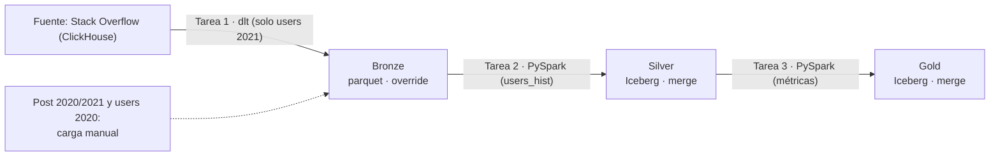

# Apuntes — Semana 9 (30 de Septiembre de 2026)

---

## 1. Resumen cronológico de la clase

> [!note] Cómo leer esta tabla
> Esta semana hubo **dos grabaciones** y cada sub-tabla usa los timestamps de la suya (sirven para ubicar el momento en el video, no son la hora del reloj):
> - **Parte 1 (00:00:01–02:14:10, ≈ 2 h 14 min):** las **exposiciones express de la Tarea 2 (Apache Airflow)** por los siete grupos.
> - **Parte 2 (00:00:03–00:30:30, ≈ 30 min):** grabada **aparte**, la **socialización del Proyecto 2** (arquitectura Lakehouse).
>
> No hubo **diapositivas nuevas del profe**: cada grupo usó su propia presentación.

### Parte 1 — Exposiciones de la Tarea 2 (Airflow)

| Franja (parte 1) | Qué pasó |
| --- | --- |
| 00:00:01–00:03:50 | Dinámica: **exposición express** (15 min de presentación + ejecución del DAG en vivo). El **grupo 6 pide abrir** y el resto del orden sale por una "ruleta" (00:01:27–00:03:07): **6 → 5 → 1 → 2 → 3 → 4 → 7**. Se enciende el temporizador. |
| 00:04:03–00:25:13 | **Grupo 6**: teoría de Airflow (qué es, componentes, DAG, versiones 3.0–3.3) + demo en vivo que **corre bien** (2 workers en paralelo). El profe corrige: usar **PythonOperator** y **SparkSubmitOperator**. |
| 00:26:18–00:46:05 | **Grupo 5**: teoría (componentes, Airflow 3.0, versionado, backfills, Edge, eventos, IA, Data Assets) + demo con **tropiezos** (doble clic, errores) que termina corriendo. Mensajes para todos: **librerías preinstaladas** y **override**. |
| 00:46:55–00:59:44 | **Grupo 1**: teoría (historia, componentes, últimos lanzamientos, cuándo NO usar Airflow) + demo que **no corre** (errores de importación; "no encuentra el bucket"); el profe los guía y les da plazo hasta el final de la clase. |
| 01:00:38–01:13:11 | **Grupo 2**: teoría muy completa (vocabulario, arquitectura, executors, 2 vs 3, empresas, Common AI Provider) + demo **rápida y exitosa** (~35 s; reseteo de la tabla Gold). |
| 01:13:45–01:30:10 | **Grupo 3**: teoría (componentes, triggerer, DAG vs DAG Run, reglas de disparo, 3.3 del 6 de julio) + demo de ~2 min OK. El profe pregunta por la **carpeta nueva** al re-ejecutar (override). |
| 01:30:19–01:47:37 | **Grupo 4**: solo teoría (desafíos de cron, arquitectura, casos de uso, evolución). **No corren el DAG** (sin recursos: <1 GB de almacenamiento). Deben **grabar el video** del DAG corriendo. |
| 01:48:24–02:09:05 | **Grupo 7**: teoría (esquema oficial, Docker Compose, comparación con Dagster/Luigi, línea de tiempo, "¿DAGs en loop?") + demo con **problemas** (imagen de MinIO, RAM): "se cayó todo" y queda un fail. |
| 02:09:12–02:12:28 | **Grupo 1 vuelve a mostrar el DAG ya corregido**: la validación de Nessie apuntaba a la **API v1** (toca v2) y el Docker tenía solo **4 GB de RAM**; al final el DAG **termina** y se verifican MinIO y Nessie. |
| 02:12:28–02:14:10 | Cierre: pendientes (grupos **4 y 7**: video del DAG **hasta las 12**); balance ("que se **apropien de los conceptos**", "usen los **ejecutores de Spark**"); anuncio del **parcial** y de la **presentación del proyecto**; pasa a grabar aparte la socialización (02:14:10). |

### Parte 2 — Socialización del Proyecto 2 (grabación aparte)

| Franja (parte 2) | Qué pasó |
| --- | --- |
| 00:00:15–00:04:24 | Alcance y arquitectura: objetivo del Proyecto 2 (Lakehouse open source) y **Medallón** (bronze/silver/gold) con sus reglas de escritura ("todo esto es obligatorio"). |
| 00:04:24–00:07:08 | Orquestación con Airflow: **DAG de 3 scripts** (dlt → bronze; silver; gold), **un solo play**, ==ejecutar ≥1 h antes de la clase== y **notebooks de respaldo** en Jupyter con nombres obligatorios. |
| 00:07:49–00:10:45 | Infraestructura y dataset: **un solo Docker Compose + README** (despliegue, comandos, accesos); dataset **Stack Overflow** (por años y pesado; de ahí las simplificaciones). |
| 00:11:28–00:15:34 | Entregables, consultas y rúbrica: diagrama de arquitectura; **Trino** (Silver→Gold) y **Dremio** (Gold); rúbrica **20/30/30/20**; Trino/Dremio se usan con **DBeaver**. |
| 00:16:06–00:17:30 | Simplificación del alcance: **2 años por dataset en bronze**, pero solo **users 2021** por el pipeline (dlt); el resto se carga **manualmente**. |
| 00:17:55–00:21:24 | **MinIO**: la imagen del profe ya no funciona (**401/403**); alternativas: **fork de Juan (G7)** o **"Flossy" (por confirmar)**; el profe probará otra imagen en la semana. |
| 00:21:24–00:23:09 | Qué va por pipeline y qué es manual (`post_hist` manual; `users_hist` por pipeline; **gold sí o sí en el pipeline**); flujo: tarea 1 → tarea 2 → tarea 3. |
| 00:23:29–00:24:41 | Comentarios de RAM: "lo mínimo [son] 16 [GB] y se queda cortico"; anécdota del PC de 4 GB. |
| 00:24:41–00:25:35 | Fechas: ==**parcial el 7 de octubre**== y ==**presentación el 14 de octubre**==; asesorías la otra semana (fechas "5" y "2" **por confirmar**). |
| 00:26:07–00:27:03 | Qué se revisa en la presentación: servicios corriendo, tablas **sin duplicados** en MinIO, **catálogo persistente**, **SparkSubmitOperator** y la consulta Silver→Gold; "no vamos a hablar de nada conceptual". |
| 00:27:31–00:29:27 | Recomendaciones si el PC no aguanta: bajar a **6 o 3 meses** de registros (**~300 mil**) con Python/PyArrow/DuckDB; que los años hagan match para los joins. |
| 00:29:47–00:30:30 | **Entrega por repositorio Git** (ya no zips): todo el proyecto subido al repo; ==el link se pasa el día de la presentación== y el profe **clona** todos los repos. |

> [!important] Tareas, entregas y fechas (lo que dejó esta clase)
> - ==**Parcial del corte 2: miércoles 7 de octubre de 2026**== ("la otra semana es el parcial", parte 1, 02:12:48; parte 2, 00:24:41).
> - ==**Presentación del Proyecto 2: miércoles 14 de octubre de 2026**== ("entre 15 días es la presentación del proyecto", parte 1, 02:12:48; parte 2, 00:25:00).
>   - ==**Ejecutar el DAG al menos 1 hora antes de la clase**== para tener los datos frescos y mostrar todo escrito en bronze, silver y gold (parte 2, 00:05:31).
>   - ==**Entrega por repositorio Git (ya no zips)**==: compose, README, DAG, notebooks, consultas y diagrama; ==el link se pasa el día de la presentación y el profe clona todos los repos== (parte 2, 00:29:47–00:30:22).
> - **Pendientes inmediatos de la clase:** ==los grupos 4 y 7 debían enviar el video del DAG corriendo "hasta las 12"== — grabado el mismo día, con OBS o PowerPoint y la hora visible; el grupo 7 podía terminarlo antes de acabar la clase y la entrega del video podía quedar para el día siguiente cuando hubiera internet (parte 1, 01:46:30–01:47:24, 02:12:28, 02:13:51).
> - **Imagen de MinIO:** ==la imagen que compartió el profe ya no funciona (error 401/403)==. Alternativas: el **fork que pasó Juan (grupo 7)** por el chat o **"Flossy" (por confirmar)** (simulador de servicios cloud; se puede desplegar solo S3). El profe probará otra imagen durante la semana (parte 2, 00:17:55–00:21:24).
> - **Asesorías:** la otra semana se puede escribir al profe para agendar espacios de asesoría del proyecto (fechas "5" y "2" **por confirmar**) (parte 2, 00:25:17).
> - **Reglas para el proyecto que se repitieron en las exposiciones:** ==usar **PythonOperator** y **SparkSubmitOperator**== (parte 1, 00:22:17–00:23:09); ==librerías **preinstaladas** (no quemadas en el script)== (00:43:04–00:43:44); ==escritura **override** (sobrescribir; sin carpetas nuevas)== (00:45:47, 01:30:10).

> [!note] Fuentes de estos apuntes
> - **Transcripción, parte 1 (exposiciones)** — [[Big Data/Apuntes/Recursos/Semana 09/Transcripción - 30 de Septiembre (Parte 1)]] (fuente principal: 00:00:01–02:14:10).
> - **Transcripción, parte 2 (socialización del Proyecto 2)** — [[Big Data/Apuntes/Recursos/Semana 09/Transcripción - 30 de Septiembre (Parte 2)]] (grabación aparte: 00:00:03–00:30:30).
> - **Consigna del Proyecto 2** — [[Big Data/Trabajos/Corte 2/Proyecto 2 - Arquitectura Lakehouse/Consigna - Proyecto 2]].
> - **No hubo diapositivas nuevas del profe:** cada grupo usó su propia presentación (no se archivan en la vault). La única referencia documental de la semana es el PDF de la consigna del Proyecto 2 (enlace y páginas clave en [[#6. Recursos de la semana]]).

---

## 2. Exposiciones de la Tarea 2 (Apache Airflow) por grupo

La clase fue la **exposición express de la [[Big Data/Trabajos/Corte 2/Tarea 2 - Apache Airflow/Consigna - Tarea 2|Tarea 2]]**: 15 minutos de presentación + ejecución del DAG en vivo. El **grupo 6 pidió abrir** y el resto del orden salió con una "ruleta" (00:01:27–00:03:07): **6 → 5 → 1 → 2 → 3 → 4 → 7**. Todos presentaron su pipeline `Spark Load to Iceberg` orquestado con Airflow.

> [!note] Sobre los nombres
> La diarización mezcla voces, así que se atribuye "un integrante del grupo" salvo cuando el nombre es inequívoco (nombres declarados al presentarse o cuando el profe los nombra). Los nombres dudosos se conservan con "(por confirmar)".

### Grupo 6 (00:04:03–00:25:13)

**Quién expuso:** intervinieron **cuatro voces**; el grupo declaró a **Adin Melo, Nicolás Zapata y Luis García** (00:04:03); no es posible asignar cada nombre a una voz concreta (quien cubrió las versiones es llamado "Nicolás").

**Qué mostraron (teoría):**

- Qué es: plataforma open source para desarrollar, programar y monitorear **workflows mediante código**; nació en **Airbnb en 2014** y hoy es un proyecto de Apache usado en producción (00:04:22).
- Idea clave: "**Airflow no procesa grandes cantidades de datos por sí solo, sino que orquesta** las herramientas que hacen ese procesamiento" (00:04:39); sin Airflow tocaría ejecutar el script 1, esperar, verificar, ejecutar el 2…
- Características: **dinámico** (workflows en Python con bucles y funciones), **escalable** (Local, Celery, Kubernetes) y **robusto** (reintentos automáticos, alertas y recuperación ante fallos).
- Componentes: **Web Server** (:8080; monitorear, disparar y ver tareas), **Scheduler** (decide qué tarea ejecutar y cuándo, respetando dependencias), **Executor** (en su caso **Celery**, reparte el trabajo entre workers) y **metadata database** (**Postgres**: estado e historial) (00:05:42–00:06:19).
- **DAG** (*Directed Acyclic Graph*): dirigido (con sentido), acíclico (sin ciclos ni loops) y grafo (nodos = tareas, aristas = dependencias) (00:07:26).
- Casos de uso: ETL/ELT, Data Lakes/Lakehouse (Iceberg o Delta Lake), ML, reportes periódicos y sincronización de APIs/bases de datos (00:08:05).
- El script **Spark Load to Iceberg**: seis pasos (validar, conectar, localizar, crear, cargar y validar con integridad); toma el parquet de **MinIO** y crea la tabla del proyecto (**yellowtrip**) en el catálogo de **Nessie** con ~3 millones de registros de **NYC TLC** (00:08:38–00:09:20).
- Estructura de su DAG: log de inicio → validar prerequisitos → pipeline → log final; características: ejecutar n veces sin duplicar datos, reintentos automáticos, monitoreo en la UI y **TaskGroup**; cada tarea corre dentro de un worker con **BashOperator** (00:09:41–00:10:43).
- Versiones: **3.0** (React y FastAPI, versionado de DAGs, scheduling por eventos, Task SDK cliente-servidor), **3.1** (Human in the Loop), **3.2** (assets particionados, observabilidad) y **3.3** (gestión de estado entre tareas, multilenguaje, observabilidad remota) (00:11:19–00:13:17).
- Pregunta interna: ¿por qué el compose usa **2.10.3** y no la 3.x? → es la versión más probada, con documentación y el compose Celery + Postgres ya configurado; migrar "no compensa tanto" (00:13:58–00:15:25).

**Demo:** integraron Airflow a su propio compose (scheduler, triggerer, web server y worker; **Redis** como cola; **Postgres** para metadatos) y corrieron el DAG en vivo: tareas **en paralelo con 2 workers**; al final en **MinIO** se veían los datos y los metadatos creados (00:23:33–00:24:24). También usaron su proyecto del periodo pasado como apoyo (00:20:56).

> [!tip] Feedback del profe — lo que quedó bien
> - "Ya con eso vimos que **ejecutó correctamente**. Y básicamente ya también adelantaron parte del proyecto" (00:24:38).
> - "Ya le está funcionando y **ya mandan el trabajo al job**, que es lo que importa" (00:25:06). El grupo aclaró que era "un borrador" (00:25:00).

> [!warning] Corrección del profe — operators (mensaje para todos)
> - Les preguntó por qué usaban **BashOperator** si los scripts eran de Python (00:22:17). Recomendación: "utilicen directo para el proyecto el de **Python**, que para eso está" (00:22:39) y "para el script de Spark, utilicen el **SparkSubmitOperator** directamente… **para todos**, no solo para ustedes" (00:22:52).

### Grupo 5 (00:26:18–00:46:05)

**Quién expuso:** cuatro voces (componentes; casos de uso y demo; versionado/backfills/Edge/eventos/IA/Data Assets; conclusión). El profe nombra a **José David** en la demo (00:44:32); los demás nombres no se declaran.

**Qué mostraron (teoría):**

- Qué es: plataforma **open source escrita en Python** para programar, orquestar y supervisar flujos de trabajo **por lotes**; creada por **Airbnb (2014)** y hoy pertenece a la **Apache Software Foundation** (00:26:38).
- Características: DAGs en Python (flujos dinámicos), extensible (cientos de conectores nativos), escalable (de un servidor a clústeres en la nube) y observable (interfaz con monitoreo, logs y alertas).
- Componentes: **planificador** ("el cerebro": revisa los DAGs y determina qué tareas están listas), **web server** (interfaz: estado, encendido/apagado, logs y conexiones), **base de datos de metadatos** (Postgres/MySQL) y **worker** (el trabajo pesado) (00:27:34–00:28:14).
- Casos de uso: manejo masivo de información, construcción de rutas de datos y conexión de herramientas (locales y en la nube).
- **Airflow 3.0**: estructura más flexible (las partes crecen o se reparan de forma independiente), panel visual más rápido y **multilenguaje** (ya no solo Python: Java, Rust, Go) (00:30:12–00:31:13).
- Innovaciones: **versionado de DAGs** (relacionar una ejecución histórica con la versión del DAG que corrió), **backfills** (re-ejecutar un periodo anterior; ahora desde la interfaz), **ejecución Edge** (acercar la ejecución a los datos: menos latencia y costo de transferencia), **programación por eventos** (mensajes de Kafka, webhooks), **soporte para IA/RAG** y **Data Assets** (los datos como activos con información asociada: disponibilidad, calidad, origen) (00:31:36–00:37:54).
- Conclusión: el salto a la 3.x es un cambio real de arquitectura (distribuida, Task SDK, versionado, eventos, monitoreo).

**Demo (con tropiezos):** la primera tarea ("verificar origen") **crea el catálogo**; el profe los guio por los logs (00:42:18–00:43:04); hubo un **doble clic en "ejecutar"** que generó errores — "yo lo detuve porque no quería ejecutar dos veces" (00:44:28) —; re-ejecutaron y el DAG terminó (Spark Master + workers).

> [!tip] Feedback del profe — lo que quedó bien
> - "**Eso es normal, las pruebas**" (00:44:32), después de la broma "si el grupo está de acuerdo, solo le bajo a José David" (00:44:32).

> [!warning] Dos reglas para el proyecto (mensaje para todos)
> - **Librerías preinstaladas:** "para el proyecto del segundo corte… todas las dependencias [están] quemadas en el script… En el proyecto, **todas las librerías ya tienen que estar preinstaladas**" (00:43:04–00:43:44); instalarlas en vivo "no es eficiente" y pierde tiempo.
> - **Override:** "no tienen que crearles una carpeta nueva cada que creen la tabla, sino que tienen que **sobrescribir la que ya existe**, para que lo tengan en cuenta todos para el segundo corte" (00:45:47).

### Grupo 1 (00:46:55–00:59:44 · ajuste y demo final: 02:09:12–02:12:28)

**Quién expuso:** cinco intervenciones: abre y hace la demo (Est. 17); componentes y casos de uso (Est. 25); **Gomez (yo)** en "últimos lanzamientos"; moderación (Est. 7); y quien comparte pantalla (Est. 14).

**Qué mostraron (teoría):**

- Qué es e historia: plataforma open source para crear flujos de datos; **2014 Airbnb → 2015 open source → 2019 proyecto de nivel superior**; hoy "el estándar global de la orquestación" (00:46:55–00:47:55).
- Arquitectura modular y desacoplada: separa **orquestación, ejecución y monitoreo**; Scheduler, Workers y Web Servers interactúan coordinados por una **base central de metadatos**.
- Componentes: **Scheduler** (evalúa tiempos y dependencias), **Executor** (local o distribuido), **Web Server** (interfaz), **base de datos** (estado, variables, conexiones) y **DAG directory** (scripts de Python) (00:48:37–00:49:27).
- Beneficios: orquestación con DAGs, código en Python, observabilidad, escalabilidad, modularidad e integración con nubes.
- Casos de uso: automatización, cumplimiento y gobernanza (linaje, validación, auditorías), reportes automatizados y monitoreo de alertas.
- Últimos lanzamientos: **políticas de reintento conectables + asistidas por IA** (con 3.3 se definen reglas según la excepción y una IA clasifica el error y decide si vale la pena reintentar), **soporte multilenguaje** (Task SDK: tareas en Go o Java que se comunican con el scheduler por una API interna) y **particionamiento de assets** (3.2: reaccionar solo a las porciones que cambiaron) (00:51:01–00:53:15).
- **Cuándo NO usar Airflow:** procesamiento en tiempo real (flujos continuos), tareas muy frecuentes y cortas (el costo de registrar cada ejecución no compensa; Airflow es para frecuencias de horas o diarias) y procesamiento pesado dentro de Airflow. Frase clave: "**Airflow es como más el director que coordina, no el que toca o usa los instrumentos**" (00:54:40).

**Demo (no corrió en su turno):** ninguno de los cuatro logró correrlo: errores de importación en los notebooks y logs que mostraban que **no encontraba el bucket** (00:56:39–00:58:02). El profe los guio: revisar el log de la primera tarea; probar **quitando la task que crea el contenedor en MinIO** ("ese no es necesario") y ejecutando solo la segunda tarea; o **modificar el DAG eliminando la primera y la última** para "que solo ejecute el centro" (00:57:12–00:59:17).

**Ajuste posterior:** volvieron al final de la clase (02:09:12) con el DAG corregido. Dos causas: la **validación de Nessie apuntaba a la API vieja (v1)** → "Toca usar la versión 2" (02:11:09–02:11:30); y el Docker tenía solo **4 GB de RAM**, "entonces se estaba cayendo cada rato" (02:11:32). El DAG terminó ("ya acabó") y se verificaron **MinIO** y **Nessie**; worker de 2 GB (02:11:43–02:12:08).

> [!tip] Feedback del profe
> - Les dio plazo: "**Tienen tiempo hasta que termine el último grupo** para presentar ese ajuste, que les funcione" (00:59:49). Al final: ejecución OK.
> - Anuncio al pasar: "al final vamos a hablar del proyecto del curso" (00:47:52).

### Grupo 2 (01:00:38–01:13:11)

**Quién expuso:** cinco voces; quien abre declaró los integrantes: **Michel Burgo, Nicolás Cuara, Ryan Carvajal (por confirmar), Sebastián Velásquez (por confirmar)** y él mismo, **Juan David** (01:00:38).

**Qué mostraron (teoría):**

- Qué es: herramienta open source de orquestación; idea central **workflows as code**; cada flujo se define como un **DAG** (grafo dirigido acíclico: nodos = tareas, aristas = dependencias); al ser código se puede versionar en Git (01:00:58).
- Funcionamiento: el scheduler evalúa los DAGs y envía la tarea a un worker cuando se cumplen sus dependencias; todo el estado queda en la **base de metadatos**; de ahí salen reintentos, backfills y monitoreo (01:01:36).
- Historia: Airbnb 2014 → comunidad Apache 2016 → **3.0 en 2025**; "Airflow **no procesa los datos, los orquesta**: decide qué se ejecuta, cuándo y en qué orden" (01:02:16).
- **Vocabulario:** task; **operators** ("plantillas": Python, Bash, Spark — "que es el que vamos a usar en la demo"); **sensor** (espera algo, p. ej. un archivo); **hooks y conexiones** (sistemas externos y credenciales); **XCom** (pasar datos pequeños entre tareas); **schedule** y **DAG Run** (01:02:32–01:03:48).
- Arquitectura interna: web server → scheduler (con el executor) → workers → **metadata database** (Postgres) → **DAG directory** (archivos Python); **triggerer** opcional para tareas que esperan sin ocupar un worker (01:03:48–01:04:52).
- **Ciclo de una tarea en 5 pasos**: el DAG processor lee el archivo y lo guarda en la base; el scheduler detecta que se cumplieron las dependencias; el executor la encola; un worker la ejecuta; la interfaz muestra estado y logs. Estados: **queued, running, success, up for retry, failed** (01:05:18–01:05:55).
- Executors: **Local** (misma máquina), **Celery** (workers distribuidos + cola Redis; el de la demo), **Kubernetes** (un pod por tarea) y **Edge** (equipos remotos) (01:06:00).
- **Airflow 2 vs 3:** el web server pasa a **API server** con interfaz en **React**; el analizador de DAGs (por confirmar) es un componente aparte; los workers ya no entran directo a la base, pasan por la **task execution API** (mejor seguridad); llegan **assets**, **versionado de DAGs** y **backfills desde la interfaz** (01:06:36–01:07:03).
- Casos de uso: ETL/ELT (Data Lake/Warehouse), **MLOps** (preparar, entrenar y reentrenar), Business Ops (reportes y dashboards) y gestión de infraestructura (clústeres temporales) (01:07:19–01:07:54).
- Empresas: **ADN (por confirmar)**, **Sift** (ciberseguridad; ML y ETL), **OneFootball** (transformaciones SQL, ML y analíticas) y **Adobe** (Spark y otros workflows) (01:08:13–01:08:49). Lo que no es: streaming en tiempo real (Kafka/Flink) ni procesamiento pesado propio; para una tarea simple "un **cron** puede ser suficiente" (01:09:12).
- Evolución: **2.10 (ago-2024)**, **3.0 (abr-2025)**, **3.1** (aprobaciones humanas y deadlines), **3.2** (assets particionados), **3.3 (jul-2026)** (estado de tareas, Task SDK Java/Go) (01:09:30–01:10:15).
- **Common AI Provider** (abril de 2026): decoradores **`task.llm` / `task.agent`** (un paso del DAG llama a un modelo o agente), más de 20 proveedores y aprobaciones humanas; "es una versión 0.1" (01:10:28–01:11:05).

**Demo:** "Tarda, yo creo que **35 segundos máximo**" (01:11:05): **CheckServices** (revisa MinIO y Nessie) → creación de buckets → ingesta a bronce → **reseteo de la tabla Gold** ("para que no aparezcan nuevas carpetas, sino que en la misma carpeta se restablezca todo", 01:11:40) → carga a Iceberg (**3.400.000 registros**) → validación. Mostraron **Nessie** (Yellow Trip), **MinIO** (finished) y los logs de la última tarea (01:12:04–01:12:45).

> [!tip] Feedback del profe
> - "**Todo claro, bien. Les corrió bastante rápido**, ¿verdad? Y eso que solo tienen ahí… ¿un worker de 2 GB de RAM?" → "no es mucho, dos gigas" (01:12:59–01:13:05).
> - "Curioso, porque debe ser por las **tareas de limpieza de la tabla** para que fuera más rápido" (01:13:11).

### Grupo 3 (01:13:45–01:30:10)

**Quién expuso:** cinco voces: abre y cierra; qué es y componentes; API server/metadata/triggerer/ventajas; **Juan Felipe** (estructura del DAG y ejemplo; nombrado por el profe, 01:19:10); y ejemplo ETL y casos de uso.

**Qué mostraron (teoría):**

- Qué es: herramienta para organizar y automatizar procesos con varias tareas (sacar datos → transformar → generar reporte), con visibilidad del estado y de los errores; "Airflow no es el que transforma los datos… se encarga más que todo de **coordinarlos**" (01:14:29–01:15:28).
- Componentes: **DAG**, **DAG Processor** (lee el flujo y lo deja listo), **Scheduler** (espera las dependencias), **executor** y **tasks** (01:15:50–01:16:35).
- Además: **workers** (ejecutan), **API server** (interfaz web + APIs por las que las tareas comunican su estado), **base de metadatos** (información operativa; "no confundirla con el almacén de datos") y **triggerer** (tareas diferidas; vigila eventos de forma **asíncrona** para no mantener un worker ocupado) (01:16:56–01:17:57).
- Ventajas del DAG como código: dinámicos (se generan a partir de parámetros), extensibles (operadores de integración) y flexibles (**plantillas de Jinja**); revisables en equipo y versionables (01:18:25–01:18:52).
- **DAG vs DAG Run**: el DAG es la plantilla del flujo; el DAG Run es una ejecución ("darle vida a esa plantilla"); cada tarea espera a que las anteriores terminen, y las **reglas de disparo** permiten ajustar ese comportamiento (01:19:18–01:22:21).
- Ejemplo de DAG: `ingest` → `analyze` → `check integrity` → `save` (si todo bien) o `describe integrity` + `email error` (si hay errores) → `report` final (01:20:11–01:20:44).
- Diseñar el flujo no es solo dibujar flechas: qué hacer si falla la extracción, qué resultados se necesitan para el siguiente paso y cuándo vale la pena un reintento; "el reintento automático no es una solución mágica" (si el error es de lógica o los datos están corruptos, no lo arregla) (01:22:21–01:23:03).
- Ejemplo ETL (reporte diario de ventas) y casos de uso: ML (reentrenamiento y métricas), **calidad de datos** (nulos, duplicados, alertas) y orquestación de herramientas (empezar en un ambiente y terminar en otro, p. ej. Spark) (01:23:03–01:25:31).
- Versión **3.3** (lanzada el **6 de julio de 2026**): almacenamiento de estado para tareas (puntos de control), Task SDK ampliado a Java/Go (experimental; el DAG se sigue declarando en Python), activos particionados y políticas de reintento extensibles (01:25:58–01:27:21).

**Demo:** corrió en ~2 minutos; mostraron el DAG en Airflow y el resultado en **MinIO (gold)** y **Nessie (catálogo)** (01:28:46–01:29:50).

> [!warning] Feedback del profe — la carpeta nueva (mensaje para todos)
> - Preguntó si al ejecutar se creó una **carpeta adicional** o si estaban sobrescribiendo; el grupo: "tal vez se creó una" (01:29:53–01:30:07).
> - "**Eso es un mensaje para todos**… Ahorita ya para el proyecto. Eso tienen que corregirlo" (01:30:10).

### Grupo 4 (01:30:19–01:47:37)

**Quién expuso:** tres voces (abre; estructura/arquitectura y reporte del caso; casos de uso y evolución). Miembro ausente: **Alejandro Estrada** (problemas de energía/red; el correo también mencionaba a "Diego") (01:45:41–01:46:07).

**Qué mostraron (teoría):**

- Desafíos previos: procesos con herramientas básicas como **cron** → frágiles, **fallas en cadena** (si una API falla, todo lo que depende falla o se procesa mal) y **falta de visibilidad**; se necesita centralizar dependencias, reintentos y control (01:31:26–01:32:42).
- Qué es: plataforma open source (2014) para flujos complejos; **flujos como código** en Python (control de versiones, pruebas, trabajo colaborativo); "es un **director** que orquesta" (01:33:01–01:33:56).
- Estructura del DAG: **sensor** (en stand-by hasta que se cumpla una condición), **tasks** y **operadores** (plantillas predefinidas); el DAG no permite bucles (01:34:10–01:34:49).
- Arquitectura: **web server** (interfaz, logs, activación), **scheduler** ("el cerebro": dependencias y cola), **workers** (procesos independientes), **metadata database** (historial y estados) y **triggerer** (tareas asíncronas en stand-by sin consumir CPU) (01:35:02–01:36:16).
- Casos de uso: ETL/ELT (ejemplo de tienda online: ventas del día → limpiar duplicados → cargar a un Data Warehouse tipo BigQuery/Redshift (por confirmar), 01:37:18); **MLOps** (degradación del modelo → reentrenar); **BI** (datos listos a las 4 a. m. para el informe diario); y **mantenimiento de infraestructura** (backups, limpieza de registros y encender/apagar clústeres: "los apagamos al terminar" para ahorrar costos) (01:36:34–01:40:09).
- Evolución 3.0→3.3: 3.0 (arquitectura orientada a servicios, ejecución remota, eventos, React, versionado de DAGs); 3.1 (pausar y esperar una decisión humana; desacoplamiento del Task SDK); 3.2 (precisión: ejecutar solo una parte de los datos, p. ej. una fecha o partición); 3.3 (mejoras generales: multilenguaje, eventos, UI) (01:40:28–01:42:48).
- Cuándo usar/no: madurez e integraciones ("el integrador más grande dentro de la industria"); no para streaming en tiempo real (latencia) ni cuando "un solo script sea suficiente" (01:43:19–01:44:37).

**Demo: no corrieron el DAG.** Reportaron que **ninguno de los tres tenía recursos** en el computador: a uno "se me queda colgado solamente con abrir el Docker" y tiene **menos de 1 GB de almacenamiento**; Alejandro Estrada estaba sin energía/red (01:45:41–01:46:30).

> [!warning] Pendiente asignado: video del DAG corriendo
> - "Tienen que **grabarme entonces la ejecución del DAG**. Que muestre que lo ejecutó ahorita… **Que lo grabe con OBS, con PowerPoint**. La ejecución ahorita. Y que **se vea la hora** exactamente en ese momento" (01:46:30–01:46:51).
> - "Que muestre el **DAG corriendo**, la creación en el **catálogo** y la creación de los **parquet dentro de MinIO**" (01:47:24).
> - Plazo: ==enviarlo "hasta las 12"== (02:12:28, 02:13:51).

### Grupo 7 (01:48:24–02:09:05)

**Quién expuso:** tres voces: arquitectura, Docker Compose y ventajas (Est. 8); esquema de la documentación, comparación de herramientas, la pregunta "¿los DAGs pueden ir en loop?" y la demo (Est. 2); importancia, DAG, casos de uso y línea de tiempo (Est. 5). Integrantes declarados: **Nicole Ruiz, Alejandro Rodríguez y Juan Esteban Viera** (01:49:18).

**Qué mostraron (teoría):**

- Qué es: plataforma open source para crear, programar y monitorear flujos; **2014 Airbnb** (cientos de procesos dependían entre sí y cron ya no alcanzaba) → **2016 incubadora Apache** → **2019 proyecto de primer nivel** (01:49:53–01:50:11).
- Dos ideas fuerza: los flujos se escriben en **Python** (un pipeline es un `.py` que se puede versionar en Git) y "**Airflow orquesta, pero no procesa**": le dice a Spark, a una base de datos o a una API qué hacer y cuándo; "**orquestar es decidir qué corre, cuándo, en qué orden y qué pasa si algo falla**" (01:50:28–01:51:05).
- Importancia en Big Data: dependencias (una tarea arranca cuando la anterior termina bien → consistencia), manejo de fallas y alertas, programaciones y visibilidad de estados y tiempos (01:51:23–01:52:30).
- **DAG**: nodos = tareas, flechas = dependencias; **Airflow rechaza los DAGs cíclicos** (si A depende de B y B de A, el scheduler no sabría cuál correr primero) (01:52:48–01:53:29).
- Esquema de la documentación: carpeta de **DAGs** (archivos `.py`) → **DAG processor** ("únicamente lee los archivos .py", por eso el notebook se convierte a script) → **scheduler** (crea las ejecuciones y decide) → **metadata DB** (Postgres: estado, historia, conexiones, usuarios; "si cae la base de datos, básicamente se cae Airflow") → **web server/API** (solo lee la base, no ejecuta) → **Celery + Redis** (cola) → **workers** (01:54:01–01:55:38).
- Recorrido de una tarea: **parseo** (se registra el DAG), **programación** (el scheduler crea la ejecución y mira dependencias), **encolado** (un worker la toma, la ejecuta y reporta); estados: programada, en cola, corriendo, éxito o fallo; si falla: reintentos y **up for retry** (01:55:52–01:56:22).
- **Docker Compose oficial (Airflow 2.10.3)**: Postgres (metadatos), Redis (cola de Celery), web server :8080, scheduler, worker, triggerer y **airflow-init** (corre una sola vez: prepara la base y crea el usuario); **Airflow CLI y Flower son opcionales**; todos comparten imagen, variables y carpetas (DAGs, logs, config, plugins) (01:56:38–01:57:38).
- Casos de uso: ETL y **Lakehouse** (Medallón bronce→gold), orquestar motores de procesamiento, ML, **IA generativa/RAG** (ingesta y vectorización de documentos), calidad de datos, reportes y mantenimiento; no es buena para **streaming** (01:57:50–01:59:08).
- Comparación: **Airflow** (comunidad fuerte, estándar de la industria, cientos de integraciones; punto débil: operar varios servicios), **Dagster** (piensa en activos de datos → buen linaje y calidad; conceptos más difíciles) y **Luigi** (de Spotify; liviano pero con interfaz limitada y poco mantenimiento) (01:59:08–02:00:17).
- Ventajas/desventajas: flujos como código, ecosistema de integraciones, UI con monitoreo y logs, escala con Celery/Kubernetes, comunidad; en contra: no es para tiempo real, exige mantener infraestructura, curva de aprendizaje alta y probar DAGs en local no es directo (levantaron Postgres, Scheduler, Web Server, Triggerer, Spark, MinIO y Nessie) (02:00:17–02:00:56).
- Línea de tiempo: **2014** Airbnb → **2020 Airflow 2.0** (varios schedulers, TaskFlow API) → **2.9 (2024)** (la imagen del stack de la clase) → **2.10.3** (el compose de la tarea) → **3.0 (abr-2025)** (reescritura: API server, interfaz nueva, versionado, eventos) → **3.1 (sep-2025)** (aprobaciones humanas, interfaz multiidioma) → **3.2 y 3.3 (2026)** (Java/Go, particiones) → **3.3.2 (17 de septiembre)** (02:01:27–02:03:45).
- Su pipeline: tomaron el notebook **Spark Load to Iceberg** de la semana y lo convirtieron en un **job de Spark lanzado con SparkSubmitOperator**: el DAG envía el trabajo al master, el master asigna recursos al worker, el worker lee el parquet de **taxis de enero de 2025** desde el bucket **bronce**, escribe la tabla Iceberg, registra el commit en **Nessie** (namespace **Gold**) y los archivos quedan en el bucket **gold**; "los datos **nunca pasan por Airflow**" (02:05:06–02:05:49).

> [!question]- ¿Los DAGs pueden ir en loop? (respuesta del grupo, 02:04:05)
> Con matices: **dentro de una ejecución el grafo sigue siendo acíclico**, pero ahora hay formas de **iterar alrededor de él**: **human in the loop** (3.1: la tarea se pausa hasta que una persona aprueba y elige una opción), **assets y eventos** (3.2: cuando un DAG actualiza un dato puede disparar a otro DAG o al mismo en una ejecución nueva; "el bucle existe, pero ocurre entre ejecuciones y cada vuelta queda registrada") y **reintentos + mapeo dinámico** (una tarea se repite o se multiplica mientras corre).

**Demo (con problemas):** usaron **otra imagen de MinIO** (un fork; "la que venía con la tarea no nos funcionaba"; la `latest` no descarga) (02:06:37–02:07:07); reiniciaron para la prueba; "requería tener varios [servicios] corriendo al tiempo y la RAM no va" (02:07:23); el DAG alcanzó a correr, pero "**se cayó todo**" y quedó un **fail** ("un momentico lo revisamos… no se ha caído Airflow", 02:08:48).

> [!warning] Feedback del profe
> - Sobre la imagen: "Se usaron como una especie de **fork** ahí del MinIO" (02:07:07); quedó en el chat **la nueva ruta para descargar la imagen de MinIO** (02:08:42).
> - "**Ingresa el DAG. Es que no has ingresado**" (02:07:17); el profe pidió revisarlo ("revisando mientras pasa el otro grupo 1", 02:09:05).
> - ==Pendiente: enviar el video del DAG corriendo hasta las 12== (o terminarlo antes de acabar la clase) (02:13:51).

### Cierre de la parte 1 (02:12:28–02:14:10)

- **Pendientes:** los grupos **4 y 7** deben enviar el video del DAG corriendo **hasta las 12** (02:12:28, 02:13:51).
- **Anuncios:** "La otra semana es el **parcial** y entre 15 días es la **presentación del proyecto**" (02:12:48).
- El profe cierra la parte 1 y **pasa a grabar aparte** la socialización del Proyecto 2 (02:14:10). El balance general del profe quedó en la sección 3.4.

---

## 3. Lecciones y feedback recurrente (síntesis)

### 3.1 Las reglas técnicas que el profe pidió aplicar al Proyecto 2

| Tema | Qué dijo el profe | Timestamp |
| --- | --- | --- |
| **Operators** | Para el proyecto: **PythonOperator** para los scripts de Python y **SparkSubmitOperator** para los jobs de Spark (no BashOperator). | 00:22:17–00:23:09 |
| **Dependencias** | **Librerías preinstaladas**: nada de instalar en vivo; el script no debe "quemar" dependencias. | 00:43:04–00:43:44 |
| **Escritura** | **Override** (sobrescribir): no crear una carpeta nueva cada vez que se crea la tabla (repetido en G3 y G5). | 00:45:47, 01:30:10 |
| **Ejecutores** | "Que utilicen los **ejecutores de Spark** para el proyecto" (jobs lanzados desde Airflow al clúster). | 02:13:29 |

### 3.2 "Airflow es el director de la orquesta"

> [!def] La idea que más se repitió
> Airflow **no procesa ni transforma datos: orquesta**. Le dice a las herramientas (Spark, bases de datos, APIs) **qué hacer y cuándo**, y el trabajo pesado lo hacen ellas. Frases de las exposiciones:
> - "Airflow no procesa grandes cantidades de datos por sí solo, sino que **orquesta** las herramientas que hacen ese procesamiento" (G6, 00:04:39).
> - "Airflow **no procesa los datos, los orquesta**: decide qué se ejecuta, cuándo y en qué orden" (G2, 01:02:16).
> - "**Airflow es como más el director que coordina, no el que toca o usa los instrumentos**" (G1, 00:54:40).
> - "**Airflow orquesta, pero no procesa**… orquestar es decidir qué corre, cuándo, en qué orden y qué pasa si algo falla" (G7, 01:50:28–01:51:05).
> - En el pipeline del curso, "los datos **nunca pasan por Airflow**": Spark lee y escribe directamente en MinIO (G7, 02:05:49).

### 3.3 Conceptos de Airflow que dejaron las exposiciones

> [!def] Definiciones clave
> - **DAG (Directed Acyclic Graph):** el flujo completo; nodos = tareas, aristas = dependencias; dirigido (con sentido) y acíclico (sin bucles). Airflow **rechaza los DAGs cíclicos**.
> - **DAG Run:** una ejecución concreta de un DAG ("darle vida a la plantilla"); cada tarea tiene su instancia y sus estados: **queued, running, success, up for retry, failed**.
> - **Versionado de DAGs:** relacionar cada ejecución histórica con la versión del código que corrió (saber "con qué versión del DAG se ejecutó esto").
> - **Backfill:** volver a ejecutar un proceso para un periodo anterior; antes por CLI, ahora desde la interfaz.
> - **Ejecución Edge:** ejecutar tareas cerca de donde están los datos (menos latencia y costo de transferencia).
> - **Programación por eventos y assets:** disparar DAGs cuando llega un dato (mensaje de Kafka, webhook, cambio de tabla) en vez de solo por horario; en 3.2 los assets pueden estar **particionados** (solo reacciona a las porciones que cambiaron).
> - **Human in the loop:** una tarea se pausa hasta que una persona aprueba desde la interfaz y el flujo continúa según su respuesta.
> - **Data Assets:** ver los datos como activos con información asociada (disponibilidad, calidad, origen) para decidir cuándo ejecutar.
> - **XCom:** mecanismo para pasar datos pequeños entre tareas.
> - **Triggerer:** componente opcional que vigila tareas diferidas de forma **asíncrona** para no ocupar un worker.

> [!note] Versiones de Airflow mencionadas en las exposiciones
> | Versión | Fecha | Novedades |
> | --- | --- | --- |
> | **2.10.3** | 2.10: ago-2024 | La del compose de la Tarea 2; la más probada (por eso el curso no migra a 3.x). |
> | **3.0** | abril de 2025 | Reescritura: **API server** + interfaz en **React**, Task SDK cliente-servidor, **versionado de DAGs**, scheduling por eventos, ejecución remota, arquitectura orientada a servicios. |
> | **3.1** | septiembre de 2025 | **Human in the Loop** (aprobaciones), alertas de deadlines, desacoplamiento del Task SDK. |
> | **3.2** | abril de 2026 | **Assets particionados** (precisión de datos: ejecutar solo una fecha/partición), observabilidad. |
> | **3.3** | 6 de julio de 2026 | Almacenamiento de estado entre tareas, **Task SDK para Java y Go** (experimental), activos particionados ampliados, **políticas de reintento extensibles** (con IA). |
> | **3.3.2** | 17 de septiembre de 2026 | Versión vigente mencionada por el Grupo 7. |
> | **Common AI Provider** | abril de 2026 | Decoradores `task.llm` / `task.agent`; más de 20 proveedores de modelos; aprobaciones humanas; "versión 0.1". |

### 3.4 Balance general del profe

> [!tip] Cierre de las exposiciones (02:13:11–02:13:29)
> - "En general les fue muy bien en las presentaciones, los casos de uso, las ejecuciones. Ahí lo importante es justamente que **se apropien de los conceptos**. Ir un poquito más al detalle, sobre todo de los **componentes**, una parte un poquito más técnico. Y de resto bien".
> - "Sobre todo también el tema de los ejecutores: que utilicen, que utilicen los de **Spark** para el proyecto".
> - Detalles operativos: **override** en las tablas, **librerías preinstaladas** y demos **re-ejecutables** sin duplicar carpetas fueron los puntos que más se corrigieron en vivo.

---

## 4. Socialización del Proyecto 2 (parte 2, grabación aparte)

El profe pasó a **grabar aparte** (02:14:10) la socialización del **Proyecto 2 del corte 2**: "despliegue de la arquitectura Lakehouse open source con un pipeline de ingesta y carga de datos". La consigna completa está en [[Big Data/Trabajos/Corte 2/Proyecto 2 - Arquitectura Lakehouse/Consigna - Proyecto 2]] (aquí solo se resume lo que se habló en clase; el detalle oficial no se duplica).

### 4.1 Qué pide el proyecto (resumen)

- **Objetivo:** diseñar y desplegar la **arquitectura Lakehouse open source** con **MinIO** (object storage), **Apache Iceberg** (formato de tablas), **Spark/PySpark** (procesamiento), **Nessie** (catálogo), **Airflow** (orquestación), **dlt** (ingesta) y **Dremio/Trino** (motores SQL), implementando la **arquitectura Medallón** (Bronze → Silver → Gold) (00:00:15–00:01:28).
- "Si ya del corte pasado agregaron los motores SQL y ahorita Airflow con Spark, **el despliegue de la arquitectura ya lo tienen listo**: el proyecto es **darle uso**" (00:00:41, 00:25:35).

| Capa | Formato | Escritura | Reglas que dio el profe |
| --- | --- | --- | --- |
| **Bronze** | Parquet | **Override** (se sobrescribe al re-ejecutar) | Datos crudos anuales de la fuente; **cargar más de un año** |
| **Silver** | Iceberg | **Merge** (no override) | Tablas curadas, normalizadas e históricas; maneja duplicados y cambios históricos; ==columna de fecha de carga== |
| **Gold** | Iceberg | **Merge** | Reglas de negocio y agregaciones (métricas, KPIs, tablas analíticas); ==columna de fecha de carga== |

> [!warning] "Todo esto es obligatorio" (00:04:06)
> "Básicamente, **nada es opcional**": override solo en bronze; silver y gold con **merge** y **columna de fecha de carga** (la de control/auditoría que ya se venía pidiendo desde el corte 1).

### 4.2 Orquestación: DAG de 3 tareas + notebooks de respaldo

- Todo se ejecuta **desde Airflow**, que orquesta **tres scripts**: (1) ingesta con **dlt** desde la fuente → bronze; (2) lee bronze y consolida las **tablas históricas** en Iceberg → silver; (3) lee silver y genera las **tablas de agregación** → gold (00:04:31–00:04:57).
- ==El DAG debe ejecutarse completo con un solo "play" en Airflow.==
- ==Ejecutar el DAG al menos 1 hora antes de la clase== para tener los datos frescos y revisar que todo se escribió en bronze, silver y gold; si no, la corrida puede demorar 10 minutos o más (00:05:31–00:05:47).
- **Notebooks de respaldo en Jupyter** con los mismos tres scripts, por si el profe pide ejecutarlos cuando algo falle en Airflow (00:06:00–00:06:54).
- **Nombres obligatorios:** `bronze_ingest`, `silver_transform`, `gold_aggregation` (en el PDF de la consigna figuran como `bronze_ingest.ipynb`, `silver_transform.ipynb`, `gold_agg.ipynb`) (00:06:23).
- Si algo se ve raro en la presentación, el profe puede pedir correr el DAG completo en vivo (00:07:08–00:07:26).

### 4.3 Infraestructura, dataset y alcance simplificado

- **Entregable de infraestructura:** todos los servicios en **un solo Docker Compose** + **README** con instrucciones de despliegue, comandos necesarios, accesos, usuarios y contraseñas (00:07:49–00:07:56).
- **Dataset:** **Stack Overflow** (el de ClickHouse): Posts, Users, Votes, Comments, Badges, PostLinks, PostHistory; cada tabla viene **por años** y los parquets son pesados (en la primera edición del curso "se les empezó a estallar los PCs"; de ahí las simplificaciones) (00:08:16; el problema de los PCs se contó al inicio, 00:02:08–00:02:39).
- **Simplificación del alcance:** en **bronze** se cargan **dos años por dataset**, pero ==solo **un año de un único dataset** se ingesta por el pipeline (dlt)==; el resto se **carga manualmente** en las rutas de bronze (00:09:07–00:17:30).
  - Ejemplo del profe: post 2020 y 2021 **manuales**; users 2020 **manual**; **users 2021** es el que corre por el pipeline (00:16:37–00:16:54).
- En **Silver**, la tabla histórica de **post** (`post_hist`) puede ser un **script manual** que lee los dos parquets de bronze; **`users_hist`** va por el pipeline. En **Gold**, la tabla de métricas **sí o sí** va dentro del pipeline, cruzando las dos tablas históricas (00:21:24–00:23:09).
- Flujo del DAG: **tarea 1** ingesta users 2021 → **tarea 2** consolidar users histórica → **tarea 3** generar métricas.
- Ejemplos de tablas Gold: `post_counts_by_user`, `vote_stats_per_post`, `top_tags`; usar **al menos dos tablas** y combinarlas (joins + agrupaciones) (00:09:40–00:11:05).

### 4.4 Entregables, consultas y rúbrica

- **Entregables:** docker-compose; README; **DAG de Airflow** con las tres tareas (tres archivos `.py`); notebooks de Jupyter (`.ipynb`); **consultas**; y **diagrama de la arquitectura implementada** (explicando capas, herramientas y cómo se relacionan) (00:11:28–00:12:49).
- **Consultas:** en **Trino** se leen las tablas históricas de **Silver** con SQL para **replicar la tabla de Gold**; en **Dremio** se leen las tablas de **Gold**. En la presentación se comparan los resultados y ==deben coincidir (uno a uno)== (00:12:49–00:15:34). Trino se despliega con un archivo de configuración y se usa desde **DBeaver**; Dremio también se puede conectar desde DBeaver (00:15:44–00:15:59).
- **Rúbrica (del PDF oficial):**
  - **Entregables 20 %** (compose, README, DAG con 3 tareas, notebooks de respaldo, consultas Silver→Gold, diagrama).
  - **Infraestructura 30 %** (contenedores y servicios desplegados: MinIO, Airflow, Spark, Nessie, Dremio, Trino, Jupyter).
  - **Pipeline 30 %** (10 % bronze con parquet/override, 10 % silver con Iceberg/merge, 10 % gold con Iceberg/merge + agregaciones; si falla Airflow, ==se evalúa la ejecución manual de los notebooks==).
  - **Consumo y consulta 20 %** (10 % Trino sobre Silver replicando Gold; 10 % Dremio sobre Gold).
- **En la presentación se muestra:** servicios corriendo, ejecución del pipeline, tablas creadas en MinIO/Object Storage (rutas correctas y **sin tablas duplicadas** tras correr varias veces), **catálogo persistente**, ejecuciones de Spark con **SparkSubmitOperator** (jobs lanzados desde Airflow al clúster) y la consulta de Silver para replicar Gold. "**No vamos a hablar de nada conceptual**, sino que es ejecución directamente y validar que todo esté correcto" (00:26:07–00:27:03).

### 4.5 Fechas y entrega por Git

- El profe cerró con las fechas (==parcial **7 de octubre**; presentación **14 de octubre**==, ya detalladas en el callout de tareas del inicio) y con la entrega: ==**por repositorio Git** ("ya no subamos zips")==, todo el proyecto subido al repo; ==el link se pasa el día de la presentación y el profe clona todos los repos== (00:29:47–00:30:22).
- Asesorías: la otra semana se puede escribir para agendar espacios (fechas "5" y "2" **por confirmar**) (00:25:17).

### 4.6 La imagen de MinIO (tema abierto)

- La imagen que compartió el profe da **error 401/403 (unauthorized)**: "MinIO dejó de ser open source" y esa imagen ya no funciona; a él le pasó "la semana pasada" (00:17:55–00:18:42).
- Alternativas que dio:
  - (a) El **fork que pasó Juan (grupo 7)** por el chat ("mejor esa", 00:20:33–00:20:51).
  - (b) **"Flossy" (por confirmar)**: un **simulador de servicios cloud** (Azure, GCP, AWS) donde se puede desplegar **solo S3** ("serían las mismas APIs"); él probará otra imagen durante la semana (00:19:02–00:20:16).
- Parangón: ya pasó antes con las imágenes de **Bitnami** (se volvieron pagas) y por eso el curso usa la imagen oficial de Spark (00:21:03–00:21:18).

### 4.7 Preguntas y recomendaciones

> [!question]- ¿La consulta de Silver "simula" lo que hace Gold? (Estudiante 1, 00:13:37)
> Sí: "**como para probarlo**". La idea es que la consulta en Trino **replique la tabla de Gold** a partir de las dos tablas de Silver y que los resultados **coincidan uno a uno** con lo que generó el pipeline ("si me generó 100.000 registros, en Gold también tienen que ser iguales", 00:13:46–00:14:05).

> [!tip] Si el PC no aguanta (00:28:00–00:29:27)
> - Bajar la cantidad de registros de las tablas que se cargan **manualmente**: **6 o 3 meses** por tabla (ej.: post de enero a junio de 2020 y de 2021).
> - Se puede hacer con **Python/PyArrow** (o **DuckDB**): leer los parquets, mirar las columnas de fechas y cortar los registros.
> - Con **~300 mil registros** ya se generan resultados en las agregaciones de Gold.
> - Importante: que los años de las tablas **hagan match** para que los joins funcionen.
> - Sobre RAM: "lo mínimo que uno debería tener [son] **16 [GB], y la verdad se queda cortico**" (00:24:12); el profe contó que su PC de universidad tenía 4 GB "y se murió el día de la presentación de un proyecto final" (00:24:41).

---

## 5. Correcciones de transcripción

La transcripción automática confundió varios términos. Correcciones aplicadas (inferidas del contexto):

| En la transcripción | Correcto |
| --- | --- |
| DAC / DAX / DAP / DAB / DACA | **DAG / DAGs** |
| Artflow, Aeroflow, Arful, Airplug, iFlow, iFruit, "Apache Errol", Shareflow, "el Flu", Firefox, AdCloud, "Apache Flow", Airflop | **Airflow** |
| el Edge Saluder / Scheldudder / Shoulder / shooter | el **Scheduler** |
| la metadata de la database / el metadata del database | la **metadata database** |
| Poder SQL / Progres | **Postgres** |
| Salir Executor | **Celery Executor** |
| versionada de los DATS / versionado de DAX | **versionado de DAGs** |
| los axes / los access | los **assets** |
| el piling | el **pipeline** |
| TAX Sdk / tags SKD / TAS SDK / "el language del SDK" | **Task SDK** |
| Sparkload to iceberg / Spark Glow to Iceberg / "Spark to Load, tu Iceberg" | **Spark Load to Iceberg** |
| Spark Summit Operator / "el Spark Operator" | **SparkSubmitOperator** |
| bash operator | **BashOperator** |
| "New Year's y TLC" | **NYC TLC** |
| "el proyecto .yero triplo" | **yellowtrip** |
| Duck Run | **DAG Run** |
| backflips / backfields | **backfills** |
| Data Access | **Data Assets** |
| "un mensaje CAP" | un mensaje de **Kafka** |
| sistema RAP / sistemas RAC | sistema **RAG** |
| Patches de Software Foundation | **Apache Software Foundation** |
| IRB | **Airbnb** |
| plantillas de Ginga | plantillas de **Jinja** |
| tareas programadas tipo Chrome / "un Chrome puede ser suficiente" | **cron** |
| Daxter | **Dagster** |
| LTL / LLT / ETH / "LT y ETL" | **ETL / ELT** |
| "los Firearms de Data Engineer" | los **frameworks de Data Engineering** |
| DataLex / Lighthouse / Nota Warehouse | **Data Lake / Lakehouse / Data Warehouse** |
| Goal / Gol | **Gold** |
| "wicket, runen, suces, upforwitry... y file" | **queued, running, success, up for retry, failed** |
| Check Integrity / Distraive Integrity | **check integrity / describe integrity** |
| los parques (de bronce) | los **parquets** |
| el Minion / "la imagen del niño" | **MinIO** |
| Nesi / NSI | **Nessie** |
| "el bucket call" | el **bucket gold** |
| Diver | **DBeaver** |
| bronzing gest | **bronze_ingest** |
| gold aggregation | **gold_aggregation** (en el PDF de la consigna figura como `gold_agg.ipynb`) |
| PostConsByUsers | **post_counts_by_user** |
| BotsStatsPerBots | **vote_stats_per_post** |
| TopTags | **top_tags** |
| DocDV | **DuckDB** |
| Big Nami | **Bitnami** |
| la rúdica | la **rúbrica** |
| "el micrófono motivado" | el micrófono **muteado** |
| "en Browns" | en **bronce** |
| .ypnb | **.ipynb** |
| "que es grave con OBS" | "que lo **grabe** con OBS" |
| "Docker File" | **Dockerfile** |
| "textbooks" | **notebooks** |
| "ese morgen de cinco minutos" | ese **margen** de cinco minutos |
| "el compost" | el **compose** |
| "dos cifras" (RAM) | dos **gigas** |
| "El throw únicamente lee los archivos .py" | "El **DAG processor (por confirmar)** únicamente lee los archivos .py" |
| "El análisis de React" | el **analizador de DAGs (por confirmar)** |
| "las tareas de tele diarias" | las tareas **tediosas** y diarias |
| "una propia seguridad de la base de datos" | una **copia** de seguridad de la base de datos |
| "Y los pagamos al terminal" | Y los **apagamos al terminar** |
| "sincrónica" (triggerer) | **asíncrona** |
| Apache Cyber | **Apache Iceberg** |
| Dremitrino | **Dremio y Trino** |
| "Airflow, que estación" | Airflow, **orquestación** |
| "la ingestación" | la **ingesta** |
| "el proceso de TL" | el proceso de **ETL** |
| "en el campo si tengan alguna duda" | en el **campus** si tienen alguna duda |
| "Y el proyecto que haría para presentar el 14" | Y el proyecto **quedaría** para presentar el 14 |
| "vamos a ver DRT" | vamos a ver **DLT (por confirmar)** |
| "el Rojo" (si falla dentro del...) | el **run (por confirmar)** |

> [!note] Notas de la corrección
> También se normalizaron las etiquetas `Hablante N` → `Estudiante N` y se conservó `Gomez (yo)` para la voz del usuario. Los nombres propios dudosos quedaron con "(por confirmar)" (p. ej., Ryan Carvajal y Sebastián Velásquez del Grupo 2).

---

## 6. Recursos de la semana

Carpeta `Big Data/Apuntes/Recursos/Semana 09`:

- [[Big Data/Apuntes/Recursos/Semana 09/Transcripción - 30 de Septiembre (Parte 1)]] — exposiciones de la Tarea 2 (fuente principal: 00:00:01–02:14:10).
- [[Big Data/Apuntes/Recursos/Semana 09/Transcripción - 30 de Septiembre (Parte 2)]] — socialización del Proyecto 2, grabada aparte (00:00:03–00:30:30).
- **Consigna del Proyecto 2** — [[Big Data/Trabajos/Corte 2/Proyecto 2 - Arquitectura Lakehouse/Consigna - Proyecto 2]] (resumen completo en la vault; el PDF oficial es la referencia):
  - Objetivo, infraestructura y arquitectura Medallón: ![[Big Data/Trabajos/Corte 2/Proyecto 2 - Arquitectura Lakehouse/Recursos/Proyecto 2 - Frameworks y herramientas para big data.pdf#page=1]]
  - Rúbrica oficial de calificación: ![[Big Data/Trabajos/Corte 2/Proyecto 2 - Arquitectura Lakehouse/Recursos/Proyecto 2 - Frameworks y herramientas para big data.pdf#page=4]]
- **No hubo diapositivas nuevas del profe esta semana:** cada grupo expuso con su propia presentación (no se archivan en la vault); estos apuntes se basan en las dos transcripciones y en la consigna del Proyecto 2.

---

## 7. Pendientes y dudas del estudiante

- [ ] ==**Parcial del corte 2: miércoles 7 de octubre de 2026**== (lo anunció el profe en las dos grabaciones).
- [ ] ==**Proyecto 2: presentación el miércoles 14 de octubre**==: subir todo a un ==**repositorio Git**== (compose, README, DAG, notebooks, consultas y diagrama) y ==**pasar el link ese día**==; ==**ejecutar el DAG al menos 1 hora antes de la clase**==.
- [ ] Verificar el pendiente de la clase: grupos **4 y 7** → video del DAG corriendo "hasta las 12" (con OBS o PowerPoint y la hora visible; el grupo 7 podía terminarlo antes de acabar la clase).
- [ ] Revisar la **imagen de MinIO**: probar el **fork que pasó Juan (grupo 7)** o **"Flossy" (por confirmar)**; el profe probará otra imagen durante la semana.
- [ ] Aplicar al proyecto las reglas que se repitieron: **PythonOperator / SparkSubmitOperator**, **librerías preinstaladas**, **override** (sin carpetas nuevas) y **merge** en silver/gold.
- [ ] Escribir al profe para agendar **asesorías** del proyecto (la otra semana; fechas "5" y "2" **por confirmar**).
- [ ] Dudas para el profe (quedaron "(por confirmar)" en las fuentes):
  - Confirmar el nombre del emulador de servicios cloud: **"Flossy" (por confirmar)**.
  - Confirmar fechas/horas exactas de los **espacios de asesoría** ("5" y "2" por confirmar).
  - Confirmar el nombre exigido del notebook de gold: `gold_aggregation` (dicho en clase) vs. `gold_agg.ipynb` (PDF de la consigna).
  - Términos dudosos de las exposiciones: "el analizador de DAGs (por confirmar)" (G2), "la rama acotada (por confirmar)" (G6), "el Senter (por confirmar)" (G5), "http-to-dominio (por confirmar)" (tarea del DAG del G6) y "verificar necesidad" (tarea del G5).
  - Empresas dudosas del G2: "ADN (por confirmar)" y "Adiem (por confirmar)"; y "Bitware y Roundplay (por confirmar)" (¿BigQuery/Redshift?) del G4.
  - Nombres por confirmar del Grupo 2: **Ryan Carvajal** y **Sebastián Velásquez**.
